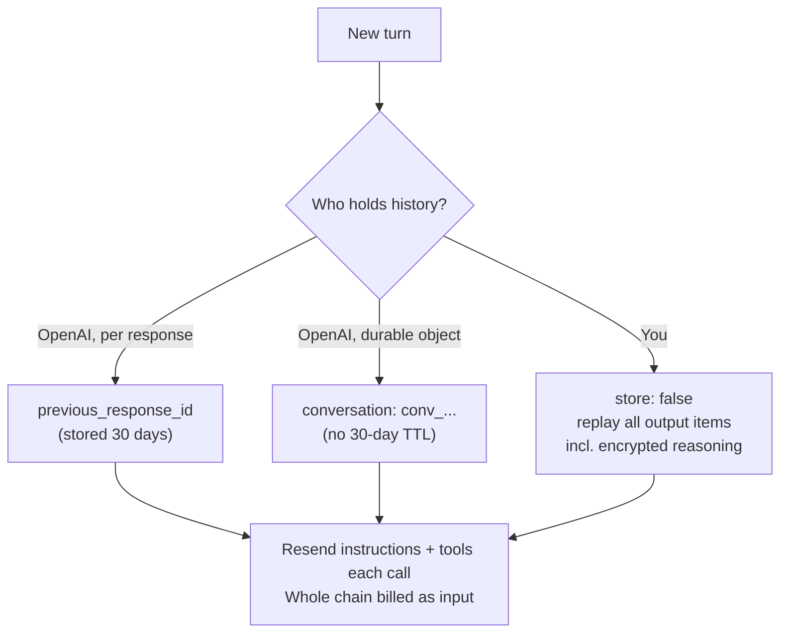

The **Responses API** (`POST /v1/responses`) is OpenAI's main endpoint for model calls, launched in March 2025 to merge Chat Completions' simplicity with the Assistants API's tools and state ([InfoQ](../sources/infoq-2025-openai-responses-api-agents-sdk.md)). A request takes `instructions` plus an `input` list of typed **items**; the response is an `output` list of items (`message`, `reasoning`, `function_call`, hosted-tool calls) rather than a single chat message. Unlike Chat Completions it can store conversation state on OpenAI's side, run hosted tools inside the request, and carry encrypted reasoning between turns ([migration guide](../sources/openai-migrate-to-responses-guide.md)). As of November 2026 it is the only route to the full GPT-6 feature set: GPT-6 Astra and GPT-6.1 Sol support tool calling only through Responses, and from GPT-5.4 on Chat Completions allows tool calling only with `reasoning_effort: none` ([reasoning guide](../sources/openai-reasoning-guide.md), [migration guide](../sources/openai-migrate-to-responses-guide.md)), and the Assistants API was sunset on 2026-08-26 ([migration guide](../sources/openai-migrate-to-responses-guide.md)).

## Request and response shape

| Aspect | Chat Completions | Responses |
|---|---|---|
| Unit | `messages` in and `choices[].message` out | typed items in `input` and `output` |
| System prompt | `system`/`developer` message | top-level `instructions` |
| Candidates | `n` up to 128 | one generation, no `n` |
| Function tool | nested under `function` (externally tagged) | fields at top level (internally tagged) |
| Strict schemas | off unless `strict: true` | tried when `strict` is omitted, falls back to non-strict if the schema is incompatible |
| Structured output | `response_format` | `text.format` |
| Hosted tools | none (except search models) | web search, file search, code interpreter, shell, computer use, image generation, remote MCP |
| Storage default | stored by default for new accounts | stored (30 days) unless `store: false` |
| Streaming | `delta` chunks | typed semantic events |

Sources: [migration guide](../sources/openai-migrate-to-responses-guide.md), [Chat Completions reference](../sources/openai-chat-completions-api-reference.md), [conversation state](../sources/openai-conversation-state-guide.md).

Key length control is `max_output_tokens`, which caps reasoning plus visible text; hitting it returns `status: "incomplete"`, possibly with no visible text, so OpenAI suggests reserving at least 25,000 tokens when starting out with reasoning models ([reasoning guide](../sources/openai-reasoning-guide.md)). Streaming emits `response.created`, `response.output_item.added`, `response.output_text.delta`, `response.function_call_arguments.delta`, `response.completed` and tool-specific events ([streaming guide](../sources/openai-streaming-responses-guide.md); see [streaming](streaming.md)).

## Conversation state: three options

- **`previous_response_id`** chains to an earlier stored response. It does **not** carry `instructions` forward and does **not** save money: every earlier token in the chain is billed as input again ([migration guide](../sources/openai-migrate-to-responses-guide.md), [conversation state](../sources/openai-conversation-state-guide.md)). Savings come from [prompt caching](prompt-caching.md), not from chaining.
- **Conversations API** gives a durable `conversation` object whose items are not subject to the 30-day response TTL ([conversation state](../sources/openai-conversation-state-guide.md)). Conversations are not ZDR-eligible ([data controls](../sources/openai-your-data-controls.md)).
- **Manual (stateless)**: `store: false` and replay the full `output` array each turn. Reasoning items then carry `encrypted_content`, which must be passed back in order; ZDR organizations have `store: false` forced ([reasoning guide](../sources/openai-reasoning-guide.md), [data controls](../sources/openai-your-data-controls.md)).

`reasoning.context` (`auto` / `current_turn` / `all_turns`; GPT-5.6 defaults to `all_turns`) decides whether earlier turns' reasoning is reused; reuse works only within one model family ([reasoning guide](../sources/openai-reasoning-guide.md)).

**Compaction** keeps long conversations inside the window: `context_management: [{type: "compaction", compact_threshold: N}]` compacts server-side when the prompt crosses N tokens, or `POST /responses/compact` returns a smaller window statelessly. The result is an opaque encrypted compaction item; with `previous_response_id` chaining you must not prune manually ([compaction guide](../sources/openai-compaction-guide.md)).

**Background mode** (`background: true`) runs long reasoning or agent jobs asynchronously: poll while `queued`/`in_progress`, cancel via `/cancel`, and resume a dropped stream with `starting_after` a saved `sequence_number`. It stores data temporarily even with `store: false` (about 10 minutes for ZDR projects) ([background guide](../sources/openai-background-mode-guide.md)).

## Tools

Function tools are `{type: "function", name, description, parameters, strict}`; calls arrive as `function_call` items with a `call_id`, and you answer with `function_call_output` items carrying the same `call_id`, passing back any reasoning items alongside ([function calling](../sources/openai-function-calling-guide.md); see [function calling](function-calling.md)). `tool_choice` accepts `auto`, `required`, a named function, `allowed_tools` (restrict without changing the tool list, which keeps the cache warm) and `none`. `tool_search` with `defer_loading` loads tools on demand on gpt-5.4+, and custom tools accept free text constrained by a Lark or regex grammar ([function calling](../sources/openai-function-calling-guide.md)).

Hosted tools run inside the request and appear as their own output items:

| Tool | Key controls | Notes |
|---|---|---|
| `web_search` | domain `filters` (100 allow/block), `user_location`, `search_context_size`, `external_web_access` | `url_citation` annotations; search context capped at 128K tokens; per-call fee ([web search](../sources/openai-web-search-tool-docs.md)) |
| `file_search` | `vector_store_ids`, `max_num_results`, attribute `filters` | `file_citation` annotations; results hidden unless `include` asks ([file search](../sources/openai-file-search-tool-docs.md)) |
| code interpreter | container `auto` or explicit, memory 1g-64g | container dies after 20 idle minutes; 100 RPM per org ([code interpreter](../sources/openai-code-interpreter-docs.md)) |
| shell | hosted container or local `shell_call` | no outbound network by default; admin allowlist plus `network_policy` ([shell](../sources/openai-shell-tool-docs.md)) |
| `computer` | action batches in `computer_call` | you execute and return screenshots; safety checks need approval ([computer use](../sources/openai-computer-use-guide.md)) |
| remote MCP | `server_url`, `require_approval` | see [MCP in practice](mcp-in-practice.md) |

## Reasoning controls

`reasoning.effort` ranges `none`, `minimal`, `low`, `medium` (default), `high`, `xhigh`, `max` depending on model; `reasoning.mode: "pro"` adds more work at standard token rates; `reasoning.summary` opts into summaries. Raw reasoning is never returned but is billed as output (`output_tokens_details.reasoning_tokens`). A `configuration_update` input item can change effort mid-conversation without breaking the cached prefix ([reasoning guide](../sources/openai-reasoning-guide.md); see [reasoning models](reasoning-models.md)).

## Caching, limits and pricing hooks

- Caching is automatic by default (on GPT-5.6+ for prefixes of 1,024+ visible tokens; earlier models have model-dependent minimums). GPT-5.6+ adds `prompt_cache_options`: `implicit` (default; one automatic breakpoint at the latest message, leaving three for your own) or `explicit` (only your breakpoints, so no breakpoints means no caching), up to four writes per request, and `ttl` `30m` (write 1.25x) or `12h` (write 2.5x, Responses only), with reads at 0.1x input (0.05x on GPT-6.1 Sol and Terra; see also [pricing](../sources/openai-api-pricing.md)). Caches live on individual machines, so above roughly 15 RPM traffic can overflow to other machines and miss; on older models `prompt_cache_key` steers routing, while on GPT-5.6+ routing is automatic and the key is optional (mainly for cache accounting). Changing tools, reasoning effort or output format breaks the prefix ([caching guide](../sources/openai-prompt-caching-guide.md)).
- Rate limits are RPM/TPM/RPD/TPD per tier (Free, Build $5, Launch $100, Grow $500 in cumulative purchases). TPM is charged on the larger of `max_tokens` and the estimated input size, so an inflated `max_tokens` wastes headroom ([rate limits](../sources/openai-rate-limits-guide.md); see [rate limits and retries](rate-limits-and-retries.md)).
- Batch and Flex are half price, Fast mode 2x; input above 272K tokens pays a higher rate ([pricing](../sources/openai-api-pricing.md)).

## Side by side with Claude and Gemini

Synthesis, compiled from the three provider pages and their sources (Nov 2026):

| Concern | OpenAI Responses | [Anthropic Messages](anthropic-messages-api.md) | [Gemini Interactions](gemini-api.md) |
|---|---|---|---|
| Server-side state | `previous_response_id` (30 days) or `conversation` | none; resend history | `previous_interaction_id` (55 days paid, 1 day free) |
| What chaining forgets | `instructions` | n/a | `tools`, `system_instruction`, `generation_config` |
| Tool call / result | `function_call` / `function_call_output` items, `call_id` | `tool_use` / `tool_result` blocks in the user turn | `function_call` / `function_result` steps, `call_id` |
| Opaque reasoning to replay | reasoning item `encrypted_content` | thinking block `signature` | `thought_signature` on thought steps |
| Effort knob | `reasoning.effort` | `output_config.effort` | `thinking_level` |
| Caching | automatic ≥1,024 tokens, optional breakpoints, 30 m / 12 h TTL | opt-in: block-level `cache_control` or one top-level "automatic" breakpoint, ≤4 breakpoints, 5 m / 1 h | implicit (≥4,096 on Gemini 3/4); explicit `cachedContents` on generateContent only |
| Server loop hand-back | hosted-tool items inline | `pause_turn` | built-in tool steps inline |
| Files lifetime | until deleted | until deleted | auto-deleted after 48 h |
| Sampling params | `temperature` 0-2, `top_p` documented on Chat Completions | 400 on version `2026-10-21` | silently ignored on Gemini 3.6 Flash+ |

Sources: [conversation state](../sources/openai-conversation-state-guide.md), [migration guide](../sources/openai-migrate-to-responses-guide.md), [OpenAI caching](../sources/openai-prompt-caching-guide.md), [Anthropic API reference](../sources/anthropic-messages-api-reference.md), [Anthropic caching](../sources/anthropic-prompt-caching-docs.md), [Anthropic thinking](../sources/anthropic-thinking-docs.md), [Anthropic server tools](../sources/anthropic-server-tools-docs.md), [Anthropic sampling removal](../sources/anthropic-api-2026-10-21-sampling-removal.md), [Gemini Interactions](../sources/gemini-interactions-api-docs.md), [Gemini thinking](../sources/gemini-thinking-docs.md), [Gemini caching](../sources/gemini-context-caching-docs.md), [Gemini Files](../sources/gemini-files-api-docs.md), [Gemini generateContent](../sources/gemini-generate-content-api.md), [Chat Completions reference](../sources/openai-chat-completions-api-reference.md).

**Porting checklist** (Synthesis): (1) move the system prompt to the target's slot and re-send it every turn wherever chaining forgets it; (2) remap tool-call IDs and the role that carries results; (3) never carry reasoning artifacts across providers, and drop them when switching model family; (4) redesign cache layout, since OpenAI and Gemini cache implicitly while Claude caching is opt-in (explicit breakpoints or a top-level automatic `cache_control`); (5) strip sampling parameters; (6) re-upload files per provider and plan for Gemini's 48-hour expiry; (7) re-run evals, because the same prompt behaves differently (see [model routing and fallbacks](model-routing-and-fallbacks.md)).

## The "OpenAI-compatible" trap

Many providers expose Chat Completions-shaped endpoints, not Responses. Anthropic's layer ignores `strict`, drops prompt caching, hoists all system messages to the top, hides thinking, and is positioned for testing rather than production ([Anthropic compat](../sources/anthropic-openai-sdk-compatibility.md)). Gemini's layer is beta, covers Chat Completions, embeddings, images and batch but not Responses, and silently ignores unknown parameters ([Gemini compat](../sources/gemini-openai-compatibility-docs.md)). Synthesis: "OpenAI-compatible" means Chat Completions syntax only; hosted tools, stored state and encrypted reasoning do not port. Use a native SDK or a gateway that translates semantics (see [LLM gateways](llm-gateways.md)).

## Failure modes and gotchas

- Code reading `choices[0].message.content` breaks; not every output item is a message ([migration guide](../sources/openai-migrate-to-responses-guide.md)).
- Dropping reasoning or `function_call` items when replaying manually breaks continuity; a missing `call_id` match errors ([migration guide](../sources/openai-migrate-to-responses-guide.md)).
- Forgetting to resend `instructions` with `previous_response_id` silently loses the system prompt ([migration guide](../sources/openai-migrate-to-responses-guide.md)).
- A low `max_output_tokens` can produce an `incomplete` response with no visible text, all billed ([reasoning guide](../sources/openai-reasoning-guide.md)).
- Default storage (30 days) can conflict with data-handling commitments; set `store: false` deliberately ([conversation state](../sources/openai-conversation-state-guide.md), [data controls](../sources/openai-your-data-controls.md)).

## When to use / when not

Synthesis:
- **Use** Responses for any new OpenAI integration, especially agents with tools, reasoning models, or hosted search/retrieval/code.
- **Use server-side state** for prototypes and chat apps where 30-day storage is acceptable; **prefer stateless replay** for ZDR, multi-provider portability, and when your own store is the source of truth (see [agent memory](agent-memory.md), [durable agent execution](durable-agent-execution.md)).
- **Keep Chat Completions** only for legacy code or third-party "OpenAI-compatible" endpoints, and accept that tool calling there is unavailable with GPT-6 Astra and GPT-6.1 Sol and limited to `reasoning_effort: none` on other GPT-5.4+ models.
- Compare with the [Anthropic Messages API](anthropic-messages-api.md) (stateless, opt-in cache breakpoints) and the [Gemini API](gemini-api.md) (stateful Interactions API); the [OpenAI Agents SDK](openai-agents-sdk.md) builds on Responses.

## Sources

- [Migrate to the Responses API](../sources/openai-migrate-to-responses-guide.md)
- [Conversation state](../sources/openai-conversation-state-guide.md)
- [Reasoning models guide](../sources/openai-reasoning-guide.md)
- [Function calling guide](../sources/openai-function-calling-guide.md)
- [Structured outputs guide](../sources/openai-structured-outputs-guide.md)
- [Streaming responses guide](../sources/openai-streaming-responses-guide.md)
- [Web search tool](../sources/openai-web-search-tool-docs.md)
- [File search tool](../sources/openai-file-search-tool-docs.md)
- [Code interpreter](../sources/openai-code-interpreter-docs.md)
- [Shell tool](../sources/openai-shell-tool-docs.md)
- [Computer use guide](../sources/openai-computer-use-guide.md)
- [Compaction guide](../sources/openai-compaction-guide.md)
- [Background mode guide](../sources/openai-background-mode-guide.md)
- [Prompt caching guide](../sources/openai-prompt-caching-guide.md)
- [Rate limits guide](../sources/openai-rate-limits-guide.md)
- [Your data controls](../sources/openai-your-data-controls.md)
- [Models docs](../sources/openai-models-docs.md)
- [API pricing](../sources/openai-api-pricing.md)
- [Chat Completions reference](../sources/openai-chat-completions-api-reference.md)
- [InfoQ: Responses API and Agents SDK launch](../sources/infoq-2025-openai-responses-api-agents-sdk.md)
- [Anthropic: OpenAI SDK compatibility](../sources/anthropic-openai-sdk-compatibility.md)
- [Gemini: OpenAI compatibility](../sources/gemini-openai-compatibility-docs.md)
