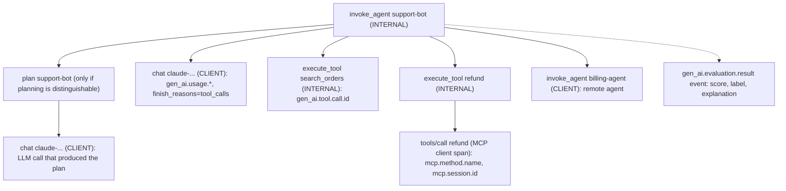

The **OpenTelemetry GenAI semantic conventions** are the OpenTelemetry (OTel) project's standard names and shapes for telemetry from generative-AI workloads. They cover spans for model inference, embeddings, retrieval, tool execution and agents, `gen_ai.*` attributes for model, parameters, token usage and (opt-in) message content, events for content and evaluation results, and metrics for latency and tokens. Any instrumentation that emits them over OTLP can be read by any backend that understands them, without either side knowing the other. That makes them the interoperability layer under [LLM observability](llm-observability.md). As of 2026-11-14 every GenAI-specific item is still at **Development** stability, and the conventions live in their own repository, `open-telemetry/semantic-conventions-genai`, which has no tagged release yet ([spec](../sources/opentelemetry-genai-semantic-conventions.md), [details](../sources/opentelemetry-genai-semconv-events-tools-mcp.md)).

## Status and history

| When | Release | What changed |
|---|---|---|
| 2024-05-21 | core semconv v1.26.0 | First GenAI client conventions |
| 2025-08-25 | v1.37.0 (breaking) | Per-message events (`gen_ai.user.message`, `gen_ai.choice`...) replaced by `gen_ai.input.messages` / `gen_ai.output.messages` / `gen_ai.system_instructions`; `gen_ai.system` renamed `gen_ai.provider.name`; `gen_ai.openai.*` loses its prefix |
| 2026-06-12 | v1.42.0 (breaking) | All `gen_ai.*`, `openai.*` and `mcp.*` conventions deprecated in core and moved to `semantic-conventions-genai` |
| 2026-11 | genai repo `main` | No tagged release, schema URL still TODO; references core v1.45.0 |

Sources: [changelog](../sources/opentelemetry-semantic-conventions-changelog-genai.md), [spec](../sources/opentelemetry-genai-semantic-conventions.md), [details](../sources/opentelemetry-genai-semconv-events-tools-mcp.md).

**Transition switch.** Instrumentations that shipped the v1.36-or-older names keep emitting them by default. Setting `OTEL_SEMCONV_STABILITY_OPT_IN=gen_ai_latest_experimental` switches them to the latest experimental names, with no double-emission ([changelog](../sources/opentelemetry-semantic-conventions-changelog-genai.md)). In practice this matters: Datadog accepts only v1.37+ shapes and tells users of older emitters such as strands-agents to set the flag ([Datadog](../sources/datadog-llm-observability-otel-genai.md)).

Synthesis: "Development" means names can still change without a major version. The v1.37 rename of `gen_ai.system` and the replacement of message events show this has already happened once in a breaking way, so treat attribute names as a dependency you pin.

## Mechanics

### Inference spans

One span covers one logical model call, including the client's automatic retries ([spec](../sources/opentelemetry-genai-semantic-conventions.md)).

- **Name:** `{gen_ai.operation.name} {gen_ai.request.model}`, e.g. `chat gpt-4`. **Kind:** `CLIENT`, or `INTERNAL` for an in-process model.
- **Required:** `gen_ai.operation.name` (`chat`, `generate_content`, `text_completion`, `embeddings`, `retrieval`, `execute_tool`, `create_agent`, `invoke_agent`, `invoke_workflow`, `plan`, memory operations, `fetch_response`, `realtime_inference`) and `gen_ai.provider.name` (`openai`, `aws.bedrock`, `gcp.vertex_ai`...). The provider name also tells a backend which provider-specific attributes (Anthropic, Bedrock, Azure AI Inference, OpenAI pages) may be present.
- **Request:** `gen_ai.request.model`, `max_tokens`, `temperature`, `top_p`, stop sequences, penalties, `seed`, `choice.count`, `reasoning.level`, `stream`. **Response:** `gen_ai.response.id`, `response.model` (the resolved snapshot), `finish_reasons`, `time_to_first_chunk`.
- **Usage:** `gen_ai.usage.input_tokens`, `output_tokens`, `cache_read.input_tokens`, `cache_write.input_tokens`, `reasoning.output_tokens`, plus text/image/audio splits. Cache and per-modality counts are meant to be *included in* `input_tokens`, not added on top ([details](../sources/opentelemetry-genai-semconv-events-tools-mcp.md)).
- **Correlation:** `gen_ai.conversation.id` (thread/session; the one attribute an instrumentation may propagate to nested instrumentations through context), `gen_ai.prompt.name` and `gen_ai.prompt.version` for templated prompts (useful with [prompt management](prompt-management.md)), and `gen_ai.conversation.compacted` when [context compaction](context-compaction.md) happened.
- **Errors:** `error.type`, one of the few reused attributes that are Stable.

### Content: attributes, events, references

Content is the sensitive and bulky part, so it is **off by default**. When enabled, it is structured JSON rather than flattened keys. `gen_ai.input.messages` is an ordered list of `{role, parts:[{type, content}...]}` with typed parts (text, tool call, tool call response, and since v1.38 `uri`/`file`/`blob` media). `gen_ai.output.messages` holds one message per choice, set only when output was actually produced. `gen_ai.system_instructions` carries instructions passed separately from the chat history, and `gen_ai.tool.definitions` carries the advertised tools ([details](../sources/opentelemetry-genai-semconv-events-tools-mcp.md), [changelog](../sources/opentelemetry-semantic-conventions-changelog-genai.md)).

Where content lands is controlled by `OTEL_INSTRUMENTATION_GENAI_CAPTURE_CONTENT`:

| Value | Effect |
|---|---|
| `NO_CONTENT` (default, also the fallback for invalid values) | Metadata only |
| `SPAN_ONLY` | Content attributes on the span |
| `EVENT_ONLY` | Content on a `gen_ai.client.inference.operation.details` log event (DEBUG severity), which can be stored and retained apart from traces |
| `SPAN_AND_EVENT` | Both |

For production the spec recommends a third route. A hook uploads content to external storage (e.g. S3), and the span records only `gen_ai.input.messages_ref`-style URIs. That gives content its own access control and retention, and the hook runs regardless of the trace sampling decision ([spec](../sources/opentelemetry-genai-semantic-conventions.md)). The URI must not embed credentials such as signed-URL parameters ([details](../sources/opentelemetry-genai-semconv-events-tools-mcp.md)).

### Agents, tools, MCP

Synthesis: the diagram composes the span types the spec defines into one plausible [agent loop](agent-loop.md) turn. Exact parent-child links depend on the framework.

- **Agent spans:** `create_agent {name}` (CLIENT, for hosted agent services). `invoke_agent {name}` is CLIENT for a remote agent and INTERNAL for an in-process agent or framework entrypoint; nested invocations such as a sub-graph are still reported. `plan` should be emitted only when the instrumentation can reliably tell planning from ordinary inference, and the LLM call that wrote the plan is its child ([details](../sources/opentelemetry-genai-semconv-events-tools-mcp.md)). This maps directly onto [subagents](subagents.md) and [agent handoffs](agent-handoffs.md).
- **Tool spans:** `execute_tool {gen_ai.tool.name}`, INTERNAL, with `gen_ai.tool.call.id` (joins the model's tool-call request to its execution), `tool.type` and `tool.description`, plus opt-in `tool.call.arguments` and `tool.call.result`. Refinements exist for agents exposed as tools and for [Agent Skills](agent-skills.md). Because application code usually runs the tools ([function calling](function-calling.md)), the spec asks developers to instrument tool calls the auto-instrumentation misses ([details](../sources/opentelemetry-genai-semconv-events-tools-mcp.md)).
- **MCP and A2A:** [MCP](model-context-protocol.md) client and server spans are named `{mcp.method.name} {target}`, carry `mcp.session.id`, and should also set `gen_ai.operation.name` so a backend treats MCP tool calls like any other tool call. [A2A](agent2agent-protocol.md) has its own page in the repo ([details](../sources/opentelemetry-genai-semconv-events-tools-mcp.md)).
- **Evaluation event:** `gen_ai.evaluation.result` records a score (`score.value`, `score.label`, `explanation`, required `evaluation.name`), parented to the evaluated span or keyed by `gen_ai.response.id`. Synthesis: this gives online [LLM-as-judge](llm-as-judge.md) scores a vendor-neutral home next to the trace instead of a vendor-specific feedback API.

### Metrics

Histograms let you keep latency and token dashboards at 100% even when traces are sampled. Client inference has `gen_ai.client.inference.duration` (seconds, explicit buckets 0.01 to 81.92 s), `time_to_first_chunk` and `time_per_output_chunk` for [streaming](streaming.md), and per-type token histograms (input, output, cache read/write, reasoning). There are also a generic `gen_ai.client.operation.duration`, server-side `gen_ai.server.request.duration`, `time_to_first_token` and `time_per_output_token` (relevant to [vLLM](vllm.md)-style serving), agent metrics `gen_ai.invoke_agent.duration`, `inference_calls` and `tool_calls`, and `mcp.client/server.operation.duration` ([spec](../sources/opentelemetry-genai-semantic-conventions.md), [details](../sources/opentelemetry-genai-semconv-events-tools-mcp.md)). Up to core v1.41.0 the token metric was a single `gen_ai.client.token.usage` ([changelog](../sources/opentelemetry-semantic-conventions-changelog-genai.md)), so dashboards built on it need migrating.

## The dialects: OpenLLMetry and OpenInference

Two instrumentation projects predate the official conventions and still emit their own attribute sets on top of standard OTLP.

| | OTel GenAI (official) | OpenLLMetry (Traceloop) | OpenInference (Arize) |
|---|---|---|---|
| License / owner | OTel project spec (GenAI SIG) | Apache-2.0, Traceloop | Apache-2.0, Arize |
| Step type | `gen_ai.operation.name` | `traceloop.span.kind` (`workflow`, `task`, `agent`, `tool`) + `llm.request.type` | `openinference.span.kind` (LLM, EMBEDDING, CHAIN, RETRIEVER, RERANKER, TOOL, AGENT, GUARDRAIL, EVALUATOR, PROMPT, DECISION) |
| Provider | `gen_ai.provider.name` | `gen_ai.system` (pre-1.37 name) | `llm.system`, `llm.provider` |
| Messages | JSON `gen_ai.input.messages` / `output.messages` | `gen_ai.prompt` / `gen_ai.completion` arrays | flattened `llm.input_messages.N.message.role`... |
| Tokens | `gen_ai.usage.input_tokens`... | `gen_ai.usage.prompt_tokens` / `completion_tokens` | `llm.token_count.prompt` / `completion` / `total` |
| Session | `gen_ai.conversation.id` | `traceloop.association.properties` | `session.id`, `user.id` |
| Content default | Off | **On** (`TRACELOOP_TRACE_CONTENT=false` to disable) | Messages are core attributes (`llm.input_messages`...); check each instrumentor's settings |
| Coverage | spec only; implementations vary | 16 LLM providers, 7 vector DBs, 10 frameworks, MCP | Python, JS, Java, Go instrumentors; native in Phoenix |

Sources: [OpenLLMetry](../sources/openllmetry-traceloop.md), [OpenInference/Phoenix](../sources/arize-phoenix-docs.md), [Phoenix otel](../sources/phoenix-evals-and-self-hosting-docs.md), [spec](../sources/opentelemetry-genai-semantic-conventions.md).

- **OpenLLMetry** says it led the OTel working group that standardised the conventions and calls its own conventions an extension of them. Its documented names are the *older* ones (`gen_ai.system`, `prompt_tokens`) ([OpenLLMetry](../sources/openllmetry-traceloop.md)). Traceloop joined ServiceNow in March 2026, with the commitment that OpenLLMetry stays open source.
- **OpenInference** is Arize's convention set and instrumentor family. Phoenix speaks it natively and translates OpenLLMetry and OpenLIT spans through span processors ([Phoenix otel](../sources/phoenix-evals-and-self-hosting-docs.md)). Frameworks such as [smolagents](smolagents.md) rely on its instrumentor rather than shipping their own tracing ([smolagents](../sources/smolagents-inspect-runs-docs.md)).

Synthesis: OpenInference's flattened-key model suits backends that index individual attributes. The official JSON-valued content attributes are more faithful for multimodal parts but need a backend that parses structured values.

## Which tools ingest it (2026-11)

| Backend | GenAI semconv | Other dialects | Notes |
|---|---|---|---|
| [Datadog LLM Observability](../sources/datadog-llm-observability-otel-genai.md) | v1.37+ only, native, no Datadog SDK | OpenInference (`gen_ai.operation.name` wins if both present); OpenLLMetry `traceloop-sdk` >= 0.47.0 | `http/protobuf`, `dd-otlp-source=llmobs` plus an explicit enable flag; non-qualifying traces dropped; 3 to 5 min ingest delay |
| [LangSmith](langsmith.md) | `gen_ai.operation.name` → run type, `gen_ai.request.*` → params, usage incl. cache/reasoning | OpenInference, Traceloop, Logfire | endpoint `/otel`; spans with a never-arriving parent are dropped silently |
| [Langfuse](langfuse.md) | yes; subtracts cache reads/writes from `input` | any OTel instrumentation | OTLP over HTTP only, no gRPC |
| [Arize Phoenix](arize-phoenix.md) | via OTLP | OpenInference native; OpenLLMetry/OpenLIT via span processors | free self-host |
| Honeycomb, Grafana, Splunk, New Relic, Sentry, OTel Collector... | as generic OTLP | listed as OpenLLMetry destinations | GenAI-aware views vary |

Sources: [Datadog](../sources/datadog-llm-observability-otel-genai.md), [LangSmith](../sources/langsmith-observability-docs.md), [Langfuse](../sources/langfuse-observability-docs.md), [Phoenix otel](../sources/phoenix-evals-and-self-hosting-docs.md), [OpenLLMetry](../sources/openllmetry-traceloop.md).

On the emitting side, Datadog's docs list the OTel contrib `opentelemetry-instrumentation-openai-v2`, native emitters such as Strands Agents and the Langfuse SDK, and Java frameworks Spring AI and LangChain4j ([Datadog](../sources/datadog-llm-observability-otel-genai.md)). The [Vercel AI SDK](vercel-ai-sdk.md) 7 ships a redesigned OTel package, `@ai-sdk/otel` ([changelog](../sources/vercel-ai-sdk-7-changelog.md)).

## Limits and failure modes

- **Pre-stable churn.** Names changed incompatibly in v1.37 and the home moved in v1.42. A dashboard keyed on `gen_ai.system` or `gen_ai.client.token.usage` silently goes empty when an instrumentation upgrades ([changelog](../sources/opentelemetry-semantic-conventions-changelog-genai.md)).
- **Mixed dialects in one trace.** A [LangChain](langchain.md) app with OpenInference, a provider call with OpenLLMetry and a framework emitting native `gen_ai.*` produce three vocabularies. Backends reconcile some of them (Datadog prefers `gen_ai.operation.name`), but token totals can be double-counted. Datadog documents exactly that for Claude SDK plus Claude Platform spans ([Datadog](../sources/datadog-llm-observability-otel-genai.md)).
- **Token semantics differ.** The spec includes cache tokens in `input_tokens`, and Langfuse subtracts them on ingest ([Langfuse](../sources/langfuse-observability-docs.md)). Synthesis: if an emitter maps a provider field that already excludes cache hits straight into `input_tokens`, cost per call comes out wrong. Check one call by hand against the provider bill, especially with [prompt caching](prompt-caching.md).
- **Content defaults disagree.** The spec says off, OpenLLMetry says on. An unreviewed OpenLLMetry install ships prompts and completions, and any [PII](pii-and-data-privacy.md) in them, to every configured backend ([OpenLLMetry](../sources/openllmetry-traceloop.md)). This is a [data residency and retention](data-retention-and-residency.md) question as much as an observability one.
- **Events are uneven.** The spec notes that GenAI events are not yet available in some languages, so `EVENT_ONLY` may capture nothing on some stacks ([details](../sources/opentelemetry-genai-semconv-events-tools-mcp.md)).
- **Backend-side drops.** LangSmith drops orphan spans after returning 200 ([LangSmith](../sources/langsmith-observability-docs.md)), and Datadog drops traces with no qualifying span ([Datadog](../sources/datadog-llm-observability-otel-genai.md)). Synthesis: a broken parent context or an unflushed serverless exporter looks like missing data, not like an error.
- **Provider attribution behind gateways.** `gen_ai.provider.name` reflects the client's view, so calls through an [LLM gateway](llm-gateways.md) such as [LiteLLM](litellm.md) may be labelled with the gateway's API style rather than the true upstream ([changelog](../sources/opentelemetry-semantic-conventions-changelog-genai.md): the attribute records the client's perception). Synthesis: the gateway example is an inference from that rule.
- **Agent structure is only as good as the framework.** `plan` spans are emitted only when planning can be distinguished, and tool spans exist only if someone instruments the tool. Hand-written loops get a flat list of `chat` spans unless you add `invoke_agent` and `execute_tool` yourself ([details](../sources/opentelemetry-genai-semconv-events-tools-mcp.md)).

## Practical guidance

Synthesis, drawing on the sources above:

1. **Emit official `gen_ai.*` at v1.37+ shapes.** Set `OTEL_SEMCONV_STABILITY_OPT_IN=gen_ai_latest_experimental` wherever an instrumentation supports it, and record which instrumentation versions you run. That is your effective spec version, since the genai repo has no releases.
2. **Route through an OTel Collector.** Redaction, sampling and fan-out (for example APM backend plus an LLM-specific store) then happen in one place, and changing vendor becomes a config change. Datadog's and Langfuse's docs both describe Collector-based routing.
3. **Decide content capture explicitly.** Prefer `NO_CONTENT` on spans plus an upload hook with `_ref` URIs, or `EVENT_ONLY` into a log pipeline with its own retention. For OpenLLMetry, set `TRACELOOP_TRACE_CONTENT` deliberately.
4. **Wrap your own loop.** Emit `invoke_agent` per turn, `execute_tool` per tool with `gen_ai.tool.call.id`, and set `gen_ai.conversation.id` and `gen_ai.prompt.version`. This is what makes [error analysis](error-analysis.md) and [agent evaluation](agent-evaluation.md) possible from production traces. [Agent hooks and middleware](agent-hooks-and-middleware.md) are a natural place to do it.
5. **Attach evals to traces.** Write online judge scores as `gen_ai.evaluation.result` events, or via the backend's feedback API, keyed by span or response ID.
6. **Keep metrics unsampled, traces sampled.** Latency and token histograms are cheap. Full-content traces are not.
7. **Validate per backend.** Send one known trace with an agent, a tool, cache hits and an error, then check kinds, nesting, token counts and cost in each backend before rolling out.

## Sources

- [OpenTelemetry semantic conventions for generative AI](../sources/opentelemetry-genai-semantic-conventions.md)
- [OpenTelemetry GenAI conventions: events, tool, agent, MCP and registry details](../sources/opentelemetry-genai-semconv-events-tools-mcp.md)
- [OpenTelemetry semantic-conventions CHANGELOG (GenAI entries)](../sources/opentelemetry-semantic-conventions-changelog-genai.md)
- [OpenLLMetry (Traceloop) README, conventions and ServiceNow announcement](../sources/openllmetry-traceloop.md)
- [Arize Phoenix and OpenInference documentation](../sources/arize-phoenix-docs.md)
- [Arize Phoenix docs: evals, experiments, phoenix-otel, self-hosting](../sources/phoenix-evals-and-self-hosting-docs.md)
- [Datadog LLM Observability: OpenTelemetry GenAI ingestion](../sources/datadog-llm-observability-otel-genai.md)
- [LangSmith observability docs](../sources/langsmith-observability-docs.md)
- [Langfuse observability docs](../sources/langfuse-observability-docs.md)
- [smolagents docs: Inspecting runs with OpenTelemetry](../sources/smolagents-inspect-runs-docs.md)
- [Vercel AI SDK 7 changelog](../sources/vercel-ai-sdk-7-changelog.md)
