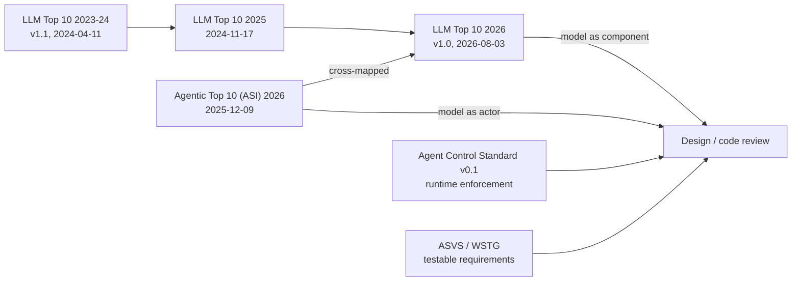

The **OWASP Top 10 for LLM Applications** is a ranked, community-maintained list of the ten most critical security risks in applications built on large language models, published by the OWASP GenAI Security Project. It has had three editions: 2023-24 (v1.1, dated 2024-04-11), 2025 (published 2024-11-17) and 2026 (v1.0, published 2026-08-03) ([2023-24](../sources/owasp-llm-top-10-2023-24.md), [2025 pages](../sources/owasp-llm09-llm10-2025.md), [2026](../sources/owasp-llm-top-10-2026.md)). Its companion, the **OWASP Top 10 for Agentic Applications** (labelled 2026, released 2025-12-09, entries ASI01 to ASI10), covers systems where the model plans, calls tools, keeps memory and talks to other agents ([Agentic Top 10](../sources/owasp-agentic-top-10-2026.md)). Both are awareness documents: they name and rank risk classes, but they are not testable requirements ([Notebook OWASP](../sources/notebook-owasp.md)). This page covers the lists as frameworks. For the threat model and controls risk by risk, see [LLM security risks](llm-security-risks.md).

## How the lists fit together

The 2026 LLM list treats the model as a *component* of an application. Once the model becomes an *actor*, with tools it can call, memory across sessions and downstream consequences, the risk is routed to the Agentic Top 10 ([Help Net Security](../sources/helpnetsecurity-2026-owasp-llm-top-10.md)). The 2026 document maps its entries to NIST, MITRE ATLAS, CWE and the Agentic Top 10 ([2026](../sources/owasp-llm-top-10-2026.md)). Alongside the 2026 release OWASP presented the **Agent Control Standard (ACS) v0.1**, a separate specification for enforcing controls on agents at runtime ([CSA](../sources/csa-2026-owasp-llm-top-10-and-acs.md)).

Synthesis: lineage and scope of the OWASP GenAI documents.

## The 2026 LLM list, entry by entry

| ID | Risk | One-line meaning |
|---|---|---|
| LLM01:2026 | Prompt Injection | Untrusted text (user, documents, tool output, memory, images or audio) changes model behaviour; see [prompt injection](prompt-injection.md) |
| LLM02:2026 | Sensitive Information Disclosure | The app reveals PII, secrets or data beyond the user's rights, including through retrieval and logs; see [PII and data privacy](pii-and-data-privacy.md) |
| LLM03:2026 | Excessive Agency | Too much functionality, permission or autonomy, so a manipulated output does real damage |
| LLM04:2026 | Supply Chain | Tampered or substituted weights, adapters, templates, unsafe formats, hallucinated packages |
| LLM05:2026 | Data and Model Poisoning | Corrupted pre-training, fine-tuning, adapter or embedding data plants bias or backdoors |
| LLM06:2026 | Unbounded Consumption | Cost and availability abuse, amplified by [reasoning models](reasoning-models.md) and [agent loops](agent-loop.md) |
| LLM07:2026 | Misinformation | Wrong output relied on, now often by automated downstream steps; see [hallucination](hallucination.md) |
| LLM08:2026 | Hidden Context Exposure | Leakage of [system prompts](system-prompts.md), tool schemas, policy text, retrieved documents, memory and app state |
| LLM09:2026 | Vector and Embedding Weaknesses | Cross-tenant leakage, retrieval manipulation and embedding inversion in [vector databases](vector-databases.md) |
| LLM10:2026 | Improper Output Handling | Model output reaches HTML, SQL, shells, terminals (ANSI escapes) or auto-fetching renderers unvalidated |

Sources: order and scope changes from [2026](../sources/owasp-llm-top-10-2026.md), [Help Net Security](../sources/helpnetsecurity-2026-owasp-llm-top-10.md) and [CSA](../sources/csa-2026-owasp-llm-top-10-and-acs.md). The official PDF was not fetched directly; three secondary summaries agree on the order.

## Edition differences

| Risk theme | 2023-24 (v1.1) | 2025 | 2026 |
|---|---|---|---|
| Prompt injection | LLM01 | LLM01 | LLM01 |
| Sensitive information disclosure | LLM06 | LLM02 | LLM02 |
| Excessive agency | LLM08 | LLM06 | LLM03 |
| Supply chain | LLM05 Supply Chain Vulnerabilities | LLM03 | LLM04 |
| Poisoning | LLM03 Training Data Poisoning | LLM04 Data and Model Poisoning | LLM05 |
| Resource abuse | LLM04 Model Denial of Service; LLM10 Model Theft | LLM10 Unbounded Consumption | LLM06 |
| Wrong output relied on | LLM09 Overreliance | LLM09 Misinformation | LLM07 |
| Hidden instructions and context | (none) | LLM07 System Prompt Leakage | LLM08 Hidden Context Exposure |
| [RAG](retrieval-augmented-generation.md) and vector stores | (none) | LLM08 Vector and Embedding Weaknesses | LLM09 |
| Output handling | LLM02 Insecure Output Handling | LLM05 Improper Output Handling | LLM10 |
| Plugins | LLM07 Insecure Plugin Design | (no standalone entry) | (none) |

Sources: [2023-24](../sources/owasp-llm-top-10-2023-24.md), [2025](../sources/owasp-llm-top-10-2025.md), [2026](../sources/owasp-llm-top-10-2026.md).

**2023-24 to 2025.** The 2025 edition added System Prompt Leakage (incidents showed prompts leak) and Vector and Embedding Weaknesses (RAG had become central). It widened Training Data Poisoning into Data and Model Poisoning, recast Overreliance as Misinformation, and replaced denial of service with Unbounded Consumption, which also covers runaway cost. Excessive Agency grew in scope as agent architectures spread ([Qualys](../sources/qualys-2024-owasp-llm-2025-changes.md)). LLM10:2025 lists model extraction via API and functional model replication among its examples, and LLM09:2025 treats overreliance as the amplifier of misinformation ([2025 pages](../sources/owasp-llm09-llm10-2025.md)). Synthesis: Model Theft therefore lives on inside Unbounded Consumption. Insecure Plugin Design's concerns are spread across Excessive Agency (minimise extensions and their permissions) and Supply Chain (third-party components) ([2025](../sources/owasp-llm-top-10-2025.md)); OWASP's risk pages do not state these mappings themselves.

**2025 to 2026.** Eight of ten positions changed. The movements that matter for reviewers:

- **Method.** Ranking is 75% practitioner vote and 25% evidence from 6,639 real incidents ([Help Net Security](../sources/helpnetsecurity-2026-owasp-llm-top-10.md), [CSA](../sources/csa-2026-owasp-llm-top-10-and-acs.md)).
- **Excessive Agency, #6 to #3.** Both votes and incidents point to agent deployments as where damage happens ([Help Net Security](../sources/helpnetsecurity-2026-owasp-llm-top-10.md)).
- **Unbounded Consumption, #10 to #6**, reframed as cost asymmetry from reasoning models and loops; **Misinformation, #9 to #7**, because incident data ranked it far above the vote ([2026](../sources/owasp-llm-top-10-2026.md), [Help Net Security](../sources/helpnetsecurity-2026-owasp-llm-top-10.md)).
- **System Prompt Leakage renamed Hidden Context Exposure**, widening confidentiality from the prompt to everything placed in context ([CSA](../sources/csa-2026-owasp-llm-top-10-and-acs.md)).
- **Improper Output Handling, #5 to #10**, while gaining terminal and auto-fetching renderer sinks ([2026](../sources/owasp-llm-top-10-2026.md)).
- **Prompt Injection stays #1** despite few public incidents, which OWASP attributes to a "defense effect": heavy mitigation hides the underlying risk ([Help Net Security](../sources/helpnetsecurity-2026-owasp-llm-top-10.md)).

## The Agentic Top 10 (ASI01-ASI10)

Built by OWASP's Agentic Security Initiative with more than 100 contributors, around two principles: **least agency** (only the autonomy, tools and permissions the task needs) and **strong observability** (you can see what agents do, why, and with which tools) ([NeuralTrust](../sources/neuraltrust-owasp-agentic-top-10.md), [Agentic Top 10](../sources/owasp-agentic-top-10-2026.md)).

| ID | Risk | What goes wrong | Typical control |
|---|---|---|---|
| ASI01 | Agent Goal Hijack | Injected content redirects the agent's goal or plan | Treat all natural-language input as untrusted; approve goal changes |
| ASI02 | Tool Misuse and Exploitation | An authorised tool is used unsafely | Per-tool least privilege, policy check between planner and tool, budgets |
| ASI03 | Identity and Privilege Abuse | Inherited or delegated credentials reach too far | Short-lived, task-scoped tokens per agent; see [agent auth](agent-authentication-and-authorization.md) |
| ASI04 | Agentic Supply Chain Vulnerabilities | A loaded tool, prompt, plugin or [MCP](model-context-protocol.md) server is malicious | Signing, AI-BOM, pinning and allowlists, kill switch |
| ASI05 | Unexpected Code Execution | Text becomes executed code | [Sandboxes](code-execution-sandboxes.md), no `eval`, validation gate |
| ASI06 | Memory and Context Poisoning | Corrupted [memory](agent-memory.md), summaries or retrieval stores bias later steps | Scan writes, segment per user, provenance, rollback |
| ASI07 | Insecure Inter-Agent Communication | Spoofed, replayed or tampered agent messages ([A2A](agent2agent-protocol.md)) | Mutual auth, signed messages, nonces, typed schemas |
| ASI08 | Cascading Failures | One fault spreads across agents and workflows | Independent policy engine, circuit breakers, rate limits |
| ASI09 | Human-Agent Trust Exploitation | A fluent agent steers human approvals | Plain-language risk summaries, log shown vs executed; see [human-in-the-loop](human-in-the-loop.md) |
| ASI10 | Rogue Agents | An agent drifts while each action looks legitimate | Behavioural baselines, owner and expiry per agent, tested kill switch |

Source: [NeuralTrust](../sources/neuraltrust-owasp-agentic-top-10.md), names cross-checked with [Agentic Top 10](../sources/owasp-agentic-top-10-2026.md); the official PDF was not fetched.

Each agentic risk maps to one to four entries of the 2025 LLM list ([NeuralTrust](../sources/neuraltrust-owasp-agentic-top-10.md)), and an OWASP governance report found prompt injection maps to six of the ten agentic categories ([CSA](../sources/csa-2026-owasp-llm-top-10-and-acs.md)). Synthesis: ASI01 and ASI06 are prompt injection (LLM01) seen from the agent's side, one acting on the current goal and one stored for later. ASI02, ASI03 and ASI05 split Excessive Agency (LLM03:2026) into tool, identity and execution. ASI07, ASI08 and ASI10 have no real LLM-list equivalent, because they only exist once there are several agents or long-running autonomy.

## Comparisons

- **LLM list vs Agentic list.** Use the LLM list for any feature that calls a model. Add the Agentic list as soon as the model selects tools, writes memory or hands off to another agent ([Help Net Security](../sources/helpnetsecurity-2026-owasp-llm-top-10.md)).
- **Top 10 vs ASVS/WSTG.** Top 10 lists build awareness; ASVS gives verifiable requirements and WSTG gives test procedures ([Notebook OWASP](../sources/notebook-owasp.md)).
- **Top 10 vs Agent Control Standard.** The Top 10 says what can go wrong; ACS v0.1 specifies runtime enforcement: guardian-agent enforcement points, [OpenTelemetry](opentelemetry-genai.md) and OCSF tracing, and an Agent Bill of Materials. Its roadmap reaches deny/modify enforcement across A2A and MCP only at v3, so pilot it rather than deploy it ([CSA](../sources/csa-2026-owasp-llm-top-10-and-acs.md)).
- **Top 10 vs design rules.** The [lethal trifecta](lethal-trifecta.md) and Meta's Rule of Two are design constraints you can check per feature, not risk categories ([Willison](../sources/willison-2025-lethal-trifecta.md), [Meta](../sources/meta-2025-agents-rule-of-two.md)).

## Limits and failure modes

- **IDs are not stable across editions.** LLM06 means Excessive Agency in 2025 and Unbounded Consumption in 2026; LLM07 means System Prompt Leakage, then Misinformation. Always write the year suffix (`LLM03:2026`) in tickets, findings and tool configs ([2025](../sources/owasp-llm-top-10-2025.md), [2026](../sources/owasp-llm-top-10-2026.md)).
- **The ranking is mostly opinion.** Three quarters of the weight is a practitioner vote, and the incident data is new ([Help Net Security](../sources/helpnetsecurity-2026-owasp-llm-top-10.md)). CSA advises building programmes on the risk categories, not one year's order ([CSA](../sources/csa-2026-owasp-llm-top-10-and-acs.md)).
- **Global rank is not your risk.** Synthesis: a read-only internal chatbot and a payment agent face the same list with very different orderings. Rank by your data, tools and outbound channels.
- **Categories overlap.** One exfiltration chain can be LLM01, LLM02, LLM03 and LLM10 at once. Synthesis: record the root cause once and tag the other IDs, or the same issue gets counted four times.
- **Coverage is not prevention.** No foolproof defence against prompt injection is known ([2025](../sources/owasp-llm-top-10-2025.md)); the leads' advice is to assume the model will be fooled and design so nothing important breaks ([Help Net Security](../sources/helpnetsecurity-2026-owasp-llm-top-10.md)).
- **Secondary-source caveat (as of 2026-11).** The 2026 order and the ASI definitions on this page come from consistent secondary summaries, not the official PDFs.

## Using the lists in a review

Synthesis: a review procedure built from the controls in the sources above.

1. **Scope.** Draw the data flow: inputs (user, documents, web, tool results, memory), the model, outputs and their sinks, tools and their credentials. Decide whether the feature is a component (LLM list only) or an actor (add ASI).
2. **Trifecta check first.** If a single session combines private data, untrusted content and an outbound channel, flag it before going item by item ([Willison](../sources/willison-2025-lethal-trifecta.md), [Meta](../sources/meta-2025-agents-rule-of-two.md)).
3. **Walk each entry as a question with evidence.** For example: *LLM03/ASI02-03*: which tools, which scopes, whose identity, which actions need approval? *LLM08*: is any secret, limit or authorisation rule in context that the code assumes the model will keep? *LLM10/ASI05*: where does output go, and is it escaped, schema-validated ([structured outputs](structured-outputs.md)) or sandboxed? *LLM06*: are turns, tokens and spend capped per user? *ASI06*: who can write to memory and the vector store, and can a write be rolled back?
4. **Prefer deterministic controls.** Authorisation, secrets and limits belong in code, [hooks and middleware](agent-hooks-and-middleware.md) and downstream systems, not in prompts ([2025](../sources/owasp-llm-top-10-2025.md)). Classifier-style [guardrails](agent-guardrails.md) are a second layer.
5. **Test.** Turn findings into red-team cases ([LLM red teaming](llm-red-teaming.md), [OWASP red teaming guide](../sources/owasp-genai-red-teaming-guide.md)). [promptfoo](promptfoo.md) ships framework presets `owasp:llm` (per item, e.g. `owasp:llm:01`) and `owasp:agentic` ([promptfoo docs](../sources/promptfoo-red-team-docs.md), [plugins](../sources/promptfoo-red-team-plugins-docs.md)). Check which edition a preset's numbering follows before mapping results.
6. **Record and re-baseline.** Log findings against year-suffixed IDs, give each item an owner ([Notebook OWASP](../sources/notebook-owasp.md)), and re-rank existing risk registers when a new edition lands ([CSA](../sources/csa-2026-owasp-llm-top-10-and-acs.md)). Feed the result into [AI governance and compliance](ai-governance-and-compliance.md) evidence.

## Sources

- [OWASP Top 10 for LLM Applications 2026](../sources/owasp-llm-top-10-2026.md)
- [OWASP Top 10 for LLM Applications 2025 (risk pages)](../sources/owasp-llm-top-10-2025.md)
- [OWASP LLM09:2025 and LLM10:2025](../sources/owasp-llm09-llm10-2025.md)
- [OWASP Top 10 for LLM Applications 2023-24 (v1.1)](../sources/owasp-llm-top-10-2023-24.md)
- [OWASP Top 10 for Agentic Applications (2026)](../sources/owasp-agentic-top-10-2026.md)
- [NeuralTrust: OWASP Agentic Top 10 explainer](../sources/neuraltrust-owasp-agentic-top-10.md)
- [Help Net Security: OWASP 2026 LLM Top 10](../sources/helpnetsecurity-2026-owasp-llm-top-10.md)
- [CSA research note: 2026 LLM Top 10 and Agent Control Standard](../sources/csa-2026-owasp-llm-top-10-and-acs.md)
- [Qualys: what changed in the 2025 list](../sources/qualys-2024-owasp-llm-2025-changes.md)
- [Notebook: OWASP](../sources/notebook-owasp.md)
- [promptfoo red team docs](../sources/promptfoo-red-team-docs.md)
- [promptfoo red team plugins](../sources/promptfoo-red-team-plugins-docs.md)
- [OWASP GenAI Red Teaming Guide](../sources/owasp-genai-red-teaming-guide.md)
- [Willison: the lethal trifecta](../sources/willison-2025-lethal-trifecta.md)
- [Meta: Agents Rule of Two](../sources/meta-2025-agents-rule-of-two.md)
