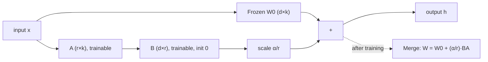

**Parameter-efficient fine-tuning (PEFT)** adapts a pre-trained model by training a small number of new or selected parameters while the base weights stay frozen. **LoRA (Low-Rank Adaptation)** is the dominant PEFT method. It represents the weight update of each targeted matrix as the product of two thin, trainable matrices, which you can keep as a swappable adapter or merge into the base weights after training ([LoRA](../sources/lora-hu-2021.md)). PEFT is what makes [fine-tuning](fine-tuning.md) cheap enough for most teams: a small adapter instead of the whole model ([notebook](../sources/notebook-finetune-rag-prompt.md)).

## How LoRA works

LoRA rests on the hypothesis that the weight change needed for adaptation has a low "intrinsic rank". For a frozen weight `W0` (d×k):

```
h = W0·x + (α/r) · B·A·x        B: d×r,  A: r×k,  r ≪ min(d, k)
```

- **Initialisation.** A is random (Gaussian in the paper, Kaiming-uniform in PEFT) and B is zero, so the adapter starts as a no-op and training begins exactly at the base model ([LoRA](../sources/lora-hu-2021.md), [PEFT](../sources/hugging-face-peft-lora-guide.md)).
- **Scaling α/r.** This keeps the update size roughly stable as r changes. The authors set α once and didn't tune it, since with Adam tuning α is roughly the same as tuning the learning rate ([LoRA](../sources/lora-hu-2021.md)). **rsLoRA** scales by α/√r instead, which keeps higher ranks stable ([PEFT](../sources/hugging-face-peft-lora-guide.md)).
- **No inference latency once merged.** `W = W0 + (α/r)BA` folds back into the base weights (`merge_and_unload()` in PEFT). The catch: once merged, you can't easily batch requests for *different* adapters in one forward pass. Keeping adapters unmerged lets you choose one per request, at some cost ([LoRA](../sources/lora-hu-2021.md), [PEFT](../sources/hugging-face-peft-lora-guide.md)).
- **Savings on GPT-3 175B.** About 10,000× fewer trainable parameters. Training VRAM fell from 1.2 TB to 350 GB, because frozen weights need no optimizer state. Checkpoints shrank from 350 GB to 35 MB. Training ran about 25% faster. A hundred task adapters take about 354 GB instead of 35 TB ([LoRA](../sources/lora-hu-2021.md)).



## QLoRA: LoRA on a 4-bit base

QLoRA backpropagates through a **frozen 4-bit base model** into LoRA adapters that train in higher precision. This let a 65B model fine-tune on one 48 GB GPU, and the authors claim parity with 16-bit fine-tuning ([QLoRA](../sources/qlora-dettmers-2023.md)). It adds three tricks:

1. **NF4 (4-bit NormalFloat):** a 4-bit data type designed for normally distributed weights.
2. **Double quantization:** the quantization constants are quantized too.
3. **Paged optimizers:** absorb memory spikes.

In practice, QLoRA uses about 4× less VRAM than 16-bit LoRA and is slightly slower and slightly less accurate ([Unsloth](../sources/unsloth-lora-hyperparameters.md)). In TRL you pass a `BitsAndBytesConfig` together with a `peft_config` ([TRL](../sources/hugging-face-trl-docs.md)). PEFT's `loftq` init reduces quantization error for quantized bases ([PEFT](../sources/hugging-face-peft-lora-guide.md)). See [quantization](quantization.md).

## Variants and options (PEFT library)

| Option | What it does | Use when |
|---|---|---|
| `target_modules="all-linear"` | Adapts every linear layer, not just attention q/v (the PEFT default) | Almost always (see below) |
| `use_rslora=True` | Scales by α/√r | Higher ranks (64+) |
| `use_dora=True` | Splits the update into magnitude and direction (LoRA) | Low ranks; adds overhead unless merged |
| `init_lora_weights="pissa"` / `"olora"` / `"eva"` | SVD-, QR- or data-driven initialisation | Faster convergence experiments |
| `init_lora_weights="loftq"` | Initialises to offset quantization error | Quantized bases |
| `modules_to_save=[...]` | Fully trains extra modules, e.g. a classifier head or `lm_head` | New heads or vocabularies |
| `add_weighted_adapter(...)` | Combines adapters (linear, svd, cat, TIES, DARE) | Merging task adapters |

Source: [PEFT](../sources/hugging-face-peft-lora-guide.md).

## Hyperparameters that matter

| Knob | Starting value | Evidence |
|---|---|---|
| Target modules | All linear layers: q, k, v, o, gate, up, down | Attention-only LoRA underperforms even at matched parameter count ([LoRA Without Regret](../sources/lora-without-regret.md), [Unsloth](../sources/unsloth-lora-hyperparameters.md)) |
| Rank r | 16–32 (8–128 range) | Higher ranks cost memory and can overfit ([Unsloth](../sources/unsloth-lora-hyperparameters.md)); in RL even r=1 matches full fine-tuning ([LoRA Without Regret](../sources/lora-without-regret.md)) |
| α | r or 2r | ([Unsloth](../sources/unsloth-lora-hyperparameters.md)) |
| Learning rate | ~2e-4 (SFT), ~10× the full-FT optimum; ~5e-6 for DPO/GRPO | ([LoRA Without Regret](../sources/lora-without-regret.md), [Unsloth](../sources/unsloth-lora-hyperparameters.md)); TRL suggests ~1e-4 for SFT adapters and ~1e-5 for DPO adapters ([TRL](../sources/hugging-face-trl-docs.md)) |
| Dropout | 0–0.1 | Rarely useful on short runs ([Unsloth](../sources/unsloth-lora-hyperparameters.md)) |
| Batch size | Modest (effective ~16) | LoRA degrades more than full FT at large batch, and more rank doesn't fix it ([LoRA Without Regret](../sources/lora-without-regret.md)) |

Note that the original paper adapted only Wq and Wv with tiny ranks and still matched full fine-tuning on GPT-3 ([LoRA](../sources/lora-hu-2021.md)). Later work found all-layer LoRA matters at modern scale and data sizes ([LoRA Without Regret](../sources/lora-without-regret.md)).

## LoRA vs full fine-tuning

| | LoRA / QLoRA | Full fine-tuning |
|---|---|---|
| Memory | Base weights + small adapter + its optimizer state | Weights + gradients + full Adam state |
| Storage and serving | MB-scale adapters; many per base model; hot-swappable | One full copy per task |
| Small/medium SFT, RL | Matches full FT if all layers are adapted ([LoRA Without Regret](../sources/lora-without-regret.md)) | Baseline |
| Large-corpus code/math, continued pre-training | Substantially worse ([Biderman et al.](../sources/lora-learns-less-forgets-less.md)) | Better; learns perturbations of 10–100× higher rank |
| Forgetting | Less: preserves out-of-domain skills and diversity ([Biderman et al.](../sources/lora-learns-less-forgets-less.md)) | More |

Google's managed tuning shows the same split: adapter tuning is cheaper and works with less data, while full tuning may score higher on complex tasks but costs more to train and serve ([Vertex AI](../sources/vertex-ai-gemini-tuning.md)).

## Failure modes

- **Capacity ceiling.** On large datasets the adapter can't absorb everything, and loss plateaus above full fine-tuning ([LoRA Without Regret](../sources/lora-without-regret.md), [Biderman et al.](../sources/lora-learns-less-forgets-less.md)).
- **Wrong LR.** Copying a full-FT learning rate into LoRA undertrains by about 10× ([LoRA Without Regret](../sources/lora-without-regret.md)).
- **Attention-only targeting.** This older default leaves quality on the table ([LoRA Without Regret](../sources/lora-without-regret.md)).
- **Overfitting at high rank or too many epochs.** Training loss falling below ~0.2 is a warning sign ([Unsloth](../sources/unsloth-lora-hyperparameters.md)).
- **Adapter/base mismatch.** *Synthesis:* an adapter only works on the exact base checkpoint (and quantization) it was trained against. Version adapters with their base.

## When to use, and when not

- **Use LoRA/QLoRA** by default for task, format and style SFT, for DPO and RL, for limited GPU memory, for many tenant- or task-specific variants served from one base ([LLM inference serving](llm-inference-serving.md)), and when you want to limit forgetting.
- **Prefer full fine-tuning** for continued pre-training on billions of tokens, for large domain shifts such as a new language or heavy code or math, or when you have the compute and evals show LoRA hitting a ceiling.

## Sources

- [LoRA (Hu et al., 2021)](../sources/lora-hu-2021.md)
- [QLoRA (Dettmers et al., 2023)](../sources/qlora-dettmers-2023.md)
- [LoRA Learns Less and Forgets Less](../sources/lora-learns-less-forgets-less.md)
- [LoRA Without Regret](../sources/lora-without-regret.md)
- [Hugging Face PEFT LoRA guide](../sources/hugging-face-peft-lora-guide.md)
- [Unsloth LoRA hyperparameters guide](../sources/unsloth-lora-hyperparameters.md)
- [Hugging Face TRL docs](../sources/hugging-face-trl-docs.md)
- [Vertex AI Gemini tuning](../sources/vertex-ai-gemini-tuning.md)
- [Notebook: Fine-tuning vs RAG vs Prompting](../sources/notebook-finetune-rag-prompt.md)
