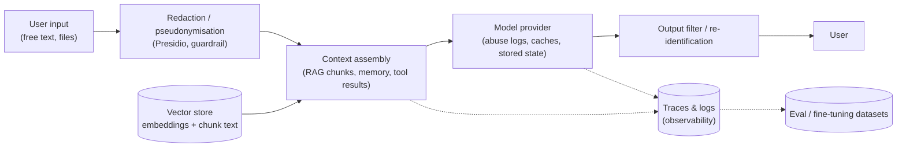

**PII and data privacy engineering** for LLM applications means controlling where personal data goes as it passes through prompts, [retrieval](retrieval-augmented-generation.md), model providers, logs and training sets. In practice that means four things: minimise or transform personal data before it leaves your boundary (detection and redaction), choose provider settings that limit what is stored and where ([zero data retention](data-retention-and-residency.md), training opt-outs, data residency), keep the stores you own (traces, vector indexes, caches) inside your retention and erasure processes, and be able to show a regulator a lawful basis for each step. [OWASP](owasp-top-10-for-llm.md) ranks Sensitive Information Disclosure as LLM02 in both the 2025 and 2026 editions, and notes that system-prompt instructions alone cannot prevent it, because [prompt injection](prompt-injection.md) can override them ([OWASP LLM02](../sources/owasp-llm02-sensitive-information-disclosure.md), [OWASP 2026](../sources/owasp-llm-top-10-2026.md)).

## Where personal data lives in an LLM system

Synthesis: each box in the diagram is a separate retention and erasure problem. The ones teams most often forget:

- **Provider-side stores**: abuse-monitoring logs, stored responses, files, [prompt caches](prompt-caching.md). OpenAI keeps prompt-cache tensors in GPU-local storage for up to 24 hours ([OpenAI](../sources/openai-your-data-controls.md)). Vertex implicit caches are deleted within 24 hours ([Vertex](../sources/vertex-ai-data-governance.md)).
- **Your traces.** [Observability](llm-observability.md) tools capture full prompts and completions by default.
- **Embeddings.** Vec2Text recovers 92% of 32-token inputs exactly from their embeddings, and full names from clinical-note embeddings ([Morris et al.](../sources/morris-2023-vec2text.md)). Synthesis: treat a vector index as containing the source text, with the same access control and erasure duties. See [embeddings](embeddings.md), [vector databases](vector-databases.md).
- **Model weights**, if you [fine-tune](fine-tuning.md) on personal data. Models memorise training data verbatim, even sequences seen in a single document, and larger models memorise more ([Carlini et al.](../sources/carlini-2021-extracting-training-data.md)). NIST lists memorisation, leakage and inference of undisclosed sensitive attributes under its data-privacy risk ([NIST AI 600-1](../sources/nist-ai-600-1-genai-profile.md)).

## Detection and redaction with Presidio

Presidio is the standard open-source building block. It was started by Microsoft and is now community-owned under "Data Privacy Stack" ([Presidio](../sources/presidio-docs.md)).

- **Analyzer.** An `AnalyzerEngine` runs every recognizer in a `RecognizerRegistry` over text pre-processed by an NLP engine (spaCy by default; Stanza or [Hugging Face](hugging-face-ecosystem.md) Transformers optional). Recognizers combine NER, regular expressions, checksum validation and rule logic. A context enhancer raises confidence when nearby words, matched by lemma or phrase, support the entity. Each result is an entity type, a span and a score. Recognizers carry a country code, so you can scope detection (e.g. EU-only), and you can add custom recognizers ([Presidio](../sources/presidio-docs.md)).
- **Anonymizer operators.** `replace` (default `<ENTITY_TYPE>`), `redact`, `mask` (`chars_to_mask`, `masking_char`, `from_end`), `hash` (salted SHA-256/512; reuse one salt to get consistent hashes), `encrypt` (keyed), `custom`, `surrogate_ahds` (realistic surrogates via Azure Health Data Services), `keep`. Only `encrypt` is reversible, via `decrypt` with the same key ([Presidio](../sources/presidio-docs.md)).
- **Also:** an image redactor (OCR, then redaction) and a structured-data mode for tables ([Presidio](../sources/presidio-docs.md)).

| Operator | Reversible | LLM still understands? | Use when |
|---|---|---|---|
| `replace` with type tag | no | partly: it knows "a PERSON" | analytics, logs |
| `hash` (fixed salt) | no (linkable) | consistent tokens across a conversation | joining records without exposing values |
| `encrypt` | yes, with key | consistent opaque tokens | round-trip pseudonymisation: redact before the provider, `decrypt` in the output |
| `mask` | no | partial (e.g. last 4 digits) | UI display, support tickets |
| surrogate | no | yes, it reads naturally | test data and fine-tuning sets |

Synthesis on the round-trip pattern: replace each entity with a consistent token before the API call, keep the token-to-value map (or key) inside your boundary, and restore values in the response. The provider then sees pseudonymised data. Under GDPR that is still personal data for you, because you hold the key ([GDPR Art. 4](../sources/gdpr-article-4-definitions.md)), but it shrinks what a provider breach or log can expose.

Managed alternatives exist. Bedrock Guardrails' sensitive-information filters block or mask PII and custom regexes on inputs and outputs, and do not evaluate reasoning blocks ([Bedrock Guardrails](../sources/aws-bedrock-guardrails.md)). See [guardrail tooling](guardrail-tooling.md).

**Limits.** Presidio's docs warn that automated detection cannot guarantee it finds all sensitive data ([Presidio](../sources/presidio-docs.md)). Synthesis: expect misses on names that are also ordinary words, non-English text, IDs split across tokens or lines, and quasi-identifiers (job title + town + date) that no single recognizer flags. Measure recall on your own labelled sample before relying on it, and red-team leakage with [promptfoo](promptfoo.md)'s `pii:direct`, `pii:session`, `pii:social`, `pii:api-db` and `cross-session-leak` plugins ([promptfoo plugins](../sources/promptfoo-red-team-plugins-docs.md); see [LLM red teaming](llm-red-teaming.md)).

## Provider controls: training, retention, residency (as of 2026-11)

| Provider | Training on API data | Default retention | Zero-retention option | Residency |
|---|---|---|---|---|
| Anthropic API | Commercial products excluded from the consumer training choice | deleted within 30 days; flagged content up to 2 years | ZDR per organization; no browser (CORS) calls; [Batch](batch-processing.md), Files and code execution step outside it; "Covered Models" need 30-day retention | `inference_geo` `global`/`us` per request (US-only at 1.1x price, Claude 4.6+); workspace geo `us` only, immutable |
| OpenAI API | not since 2023-03-01 unless opted in | abuse logs up to 30 days; `store`d responses ≥30 days | Modified Abuse Monitoring or ZDR (forces `store=false`); not for files, vector stores, batch, fine-tuning, assistants | regional domains; US, EU, UAE (and some models in AU/JP/IN) process in-region, CA/SG/KR/UK store only; +10% on newer models |
| Amazon Bedrock | providers have no access to prompts | per model `DataRetentionMode` | mode `none`, enforceable by SCP; some models require `aws_review` | per Region; cross-Region inference stores in the destination Region |
| Vertex AI | not without permission | caches ≤24 h; grounding logs (Search: 3 days, Maps: 30 days) | disable caching and logging; use Web Grounding for Enterprise | regional and multi-region endpoints |
| Azure / Foundry | not used for training; not shared with OpenAI | abuse monitoring store in resource geography | Modified abuse monitoring (`ContentLogging=false`) | Standard (in geography), DataZone, Global |

Sources: [Anthropic retention](../sources/anthropic-api-and-data-retention.md), [Anthropic residency](../sources/anthropic-data-residency-docs.md), [Anthropic consumer terms](../sources/anthropic-2025-consumer-terms-update.md), [OpenAI data controls](../sources/openai-your-data-controls.md), [OpenAI residency](../sources/openai-data-residency-guide.md), [Bedrock retention](../sources/bedrock-data-retention-docs.md), [Bedrock data protection](../sources/aws-bedrock-data-protection.md), [Vertex](../sources/vertex-ai-data-governance.md), [Foundry](../sources/microsoft-foundry-data-privacy.md).

Traps hidden in that table:

- **`store=false` is not ZDR.** On Bedrock only mode `none` guarantees zero retention ([Bedrock](../sources/bedrock-data-retention-docs.md)). On Vertex partner OpenAI models, `store: false` alone doesn't enable ZDR ([Vertex](../sources/vertex-ai-data-governance.md)).
- **Stateful features break ZDR.** Anthropic's API does not block ineligible features under ZDR; using one simply takes that data outside ZDR ([Anthropic](../sources/anthropic-api-and-data-retention.md)). OpenAI files and vector stores are ineligible ([OpenAI](../sources/openai-your-data-controls.md)).
- **Flagged content is kept anyway.** Trust-and-safety holds override ZDR at Anthropic (up to 2 years) and OpenAI ([Anthropic](../sources/anthropic-api-and-data-retention.md), [OpenAI](../sources/openai-your-data-controls.md)).
- **Storage residency is not inference residency.** OpenAI's storage-only regions may process outside the region ([OpenAI residency](../sources/openai-data-residency-guide.md)). Anthropic's `inference_geo` does not apply on Bedrock, Google-managed Vertex or Foundry, where the endpoint or deployment type decides (it does work on Claude Platform on AWS and Anthropic-managed Claude on Google Cloud) ([Anthropic residency](../sources/anthropic-data-residency-docs.md)).
- **Consumer is not commercial.** Consumer Claude plans let users opt in to training, with 5-year retention if they do; API and cloud-platform use is excluded ([Anthropic consumer terms](../sources/anthropic-2025-consumer-terms-update.md)). Synthesis: employees pasting customer data into consumer chat apps is a governance problem, not an API setting.

See [enterprise LLM deployment](enterprise-llm-deployment.md), [Amazon Bedrock](amazon-bedrock.md), [Google Vertex AI](google-vertex-ai.md), [Azure AI Foundry](azure-ai-foundry.md).

## GDPR implications for prompts, logs, embeddings and models

- **Prompts and logs that mention a person are personal data.** Sending them to an API is processing ([GDPR Art. 4(2)](../sources/gdpr-article-4-definitions.md)). Synthesis: an API provider acting on your instructions under a data processing agreement is normally a processor in the Art. 4(8) sense; check its terms, since any use for its own purposes (e.g. consumer-style training) changes that role. Pseudonymised data stays personal data ([GDPR Art. 4(5)](../sources/gdpr-article-4-definitions.md)).
- **Anonymity is relative and must be demonstrated.** The EDPB's draft 2026 anonymisation guidelines use three criteria (no isolation, no linkage, no inference). They state that meaningful inferences drawn by prompting a model, and [synthetic data](synthetic-data-generation.md), can fail the no-inference test, so outputs are not anonymous by default ([EDPB 02/2026](../sources/edpb-guidelines-02-2026-anonymisation.md)).
- **Are model weights personal data?** Hamburg's DPA argued in 2024 that LLMs store no personal data, so data-subject rights attach to the system's inputs and outputs ([Hamburg](../sources/hamburg-dpa-2024-llms-personal-data.md)). The EDPB's Opinion 28/2024 is stricter: a model trained on personal data is anonymous only if both extraction and query-based disclosure are insignificant, judged case by case ([EDPB 28/2024](../sources/edpb-opinion-28-2024-ai-models.md)).

  > **Contradiction:** Hamburg says training-phase violations don't affect the lawfulness of deploying the model. The EDPB says it depends: a deployer must assess how a third-party model was developed, unless the model was effectively anonymised. Prefer the EDPB position, which is the EU-wide one.

- **Legal basis.** Legitimate interest needs the three-step test (legitimate interest, necessity with data minimisation, balancing against data subjects' reasonable expectations) ([EDPB 28/2024](../sources/edpb-opinion-28-2024-ai-models.md)).
- **Erasure and access.** Synthesis: a deletion request must reach every copy: traces, conversation memory ([agent memory](agent-memory.md)), vector-index entries and their chunk text, [eval datasets](llm-evaluation.md), provider-stored state (responses, files, threads), and any fine-tuned adapter. Weights cannot be surgically edited, which is a strong argument for keeping personal data in retrieval, where it can be deleted, rather than in fine-tuning. Design document IDs so one data subject's chunks can be found and deleted.

See [AI governance and compliance](ai-governance-and-compliance.md) for the EU AI Act layer.

## Practical guidance

Synthesis, built from the sources above:

1. **Minimise first.** Don't retrieve or send fields the task doesn't need, and scope retrieval to the requesting user ([Notebook: web/AI security](../sources/notebook-web-ai-security.md), [OWASP LLM02](../sources/owasp-llm02-sensitive-information-disclosure.md)).
2. **Redact at the boundary when the provider or the logs shouldn't see raw identifiers.** Use reversible `encrypt` tokens when the answer must name the person, and type tags for analytics. Skip redaction when the task is about the identifiers (e.g. KYC extraction). In that case, rely on contractual and technical controls: ZDR, residency, a DPA or BAA.
3. **Turn on provider controls deliberately.** Request ZDR or MAM; avoid stateful endpoints, or accept their retention; pin the inference region; enforce at the org level (Bedrock SCPs, Anthropic `allowed_inference_geos`).
4. **Treat your own stores as in scope.** Redact or hash in traces, set TTLs, and encrypt vector stores with access control equal to the source documents.
5. **Test leakage like any other failure.** Run cross-user and cross-session leakage, system-prompt extraction and PII elicitation in your [red-team](llm-red-teaming.md) suite, and add PII checks to [guardrails](agent-guardrails.md) on output.

## Sources

- [Presidio documentation](../sources/presidio-docs.md)
- [OWASP LLM02 Sensitive Information Disclosure](../sources/owasp-llm02-sensitive-information-disclosure.md) · [OWASP LLM Top 10 2026](../sources/owasp-llm-top-10-2026.md)
- [Carlini et al. 2021](../sources/carlini-2021-extracting-training-data.md) · [Morris et al. 2023, Vec2Text](../sources/morris-2023-vec2text.md)
- [Anthropic API and data retention](../sources/anthropic-api-and-data-retention.md) · [Anthropic data residency](../sources/anthropic-data-residency-docs.md) · [Anthropic consumer terms update](../sources/anthropic-2025-consumer-terms-update.md)
- [OpenAI data controls](../sources/openai-your-data-controls.md) · [OpenAI data residency](../sources/openai-data-residency-guide.md)
- [Bedrock data retention](../sources/bedrock-data-retention-docs.md) · [Bedrock data protection](../sources/aws-bedrock-data-protection.md) · [Bedrock Guardrails](../sources/aws-bedrock-guardrails.md)
- [Vertex AI data governance](../sources/vertex-ai-data-governance.md) · [Microsoft Foundry data privacy](../sources/microsoft-foundry-data-privacy.md)
- [GDPR Article 4](../sources/gdpr-article-4-definitions.md) · [EDPB Opinion 28/2024](../sources/edpb-opinion-28-2024-ai-models.md) · [EDPB Guidelines 02/2026](../sources/edpb-guidelines-02-2026-anonymisation.md) · [Hamburg DPA discussion paper](../sources/hamburg-dpa-2024-llms-personal-data.md)
- [Promptfoo red team plugins](../sources/promptfoo-red-team-plugins-docs.md) · [NIST AI 600-1](../sources/nist-ai-600-1-genai-profile.md) · [Notebook: Web, API & AI Security](../sources/notebook-web-ai-security.md)
