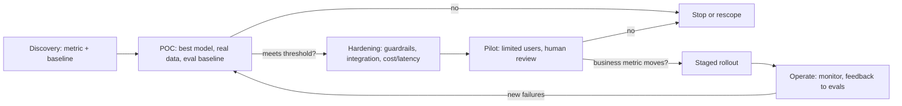

**POC to production** is the path from a working prototype of an LLM feature (a proof of concept, or POC) to a system that real users depend on, at agreed quality, cost, latency and risk. LLM prototypes are cheap and impressive. Making them dependable is the hard part. The practitioners behind *Applied LLMs* call this the gap between "0 to 1" demos and "1 to N" products ([Applied LLMs](../sources/applied-llms-year-of-building.md)). Closing that gap is the core job of a [forward deployed engineer](forward-deployed-engineering.md).

## The pilot-to-production gap

- Gartner forecast (July 2024) that at least 30% of GenAI projects would be abandoned after POC by end of 2025. The causes it named were poor data quality, inadequate risk controls, escalating costs and unclear business value ([Gartner 2024](../sources/gartner-genai-poc-abandonment-2024.md)). Its June 2025 forecast puts agentic AI cancellations above 40% by end of 2027 ([Gartner 2025](../sources/gartner-agentic-ai-cancellation-2025.md)).
- MIT NANDA (2025, preliminary, small self-reported sample) found that only about 5% of enterprise pilots produce rapid revenue impact. It blames a **learning gap**: tools that do not integrate with workflows, retain feedback or adapt to context. Model quality is not the main problem ([MIT NANDA](../sources/mit-nanda-genai-divide-2025.md)).

Synthesis: these numbers come from forecasts and small samples. The causes they name are consistent with each other: no metric, no integration, no risk controls, no cost model. Each maps to a stage gate below.

## Why demos lie

Synthesis, grounded in the sources: a POC usually runs on a curated handful of inputs, often anonymised or offline data. That is how OpenAI describes typical solutions-architect POCs, as opposed to FDE work on customer infrastructure ([Pragmatic Engineer](../sources/pragmatic-engineer-forward-deployed-engineers.md)). Production adds:

- **Distribution shift.** Real inputs include edge cases nobody imagined. Failure modes are unpredictable, so [review real traffic](error-analysis.md) daily ([Applied LLMs](../sources/applied-llms-year-of-building.md)).
- **Compounding unreliability.** At 75% [per-trial success](agent-evaluation.md), the chance that 3 of 3 trials succeed (pass^3) is only about 42% ([Anthropic evals](../sources/anthropic-demystifying-evals-for-ai-agents.md)). Users see the pass^k behaviour, not the best-case demo.
- **Persistent hallucination.** Applied LLMs puts the baseline at roughly 5-10%, which needs downstream checks ([Applied LLMs](../sources/applied-llms-year-of-building.md); see [hallucination](hallucination.md)).
- **Integration, permissions, cost at volume, security and ownership.**

## Stage gates

*Synthesis: the gate structure combines OpenAI's scope-validate-deliver phases, its incremental agent guidance and Applied LLMs' iteration loop.*

**1. POC (validate feasibility).** Prototype with the most capable model to set an [eval](llm-evaluation.md) baseline. Hit the accuracy target first, then swap in smaller models for cost and latency ([OpenAI agents guide](../sources/openai-practical-guide-building-agents.md); see [model selection](model-selection.md)). Start with [prompting](prompt-engineering.md) and retrieval, and only [fine-tune](fine-tuning.md) once those are proven insufficient ([Applied LLMs](../sources/applied-llms-year-of-building.md)). Build the smallest end-to-end slice on real systems. OpenAI FDEs validate with evals before they commit to delivery ([Pragmatic Engineer](../sources/pragmatic-engineer-forward-deployed-engineers.md)). Exit criterion: the eval score meets the threshold agreed in [discovery](ai-use-case-discovery.md).

**2. Hardening (make it dependable).**
- *Evals as a regression suite.* Start with 20-50 tasks from real failures. Capability evals should begin at a low pass rate, regression evals should sit near 100%, and saturated tasks graduate into regression ([Anthropic evals](../sources/anthropic-demystifying-evals-for-ai-agents.md)). Calibrate LLM judges against a domain expert with binary pass/fail plus critique, and report true-positive and true-negative rates separately ([Husain](../sources/husain-llm-judge-critique-shadowing.md); see [LLM-as-judge](llm-as-judge.md)). Anti-patterns include vibe-based evaluation, datasets unlike production traffic, and adding evals only after shipping ([OpenAI eval best practices](../sources/openai-evaluation-best-practices.md)).
- *Guardrails and escalation.* Layer input filters, tool-use limits and [human intervention](human-in-the-loop.md). Escalate when failure thresholds are exceeded or before high-risk actions such as cancellations, large refunds and payments ([OpenAI agents guide](../sources/openai-practical-guide-building-agents.md)). See [agent guardrails](agent-guardrails.md), [prompt injection](prompt-injection.md).
- *Architecture restraint.* Maximise a single agent with [tools](tools.md) before going multi-agent ([OpenAI agents guide](../sources/openai-practical-guide-building-agents.md); see [agent design patterns](agent-design-patterns.md)).
- *Cost and latency.* For example, Indeed's fine-tuned smaller model matched results with 60% fewer tokens ([OpenAI, Enterprise](../sources/openai-ai-in-the-enterprise.md)). See [cost and latency optimization](cost-and-latency-optimization.md), [prompt caching](prompt-caching.md).
- *Observability.* Trace every call and tool step ([LLM observability](llm-observability.md)).

**3. Pilot (validate value).** Put the system in front of a limited group of users, measure the business metric against the baseline, and keep humans reviewing outputs. Human intervention matters most early in deployment, when it surfaces failures and builds the eval cycle ([OpenAI agents guide](../sources/openai-practical-guide-building-agents.md)). Indeed tested the GPT version against the old engine before scaling ([OpenAI, Enterprise](../sources/openai-ai-in-the-enterprise.md)).

**4. Rollout and operate.** Expand in stages. Production logs feed new eval cases and fixes, which is the **data flywheel**. LLMOps exists to shorten the loop from production back to development ([Applied LLMs](../sources/applied-llms-year-of-building.md)). Klarna reached two-thirds of service chats through continuous testing and refinement, not a single launch ([OpenAI, Enterprise](../sources/openai-ai-in-the-enterprise.md)).

## Human-in-the-loop design and change management

- **Augment first.** Design the UX so users can accept, edit or reject outputs. This builds trust and generates labelled feedback. Treat the LLM as support for human workflows, not a replacement ([Applied LLMs](../sources/applied-llms-year-of-building.md)).
- **Start narrow.** Narrow products that are honest about their limits earn trust faster than generic ones ([Applied LLMs](../sources/applied-llms-year-of-building.md)).
- **Involve the people closest to the work, plus control functions.** BBVA brought Legal, Compliance and IT Security in from the start and let experts build their own tools ([OpenAI, Enterprise](../sources/openai-ai-in-the-enterprise.md)). Line managers, not only central AI labs, drive adoption ([MIT NANDA](../sources/mit-nanda-genai-divide-2025.md)). See [AI governance and compliance](ai-governance-and-compliance.md).
- **Sponsor visibly.** Leadership-led adoption and early quick wins build momentum ([OpenAI, use cases](../sources/openai-identifying-scaling-ai-use-cases.md)).
- **Expect years, not weeks.** Neural-network driving was demoed in 1988, and commercial driverless service arrived decades later ([Applied LLMs](../sources/applied-llms-year-of-building.md)).

Synthesis: change management for LLM systems differs from classic software rollouts in one way. Output quality is probabilistic, so users need a calibrated sense of when to trust the system. Ship with visible uncertainty and an escalation path, and publish the eval metrics to stakeholders.

## Production-readiness checklist

Synthesis, consolidating the sources above:

| Area | Ready when |
|---|---|
| Quality | Eval suite of real cases passes the agreed threshold; regression evals run in CI |
| Reliability | pass^k measured on critical tasks; [fallbacks](model-routing-and-fallbacks.md) and [retry limits](rate-limits-and-retries.md) defined |
| Safety | Guardrails, injection defences, human approval on irreversible actions |
| Data & access | Least-privilege credentials; [PII handling](pii-and-data-privacy.md) approved |
| Cost & latency | Cost per task and p95 latency within budget at forecast volume |
| Observability | Traces, feedback capture, alerting on quality drift |
| Ownership | A customer-side owner exists; runbooks; model-upgrade plan |
| Value | Business metric measured against the baseline in the pilot |

## Failure modes

- **Pilot purgatory.** Gartner names unclear business value among the main reasons POCs are abandoned ([Gartner 2024](../sources/gartner-genai-poc-abandonment-2024.md)). Synthesis: a POC with no agreed business metric and no customer-side owner leaves nobody able to approve production.
- **Generic tool, no workflow integration.** This is the learning gap ([MIT NANDA](../sources/mit-nanda-genai-divide-2025.md)).
- **Overbuilding.** Going multi-agent or autonomous before a single agent works ([OpenAI agents guide](../sources/openai-practical-guide-building-agents.md)), or training models before product-market fit ([Applied LLMs](../sources/applied-llms-year-of-building.md)).
- **Bespoke forever.** For vendors, custom deployments that are never turned into reusable templates. Time-box them and convert custom code to templates ([a16z](../sources/a16z-palantirization-of-everything.md)).
- **Model-centric thinking.** Models change fast. The durable assets are evals, guardrails, caching and the data flywheel ([Applied LLMs](../sources/applied-llms-year-of-building.md)).

## Sources

- [What We Learned from a Year of Building with LLMs](../sources/applied-llms-year-of-building.md)
- [A Practical Guide to Building Agents (OpenAI)](../sources/openai-practical-guide-building-agents.md)
- [AI in the Enterprise (OpenAI)](../sources/openai-ai-in-the-enterprise.md)
- [Identifying and Scaling AI Use Cases (OpenAI)](../sources/openai-identifying-scaling-ai-use-cases.md)
- [The GenAI Divide (MIT NANDA)](../sources/mit-nanda-genai-divide-2025.md)
- [Gartner: 30% of GenAI projects abandoned after POC](../sources/gartner-genai-poc-abandonment-2024.md)
- [Gartner: 40%+ of agentic AI projects canceled by 2027](../sources/gartner-agentic-ai-cancellation-2025.md)
- [Forward Deployed Engineers (The Pragmatic Engineer)](../sources/pragmatic-engineer-forward-deployed-engineers.md)
- [The Palantirization of Everything (a16z)](../sources/a16z-palantirization-of-everything.md)
- [Demystifying evals for AI agents (Anthropic)](../sources/anthropic-demystifying-evals-for-ai-agents.md)
- [Evaluation best practices (OpenAI)](../sources/openai-evaluation-best-practices.md)
- [LLM judges: critique shadowing (Husain)](../sources/husain-llm-judge-critique-shadowing.md)
