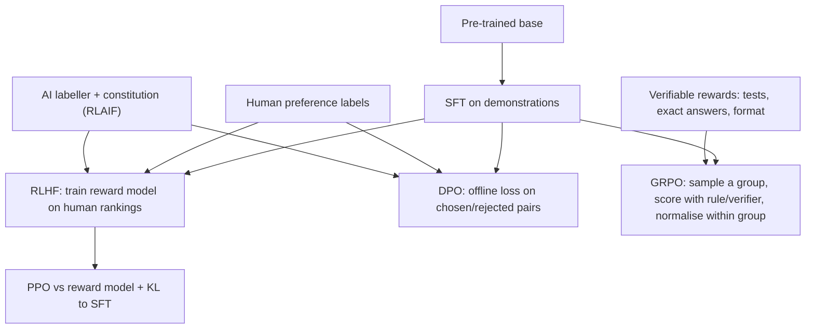

**Preference optimization** is the stage of [fine-tuning](fine-tuning.md) that comes after SFT. Instead of imitating fixed demonstrations, the model learns from *comparisons* (A is better than B) or *rewards* (a score for each sampled output), and is pushed toward higher-preference behaviour while a KL constraint keeps it near a reference model. The family includes RLHF with a learned reward model and PPO ([InstructGPT](../sources/instructgpt-ouyang-2022.md)), offline methods such as DPO that skip the reward model and the RL loop ([DPO](../sources/dpo-rafailov-2023.md)), critic-free online RL such as GRPO with verifiable rewards ([GRPO](../sources/deepseekmath-grpo-2024.md), [R1](../sources/deepseek-r1-paper.md)), and variants that replace human labels with AI feedback ([Constitutional AI](../sources/constitutional-ai-bai-2022.md), [RLAIF](../sources/rlaif-vs-rlhf-lee-2023.md)).

All of them optimise roughly the same objective: maximise expected reward minus β·KL(π‖π_ref). The reference model π_ref is usually the SFT checkpoint ([DPO](../sources/dpo-rafailov-2023.md)).



*Synthesis:* the diagram combines the pipelines from the InstructGPT, DPO, CAI and DeepSeek papers.

## RLHF with PPO (the InstructGPT recipe)

1. **SFT** on labeller demonstrations (~13k prompts).
2. **Reward model (RM).** Labellers ranked 4–9 responses per prompt (~33k prompts). A 6B RM was trained on all the pairwise comparisons; 175B RMs were unstable.
3. **PPO** against the RM (~31k prompts), with a per-token KL penalty to the SFT model to limit reward over-optimisation.

Results: a 1.3B InstructGPT was preferred to 175B GPT-3. The costs: an "alignment tax" on some NLP benchmarks, reduced by mixing pre-training gradients (PPO-ptx). Inter-labeller agreement was only about 73–77%, so preference labels are noisy ([InstructGPT](../sources/instructgpt-ouyang-2022.md)). PPO needs four models in memory: policy, reference, reward model and a value model (critic) usually as large as the policy ([GRPO](../sources/deepseekmath-grpo-2024.md)).

## DPO: Direct Preference Optimization

DPO shows that the KL-constrained RLHF optimum has a closed form. The policy itself defines an **implicit reward** `r(x,y) = β·log(πθ(y|x)/π_ref(y|x))`, so preferences can be fit with a logistic (Bradley–Terry) loss:

```
L = −log σ( β·[log πθ(y_w|x)/π_ref(y_w|x) − log πθ(y_l|x)/π_ref(y_l|x)] )
```

- No reward model, no sampling during training, no RL loop. It is an offline classification loss ([DPO](../sources/dpo-rafailov-2023.md)).
- The gradient weights each pair by how *wrongly* the implicit reward currently orders it. Without that weighting the model degenerates ([DPO](../sources/dpo-rafailov-2023.md)).
- **β** sets how far the policy may move from the reference; higher β means less deviation. The paper used β=0.1 (0.5 for summarisation) and LR 1e-6 ([DPO](../sources/dpo-rafailov-2023.md)). TRL defaults to the same β=0.1 and LR 1e-6 ([TRL](../sources/hugging-face-trl-docs.md)).
- Results: better sentiment control than PPO, and equal or better summarisation and dialogue quality ([DPO](../sources/dpo-rafailov-2023.md)).
- TRL documents a practical caveat: DPO usually wins by *pushing down the rejected* completion rather than raising the chosen one. Monitor `rewards/chosen`, `rewards/rejected`, `rewards/margins` and `rewards/accuracies` ([TRL](../sources/hugging-face-trl-docs.md)).
- **Variants** (TRL `loss_type`): `ipo` (identity transform, against overfitting), `hinge` (RSO/SLiC), `robust` and `udpo` (noisy labels), `sigmoid_norm` (SimPO-style length normalisation), `apo_zero`/`apo_down` (anchored), and more. Separate trainers cover KTO (unpaired good/bad labels), ORPO and CPO (no reference model). Online DPO samples fresh pairs during training ([TRL](../sources/hugging-face-trl-docs.md)).

## GRPO and RL with verifiable rewards

**GRPO (Group Relative Policy Optimization)** is a PPO variant without a critic. For each prompt it samples a group of G outputs and scores them. Each output's advantage is its reward normalised within the group, `(r − mean)/std`. The KL to the reference is added directly to the loss with an unbiased estimator. Dropping the value model saves substantial memory. DeepSeekMath used G=64 and KL coefficient 0.04 ([GRPO](../sources/deepseekmath-grpo-2024.md)). The paper also found an important limit: RL raised Maj@K but not Pass@K. It made already-reachable correct answers more likely rather than adding new capability ([GRPO](../sources/deepseekmath-grpo-2024.md)).

**DeepSeek-R1** made this approach widely known:

- R1-Zero ran GRPO straight on a base model with **rule-based rewards** (answer correctness via math checks or compiler tests, plus a format reward) and developed long chains of thought, self-verification and reflection.
- Neural reward models were avoided for reasoning because they invite **reward hacking** at scale. Process reward models (PRMs) and MCTS were tried and abandoned.
- R1-Zero's outputs were hard to read and mixed languages. R1 fixed this with cold-start SFT, a language-consistency reward, rejection-sampling SFT and a final RL stage ([R1](../sources/deepseek-r1-paper.md)).
- See [reasoning models](reasoning-models.md) and [test-time compute](test-time-compute.md).

**TRL `GRPOTrainer` defaults** (read 2026-11-14): `num_generations=8`, `beta=0.0` (KL off, no reference model loaded), `loss_type="dapo"` (token-level normalisation; `dr_grpo` removes length bias), `epsilon=0.2` clipping, `scale_rewards="group"`, LR 1e-6. TRL notes that DeepSeek-R1 used β=0.001. Rewards are plain Python functions returning one float per completion, summed or weighted. Generation runs in vLLM, colocated or as a server ([TRL](../sources/hugging-face-trl-docs.md)). RL learns little per episode, so LoRA matches full fine-tuning here even at rank 1 ([LoRA Without Regret](../sources/lora-without-regret.md)). Unsloth suggests LR around 5e-6 for DPO/GRPO ([Unsloth](../sources/unsloth-lora-hyperparameters.md)).

## RLAIF and Constitutional AI

- **Constitutional AI** (Anthropic). Human oversight is reduced to a short list of principles. In the supervised phase the model critiques and revises its own answers, then trains on the revisions. In the RL phase an AI picks the better of two samples, a preference model is trained on those choices, and RL runs against it (RLAIF). The result is harmless but *non-evasive*: it explains its objections instead of stonewalling ([CAI](../sources/constitutional-ai-bai-2022.md)).
- **RLAIF vs RLHF** (Google). AI labels matched human labels on summarisation and on helpful and harmless dialogue. RLAIF helped even when the labeller was the same model as the policy. *Direct* RLAIF, which skips the RM and asks an LLM for rewards during RL, did better still ([RLAIF](../sources/rlaif-vs-rlhf-lee-2023.md)). This is the same pattern as [LLM-as-judge](llm-as-judge.md), applied to training.

## Comparison

| Method | Data | Online sampling? | Models in memory | Strengths | Weaknesses |
|---|---|---|---|---|---|
| PPO-RLHF | Rankings → RM | Yes | Policy, ref, RM, critic | General preferences; mature | Complex, unstable, expensive; RM hacking |
| DPO (and IPO, SimPO…) | Chosen/rejected pairs | No (offline) | Policy + ref (or precomputed ref log-probs) | Simple, cheap, stable | Limited to dataset coverage; can lower chosen likelihood; length bias |
| KTO | Unpaired good/bad labels | No | Policy + ref | Uses thumbs-up/down logs | Weaker signal than pairs |
| GRPO / RLVR | Prompts + reward functions | Yes | Policy (+ ref if β>0) | No critic; great for verifiable tasks | Needs a reliable verifier; sharpens rather than expands ability |
| RLAIF / CAI | AI labels from principles | Either | As above | Scales labels cheaply | Inherits the labeller's biases |

Sources: rows draw on [InstructGPT](../sources/instructgpt-ouyang-2022.md), [DPO](../sources/dpo-rafailov-2023.md), [TRL](../sources/hugging-face-trl-docs.md), [GRPO](../sources/deepseekmath-grpo-2024.md), [CAI](../sources/constitutional-ai-bai-2022.md) and [RLAIF](../sources/rlaif-vs-rlhf-lee-2023.md). The "weaknesses" column for KTO and RLAIF is *Synthesis*.

## Managed options (as of 2026-11-14)

- **OpenAI:** DPO on gpt-4.1 and gpt-4.1-mini, for summary focus and chat tone. The platform is winding down: existing customers can't create jobs from 2027-01-06, and both base models shut down 2027-01-14 ([OpenAI](../sources/openai-model-optimization-guide.md), [deprecations](../sources/openai-deprecations-fine-tuning.md)).
- **Vertex AI:** preference tuning on Gemini 2.5 Flash/Flash-Lite with hundreds to thousands of pairs, and RL fine-tuning with reward functions on Gemini 3.5 Flash and 3.1 Flash-Lite with dozens to a few hundred prompts ([Vertex AI](../sources/vertex-ai-gemini-tuning.md)).
- **Bedrock:** reinforcement fine-tuning with AWS Lambda reward functions, using uploaded prompts or invocation logs ([Bedrock](../sources/bedrock-model-customization.md)).

## Failure modes

- **Reward hacking and over-optimisation.** The policy exploits a flawed RM or verifier, which is why KL penalties exist and why R1 avoided neural RMs ([InstructGPT](../sources/instructgpt-ouyang-2022.md), [R1](../sources/deepseek-r1-paper.md)).
- **Alignment tax.** Regressions on general benchmarks ([InstructGPT](../sources/instructgpt-ouyang-2022.md)).
- **Noisy preferences.** Labellers disagree about a quarter of the time ([InstructGPT](../sources/instructgpt-ouyang-2022.md)). Robust losses help ([TRL](../sources/hugging-face-trl-docs.md)).
- **Length and verbosity bias.** Handled by normalised losses such as `sigmoid_norm` and `dr_grpo` ([TRL](../sources/hugging-face-trl-docs.md)).
- **Readability and language drift** under pure RL ([R1](../sources/deepseek-r1-paper.md)).

## When to use which

*Synthesis:*

- Start with SFT.
- Add **DPO** when you can collect "A beats B" judgements (human, or [LLM-as-judge](llm-as-judge.md)) for subjective qualities such as tone, helpfulness or safety style.
- Use **GRPO/RFT** when correctness can be checked by a program: tests, exact answers, schema validity ([structured outputs](structured-outputs.md)), tool-call success.
- Reserve PPO-RLHF for labs with large-scale infrastructure.
- For small models, [distilling](knowledge-distillation.md) from a stronger reasoner beat running RL directly in R1's experiments ([R1](../sources/deepseek-r1-paper.md)).

## Sources

- [InstructGPT (Ouyang et al., 2022)](../sources/instructgpt-ouyang-2022.md)
- [DPO (Rafailov et al., 2023)](../sources/dpo-rafailov-2023.md)
- [DeepSeekMath and GRPO](../sources/deepseekmath-grpo-2024.md)
- [DeepSeek-R1](../sources/deepseek-r1-paper.md)
- [Constitutional AI](../sources/constitutional-ai-bai-2022.md)
- [RLAIF vs RLHF](../sources/rlaif-vs-rlhf-lee-2023.md)
- [Hugging Face TRL docs](../sources/hugging-face-trl-docs.md)
- [LoRA Without Regret](../sources/lora-without-regret.md)
- [Vertex AI Gemini tuning](../sources/vertex-ai-gemini-tuning.md)
- [Amazon Bedrock model customization](../sources/bedrock-model-customization.md)
- [OpenAI model optimization guide](../sources/openai-model-optimization-guide.md)
- [OpenAI deprecations: fine-tuning wind-down](../sources/openai-deprecations-fine-tuning.md)
- [Unsloth LoRA hyperparameters guide](../sources/unsloth-lora-hyperparameters.md)
