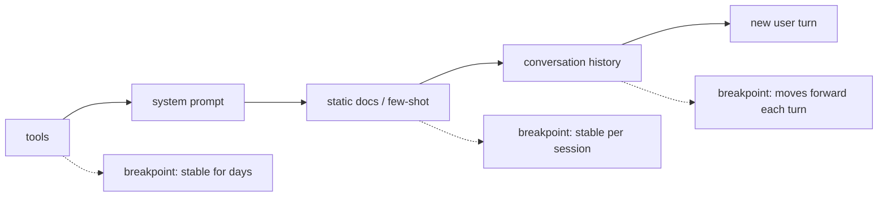

**Prompt caching** (Google calls it *context caching*) lets a model API skip recomputing the part of a prompt it has recently processed. When a request starts with exactly the same tokens as an earlier one, the provider reuses the stored attention key/value state for that prefix, so only the new suffix needs [prefill](llm-inference-serving.md). Cached tokens are billed at a steep discount, typically 90% or more off input price, and time-to-first-token drops. The output is identical to an uncached call ([Anthropic](../sources/anthropic-prompt-caching-docs.md), [OpenAI](../sources/openai-prompt-caching-guide.md), [Gemini](../sources/gemini-context-caching-docs.md)). The owner's notebook gives the core design rule: stable content first, variable content last ([Notebook](../sources/notebook-prompt-engineering.md)).

## Mechanics

What is cached is the [KV cache](kv-cache.md) of the prefix, not the text. OpenAI states that it stores key/value tensors, possibly in GPU-local storage, for at most 24 h ([OpenAI](../sources/openai-prompt-caching-guide.md)). Open-source engines show the same idea from the inside. [vLLM](vllm.md) hashes each full KV block chained to its parent block, so a lookup matches the longest identical prefix ([vLLM APC](../sources/vllm-automatic-prefix-caching-docs.md)). SGLang keeps finished requests' KV in a radix tree keyed by token sequence with LRU eviction ([SGLang RadixAttention](../sources/lmsys-sglang-radixattention-blog.md)). Two consequences follow:

1. **Prefix-exact.** A single changed token invalidates everything after it. Anthropic requires a 100% identical prefix, text and images included, up to the breakpoint ([Anthropic](../sources/anthropic-prompt-caching-docs.md)).
2. **Order matters.** Anthropic hashes `tools` → `system` → `messages`, so editing a tool definition invalidates the whole cache ([Anthropic](../sources/anthropic-prompt-caching-docs.md)).

Synthesis: lay the prompt out from most stable to most volatile and put cache breakpoints at the stability boundaries. Never put timestamps, request ids or per-user data ahead of shared content.

## Vendor comparison (as of 2026-11-14)

| | Anthropic ([Claude API](anthropic-messages-api.md)) | [OpenAI](openai-responses-api.md) | [Gemini](gemini-api.md) |
|---|---|---|---|
| Activation | Opt-in: `cache_control` on blocks (max 4 breakpoints) or top-level automatic `cache_control` | Automatic; GPT-5.6+ adds `prompt_cache_options` with implicit or explicit breakpoints (≤ 4 writes) | Implicit: automatic on 2.5+. Explicit: `cachedContents` resource (Gemini 2.5/3 only, not Gemini 4) |
| Minimum prefix | 512 tokens (5.x models) up to 4,096 (Opus 4.5/4.6, Haiku 4.5) | 1,024 visible tokens (GPT-5.6+); model-dependent on older models | 2,048 (2.5) / 4,096 (3.x, 4) |
| Lifetime | 5 min default, refreshed on every hit; `ttl: "1h"` option | Older models: `in_memory` (≈5–10 min idle, ≤ 1 h) or `24h`. GPT-5.6+: `30m` default or `12h` (Responses API only) | Implicit: best effort. Explicit: TTL you set (default 1 h), billed per hour |
| Write cost | 1.25× input (5 min), 2× (1 h) | Older: none. GPT-5.6+: 1.25× (30m), 2.5× (12h) | Explicit: storage $/MTok/hour (e.g. $0.50 on Gemini 3.8 Flash through 2026, $1.00 from Jan 2027) |
| Read cost | 0.1× input; 0.05× on Opus 5.5 / Sonnet 5.5; 0.025× on Fable/Mythos 5.1 and 5.2 | 0.1× on GPT-5.6+ (0.05× on some GPT-6.1); "up to 95%" off | e.g. 0.1× (3.8 Flash: $0.075 vs $0.75); 0.05× on Gemini 4 Carbon ($0.10 vs $2.00 until 30 Nov 2026, both doubling on 1 Dec 2026) |
| Usage fields | `cache_creation_input_tokens`, `cache_read_input_tokens`, `input_tokens` (after last breakpoint) | `input_tokens_details.cached_tokens`, `cache_write_tokens` (5.6+) | cached token count in usage metadata (`total_cached_tokens` in the Interactions API) |
| Isolation | Per organization, plus per workspace on the first-party API | Per organization and region; `prompt_cache_key` for per-tenant accounting | not specified in the docs read |

Sources: [Anthropic](../sources/anthropic-prompt-caching-docs.md), [OpenAI](../sources/openai-prompt-caching-guide.md), [Gemini](../sources/gemini-context-caching-docs.md). Prices and model lists change often, so recheck before quoting them to a customer.

### Anthropic specifics

- **Breakpoints and lookback.** Writes happen only at breakpoints. On a request, the API checks the breakpoint's prefix hash and, on a miss, walks back up to **20 blocks** looking for an entry an earlier request wrote. In a long [agent loop](agent-loop.md) that adds more than 20 blocks per turn, the breakpoint outruns the last write, so add a second breakpoint. A run of consecutive `tool_use` or `tool_result` blocks counts as one position ([Anthropic](../sources/anthropic-prompt-caching-docs.md)).
- **What invalidates what.** Changing tool definitions invalidates everything. Toggling web search, citations or fast mode invalidates system and messages. Changing [`tool_choice`](function-calling.md), or adding or removing images, invalidates messages. [Thinking](extended-thinking.md) parameters and effort are model-specific ([Anthropic](../sources/anthropic-prompt-caching-docs.md), [tool use](../sources/anthropic-tool-use-docs.md)). Changing the [structured-output](structured-outputs.md) format also invalidates the thread's cache ([Structured outputs](../sources/anthropic-structured-outputs-docs.md)).
- **Concurrency.** An entry becomes readable only after the first response *starts*. Fan-out of N parallel requests with a cold prefix pays N writes, so send one request, wait for its first token, then fan out. Alternatively, pre-warm with `max_tokens: 0` ([Anthropic](../sources/anthropic-prompt-caching-docs.md)).
- **Silent misses.** Prefixes below the minimum are not cached and no error is returned. If both cache usage fields are 0, you missed ([Anthropic](../sources/anthropic-prompt-caching-docs.md)).

### OpenAI specifics

Caches live on individual machines, and requests are routed by a hash of the leading prefix tokens plus `prompt_cache_key`. Above about **15 requests per minute** per prefix and key, traffic overflows to other machines and hit rates fall. Spread hot prefixes across several deterministic keys. Changing `tools`, `parallel_tool_calls`, `text.format`, reasoning effort, verbosity or [compaction](context-compaction.md) can break the prefix. Cached tokens still count toward TPM [rate limits](rate-limits-and-retries.md), and there is no manual cache clear ([OpenAI](../sources/openai-prompt-caching-guide.md)).

### Gemini specifics

Implicit caching gives no guarantee. Explicit caching is generateContent-only: neither the Interactions API nor Gemini 4 models support it, so on Gemini 4 you rely on implicit hits. Explicit caching guarantees the discount but charges hourly storage, so it only pays when the cache is read often enough within its TTL. In Gemini 4 agent loops, the previous request is cached as a whole only if the new turn adds at least 2,050 tokens; otherwise the last 2,050 tokens are reprocessed at full price ([Gemini](../sources/gemini-context-caching-docs.md)).

## Break-even reasoning

Synthesis, using Anthropic's 5-minute multipliers: a write costs 1.25× and each read 0.1×. Caching a prefix read *n* times within its TTL costs 1.25 + 0.1·n instead of n + 1 uncached passes, which already wins at the first reuse. The 1-hour write (2×) breaks even after about 1.1 reads. With Gemini explicit caching, add storage: for a 1 MTok cache on Gemini 3.8 Flash at $0.50/hour, each read saves about $0.675, so you need at least one read per ~80 minutes just to cover storage (figures from [Gemini pricing](../sources/gemini-context-caching-docs.md)). Gemini 3.8 Flash input, cached and storage prices all double on 1 January 2027, which leaves this ratio unchanged but doubles the absolute amounts.

## Failure modes

- A volatile token early in the prompt (date, user name, shuffled tool order, non-deterministic JSON key order in serialized tools) silently zeroes the hit rate.
- Traffic gaps longer than the TTL make you pay the write premium repeatedly with no reads. On Anthropic, that is pure overhead (1.25× instead of 1×).
- Batch jobs process requests concurrently and out of order, so cache hits are best-effort. Anthropic reports 30–98% hit rates and recommends the 1-hour TTL ([Batches](../sources/anthropic-message-batches-docs.md)). See [batch processing](batch-processing.md).
- Security: a shared cache can leak through timing. vLLM offers a per-request `cache_salt`, and OpenAI suggests `prompt_cache_key` partly to resist cache-hit probing across users ([vLLM APC](../sources/vllm-automatic-prefix-caching-docs.md), [OpenAI](../sources/openai-prompt-caching-guide.md)).

## When to use / when not

- **Use** for long [system prompts](system-prompts.md), [tool](tools.md) catalogues, [few-shot](few-shot-prompting.md) banks, multi-turn chat and agent loops (cache the growing history), repeated questions over one document, and **CAG**: preloading a small stable corpus instead of retrieving it ([Notebook RAG vs CAG](../sources/notebook-rag-cag.md)). See [retrieval-augmented generation](retrieval-augmented-generation.md) and [context engineering](context-engineering.md).
- **Don't bother** for one-shot prompts, prefixes under the minimum, or traffic sparser than the TTL (unless 1 h / 24 h tiers fit).
- **Measure**: log the cache usage fields per request in your [observability](llm-observability.md) stack. Hit rate is the metric, and it regresses silently. See [cost and latency optimization](cost-and-latency-optimization.md).

## Sources

- [Anthropic Prompt Caching Docs](../sources/anthropic-prompt-caching-docs.md)
- [OpenAI Prompt Caching Guide](../sources/openai-prompt-caching-guide.md)
- [Gemini API Context Caching and Pricing Docs](../sources/gemini-context-caching-docs.md)
- [Anthropic Message Batches Docs](../sources/anthropic-message-batches-docs.md)
- [Anthropic Tool Use Docs](../sources/anthropic-tool-use-docs.md)
- [Anthropic Structured Outputs Docs](../sources/anthropic-structured-outputs-docs.md)
- [vLLM Automatic Prefix Caching design](../sources/vllm-automatic-prefix-caching-docs.md)
- [SGLang RadixAttention blog](../sources/lmsys-sglang-radixattention-blog.md)
- [Notebook: Prompt & Context Engineering](../sources/notebook-prompt-engineering.md)
- [Notebook: RAG vs CAG](../sources/notebook-rag-cag.md)
