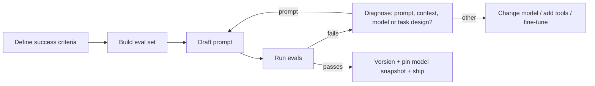

**Prompt engineering** is the practice of writing and iterating on the text (and message structure) sent to a language model so that a single call reliably produces the output you need. Because the model's weights are fixed at inference time, the prompt is the main lever you control: role/system, task, context and output format, with examples as the most common addition ([Notebook](../sources/notebook-prompt-engineering.md)). It became a discipline when GPT-3 showed that tasks could be specified purely in text, with no gradient updates ([Brown et al.](../sources/brown-2020-gpt3-few-shot.md)). It is a subset of [context engineering](context-engineering.md), which manages everything the model sees across a multi-step agent run.

## Preconditions: evals before wording

Anthropic's guide assumes three things before you touch a prompt: written success criteria, an empirical way to test against them, and a first draft ([Anthropic overview](../sources/anthropic-prompt-engineering-overview.md)). Not every failing metric is a prompt problem: latency and cost are often fixed by [model selection](model-selection.md) instead. OpenAI similarly says to build eval suites and rerun them on every prompt or model change ([OpenAI guide](../sources/openai-prompt-engineering-guide.md)). See [LLM evaluation](llm-evaluation.md).

Synthesis: the loop above combines the Anthropic preconditions with OpenAI's evals and snapshot-pinning advice.

## Anatomy of a prompt

| Part | Purpose | Where it usually goes |
|---|---|---|
| Role / identity | Who the model is, tone, expertise | [System prompt](system-prompts.md) / developer message |
| Instructions | Rules: what to do (and not do), steps, constraints | System prompt or start of prompt |
| Examples | Input → output demonstrations | System/developer message, tagged ([few-shot](few-shot-prompting.md)) |
| Context | Documents, retrieved chunks, data | Near the end of instructions, or top of the user turn for long docs |
| Input | The variable item for this call | User turn |
| Output format | Shape, length, schema | Instructions, or enforced via [structured outputs](structured-outputs.md) |

OpenAI suggests a developer message ordered Identity → Instructions → Examples → Context ([OpenAI guide](../sources/openai-prompt-engineering-guide.md)). The Notebook tutorial ranks the biggest wins as: be specific, show the format, add examples, include only relevant context ([Notebook](../sources/notebook-prompt-engineering.md)).

## Core techniques (cross-vendor)

**Clarity and directness.** Anthropic's test: if a colleague with minimal context would be confused by the prompt, the model will be too. Ask explicitly for "above and beyond" behaviour rather than hoping it is inferred ([Anthropic](../sources/anthropic-prompting-best-practices.md)). Google likewise stresses explicit constraints and response format ([Google](../sources/google-gemini-prompting-strategies.md)).

**Explain why.** Giving the reason for a rule ("output is read by a text-to-speech engine, so no ellipses") lets the model generalise beyond the literal rule ([Anthropic](../sources/anthropic-prompting-best-practices.md)).

**Positive framing and style matching.** Say what to do ("write flowing prose paragraphs") rather than what not to do; the prompt's own formatting style leaks into the output, so removing markdown from the prompt reduces markdown in the reply ([Anthropic](../sources/anthropic-prompting-best-practices.md)).

**Structure with delimiters.** All three vendors recommend delimiters. Anthropic favours XML tags (`<instructions>`, `<context>`, nested `<document index="n">` with `<source>` and `<document_content>`). OpenAI uses Markdown headers for sections and XML for document boundaries and metadata attributes ([OpenAI](../sources/openai-prompt-engineering-guide.md)). Google says pick *one* style per prompt for Gemini 3 ([Google](../sources/google-gemini-prompting-strategies.md)). Delimiters also fence untrusted data from instructions, a basic [prompt injection](prompt-injection.md) hygiene step that the OpenAI Model Spec endorses ([Model Spec](../sources/openai-model-spec.md)).

**Examples.** The most reliable way to fix format and tone; see [few-shot prompting](few-shot-prompting.md).

**Long-context ordering.** For 20k+ token inputs, Anthropic puts documents first and the question last (up to 30% better in its tests) and asks the model to extract relevant quotes before answering ([Anthropic](../sources/anthropic-prompting-best-practices.md)). Google gives the same advice for Gemini 3: data first, instructions at the end, bridged by "Based on the information above" ([Google](../sources/google-gemini-prompting-strategies.md)). This interacts with position effects documented in [long-context degradation](long-context-degradation.md) ([Lost in the Middle](../sources/lost-in-the-middle.md)).

**Reasoning.** Ask for step-by-step thinking on non-reasoning models; rely on built-in thinking and effort controls on reasoning models. See [chain-of-thought](chain-of-thought.md) and [extended thinking](extended-thinking.md).

**Decomposition / prompt chaining.** Split a task into sequential calls when you need to inspect, log or branch on intermediate outputs. Anthropic's common chain is draft → critique against criteria → refine ([Anthropic](../sources/anthropic-prompting-best-practices.md)). Google lists three shapes: one prompt per instruction (routed by input), sequential chains, and parallel operations aggregated afterwards ([Google](../sources/google-gemini-prompting-strategies.md)). These map to the workflow patterns in [agent design patterns](agent-design-patterns.md).

**Give an out.** Letting the model answer "I don't know" curbs [hallucination](hallucination.md) ([Notebook](../sources/notebook-prompt-engineering.md)).

## Prefilling and its replacement

Prefilling means supplying the start of the assistant's reply so the model continues from it, e.g. `{` to force JSON or a heading to fix structure. Google still documents this as a "completion strategy" or response prefix ([Google](../sources/google-gemini-prompting-strategies.md)). Anthropic removed it: from Claude 4.6 models onward, a prefilled final assistant turn returns a 400 error ([Anthropic](../sources/anthropic-prompting-best-practices.md)). Replacements:

| Old prefill use | Replacement on current Claude |
|---|---|
| Force JSON/YAML | [Structured outputs](structured-outputs.md) |
| Classification | Tool with an `enum` field, or structured outputs ([function calling](function-calling.md)) |
| Skip preamble | System instruction "respond directly without preamble"; strip leftovers |
| Continue a cut-off reply | Put the partial text in the user turn and ask to continue |
| Re-inject reminders | User-turn reminders, tools, compaction, or [mid-conversation system messages](system-prompts.md) |

## Model-generation drift

Prompts are not portable across model generations:

- Newer Claude models follow instructions more literally and are more responsive to the system prompt; "CRITICAL: you MUST" language written for older models now causes over-triggering of tools (Anthropic's note names Opus 4.5 and 4.6 specifically) ([Anthropic](../sources/anthropic-prompting-best-practices.md)).
- OpenAI contrasts reasoning models (give a goal, like a senior colleague) with GPT models (give precise steps, like a junior one) ([OpenAI guide](../sources/openai-prompt-engineering-guide.md), [reasoning guide](../sources/openai-reasoning-best-practices.md)).
- Google: as of 2026-11, Gemini 4 and Gemini 3.6+ ignore custom `temperature`, `top_p` and `top_k`, and Gemini 3 should not be pushed with overly persuasive language ([Google](../sources/google-gemini-prompting-strategies.md)). See [sampling parameters](sampling-parameters.md).

Synthesis: treat every model upgrade as a prompt migration: rerun evals, remove workaround instructions, and read the vendor's per-model notes.

## Prompt versioning and operations

- **Prompts live in code.** OpenAI recommends keeping production prompts in application code as small typed builder modules, reviewed and tested like any code, rolled out behind feature flags. Its hosted reusable-prompt objects are being deprecated (`v1/prompts` shutdown scheduled 2026-11-30) ([OpenAI guide](../sources/openai-prompt-engineering-guide.md)).
- **Pin model snapshots** (e.g. a dated ID) so behaviour does not shift under a fixed prompt; version the pair (prompt, model) together ([OpenAI guide](../sources/openai-prompt-engineering-guide.md)).
- **Cache-friendly layout.** Put stable content (system prompt, examples, policies) first and variable content last so [prompt caching](prompt-caching.md) hits ([OpenAI guide](../sources/openai-prompt-engineering-guide.md), [Notebook](../sources/notebook-prompt-engineering.md)). Editing the top of the prompt mid-conversation invalidates the cache; Anthropic's mid-conversation system messages exist partly to avoid this ([Anthropic mid-conversation](../sources/anthropic-mid-conversation-system-messages.md)).
- **Trace and observe** prompt versions in production ([LLM observability](llm-observability.md)); tools such as [LangSmith](langsmith.md) and [DSPy](dspy.md) automate parts of this.

## Limitations and failure modes

- **Brittleness:** small wording, order and format changes move results; Google lists rephrasing and reordering as iteration tactics precisely because of this ([Google](../sources/google-gemini-prompting-strategies.md)).
- **Over-prompting:** emphatic or blanket instructions ("if in doubt, use the tool") cause over-triggering on newer models ([Anthropic](../sources/anthropic-prompting-best-practices.md)).
- **Instruction vs data confusion:** without delimiters, instructions embedded in documents may be followed ([Model Spec](../sources/openai-model-spec.md)).
- **Ceiling:** Synthesis: prompting cannot add knowledge or skills the model lacks; when evals plateau, move to [RAG](retrieval-augmented-generation.md) for knowledge or [fine-tuning](fine-tuning.md) for consistent behaviour at scale.

## When to use / when not

Synthesis: this table distils the vendor guidance above; it is a heuristic, not a vendor recommendation.

| Situation | Reach for |
|---|---|
| Output format or tone off | Clearer format spec, examples, structured outputs |
| Missing facts | Context / retrieval, not cleverer wording |
| Multi-step reasoning errors | Thinking/effort on reasoning models; CoT on others |
| Need to inspect intermediate steps | Prompt chaining |
| Same behaviour needed at very high volume with a small model | Consider fine-tuning or distillation |
| Cost or latency target missed | Model choice, caching, shorter prompts before rewording |

## Sources

- [Prompting best practices (Anthropic)](../sources/anthropic-prompting-best-practices.md)
- [Prompt engineering overview (Anthropic)](../sources/anthropic-prompt-engineering-overview.md)
- [Mid-conversation system messages (Anthropic)](../sources/anthropic-mid-conversation-system-messages.md)
- [Prompt engineering guide (OpenAI)](../sources/openai-prompt-engineering-guide.md)
- [Reasoning best practices (OpenAI)](../sources/openai-reasoning-best-practices.md)
- [OpenAI Model Spec](../sources/openai-model-spec.md)
- [Prompt design strategies (Google Gemini)](../sources/google-gemini-prompting-strategies.md)
- [Language Models are Few-Shot Learners](../sources/brown-2020-gpt3-few-shot.md)
- [Lost in the Middle](../sources/lost-in-the-middle.md)
- [Prompt & Context Engineering (Notebook)](../sources/notebook-prompt-engineering.md)
