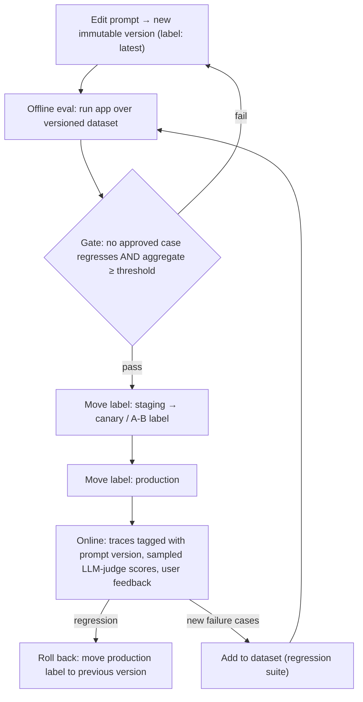

**Prompt management** is the practice of treating prompts as versioned, deployable artifacts rather than string literals scattered through code. That means a registry with an immutable version history, named pointers (labels, tags or environments) that decide which version each environment serves, runtime fetching with caching, a record on every [trace](llm-observability.md) of which version produced it, and promotion gated by [evals](llm-evaluation.md). It matters because a prompt tweak or a model upgrade can quietly break cases that used to work ([notebook](../sources/notebook-llm-evaluation.md)). Without versioning you cannot tell which prompt caused a regression or roll it back. The craft of writing the prompt itself is [prompt engineering](prompt-engineering.md). This page covers its lifecycle.

## Core mechanics (common to all registries)

1. **Immutable versions.** Each save creates a new version that never changes: numbered in Langfuse, a commit hash in LangSmith, a resolved version ID in [Braintrust](braintrust.md) (which its Ruby SDK docs call a transaction ID) ([Langfuse](../sources/langfuse-prompt-management-docs.md), [LangSmith](../sources/langsmith-prompt-management-docs.md), [Braintrust](../sources/braintrust-prompts-docs.md)).
2. **Movable pointers.** Code references a pointer, not a version. Langfuse serves `production` by default and maintains `latest` automatically. LangSmith reserves the tags `staging` and `production` for its Environments feature. Braintrust loads by environment. Deploying or rolling back means moving a pointer, with no code change.
3. **Template + variables.** Templates are `{{var}}` (Langfuse, Braintrust) or f-string/mustache (LangSmith). They come as text or chat (message list) types. Langfuse can't change a prompt's type after creation, and LangSmith recommends chat.
4. **Config travels with the prompt.** Model, [temperature](sampling-parameters.md), a [`response_format` schema](structured-outputs.md) and `tools` are versioned together with the template (Langfuse `config`, LangSmith `include_model`, Braintrust `build()` returning messages + model + params). Synthesis: this matters because a prompt is tuned for one model. Promoting new text while the model parameters stay in code silently mixes versions.
5. **Composition.** Langfuse prompt references (`@@@langfusePrompt:name=X|label=production@@@`, text prompts only) and message placeholders for chat history.
6. **Trace linkage.** Every LLM span records which prompt version produced it. Langfuse links generations and breaks latency, tokens, cost and scores down per version. Braintrust writes the prompt ID and version to `metadata.prompt` on wrapped-client spans. The OTel GenAI spec defines `gen_ai.prompt.name` and `gen_ai.prompt.version` for any backend ([OTel GenAI](../sources/opentelemetry-genai-semantic-conventions.md)).

## Runtime fetching: caching and availability

A registry sits on the request path, so how its SDK caches determines both latency and outage behaviour:

| | Langfuse | LangSmith | Braintrust |
|---|---|---|---|
| Default cache | in-memory, TTL 60 s, stale-while-revalidate | process-wide in-memory, TTL 300 s, refresh every 60 s, max 100 prompts | fetch every call; in-memory + disk cache used only on transient errors |
| Disable / bypass | `cache_ttl_seconds=0` | `skip_cache=True`, `disable_prompt_cache=True` | n/a |
| Outage behaviour | serve stale cache; optional fallback prompt if cache empty | serve cache; offline mode via `dump()`/`load()` | return last cached copy on network/429/5xx, **except** loads pinned to a version or environment, which raise |
| Uncached fetch latency | ~39 ms mean, ~69 ms p99 (vendor benchmark) | not stated | not stated |

Sources: [Langfuse](../sources/langfuse-prompt-management-docs.md), [LangSmith](../sources/langsmith-prompt-management-docs.md), [Braintrust](../sources/braintrust-prompts-docs.md).

Consequences:

- **Propagation delay:** after you move a label, instances keep serving the old version until their TTL expires. The first traces after a change may show the old version.
- **Cold start plus outage = failure.** Prefetch at startup and ship a fallback prompt. In Langfuse a call served from the fallback is not linked to any prompt version, so it shows up as unattributed.
- **Missing label = hard error.** Langfuse returns 404 with no fallback to `production`.

## Prompts in the registry vs prompts in Git

| | Registry (Langfuse, LangSmith, Braintrust, Phoenix) | Prompts as code (files in repo, e.g. promptfoo `file://`) |
|---|---|---|
| Who edits | engineers and non-engineers in a UI | engineers via PR |
| Deploy | move a label; live within the cache TTL | merge + deploy |
| Review/gate | webhooks → CI; protected labels | PR review + CI eval as a required check |
| Reproducibility | version ID on each trace | Git SHA on each trace |
| Risk | runtime dependency; edits bypass code review | slower iteration; non-engineers blocked |

Synthesis: many teams use both. The prompt is authored in Git and pushed to the registry by CI after the evals pass, so the registry serves as a deployment channel rather than the source of truth. The other direction also works: Langfuse webhooks fire on version creation and on label moves, with an HMAC-signed payload that includes the template and config. A handler can then start an eval run before anyone promotes the version ([Langfuse](../sources/langfuse-prompt-management-docs.md)). Protected labels, which need Langfuse Enterprise or Pro with the Teams add-on, stop non-admins from moving `production` ([Langfuse](../sources/langfuse-prompt-management-docs.md)). [Arize Phoenix](arize-phoenix.md) also ships prompt management alongside its playground ([Phoenix](../sources/arize-phoenix-docs.md)). The two styles can coexist: promptfoo can evaluate Langfuse-managed prompts through `langfuse://` references ([migration guide](../sources/langfuse-migrate-from-promptfoo.md)). For code-only prompts, Braintrust recommends logging your own name, version or Git SHA in span metadata ([Braintrust](../sources/braintrust-prompts-docs.md)).

## The eval-gated promotion loop

Synthesis: this diagram combines the sources below.

- **Dataset first.** Start with 20-50 cases drawn from real failures, covering happy paths, hard cases and edge cases. Never let eval cases leak into the [few-shot examples](few-shot-prompting.md) ([notebook](../sources/notebook-llm-evaluation.md), [Anthropic](../sources/anthropic-demystifying-evals-for-ai-agents.md)). OpenAI lists vibe-based evaluation and adding evals only after shipping as anti-patterns ([OpenAI](../sources/openai-evaluation-best-practices.md)).
- **Change one variable at a time** (prompt, *or* model, *or* parameters) and re-score against the baseline ([notebook](../sources/notebook-llm-evaluation.md)).
- **Gate in CI.** promptfoo exits with code 100 when tests fail or the pass rate is below `PROMPTFOO_PASS_RATE_THRESHOLD`, and its GitHub Action runs on PRs that touch prompt files ([promptfoo](../sources/promptfoo-cli-and-ci-docs.md)). Langfuse's experiment Action fails the PR on a `RegressionError`. Its docs warn that an aggregate threshold can hide a newly failing critical case. They recommend a reviewed baseline where no approved passing case may regress, treating missing results as failures, and never generating the baseline from the candidate itself ([Langfuse evals](../sources/langfuse-evaluation-docs.md)). Pin the dataset version, for example Langfuse's `dataset_version`, so the gate is reproducible.
- **Capability vs regression suites.** Regression suites should pass at close to 100%. Capability evals start low, and tasks that become saturated graduate into the regression suite ([Anthropic](../sources/anthropic-demystifying-evals-for-ai-agents.md)).
- **Online.** Compare per-version metrics after promotion (latency, tokens, cost, median score in Langfuse), and use custom labels to split traffic in A/B tests ([Langfuse](../sources/langfuse-prompt-management-docs.md)).

## Failure modes

- **Version skew:** the prompt is promoted but its config (model, schema, tools) still lives in code, or the reverse.
- **Silent edits:** a UI edit moves `production` with no eval run. Fix it with protected labels plus webhook-triggered evals.
- **Untraceable outputs:** spans lack a prompt version (unlinked calls, fallback served), so regressions can't be attributed.
- **Cache surprises:** tests read a stale cached version. Disable caching in test and dev environments.
- **Overfitting the gate:** iterating against the same small dataset until it passes. Synthesis: keep a held-out split and keep feeding in fresh production failures.
- **Leaky composition:** a referenced sub-prompt that follows `label=production` changes the parent's behaviour without a new parent version. Pin references by `version` for audited flows (Synthesis, from the reference semantics).

## When to use / when not

- **Use a registry** when non-engineers iterate on prompts, prompts change more often than code deploys, you need instant rollback, or many services share prompts.
- **Keep prompts in Git** (and still gate them with [promptfoo](promptfoo.md) or another eval) for small teams, tightly coupled prompt+code changes such as tool schemas in [function calling](function-calling.md), or regulated settings where every change must pass code review. Record the Git SHA on traces.
- For automatic prompt optimisation instead of hand edits, see [DSPy](dspy.md). Tools: [Langfuse](langfuse.md), [LangSmith](langsmith.md), [promptfoo](promptfoo.md).

## Sources

- [Langfuse prompt management documentation](../sources/langfuse-prompt-management-docs.md)
- [LangSmith prompt engineering and prompt management docs](../sources/langsmith-prompt-management-docs.md)
- [Braintrust docs: Prompts](../sources/braintrust-prompts-docs.md)
- [Langfuse evaluation, experiments and CI/CD documentation](../sources/langfuse-evaluation-docs.md)
- [Promptfoo docs: CLI, configuration guide, CI/CD and GitHub Action](../sources/promptfoo-cli-and-ci-docs.md)
- [Migrate a Promptfoo eval suite to Langfuse](../sources/langfuse-migrate-from-promptfoo.md)
- [OpenTelemetry semantic conventions for generative AI](../sources/opentelemetry-genai-semantic-conventions.md)
- [Notebook: LLM Evaluation & Observability](../sources/notebook-llm-evaluation.md)
- [Demystifying evals for AI agents (Anthropic)](../sources/anthropic-demystifying-evals-for-ai-agents.md)
- [Evaluation best practices (OpenAI)](../sources/openai-evaluation-best-practices.md)
- [Arize Phoenix and OpenInference documentation](../sources/arize-phoenix-docs.md)
