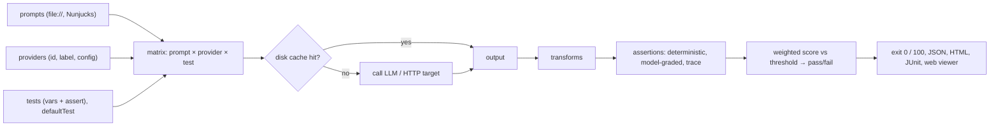

**promptfoo** is an open-source (MIT) command-line tool and Node library for [testing LLM applications](llm-evaluation.md). You describe prompts, model providers and test cases in a YAML file. `promptfoo eval` runs every combination, scores each output with **assertions**, and exits with a non-zero code when tests fail, which makes it a natural regression gate in CI. The same tool generates adversarial attacks for [red teaming](llm-red-teaming.md). Evals run locally and call the model providers directly ([CLI and CI docs](../sources/promptfoo-cli-and-ci-docs.md)). OpenAI announced on 9 March 2026 that it would acquire Promptfoo to add security testing to its Frontier agent platform. The README now says Promptfoo is part of OpenAI and remains MIT-licensed open source ([TechCrunch](../sources/techcrunch-openai-acquires-promptfoo.md), [repo](../sources/promptfoo-cli-and-ci-docs.md)).

## Mental model: the eval matrix

This flow is assembled from the [config guide, CLI docs](../sources/promptfoo-cli-and-ci-docs.md) and [assertions reference](../sources/promptfoo-assertions-docs.md).

## Configuration (`promptfooconfig.yaml`)

| Key | What it holds |
|---|---|
| `prompts` | inline strings or `file://` templates (Nunjucks: loops, conditionals, `dump` filter) |
| `providers` | model IDs or objects `{id, label, config: {temperature, ...}}`, HTTP endpoints, custom scripts |
| `tests` | cases with `vars` and `assert`; inline or loaded from CSV, JSONL, YAML/JSON, globs, JS/TS |
| `defaultTest` | shared `assert`, `vars`, `threshold`, `options` (e.g. `options.provider` = the judge model) |
| `assertionTemplates` | reusable assertion blocks referenced with `$ref` |

Vars can come from files or from scripts: a JS function, or a Python `get_var`. Transforms run in a fixed order. The provider's `transformResponse` runs first, then the test's `options.transform`, which rewrites the output before assertions run. `contextTransform` extracts the retrieved context for [RAG](retrieval-augmented-generation.md) assertions. Keep the judge model (`defaultTest.options.provider` or `--grader`) separate from the providers under test ([config guide](../sources/promptfoo-cli-and-ci-docs.md)).

## Assertions

- **Deterministic:** `equals`, `contains`, `regex`, `is-json`, `contains-json`, `is-sql`, `is-refusal`, `rouge-n`/`bleu`/`levenshtein`, `latency`, `cost`, and custom `javascript`/`python`/`webhook`.
- **Agent and trace:** `is-valid-openai-tools-call`, `tool-call-f1`, and `trajectory:tool-used`, `trajectory:tool-sequence`, `trajectory:step-count`.
- **Model-graded** ([LLM-as-judge](llm-as-judge.md)): `llm-rubric`, `g-eval`, `factuality`, `answer-relevance`, the RAG trio `context-faithfulness`/`context-recall`/`context-relevance`, `similar` ([embeddings](embeddings.md)), `classifier`, `moderation`, and `select-best` for comparisons.
- Any assertion can be negated with a `not-` prefix. Each has a `weight` (default 1; 0 records a metric without affecting the verdict) and an optional `threshold`. A test passes when its weighted score meets the test threshold. Named `metric`s and `derivedMetrics` aggregate scores across tests ([assertions](../sources/promptfoo-assertions-docs.md)).

Synthesis: put cheap deterministic checks (schema, regex, `cost`, `latency`) first and give them high weight. Reserve `llm-rubric` for qualities code can't check, and calibrate it against human labels as for any judge ([notebook](../sources/notebook-llm-evaluation.md)).

## CLI and CI gating

- `promptfoo eval` flags: `--repeat N` (repeat each case to measure [non-determinism](llm-non-determinism.md)), `-j/--max-concurrency`, `--delay`, `--filter-failing <evalId|path>`, `--filter-pattern`, `--no-cache`, `-o results.{json,html,csv,yaml,junit.xml}`, `--share/--no-share`, `--grader`, `-w/--watch`, `--table`. `promptfoo retry <evalId>` re-runs only the results that errored, and `promptfoo view` opens the local web UI.
- **Exit codes:** **100** when any test fails or the pass rate is below `PROMPTFOO_PASS_RATE_THRESHOLD` (a percentage, default 100). **1** for other errors. `PROMPTFOO_FAILED_TEST_EXIT_CODE` changes the 100.
- **Cache:** responses are cached on disk (`PROMPTFOO_CACHE_PATH`, `PROMPTFOO_CACHE_TTL`). Persisting the cache between CI runs makes unchanged cases free.
- **GitHub Action** `promptfoo/promptfoo-action@v1`: triggered on `pull_request` with a path filter on prompt files. Inputs are `github-token`, `prompts` (globs), `config` and an optional `cache-path`. It posts a PR comment that links to a before/after comparison.
- **Privacy in CI:** `PROMPTFOO_STRIP_RESPONSE_OUTPUT` and `PROMPTFOO_STRIP_TEST_VARS` keep outputs and test vars out of stored results. `--tag key=value` records pipeline metadata ([CI docs](../sources/promptfoo-cli-and-ci-docs.md)).

Synthesis, CI pattern: run the fast deterministic suite on every PR with the default 100% threshold. Run the model-graded suite with `--repeat 3` and a pass-rate threshold below 100, because judge noise otherwise makes the build flaky. Run red teaming on a nightly schedule. Anthropic's split fits this: regression suites should sit near 100%, while capability suites start low ([Anthropic](../sources/anthropic-demystifying-evals-for-ai-agents.md)).

## Red teaming

Red teaming has three steps: `redteam generate` builds attacks, `redteam run` executes and grades them, and `redteam report` summarises the results. Two config axes control what gets generated:

- **Plugins** say *what* failure to probe, for example `harmful:*`, `pii:direct`, `contracts`, `competitors`, `rbac`, and BOLA/BFLA authorisation tests. `numTests` defaults to 5 per plugin.
- **Strategies** say *how* the payload is delivered. The defaults are `basic`, `jailbreak:meta` and `jailbreak:composite`. Others include static jailbreak templates, `crescendo` (multi-turn escalation), `goat` (an attacker agent) and `base64` encoding.

`purpose` describes the target so attacks and grading are tailored to it, and `injectVar` names the variable that receives the payload. Framework presets (`owasp:llm`, `owasp:api`, `nist:ai:measure`, `mitre:atlas`) map findings to compliance reports. Targets can be provider IDs, HTTP endpoints or `file://` scripts. Attack **generation uses Promptfoo's remote service by default**, while the target always runs locally. Setting `PROMPTFOO_DISABLE_REDTEAM_REMOTE_GENERATION=true` keeps generation local, at generally lower quality. That matters for air-gapped or regulated clients ([red team docs](../sources/promptfoo-red-team-docs.md)). See [prompt injection](prompt-injection.md) and [jailbreaks](jailbreaks.md).

## promptfoo vs platform tools

| Dimension | promptfoo | [Langfuse](langfuse.md) / [LangSmith](langsmith.md) / [Braintrust](braintrust.md) |
|---|---|---|
| Authoring | declarative YAML, 30+ assertion types | code (Python/TS) evaluators + UI judges |
| Where results live | local files / local viewer / optional share | hosted experiments next to production traces |
| Online eval of prod traffic | no | yes |
| Model/prompt matrix | built-in | write the loop yourself |
| Red teaming | built-in | not built in |
| CI signal | exit code 100 | Langfuse: `RegressionError` in a GitHub Action |

Langfuse's migration guide confirms these trade-offs. Assertion `weight`/`threshold` and per-item `latency`/`cost` checks have no direct Langfuse equivalent, red teaming has none at all, and promptfoo can read Langfuse-[managed prompts](prompt-management.md) through `langfuse://` ([migration guide](../sources/langfuse-migrate-from-promptfoo.md), [Langfuse CI](../sources/langfuse-evaluation-docs.md)).

## Failure modes and limits

- **Flaky gates:** model-graded assertions and sampling randomness ([sampling parameters](sampling-parameters.md)) can flip verdicts between runs. Use `--repeat`, a pass-rate threshold, and temperature 0 where the provider supports it (Synthesis).
- **Stale cache:** the cache can hide a provider-side model change. Use `--no-cache` or a TTL for release-gating runs (Synthesis, based on the documented cache behaviour).
- **Average hides regressions:** a pass-rate threshold below 100 can mask a newly failing critical case. Keep critical cases in a separate config gated at 100% (Synthesis; Langfuse's docs make the same point about aggregate gates).
- **Judge self-preference and bias:** use a different model family for `--grader` than the one under test ([LLM-as-judge](llm-as-judge.md)).
- **Data egress:** red-team generation goes to a remote service by default, and `--share` uploads results.
- **Vendor trajectory:** OpenAI now owns the project. The open-source licence is unchanged, but future roadmap priorities follow OpenAI Frontier (Synthesis).

## When to use / when not

- **Use** for prompt and model regression tests in CI, side-by-side model comparisons during [model selection](model-selection.md), RAG assertion suites, and pre-launch [red teaming](llm-red-teaming.md). It needs no server, which suits a quick PoC at a client site ([PoC to production](poc-to-production.md)).
- **Don't use alone** when you need production tracing, online scoring or a UI where non-engineers review results. Pair it with an [observability](llm-observability.md) platform such as [Langfuse](langfuse.md).

## Sources

- [Promptfoo docs: CLI, configuration guide, CI/CD and GitHub Action](../sources/promptfoo-cli-and-ci-docs.md)
- [Promptfoo docs: Assertions and metrics](../sources/promptfoo-assertions-docs.md)
- [Promptfoo docs: Red team overview and configuration](../sources/promptfoo-red-team-docs.md)
- [OpenAI acquires Promptfoo (TechCrunch)](../sources/techcrunch-openai-acquires-promptfoo.md)
- [Migrate a Promptfoo eval suite to Langfuse](../sources/langfuse-migrate-from-promptfoo.md)
- [Langfuse evaluation, experiments and CI/CD documentation](../sources/langfuse-evaluation-docs.md)
- [Notebook: LLM Evaluation & Observability](../sources/notebook-llm-evaluation.md)
- [Demystifying evals for AI agents (Anthropic)](../sources/anthropic-demystifying-evals-for-ai-agents.md)
