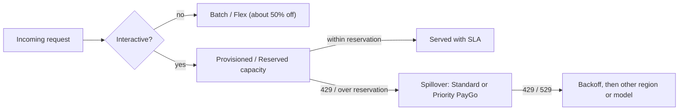

**Provisioned throughput** is LLM inference capacity reserved for one customer and one model, bought in provider-defined units for a fixed term and billed whether or not you use it. In return, requests within the reservation are served ahead of shared pay-as-you-go traffic and come with throughput, uptime or latency targets that shared capacity does not offer. Every major platform sells a version of it: Azure's **PTUs**, Vertex AI's **GSUs**, Bedrock's **model units** and **Reserved tier**, and OpenAI's **Scale Tier** and **Reserved Tier**. Anthropic's Priority Tier commitment was the direct-API equivalent and is no longer sold. Provisioned throughput is the capacity-planning counterpart to [rate limits and retries](rate-limits-and-retries.md).

## Why it exists

Shared pay-as-you-go capacity gives no assured throughput under contention. On Vertex Standard PayGo a 429 means temporary contention rather than a fixed quota ([source](../sources/vertex-ai-standard-paygo-usage-tiers.md)), and standard deployments have no latency SLA on Azure ([source](../sources/microsoft-foundry-provisioned-throughput.md)). Provisioned capacity targets real-time production with predictable traffic and cost. Vertex serves PT requests ahead of on-demand ([source](../sources/vertex-ai-provisioned-throughput.md)). Azure positions PTUs for predictable, latency-sensitive, high-volume interactive workloads, and keeps standard deployments for dev, test and spiky traffic ([source](../sources/microsoft-foundry-provisioned-throughput.md)).

## The offerings compared (November 2026)

| Platform | Unit | Terms | Overflow | Notes |
|---|---|---|---|---|
| Azure AI Foundry | PTU: model-independent quota; each model has its own input TPM per PTU | Hourly $/PTU/hr, or 1-month / 1-year Azure Reservation discount | Optional spillover to a standard deployment on 429 (`x-ms-spillover-deployment`) | Global / Data Zone / Regional deployment types; minimum 15 PTUs (Global/Data Zone) for most GPT-5.x models; per-model latency targets ([concepts](../sources/microsoft-foundry-provisioned-throughput.md), [sizing](../sources/microsoft-foundry-ptu-sizing.md)) |
| Vertex AI | GSU (generative AI scale unit), throughput per second per model | 1 week, 1 month, 3 months, 1 year (1 year about 26% cheaper than 1 month) | Spill to Standard/Priority PayGo | Unused throughput doesn't roll over; PT spend counts toward PayGo usage tiers ([PT](../sources/vertex-ai-provisioned-throughput.md), [options](../sources/vertex-ai-consumption-options.md), [tiers](../sources/vertex-ai-standard-paygo-usage-tiers.md)) |
| Amazon Bedrock: Provisioned Throughput | Model unit (MU): guaranteed input and output TPM for one model | Hourly; no commitment, 1 month or 6 months | n/a | Required for most custom models; not usable via cross-Region inference profiles ([PT](../sources/aws-bedrock-provisioned-throughput.md), [CRIS](../sources/aws-bedrock-cross-region-inference.md)) |
| Amazon Bedrock: Reserved tier | Reserved input and output TPM | 1 or 3 months, fixed price per 1K TPM, monthly | Overflow to Standard | Minimum 100K input / 10K output TPM; 99.5% uptime target; quota separate from on-demand ([source](../sources/aws-bedrock-service-tiers.md)) |
| OpenAI: Scale Tier | Token units per minute for one model snapshot | 30-day minimum | Spillover to Standard (not to Fast mode) | 99.9% uptime SLA; models before GPT-5.6 ([Scale](../sources/openai-scale-and-reserved-tier.md), [Fast](../sources/openai-fast-mode-priority-processing.md)) |
| OpenAI: Reserved Tier | Dollars per minute for one model | Enterprise contract | Overage billed pay-as-you-go | GPT-5.6 onward; covers Standard and Fast, not Batch or Flex ([source](../sources/openai-scale-and-reserved-tier.md)) |
| Anthropic: Priority Tier (legacy) | Input TPM + output TPM for one model version | 1, 3, 6, 12 months | Automatic fallback to Standard | 99.5% uptime target; no new sales; not offered for most 5.x-generation models (Fable 5 is the exception) ([source](../sources/anthropic-service-tiers-docs.md)) |

Pay-per-token premium tiers such as OpenAI Fast mode, Azure priority processing, Bedrock `priority` and Vertex Priority PayGo buy queue position without a reservation. They are the no-commitment alternative when you need lower latency but cannot forecast load ([OpenAI](../sources/openai-fast-mode-priority-processing.md), [Azure](../sources/microsoft-foundry-provisioned-throughput.md)).

## How a unit converts tokens: burndown weights

Every scheme normalises the token mix into one "input-token-equivalent" currency, weighting each token type roughly by its price:

- **Azure:** normalized TPM = input TPM × (1 − cache rate) + output-to-input ratio × output TPM. The ratio follows the Global Standard price ratio (gpt-5: 8, gpt-4.1: 4). GPT-6 and later use full normalized-token weights in which cached input, cache writes and long-context tokens all count (GPT-6 Sol: cached input 0.1, cache write 1.25, output 5, long-context output 7.5; GPT-6.1 Sol halves cached input to 0.05). Older models deduct cached input entirely ([source](../sources/microsoft-foundry-ptu-sizing.md)).
- **Vertex:** input 1x, cached input 0.1x, output 5x for the Gemini 3.6 Flash example, at 675 tokens/s per GSU ([source](../sources/vertex-ai-provisioned-throughput.md)).
- **Anthropic Priority Tier:** cache reads 0.1, 5-minute cache writes 1.25, 1-hour writes 2.0, US-only inference 1.1 ([source](../sources/anthropic-service-tiers-docs.md)).
- **Bedrock Reserved:** sizing must include cache-write tokens ([source](../sources/aws-bedrock-service-tiers.md)). Bedrock's on-demand quotas use separate output burndown multipliers of 2.5x–15x for Claude models depending on version ([source](../sources/aws-bedrock-token-quotas.md)).

Consequence: output-heavy workloads such as reasoning, long generation and agents burn capacity far faster than their raw token counts suggest. A high cache-hit rate shrinks the reservation you need, which makes [prompt caching](prompt-caching.md) a sizing lever as well as a cost lever.

## Sizing it

The method is the same on every platform: size for **peak**, not average, then round up to the unit increment.

1. Measure or forecast peak RPM (or QPS), average input tokens, average output tokens and cache-hit rate per model. Use real traces from a pilot, because the calculator assumes a single prompt and response size ([source](../sources/microsoft-foundry-ptu-sizing.md)).
2. Convert to normalized tokens per minute (or per second on Vertex) with the model's weights.
3. Divide by the per-unit throughput and round up to the minimum and increment.

Worked example, Azure ([source](../sources/microsoft-foundry-ptu-sizing.md)): gpt-5.2 on Data Zone, 1,000 RPM × 200 input / 20 output tokens. Normalized TPM = 200,000 + 8 × 20,000 = 360,000. At 3,400 input TPM per PTU that is 105.9, rounded to **110 PTUs**. With a 50% cache rate: 100,000 + 160,000 = 260,000, which gives **80 PTUs**. Worked example, Vertex: 30,000 tokens/s of input-equivalents at 675 per GSU gives 45 GSUs ([source](../sources/vertex-ai-provisioned-throughput.md)).

Synthesis: to get from users to RPM, use Little's Law. In-flight requests = throughput × latency ([source](../sources/notebook-concurrency-design.md)). If a launch expects 2,000 concurrent chat sessions sending one turn every 30 s, that is about 67 requests/s, or 4,000 RPM. Agent workloads multiply this by the number of model calls per user turn. Add headroom for the peak-to-average ratio, then decide how much of the peak to reserve and how much to spill.

## Quota is not capacity

On Azure, PTU quota is a free policy limit per subscription, region and deployment type. Capacity is the actual GPUs available for a model in a region when you deploy. Having quota doesn't guarantee a deployment will succeed, and scaling down releases capacity you may never get back ([concepts](../sources/microsoft-foundry-provisioned-throughput.md), [billing](../sources/microsoft-foundry-ptu-billing.md)). Hence Microsoft's two rules: **deploy first, then buy the reservation** (reservations are a billing discount that does not reserve capacity), and **don't scale PTUs with daily traffic** to save on hourly billing ([source](../sources/microsoft-foundry-ptu-billing.md)). Bedrock commitments can't be deleted before term end, and per-MU throughput and increases go through the AWS account team ([source](../sources/aws-bedrock-provisioned-throughput.md)). Lead times are measured in days or weeks, not minutes.

## Layered capacity: the reference pattern

This mirrors Google's suggested pattern: PT for the steady baseline, spill to Standard or Priority PayGo, Batch for backlogs, Flex for tolerant work ([source](../sources/vertex-ai-consumption-options.md)). Azure implements the spill step natively with spillover ([source](../sources/microsoft-foundry-provisioned-throughput.md)), and Bedrock Reserved, Anthropic Priority and OpenAI Scale/Reserved overflow automatically to standard capacity ([Bedrock](../sources/aws-bedrock-service-tiers.md), [Anthropic](../sources/anthropic-service-tiers-docs.md), [OpenAI](../sources/openai-scale-and-reserved-tier.md)). The last hop belongs to [model routing and fallbacks](model-routing-and-fallbacks.md), usually in an [LLM gateway](llm-gateways.md).

## Economics: when it pays

Microsoft's own illustration finds a GPT-6 Sol PTU at 100% sustained utilization costs about the same per normalized token as pay-as-you-go, and any lower utilization makes PTU more expensive per token. The illustration assumes $260 per PTU-month with no reservation discount, so it is a capacity comparison, not a quote ([source](../sources/microsoft-foundry-ptu-sizing.md)). Discounts come from term length: Azure reservations ([source](../sources/microsoft-foundry-ptu-billing.md)), Vertex 1-year terms ([source](../sources/vertex-ai-consumption-options.md)) and Bedrock longer commitments ([source](../sources/aws-bedrock-provisioned-throughput.md)).

Synthesis: treat provisioned throughput as buying **reliability and latency**, not cheaper tokens. It is worth it when one of these holds:

- Contractual SLAs or user-facing latency need guaranteed capacity.
- Peak traffic regularly hits shared-pool 429s, or OpenAI ramp limits push you toward Scale Tier ([source](../sources/openai-fast-mode-priority-processing.md)), or Reserved Tier for GPT-5.6 onward, whose purchases raise rate limits ([source](../sources/openai-scale-and-reserved-tier.md)).
- A custom or fine-tuned model can only be served that way ([source](../sources/aws-bedrock-provisioned-throughput.md)).
- Utilization of the reserved baseline stays high around the clock, for example global traffic or background agents filling troughs.

Reserve the floor of your daily curve and spill the peaks, rather than reserving the peak.

## Failure modes

- **Sizing on averages or `max_tokens`-free estimates:** p95 prompt sizes and output-heavy routes exceed the reservation, and requests 429 even though "we bought capacity".
- **Ignoring output and cache weights:** a reasoning model at 5x–8x output weight needs several times the units of a chat model with the same raw tokens.
- **Model lock-in:** most units bind to one model or snapshot (Bedrock MU, OpenAI Scale Tier, Anthropic Priority) ([sources](../sources/aws-bedrock-provisioned-throughput.md), [OpenAI](../sources/openai-scale-and-reserved-tier.md), [Anthropic](../sources/anthropic-service-tiers-docs.md)). A model upgrade mid-term strands the commitment. Azure's model-independent PTU quota and reservations are the exception ([source](../sources/microsoft-foundry-ptu-billing.md)).
- **Residency mismatch:** Global deployments route anywhere and Regional deployments hold strict residency, and reservations don't transfer between deployment types ([source](../sources/microsoft-foundry-ptu-billing.md)). Bedrock PT can't use cross-Region profiles ([source](../sources/aws-bedrock-cross-region-inference.md)). See [enterprise LLM deployment](enterprise-llm-deployment.md).
- **No spill path:** without spillover or fallback, PT turns a traffic spike into hard 429s.
- **Silent tier changes:** verify the tier actually applied in responses and metrics (Bedrock `ResolvedServiceTier`, Anthropic `usage.service_tier`) ([Bedrock](../sources/aws-bedrock-service-tiers.md), [Anthropic](../sources/anthropic-service-tiers-docs.md)).

## Capacity planning checklist for an enterprise launch

Synthesis, drawing on the sources above:

1. Build a traffic model: users → sessions → model calls per turn → tokens in/out/cached per call, at p50 and p95, per model.
2. Convert it to each platform's currency (normalized TPM, GSU, MU, ITPM/OTPM) and compare with current tier limits and quotas.
3. Request quota or tier increases and provisioned capacity weeks ahead. Confirm *capacity*, not only quota, in the target regions.
4. Load-test at the target concurrency against the real deployment. Watch utilization, 429 rate and TTFT.
5. Ship with spillover, client-side rate limiting, jittered retries and a fallback model.
6. Ramp gradually behind feature flags to stay under ramp limits ([source](../sources/openai-fast-mode-priority-processing.md)), and move offline work to [batch processing](batch-processing.md).
7. After launch, re-size from observed utilization, then buy the term discount ([LLM observability](llm-observability.md), [cost and latency optimization](cost-and-latency-optimization.md)).

Platform specifics live on [Azure AI Foundry](azure-ai-foundry.md), [Google Vertex AI](google-vertex-ai.md) and [Amazon Bedrock](amazon-bedrock.md).

## Sources

- [Microsoft Foundry: provisioned throughput](../sources/microsoft-foundry-provisioned-throughput.md)
- [Microsoft Foundry: PTU sizing](../sources/microsoft-foundry-ptu-sizing.md)
- [Microsoft Foundry: PTU billing and reservations](../sources/microsoft-foundry-ptu-billing.md)
- [Vertex AI provisioned throughput](../sources/vertex-ai-provisioned-throughput.md)
- [Vertex AI consumption options](../sources/vertex-ai-consumption-options.md)
- [Vertex AI Standard PayGo and usage tiers](../sources/vertex-ai-standard-paygo-usage-tiers.md)
- [Amazon Bedrock provisioned throughput](../sources/aws-bedrock-provisioned-throughput.md)
- [Amazon Bedrock service tiers](../sources/aws-bedrock-service-tiers.md)
- [Amazon Bedrock cross-Region inference](../sources/aws-bedrock-cross-region-inference.md)
- [Amazon Bedrock token quotas](../sources/aws-bedrock-token-quotas.md)
- [OpenAI Scale Tier and Reserved Tier](../sources/openai-scale-and-reserved-tier.md)
- [OpenAI Fast mode](../sources/openai-fast-mode-priority-processing.md)
- [Anthropic service tiers](../sources/anthropic-service-tiers-docs.md)
- [Notebook: Concurrency design](../sources/notebook-concurrency-design.md)
