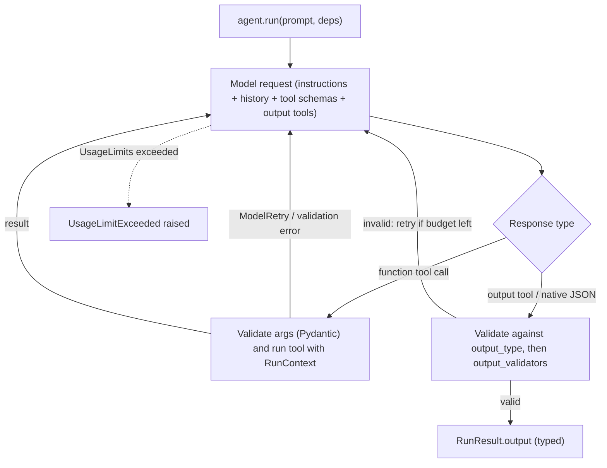

**Pydantic AI** is a model-agnostic Python agent framework built by the team behind the Pydantic validation library. The docs say agents are designed for reuse, like FastAPI apps. One `Agent` class, generic in its **dependency type** and **output type** (`Agent[Deps, Output]`), bundles instructions, tools, an output schema, a default model and settings. Pydantic validates tool arguments and final output, and validation errors are fed back to the model to retry. You select a model with a `"<provider>:<model>"` string (`openai:`, `anthropic:`, `google:`, `bedrock:`, ...), so swapping providers is a one-string change ([Pydantic AI docs](../sources/pydantic-ai-docs.md)). Version as of 2026-11-14: **v2.68.0**. V1 shipped in September 2025 with an API-stability promise; V2.0.0 went stable on 2026-06-23.

## Core API

```python
@dataclass
class Deps:
    db: DatabaseConn
    customer_id: int

class Answer(BaseModel):
    advice: str
    risk: int = Field(ge=0, le=10)

agent = Agent("anthropic:<model>", deps_type=Deps, output_type=Answer,
              instructions="You are a bank support agent.")

@agent.tool
async def balance(ctx: RunContext[Deps], include_pending: bool) -> float:
    """Return the customer's balance.

    Args:
        include_pending: include pending transactions.
    """
    return await ctx.deps.db.balance(ctx.deps.customer_id, include_pending)

result = await agent.run("What's my balance?", deps=Deps(db, 123),
                         usage_limits=UsageLimits(request_limit=5))
result.output  # typed as Answer
```

Synthesis: an illustrative sketch assembled from the documented APIs, not copied from the docs.

| Concept | Mechanism |
|---|---|
| **Run modes** | `run()` (async), `run_sync()`, `run_stream()` (stream text or partial structured output), `run_stream_events()` (all events), `iter()` (step through the underlying graph node by node) |
| **Dependencies** | Any type (usually a dataclass) passed as `deps=` per run and reached via `RunContext[Deps]` in tools, dynamic instructions and output validators. Type-checked, and replaceable in tests |
| **Tools** | `@agent.tool` (gets `RunContext`) and `@agent.tool_plain`. The JSON schema comes from the signature; descriptions come from the docstring (Google, NumPy and Sphinx styles, parsed with griffe). Raising `ModelRetry` sends a message back so the model can fix its call |
| **Toolsets / MCP** | Group tools; MCP servers plug in as toolsets ([MCP in practice](mcp-in-practice.md)) |
| **Capabilities** | "The primary extension point": reusable bundles of tools, lifecycle hooks, instructions, model settings and model selection (memory, guardrails, cost tracking, approvals). They can be loaded on demand by the model. A separate Harness package ships prebuilt `Coder` and `Researcher` agents |
| **Message history** | Pass prior messages to continue a conversation |

Sources: [docs](../sources/pydantic-ai-docs.md).

## Structured output modes

`output_type` accepts scalars, TypedDicts, dataclasses, Pydantic models, unions and output functions ([docs](../sources/pydantic-ai-docs.md)):

| Mode | How | Trade-off |
|---|---|---|
| **Tool Output** (default) | Each output type becomes an "output tool" whose parameters schema is the type; unions become one tool per member to keep schemas simple | Works on nearly every model with [function calling](function-calling.md) |
| `NativeOutput` | Provider JSON-schema response format ([structured outputs](structured-outputs.md)) | Constrained decoding, but not all models support it, with schema restrictions; older Gemini models could not combine it with function tools |
| `PromptedOutput` | Schema placed in the instructions (plus JSON mode if available), then validated | Universal but least reliable |
| `TextOutput` | Plain text passed to a function | For free text |

`@agent.output_validator` adds async or IO checks (e.g. run an EXPLAIN on generated SQL). Each `ModelRetry` raised there consumes the output retry budget, which **defaults to 1** (`retries={'output': N}`).



Synthesis: the diagram summarizes the documented loop; it is not drawn in the docs.

## Production features

- **Usage limits.** `UsageLimits(request_limit=..., tool_calls_limit=..., token limits)` guard against runaway loops. Exceeding a limit **raises** `UsageLimitExceeded` instead of returning partial output. `tool_calls_limit` is checked before execution, so a parallel batch that would exceed it runs none of its calls ([docs](../sources/pydantic-ai-docs.md)).
- **Durable execution.** Nine engines: Temporal, DBOS, Prefect, Restate, AWS Lambda, Absurd, pgtask, Azure Durable Task and Airflow. They journal model and tool calls, so a restarted run replays the completed ones and retries the one in flight. The docs separate this from **persistence** (saving, resuming or forking a run), which needs no engine.
- **Observability.** OpenTelemetry instrumentation, with Pydantic Logfire as the first-party backend ([LLM observability](llm-observability.md)).
- **Evals and graphs.** Pydantic Evals for [evaluation](llm-evaluation.md); `pydantic-graph` (typed nodes, edges from return types, persistence) when control flow is a real state machine ([comparisons](../sources/pydantic-ai-framework-comparisons.md)).
- **Testing.** `TestModel` and `FunctionModel` replace real models, `Agent.override` swaps model, deps or toolsets, and `ALLOW_MODEL_REQUESTS=False` blocks accidental real calls in CI ([docs](../sources/pydantic-ai-docs.md)).
- **UI interop.** `VercelAIAdapter` speaks the Vercel AI data stream protocol, so a React `useChat` frontend can drive a Python agent; AG-UI is also supported ([comparisons](../sources/pydantic-ai-framework-comparisons.md)).

## Limitations and failure modes

- **Small default retry budget.** One output retry by default; a weak model failing a complex schema twice raises an error. Raise `retries` deliberately, and simplify schemas.
- **Dangling tool calls when streaming.** `run_stream()` and `run_stream_sync()` treat the first output matching the output type as final. So if the model returns text *and* tool calls while `output_type` is `str`, those tool calls are **not executed** unless `end_strategy` is `'graceful'` or `'exhaustive'`, and even then their results are not sent back ([docs](../sources/pydantic-ai-docs.md)).
- **A hard stop on request limits.** A run that hits `request_limit` raises even when the model has already gathered what it needs. The docs suggest a capability that warns the model as it nears the limit.
- **Fast-moving API.** Minor releases have carried breaking changes; for example, v2.60.0 (2026-10-22) stopped recording `RetryPromptPart`, so `isinstance` checks silently match nothing ([docs](../sources/pydantic-ai-docs.md)). Pin versions and read the upgrade guide.
- **Python only.** For a TypeScript stack, see the [Vercel AI SDK](vercel-ai-sdk.md).
- **Vendor-written comparisons.** The feature tables comparing Pydantic AI with LangChain and Vercel are written by Pydantic ([comparisons](../sources/pydantic-ai-framework-comparisons.md)).

## When to use / when not

| Situation | Choice |
|---|---|
| Python backend; typed, validated outputs; tools that need DB or HTTP clients; unit-testable agent code | Pydantic AI |
| Complex multi-agent graphs with checkpointed state as the core problem | [LangGraph](langgraph.md), or `pydantic-graph` |
| Retrieval quality over large or messy corpora | [LlamaIndex](llamaindex.md) for ingestion and retrieval, exposed as a Pydantic AI tool |
| Systematic prompt optimization against a metric | [DSPy](dspy.md) |
| Single provider, a couple of calls, provider-specific features on day one | Raw SDK ([Anthropic](../sources/anthropic-building-effective-agents.md)); see also [Claude Agent SDK](claude-agent-sdk.md) and [OpenAI Agents SDK](openai-agents-sdk.md) |
| Next.js/React product | [Vercel AI SDK](vercel-ai-sdk.md) end to end, or Pydantic AI behind `useChat` |

Synthesis: of the four frameworks here, Pydantic AI is the thinnest layer over a raw SDK. It adds a loop, validation, dependency injection and testing, and keeps control flow in plain Python. That leaves it with less hidden behaviour than most frameworks, the property Anthropic's guidance values ([Anthropic](../sources/anthropic-building-effective-agents.md)).

## Sources

- [Pydantic AI documentation](../sources/pydantic-ai-docs.md)
- [Pydantic AI framework comparison pages](../sources/pydantic-ai-framework-comparisons.md)
- [Building effective agents (Anthropic)](../sources/anthropic-building-effective-agents.md)
