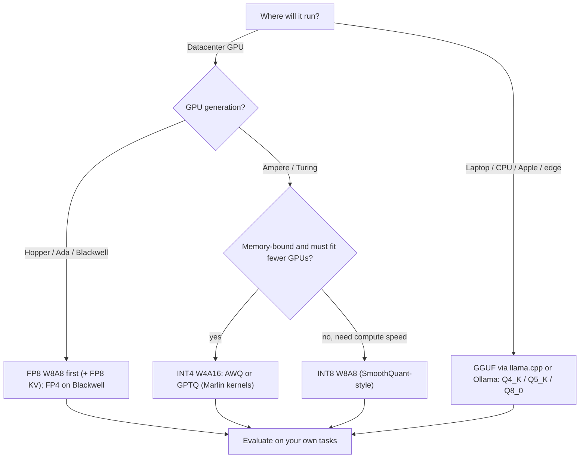

**Quantization** maps a model's numbers (weights, and optionally activations and the [KV cache](kv-cache.md)) from 16- or 32-bit floats to lower-precision formats such as FP8, INT8 or INT4. LLM decoding is memory-bandwidth bound, so fewer bytes per weight means less data moved per token. That gives more tokens per second, fewer GPUs, and more room for KV cache. The price is some approximation error, which grows unevenly as bits go down ([Notebook tutorial](../sources/notebook-quantization-pruning.md), [NVIDIA](../sources/nvidia-mastering-llm-inference-optimization.md)).

## Mechanics

**Affine mapping.** A real value r is represented by an integer q using a scale S and a zero-point Z: `q = round(r/S) + Z`, `r ≈ S(q − Z)`. Symmetric schemes set Z = 0. The granularity of S trades accuracy against overhead: per-tensor, per-channel (per output row), or per-group (e.g. every 32-256 weights). GGUF's K-quants, for example, use blocks of 16-32 weights grouped into super-blocks, each with its own scale and min ([Notebook](../sources/notebook-quantization-pruning.md), [GGUF docs](../sources/hugging-face-gguf-docs.md)).

**Outliers are the enemy.** One large value stretches the range, coarsens S, and costs precision for every ordinary value. Weights are fairly well behaved. Activations contain systematic outlier channels, which is why activation quantization is harder ([Notebook](../sources/notebook-quantization-pruning.md), [NVIDIA](../sources/nvidia-mastering-llm-inference-optimization.md), [LLM.int8()](../sources/llm-int8-paper.md)).

**Naming: WxAy.** W4A16 means 4-bit weights with 16-bit activations ("weight-only"). The weights are dequantized on the fly inside the matmul kernel, which saves memory and bandwidth but runs the arithmetic at 16-bit. W8A8 quantizes both, so the matmul itself runs on INT8 or FP8 tensor cores and also gains compute throughput ([vLLM docs](../sources/vllm-quantization-docs.md), [SmoothQuant](../sources/smoothquant-paper.md)). Synthesis: weight-only methods help most in memory-bound decode at small batch sizes. W8A8 helps more in compute-bound prefill and large batches.

**PTQ vs QAT.** Post-training quantization needs no retraining, only a small calibration set for static ranges or methods like GPTQ/AWQ. Quantization-aware training simulates rounding during training and holds up better at very low bit widths, at the cost of a training run ([Notebook](../sources/notebook-quantization-pruning.md)).

## Formats and methods

| Method | Scheme | How it works | Notes |
|---|---|---|---|
| **FP8 (E4M3 / E5M2)** | W8A8 float, also KV | 8-bit floats: E4M3 (more precision) or E5M2 (more range). Matched 16-bit quality in training up to 175B; works for PTQ where INT8 failed | Needs Ada/Hopper+ for native FP8 math ([FP8 paper](../sources/fp8-formats-paper.md), [vLLM](../sources/vllm-quantization-docs.md)) |
| **LLM.int8() (bitsandbytes)** | W8A8 with 16-bit outliers | Vector-wise INT8, with outlier feature dimensions (<0.1% of values) routed through an FP16 matmul | Halves memory with no degradation up to 175B; easy, but not the fastest ([LLM.int8()](../sources/llm-int8-paper.md)) |
| **SmoothQuant** | W8A8 INT8 | Divides activations by per-channel factors and multiplies weights by them, moving outliers into the easier-to-quantize weights | Up to 1.56x faster, 2x less memory, negligible loss ([SmoothQuant](../sources/smoothquant-paper.md)) |
| **GPTQ** | W4A16 / W3A16 | Layer-by-layer rounding, using approximate second-order (Hessian) information from calibration data to compensate each rounding error in the remaining weights | 175B model in about 4 GPU-hours; 3.25x (A100) / 4.5x (A6000) faster than FP16 ([GPTQ](../sources/gptq-paper.md)) |
| **AWQ** | W4A16 | Finds the ~1% salient weight channels from **activation** statistics and scales them up before rounding (an equivalent transform, no mixed precision, no backprop) | Generalizes well across domains; MLSys 2024 best paper ([AWQ](../sources/awq-paper.md)) |
| **GGUF (llama.cpp)** | Many: Q8_0 … Q2_K, IQ1-IQ4, MXFP4 | Single-file format with tensors plus metadata; block-wise K-quants (Q4_K = 4.5 bpw, Q5_K = 5.5, Q6_K ≈ 6.56) and importance-matrix I-quants (IQ4_XS = 4.25 bpw, IQ2_XXS = 2.06) | The local/CPU/Apple ecosystem (llama.cpp, Ollama, LM Studio) ([GGUF docs](../sources/hugging-face-gguf-docs.md)) |
| **NF4 (QLoRA)** | 4-bit weights for fine-tuning | Frozen 4-bit base with LoRA adapters trained on top | For training on small GPUs; see [PEFT and LoRA](peft-and-lora.md) ([Notebook](../sources/notebook-quantization-pruning.md)) |
| **FP4 (NVFP4/MXFP4)** | 4-bit float | Supported by TensorRT-LLM on Blackwell (B200); MXFP4 is also a GGUF type | Newest tier as of 2026 ([TensorRT-LLM](../sources/tensorrt-llm-overview.md), [GGUF docs](../sources/hugging-face-gguf-docs.md)) |

Note the bits-per-weight: the stored scales and mins add overhead, so "4-bit" GGUF Q4_K is really 4.5 bpw ([GGUF docs](../sources/hugging-face-gguf-docs.md)).

## Choosing a method

Synthesis: this decision tree combines the hardware matrix in the [vLLM docs](../sources/vllm-quantization-docs.md), the FP8/FP4 support in [TensorRT-LLM](../sources/tensorrt-llm-overview.md) and the method trade-offs above. It is not a recipe taken from any single source.

Engine support (as of 2026-11): vLLM loads AWQ, GPTQ, bitsandbytes, GGUF, FP8, INT8 W8A8 and LLM Compressor / ModelOpt / Quark checkpoints. AWQ needs Turing or newer, Marlin kernels need Turing/Ampere or newer, and FP8 W8A8 needs Ada/Hopper (or AMD) ([vLLM docs](../sources/vllm-quantization-docs.md)). TensorRT-LLM targets FP8 on Hopper and FP4 on Blackwell ([TensorRT-LLM](../sources/tensorrt-llm-overview.md)). TGI supported bitsandbytes and GPTQ but is now in maintenance mode ([TGI docs](../sources/tgi-docs.md)).

## Sizing impact

Synthesis: weight memory ≈ parameters × bits / 8. A 70B-class model is about 140 GB in BF16, about 70 GB in FP8/INT8, and about 35-40 GB at 4-bit (plus scale overhead). Databricks notes that going from 16-bit to 8-bit can halve the GPU count for Llama2-70B, and 4-bit can bring models onto consumer hardware ([Databricks](../sources/databricks-llm-inference-performance-engineering.md)). On a fixed GPU count, the freed memory becomes KV cache and therefore concurrency (see the worked example in [KV cache](kv-cache.md)). The KV cache can itself be stored in FP8, which halves it relative to BF16. Calibrate its scales ([vLLM KV docs](../sources/vllm-quantized-kv-cache-docs.md)).

## Limitations and failure modes

- **Uneven degradation.** 8-bit is usually near-lossless and 4-bit is often a good trade. Below that, quality drops faster, and reasoning and rare knowledge suffer more than perplexity shows ([Notebook](../sources/notebook-quantization-pruning.md)). Results vary by architecture and size, so evaluate the whole system on your own tasks ([Databricks](../sources/databricks-llm-inference-performance-engineering.md)). See [LLM evaluation](llm-evaluation.md).
- **Smaller ≠ faster** unless kernels and hardware support the format. An INT4 model on unsupported hardware may be no quicker ([Notebook](../sources/notebook-quantization-pruning.md)). Weight-only INT4 still computes in 16-bit ([vLLM docs](../sources/vllm-quantization-docs.md)).
- **Calibration overfitting.** Reconstruction-based methods can overfit the calibration set. AWQ avoids backprop and reconstruction partly for this reason ([AWQ](../sources/awq-paper.md)). Use calibration data that looks like production traffic.
- **Uncalibrated FP8 KV** (scales of 1.0) can cost accuracy ([vLLM KV docs](../sources/vllm-quantized-kv-cache-docs.md)).
- **Order matters in a compression pipeline:** distill, then prune and fine-tune, then quantize last ([Notebook](../sources/notebook-quantization-pruning.md)). See [knowledge distillation](knowledge-distillation.md).

## When to use / when not

- **Use** FP8 by default on Hopper-class GPUs for serving. Use INT4 AWQ/GPTQ to fit a model on fewer or older GPUs, and GGUF for [local LLMs](local-llms.md). Use FP8 KV when KV-bound.
- **Avoid or test hard** when a task is sensitive (math, code, long-tail facts, multilingual) or when going below about 4 bits. Also test hard when the provider's published quantized checkpoint has not been evaluated on your domain.
- Synthesis: if a model fits comfortably at BF16 and you are compute-bound at large batch sizes, weight-only INT4 may not help. Measure.

## Sources

- [Quantization & Pruning (Notebook tutorial)](../sources/notebook-quantization-pruning.md)
- [Mastering LLM Techniques: Inference Optimization (NVIDIA)](../sources/nvidia-mastering-llm-inference-optimization.md)
- [Databricks: LLM Inference Performance Engineering](../sources/databricks-llm-inference-performance-engineering.md)
- [GPTQ](../sources/gptq-paper.md)
- [AWQ](../sources/awq-paper.md)
- [SmoothQuant](../sources/smoothquant-paper.md)
- [LLM.int8()](../sources/llm-int8-paper.md)
- [FP8 Formats for Deep Learning](../sources/fp8-formats-paper.md)
- [Hugging Face: GGUF](../sources/hugging-face-gguf-docs.md)
- [vLLM docs: Quantization](../sources/vllm-quantization-docs.md)
- [vLLM docs: Quantized KV Cache](../sources/vllm-quantized-kv-cache-docs.md)
- [TensorRT-LLM overview](../sources/tensorrt-llm-overview.md)
- [TGI docs](../sources/tgi-docs.md)
