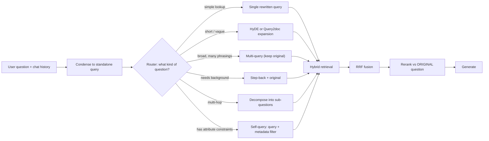

**Query transformation** is the pre-retrieval stage of a [RAG](retrieval-augmented-generation.md) pipeline in which an LLM (or rules) turns the user's raw question into one or more search requests that better match how the answer is written in the corpus. The output can be a cleaner query, a longer pseudo-document, several paraphrases, a more abstract question, a set of sub-questions, or a semantic query plus a structured metadata filter. It exists because retrieval caps what RAG can do: if the right chunk never comes back, the generator cannot recover ([Notebook](../sources/notebook-rag-cag.md)). The owner's guide lists it as the fix for vague or multi-part questions, next to HyDE for short queries that [embed](embeddings.md) poorly ([Notebook](../sources/notebook-rag-cag.md)).

## Why the raw query is often the wrong search key

- **Query/document mismatch.** Queries are short and phrased as questions; passages are long and declarative. HyDE gets around this by searching with a fake answer instead of the question ([Gao et al.](../sources/gao-2022-hyde.md)).
- **Vocabulary gap.** [BM25](bm25.md) only matches terms the user typed. LLM-written expansions add the missing terms ([Query2doc](../sources/wang-2023-query2doc.md)).
- **Multi-hop questions.** Models can answer each sub-question yet fail the composed question, and this "compositionality gap" does not close as models scale ([Press et al.](../sources/press-2022-self-ask.md)). One embedding of the whole question rarely lands near all the needed passages (Synthesis).
- **Hidden constraints.** "Pop songs under 3 minutes by Taylor Swift" mixes a semantic need with exact attribute filters that vector similarity handles badly ([LangChain self-query](../sources/langchain-self-query-retriever.md)).
- **Conversation.** Follow-ups like "and what about Q3?" are not searchable until they are rewritten as standalone questions. Synthesis: this condense-the-question rewrite is the most common production use.

## The techniques

| Technique | Output of the transform | LLM calls / retrievals per query | Reported evidence | Main failure mode |
|---|---|---|---|---|
| Rewrite (Rewrite-Retrieve-Read) | One better query | 1 / 1 | Consistent QA gains; a small rewriter can be RL-trained on reader feedback ([Ma et al.](../sources/ma-2023-query-rewriting.md)) | Rewriter drops or changes user intent |
| Expansion (Query2doc) | Query + LLM pseudo-document | 1 / 1 | BM25 +3-15% on MS MARCO / TREC DL ([Wang et al.](../sources/wang-2023-query2doc.md)) | Hallucinated terms add noise |
| HyDE | Hypothetical answer, embedded in place of the query | 1-N / 1 | Unsupervised Contriever [nDCG@10](retrieval-metrics.md) on DL19: 44.5 to 61.3 ([Gao et al.](../sources/gao-2022-hyde.md)) | Fake specifics pull in wrong documents; weak if the LLM knows nothing about the domain |
| Multi-query / RAG-Fusion | 3+ paraphrases, results fused | 1 / k | More complete answers in a manual study ([Rackauckas](../sources/rackauckas-2024-rag-fusion.md)) | Off-topic variants cause drift; k x retrieval cost |
| Step-back | A more general question, retrieved alongside the original | 1-2 / 2 | PaLM-2L TimeQA +27%, MuSiQue +7% ([Zheng et al.](../sources/zheng-2023-step-back-prompting.md)) | Over-abstraction retrieves textbook context, not the fact |
| Decomposition (self-ask) | Ordered sub-questions, each retrieved | many / many, sequential | Beats [chain-of-thought](chain-of-thought.md); adding search helps further ([Press et al.](../sources/press-2022-self-ask.md)) | Latency; one wrong intermediate answer poisons later hops |
| Self-query (metadata filter) | Query string + structured filter + limit | 1 / 1 | No published benchmark; a framework pattern ([LangChain](../sources/langchain-self-query-retriever.md)) | Invalid or over-strict filters silently return nothing |

### Rewriting

Rewrite-Retrieve-Read inserts an LLM rewrite before a frozen retriever and frozen reader. Ma et al. used a web search engine as the retriever and also trained a small rewriter with reinforcement learning, using the reader's answer quality as the reward ([Ma et al.](../sources/ma-2023-query-rewriting.md)). Synthesis: the training variant matters when you cannot afford a large LLM call per query. The rewriter then becomes a cheap, specialised model, a natural target for [knowledge distillation](knowledge-distillation.md).

### Expansion and HyDE

Both use an LLM's parametric knowledge to produce text that "looks like" the answer.

- **Query2doc** [few-shot prompts](few-shot-prompting.md) an LLM for a pseudo-document and **concatenates it with the query**, so the original terms are kept. It helps sparse and dense retrievers with no fine-tuning ([Wang et al.](../sources/wang-2023-query2doc.md)).
- **HyDE** prompts an instruction model ("write a paragraph that answers the question"), samples **N** hypothetical documents at temperature 0.7, embeds each with the document encoder, and averages the vectors, also counting the query itself as one hypothesis. The search vector is that mean ([Gao et al.](../sources/gao-2022-hyde.md)). The factual errors in the fake document are expected to be squeezed out by the encoder's dense bottleneck. On TREC DL19 nDCG@10 it lifted unsupervised Contriever from 44.5 to 61.3, above BM25's 50.6. On DL20 it went from 42.1 to 57.9 ([Gao et al.](../sources/gao-2022-hyde.md)). HyDE's paper targets the zero-shot case (no relevance labels). On DL20 a fine-tuned Contriever still beat it by about 10% on nDCG@10 ([Gao et al.](../sources/gao-2022-hyde.md)).

Synthesis: the gain shrinks as your embedder improves and as the domain moves away from what the LLM knows (internal product codes, private policies). There the hypothetical document invents plausible but wrong vocabulary.

### Multi-query and RAG-Fusion

Generate several rephrasings, retrieve for each, merge. Two merge styles exist:

- **Unique union.** [LangChain](langchain.md)'s `MultiQueryRetriever` asks for 3 variants by default (prompt overridable), runs the wrapped retriever per variant and deduplicates. `include_original=False` by default, so the user's own wording is *not* searched unless you turn it on ([LangChain](../sources/langchain-multi-query-retriever.md)).
- **Rank fusion.** RAG-Fusion fuses the per-query rankings with [reciprocal rank fusion](hybrid-search.md) ([Rackauckas](../sources/rackauckas-2024-rag-fusion.md)), which scores documents by summed reciprocal ranks so items found by several queries rise ([Cormack et al.](../sources/cormack-2009-reciprocal-rank-fusion.md)).

The reported weakness is drift: when variants stray from the question, answers go off topic ([Rackauckas](../sources/rackauckas-2024-rag-fusion.md)). Synthesis: always include the original query, and put a [reranker](reranking.md) scored against the *original* question after fusion, so drift cannot reach the prompt.

### Step-back

The model first writes a more abstract question (for example, the physics principle or the entity's whole history) and then answers the original using that abstraction. In knowledge QA the step-back question is retrieved too, so background passages join the specific ones ([Zheng et al.](../sources/zheng-2023-step-back-prompting.md)). It shines on questions with time or detail constraints (TimeQA +27% for PaLM-2L). Synthesis: it adds little for plain factoid lookups.

### Decomposition

Split a multi-hop question into sub-questions and answer them in order, each with its own retrieval. Self-ask makes the model write explicit "follow-up" questions in a parseable format so a search engine can answer them ([Press et al.](../sources/press-2022-self-ask.md)). Synthesis: decomposition comes in two shapes. *Parallel* sub-queries ("compare A and B") can run concurrently and be fused. *Sequential* ones ("who founded the company that acquired X?") need the previous answer. The sequential shape is the bridge to [agentic RAG](agentic-rag.md), where the model decides when to retrieve again.

### Self-query: metadata filters from natural language

An LLM converts the question into a `StructuredQuery`: a semantic `query` string, a `filter` in a small function language (`and(eq("genre","pop"), lt("length",180))`) or `NO_FILTER`, and an optional `limit`. You describe the data source as typed attributes (`AttributeInfo`). A per-store translator turns the filter into native syntax, and only the comparators and operators that store supports are offered to the LLM ([LangChain](../sources/langchain-self-query-retriever.md)). Synthesis: this is [structured outputs](structured-outputs.md) applied to retrieval, and a lighter cousin of [text-to-SQL](text-to-sql.md). Validate attribute names and value enums before executing, and fall back to the unfiltered query when a filter returns zero hits.

Synthesis: the router and the ordering are the author's composition of the techniques above, not a pipeline from any single source.

## Cost, latency and failure modes

- **Latency is serial.** Every transform adds an LLM round-trip *before* retrieval can start. Synthesis: use a small, fast model, keep outputs short, and stream nothing until retrieval finishes. See [cost and latency optimization](cost-and-latency-optimization.md).
- **Retrieval fan-out.** Multi-query and decomposition multiply vector-store and reranker calls by k.
- **Intent drift.** Rewrites can "fix" a query into a different question; multi-query variants can go off topic ([Rackauckas](../sources/rackauckas-2024-rag-fusion.md)).
- **Hallucinated specifics.** HyDE and Query2doc text may contain false details ([Gao et al.](../sources/gao-2022-hyde.md)). Synthesis: that is harmless only when the fake text is used purely as a search vector and never shown to the generator.
- **Silent filter failures.** A self-query filter on a misspelled or wrong-typed attribute returns empty or partial results with no error (Synthesis).
- **Exact identifiers.** Synthesis: rewriting can paraphrase away an error code or SKU. Keep the original query in a lexical ([hybrid](hybrid-search.md)) leg.

## When to use, when not

Synthesis, from the evidence above:

- **Always** for multi-turn chat: condense to a standalone query.
- **Use HyDE / expansion** for short queries over a corpus whose language the LLM knows, especially with a weak or unsupervised embedder. Skip it for private jargon and for strong, domain-tuned embedders. Measure first.
- **Use multi-query / fusion** when recall@k is the bottleneck and queries are ambiguous. Pair it with a reranker.
- **Use step-back** for "why/how" and time-scoped questions that need background principles or history.
- **Use decomposition** for comparisons and multi-hop questions. Prefer an agentic loop when hops depend on each other.
- **Use self-query** when the corpus has reliable metadata (dates, authors, product, region, permissions) and users phrase constraints in natural language.
- **Don't** stack all of them by default. Each one should earn its latency on a retrieval eval (recall@k on golden chunks) before it ships; see [LLM evaluation](llm-evaluation.md). The owner's guide gives the same advice: start light and add machinery only when an evaluation shows it helps ([Notebook](../sources/notebook-rag-cag.md)).

Related: [contextual retrieval](contextual-retrieval.md) attacks the same mismatch from the document side, at index time and with no per-query latency; [late-interaction retrieval](late-interaction-retrieval.md) reduces it in the retriever itself.

## Sources

- [Ma et al. 2023: Query Rewriting for Retrieval-Augmented LLMs](../sources/ma-2023-query-rewriting.md)
- [Gao et al. 2022: HyDE](../sources/gao-2022-hyde.md)
- [Wang et al. 2023: Query2doc](../sources/wang-2023-query2doc.md)
- [Rackauckas 2024: RAG-Fusion](../sources/rackauckas-2024-rag-fusion.md)
- [LangChain MultiQueryRetriever](../sources/langchain-multi-query-retriever.md)
- [Zheng et al. 2023: Step-Back Prompting](../sources/zheng-2023-step-back-prompting.md)
- [Press et al. 2022: Self-Ask](../sources/press-2022-self-ask.md)
- [LangChain SelfQueryRetriever](../sources/langchain-self-query-retriever.md)
- [Cormack et al. 2009: Reciprocal Rank Fusion](../sources/cormack-2009-reciprocal-rank-fusion.md)
- [Notebook: RAG vs CAG vs GraphRAG](../sources/notebook-rag-cag.md)
