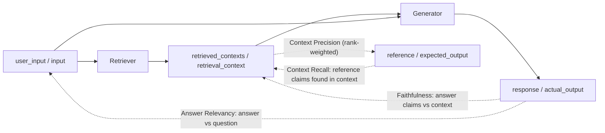

**Ragas** and **DeepEval** are open-source (Apache-2.0) Python libraries of ready-made [LLM evaluation](llm-evaluation.md) metrics. Most of their metrics are [LLM-as-judge](llm-as-judge.md) pipelines: a judge model decomposes an answer (or a reference) into claims or statements, labels each one, and the score is a ratio in [0, 1]. Ragas grew out of a 2023 paper on reference-free [RAG](retrieval-augmented-generation.md) evaluation and stays RAG- and agent-metric focused; DeepEval is a pytest-style test framework with 40+ metrics and an optional hosted platform, Confident AI. Both are metric *libraries*, not observability platforms: they compute scores, and you store and compare those scores elsewhere ([Braintrust](braintrust.md), [Arize Phoenix](arize-phoenix.md), [Langfuse](langfuse.md), [LangSmith](langsmith.md)) or in Confident AI ([deepeval-docs](../sources/deepeval-docs.md), [es-2023-ragas](../sources/es-2023-ragas.md)).

## Where the metrics come from

The Ragas paper (Es et al., 2023) proposed three reference-free scores, each computed by prompting an LLM: **faithfulness** (split the answer into statements, check each against the retrieved context, supported / total), **answer relevance** (generate questions from the answer and compare them to the real question by [embedding](embeddings.md) similarity) and **context relevance** (fraction of context sentences needed to answer). On its WikiEval set the paper reported agreement with human judgments of 0.95, 0.78 and 0.70 respectively, and found context relevance the hardest to judge ([es-2023-ragas](../sources/es-2023-ragas.md)). Almost every later RAG metric, including DeepEval's and Braintrust's [autoevals](../sources/braintrust-autoevals-github.md) RAG scorers, is a variant of this claim-decomposition pattern.

Synthesis: the diagram maps which inputs each metric compares; dotted arrows are judge calls, not data flow.

## The core RAG metrics, side by side

| Metric | Ragas (collections API, v0.4) | DeepEval (v4.x) | Needs reference? |
|---|---|---|---|
| Faithfulness | Response claims **inferable from** context / total claims ([ragas-metric-docs](../sources/ragas-metric-docs-and-releases.md)) | Response claims that **do not contradict** context / total; options `truths_extraction_limit`, `penalize_ambiguous_claims` ([deepeval-docs](../sources/deepeval-docs.md)) | No |
| Answer relevancy | LLM writes N questions from the response (`strictness`, default 3); mean cosine similarity to the real question; can fall below 0 ([ragas-ar](../sources/ragas-answer-relevancy-and-noise-sensitivity-docs.md)) | Statements in the output judged relevant to the input / total statements ([deepeval-ar](../sources/deepeval-answer-relevancy-and-contextual-recall-docs.md)) | No |
| Context precision | [Precision@k](retrieval-metrics.md) weighted by a 0/1 relevance verdict per rank, normalised by relevant chunks in top K; an irrelevant chunk at rank 1 roughly halves the score ([ragas-metric-docs](../sources/ragas-metric-docs-and-releases.md)) | Same rank-weighted idea, judged against `expected_output` ([deepeval-docs](../sources/deepeval-docs.md)) | Yes (Ragas `ContextUtilization` is the reference-free variant) |
| Context recall | Reference claims supported by retrieved context / total reference claims | Statements in `expected_output` attributable to `retrieval_context` / total ([deepeval-ar](../sources/deepeval-answer-relevancy-and-contextual-recall-docs.md)) | Yes |
| Other | Noise Sensitivity (incorrect claims / total, lower is better, `mode="relevant"` or `"irrelevant"`), Context Entities Recall, [agent metrics](agent-evaluation.md) (ToolCallAccuracy, ToolCallF1, TopicAdherence, AgentGoalAccuracy) | G-Eval, DAG, conversational metrics, safety metrics | varies |

Reading the pair: high context recall with low context precision means the right chunks were retrieved but ranked badly, a [reranking](reranking.md) problem ([deepeval-docs](../sources/deepeval-docs.md)). Answer relevancy in both libraries is not a correctness check; it penalises preamble, caveats and tangents even when the core answer is right ([deepeval-ar](../sources/deepeval-answer-relevancy-and-contextual-recall-docs.md), [ragas-ar](../sources/ragas-answer-relevancy-and-noise-sensitivity-docs.md)).

**Cheaper, deterministic variants.** Ragas ships non-LLM context precision (string similarity of retrieved chunks to reference contexts via rapidfuzz/Levenshtein) and ID-based precision/recall that just compare chunk IDs, plus `FaithfulnesswithHHEM`, which swaps the LLM verifier for Vectara's small HHEM-2.1-Open T5 classifier ([ragas-metric-docs](../sources/ragas-metric-docs-and-releases.md)). DeepEval's `hybrid` and `system_one` eval modes route per-claim yes/no decisions (or the whole metric) to a small "Jev" model. The cut-offs differ by metric: Faithfulness and Answer Relevancy count P(yes) above 0.65 as yes and below 0.35 as no, while Contextual Recall counts 0.5 or higher as attributable. `system_one` scores are not comparable with LLM-mode scores ([deepeval-docs](../sources/deepeval-docs.md), [deepeval-ar](../sources/deepeval-answer-relevancy-and-contextual-recall-docs.md)).

## G-Eval and DAG (DeepEval)

**G-Eval** (Liu et al., 2023) is a recipe for pointwise judging: give the judge a task and criterion, let it write its own evaluation steps (auto [chain-of-thought](chain-of-thought.md)), have it fill a score, and take the probability-weighted sum Σ p(sᵢ)·sᵢ over possible scores. This addresses two failure modes of direct integer scoring: one value dominating and ties. It reached Spearman 0.514 with humans on SummEval with GPT-4, but systematically preferred GPT-3.5 summaries over human-written ones ([liu-2023-g-eval](../sources/liu-2023-g-eval.md)).

DeepEval's `GEval(name, criteria | evaluation_steps, evaluation_params, rubric)` implements it. It uses logprob weighting only when the provider exposes logprobs; otherwise it returns the raw integer. If you give only `criteria`, steps are regenerated each run and scores vary more, so pin `evaluation_steps`. Listing irrelevant `evaluation_params` degrades scoring ([deepeval-docs](../sources/deepeval-docs.md)). For rule-like rubrics, **`DAGMetric`** builds an explicit decision tree (task nodes, binary and non-binary judgement nodes, verdict leaves with fixed scores). The LLM still decides each node, but the structure and score mapping are fixed in code. A GEval can sit at a leaf ([deepeval-docs](../sources/deepeval-docs.md)).

## How you run them

- **DeepEval:** `LLMTestCase(input, actual_output, expected_output, retrieval_context)` or `ConversationalTestCase`. Run with `evaluate(test_cases, metrics)` in notebooks, or with `assert_test()` inside pytest under `deepeval test run` in CI. `@observe` attaches metrics to inner components. Every metric returns a score and a reason. `threshold` defaults to 0.5, `strict_mode` forces 0/1, `flaky=True` failures do not block. `Synthesizer` creates [synthetic](synthetic-data-generation.md) goldens from documents and `ConversationSimulator` plays the user in multi-turn tests ([deepeval-docs](../sources/deepeval-docs.md)).
- **Ragas (v0.4.x, latest stable v0.4.3, 2026-01-13; a v0.4.4rc1 pre-release appeared on PyPI 2026-11-13):** metrics are classes called with `await metric.ascore(...)` / `metric.score(...)`, which return `.value`. LLMs come from `llm_factory` over [Instructor](instructor-and-outlines.md)/[LiteLLM](litellm.md) adapters. The legacy `SingleTurnSample` API is deprecated and slated for removal in 1.0, and v0.3.9 removed `ground_truths`, so old tutorials break. v0.4 added a `DSPyOptimizer` ([DSPy](dspy.md) MIPROv2) to optimise metric prompts against human labels, plus metric caching. Telemetry has been on since v0.3.5 ([ragas-metric-docs](../sources/ragas-metric-docs-and-releases.md)).

## Reliability caveats

1. **Same name, different metric.** A practitioner test gave both libraries a fabricated claim ([hallucination](hallucination.md)) that was absent from the context. Ragas scored it 0.0 (claims must be *supported*) and DeepEval scored it 1.0 in all five repeats (claims must only *not contradict*). On six "unsupported addition" cases Ragas caught 5 and DeepEval 0 ([lamb-2026](../sources/lamb-2026-ragas-vs-deepeval-faithfulness.md)). Treat this as anecdotal (27 synthetic cases, and the author built a competing tool), but it matches the documented definitions above. If a "faithfulness" score gates anything, read the implementation behind it.
2. **Omissions are invisible.** In the same test the judges caught almost no omitted facts (0/5 and 1/5), while deterministic required-fact checks caught 5/5 ([lamb-2026](../sources/lamb-2026-ragas-vs-deepeval-faithfulness.md)). Faithfulness measures precision of claims, not completeness.
3. **Judge variance.** With gpt-4o at temperature 0, per-output score ranges across repeats were small (about 0.01-0.03). With gpt-4o-mini, 11 of 27 outputs flipped verdict between runs ([lamb-2026](../sources/lamb-2026-ragas-vs-deepeval-faithfulness.md)). DeepEval documents G-Eval as [non-deterministic](llm-non-determinism.md) ([deepeval-docs](../sources/deepeval-docs.md)).
4. **Judge bias.** The G-Eval paper's own judge favoured LLM-written text ([liu-2023-g-eval](../sources/liu-2023-g-eval.md)). See [LLM-as-judge](llm-as-judge.md) for position, verbosity and self-preference biases.
5. **Cost.** Each metric makes several judge calls per sample, roughly $8-12 per 1,000 faithfulness evaluations with gpt-4o in the test above, against about $0 for deterministic checks ([lamb-2026](../sources/lamb-2026-ragas-vs-deepeval-faithfulness.md)).
6. **Generic metrics vs your failures.** Husain and Shankar recommend deriving evaluators from [error analysis](error-analysis.md) of real traces and preferring binary pass/fail checks over generic Likert-style scores ([husain-shankar-2026](../sources/husain-shankar-2026-ai-evals-faq.md)). The owner's notebook makes a related point: evaluate retrieval (recall, MRR) separately from generation (groundedness) ([notebook-llm-evaluation](../sources/notebook-llm-evaluation.md)).
7. **The metrics themselves are under-validated.** GroUSE, a set of 144 unit tests over seven failure modes of grounded answers, found that automated RAG evaluation frameworks miss important failure modes even with GPT-4 as the judge, and that open-weight judges correlating strongly with GPT-4 still fail its tests, so correlation with GPT-4 is an incomplete proxy for judge quality ([muller-2024-grouse](../sources/muller-2024-grouse.md)). A 2025 survey of lexical, semantic and LLM-based metrics found none reliably validated against human judgment, with the same problems persisting for LLM-as-judge and RAG metrics; it recommends choosing metrics per task and combining complementary evaluations ([oliva-2025](../sources/oliva-2025-illusion-of-perfect-metric.md)).

## Ragas vs DeepEval vs autoevals

| | Ragas | DeepEval | autoevals (Braintrust) |
|---|---|---|---|
| Licence | Apache-2.0 | Apache-2.0 | MIT |
| Shape | Metric classes plus "experiments-first" helpers | pytest-native tests, metrics, synthesizer, simulator | Scorer functions returning `Score(name, score, metadata)` |
| Strength | RAG/agent metric depth, non-LLM and ID-based variants, DSPy-tuned judge prompts | CI ergonomics, G-Eval/DAG custom metrics, component-level evals | Lightweight, any OpenAI-compatible endpoint, plugs into [Braintrust](braintrust.md) |
| Hosted side | None required | Confident AI: Free (2 seats, 5 test runs/week), Starter $200/mo, Team $2,000/mo, Enterprise with on-prem (2026-11) | Braintrust |

Sources: [ragas-metric-docs](../sources/ragas-metric-docs-and-releases.md), [deepeval-docs](../sources/deepeval-docs.md), [autoevals](../sources/braintrust-autoevals-github.md).

## When to use / when not

Synthesis:
- **Use** them to bootstrap a RAG eval suite quickly, to get *diagnostic* signals that separate retriever failures (context recall/precision) from generator failures (faithfulness), and as scorers inside a platform. Phoenix, Braintrust and Langfuse all accept them as custom evaluators.
- **Prefer DeepEval** when the team wants evals as pytest tests in CI with thresholds. **Prefer Ragas** for RAG-specific depth, cheap ID-based retrieval metrics, or judge prompts you want to tune against human labels.
- **Do not** ship a release gate on an off-the-shelf LLM metric you have not checked against 50-100 human-labelled examples from the client's domain. Do not compare scores across libraries, judge models or eval modes. Do not use answer relevancy as a proxy for correctness. Put must-have facts, formats and citations in deterministic checks ([promptfoo](promptfoo.md)-style assertions), and keep judges for the semantic residue.
- For an FDE engagement, pin the library version and the judge model and record both with every score. Both libraries have broken their APIs within a year.

## Sources

- [Es et al. 2023: RAGAS](../sources/es-2023-ragas.md)
- [Ragas docs: available metrics](../sources/ragas-docs-metrics.md)
- [Ragas docs: context precision, recall, faithfulness, releases](../sources/ragas-metric-docs-and-releases.md)
- [Ragas docs: answer relevancy and noise sensitivity](../sources/ragas-answer-relevancy-and-noise-sensitivity-docs.md)
- [DeepEval docs and Confident AI pricing](../sources/deepeval-docs.md)
- [DeepEval docs: answer relevancy and contextual recall](../sources/deepeval-answer-relevancy-and-contextual-recall-docs.md)
- [Liu et al. 2023: G-Eval](../sources/liu-2023-g-eval.md)
- [Lamb 2026: RAGAS vs DeepEval faithfulness](../sources/lamb-2026-ragas-vs-deepeval-faithfulness.md)
- [Braintrust autoevals](../sources/braintrust-autoevals-github.md)
- [Husain and Shankar: AI evals FAQ](../sources/husain-shankar-2026-ai-evals-faq.md)
- [Notebook: LLM evaluation and observability](../sources/notebook-llm-evaluation.md)
- [Muller et al. 2024: GroUSE](../sources/muller-2024-grouse.md)
- [Oliva et al. 2025: The illusion of a perfect metric](../sources/oliva-2025-illusion-of-perfect-metric.md)
