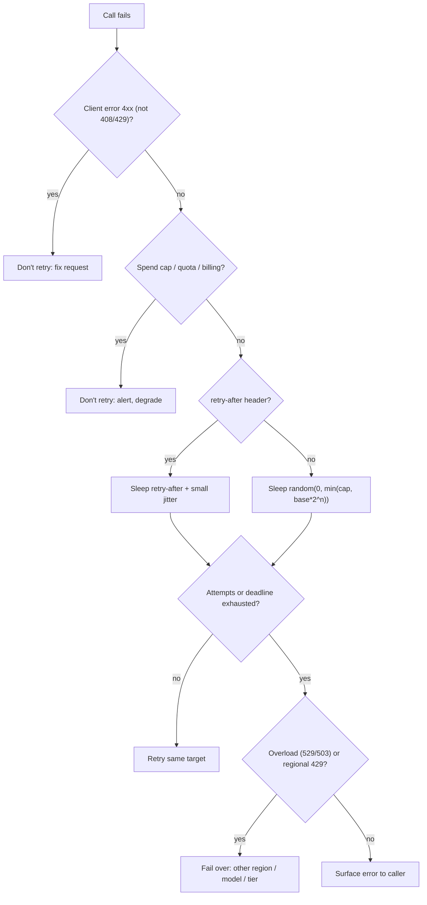

**Rate limits** are the per-organisation (or per-project, per-subscription) ceilings an LLM provider puts on requests and tokens per unit time; **retries** are the client-side policy for recovering when a call is throttled, overloaded or times out. Operating LLMs at scale is mostly about these two halves fitting together: knowing exactly which meter you are about to trip, telling a transient 429 from a permanent one, and retrying in a way that does not amplify the overload. Together with [provisioned throughput](provisioned-throughput.md), this is the capacity side of [enterprise LLM deployment](enterprise-llm-deployment.md).

## What gets metered

Every major provider meters several dimensions at once, and whichever runs out first throttles you ([OpenAI](../sources/openai-rate-limits-guide.md), [Gemini](../sources/gemini-api-rate-limits-docs.md)).

| Provider (late 2026) | Dimensions | Scope | Notable mechanics |
|---|---|---|---|
| [Anthropic Claude API](anthropic-messages-api.md) | RPM, input TPM (ITPM), output TPM (OTPM), monthly spend cap per tier | Organisation, per model class | Token bucket refilling continuously; cache reads don't count toward ITPM; ramp limits on sharp increases ([source](../sources/anthropic-rate-limits-docs.md)) |
| [OpenAI API](openai-responses-api.md) | RPM, RPD, TPM, TPD, IPM; Batch queue tokens | Organisation and project, per model; some models share a pool | Counted usage = max(`max_tokens`, estimated tokens); tiers Free/Build/Launch/Grow ([source](../sources/openai-rate-limits-guide.md)) |
| [Gemini Developer API](gemini-api.md) | RPM, input TPM, RPD (+IPM, TPD for some models), rolling 10-minute spend | Project, not API key | RPD resets midnight Pacific; tiers by cumulative spend and account age ([source](../sources/gemini-api-rate-limits-docs.md)) |
| [Vertex AI](google-vertex-ai.md) Standard PayGo | Org-level prioritized TPM threshold per model; no RPM | Organisation | Shared pool: traffic above threshold may be served but is throttled first; 429 = contention ([source](../sources/vertex-ai-standard-paygo-usage-tiers.md)) |
| [Amazon Bedrock](amazon-bedrock.md) on-demand | TPM, TPD, RPM quotas | Account, Region, model | Reserves input + `max_tokens` up front; output burndown multipliers up to 15x ([source](../sources/aws-bedrock-token-quotas.md)) |
| Azure OpenAI ([Foundry](azure-ai-foundry.md)) Standard | TPM with RPM derived from it | Subscription/region pools, per deployment type | Seven quota tiers assigned automatically ([source](../sources/microsoft-foundry-quotas-limits.md)) |

Four mechanics matter more than the headline numbers:

- **Bucket refill, not a minute boundary.** Anthropic uses a continuously refilling token bucket, so a burst within a second can 429 even when the per-minute average is fine ([source](../sources/anthropic-rate-limits-docs.md)). Vertex likewise asks you to smooth spikes inside each minute ([source](../sources/vertex-ai-standard-paygo-usage-tiers.md)).
- **`max_tokens` is reserved up front (on some providers).** OpenAI counts the larger of `max_tokens` and the estimated prompt size ([source](../sources/openai-rate-limits-guide.md)). Bedrock deducts input + `max_tokens` at request start, settles at the end with output multiplied by a model-specific burndown rate (2.5x–15x for Claude models depending on version, e.g. 5x for Claude 4.7 and older, 15x for Claude 4.8), and refunds the difference. A 32K `max_tokens` for a 1K reply therefore cuts concurrency sharply ([source](../sources/aws-bedrock-token-quotas.md)). Set `max_tokens` close to the real output length. Anthropic's own API is the exception: OTPM counts only tokens actually generated, so `max_tokens` has no rate-limit cost there ([source](../sources/anthropic-rate-limits-docs.md)).
- **Caching raises effective throughput.** On Anthropic, cache reads don't count toward ITPM, so 2M ITPM at an 80% hit rate means about 10M total input tokens per minute ([source](../sources/anthropic-rate-limits-docs.md)). Bedrock also excludes cache reads ([source](../sources/aws-bedrock-token-quotas.md)). See [prompt caching](prompt-caching.md).
- **Ramp limits.** Even under your limit, a sudden jump can be throttled. Anthropic returns 429 `ramp_limit_exceeded` and asks for at most one step up per minute ([source](../sources/anthropic-rate-limits-docs.md)). OpenAI's rule of thumb: past about 1M input TPM, grow no more than 50% per 15 minutes ([source](../sources/openai-rate-limits-guide.md)). Its Fast mode downgrades over-ramp requests to Standard speed and price, reporting `service_tier: "default"` in the response ([source](../sources/openai-fast-mode-priority-processing.md)). Vertex Priority PayGo also has a ramp limit ([source](../sources/vertex-ai-consumption-options.md)). Launches and model migrations should shift traffic gradually behind feature flags.

## Classifying failures

The most common production bug is treating every 429 the same way. The status code alone is not enough; read the error type, `error_code` and headers.

| Signal | Meaning | Retry? |
|---|---|---|
| 429 with `retry-after` (Anthropic `rate_limit_error`, OpenAI temporary limit) | Your own rate limit | Yes, after at least `retry-after` |
| Anthropic 429 `ramp_limit_exceeded` / OpenAI 429 `slow_down` | Ramped too fast | Yes, slower; reduce ramp rate |
| Anthropic 429 `enforced_spend_limit_reached`, no `retry-after` | Tier monthly spend cap | **No**, keeps failing until access resumes ([source](../sources/anthropic-api-errors-docs.md)) |
| Anthropic 400 for a self-set spend limit, Anthropic 402 `billing_error`; OpenAI hard spend limit 429; quota/billing errors | Budget exhausted | **No** ([Anthropic](../sources/anthropic-api-errors-docs.md), [OpenAI](../sources/openai-rate-limits-guide.md)) |
| Anthropic 529 `overloaded_error` | Provider-wide overload, not your quota | Yes with backoff, or fail over |
| OpenAI 503 `server_is_overloaded` | Provider overload | Yes with backoff |
| Gemini/Vertex 429 `RESOURCE_EXHAUSTED` | Quota, spend window, or shared-pool contention | Yes with backoff; consider the global endpoint ([source](../sources/vertex-ai-standard-paygo-usage-tiers.md)) |
| OpenAI flex 429 Resource Unavailable | No flex capacity right now (not billed) | Back off, or retry on the default tier ([source](../sources/openai-flex-processing-guide.md)) |
| 500 `api_error`, 504 `timeout_error` | Server fault or processing timeout | Yes with backoff; switch long calls to streaming |
| 400/401/403/404/413 | Client error | No (409 `conflict_error`: resolve the conflict first) |

Headers give you pre-emptive control: `anthropic-ratelimit-{requests,input-tokens,output-tokens}-{limit,remaining,reset}` ([source](../sources/anthropic-rate-limits-docs.md)) and `x-ratelimit-{limit,remaining,reset}-{requests,tokens}` ([source](../sources/openai-rate-limits-guide.md)). Log the `request-id` on every failure for support tickets ([source](../sources/anthropic-api-errors-docs.md)).

## Backoff with jitter

Capped exponential backoff without randomness performs worst, because clients that failed together retry together. Adding jitter cut total calls by more than half with 100 contending clients in Brooker's simulation ([source](../sources/aws-exponential-backoff-and-jitter.md)). The variants:

- **Full jitter:** sleep a uniform random time in `[0, min(cap, base × 2^attempt)]`. This is the variant in the owner's tutorial code ([source](../sources/notebook-concurrency-design.md)), and it does the least total work ([source](../sources/aws-exponential-backoff-and-jitter.md)).
- **Equal jitter:** keep half the window fixed and randomize the other half. Similar work, slower to finish; the weakest jittered option.
- **Decorrelated jitter:** grow the random window from the previous sleep. Finishes slightly faster, at somewhat more work.

LLM-specific rules on top:

1. **Honour `retry-after` first**, and add a small random delay to it ([source](../sources/openai-rate-limits-guide.md)).
2. **Failed requests still count** toward OpenAI per-minute limits, so tight retry loops make throttling worse ([source](../sources/openai-rate-limits-guide.md)).
3. **Don't stack retry layers.** The Anthropic SDK already retries connection errors, 429s and 5xx twice by default ([source](../sources/anthropic-api-errors-docs.md)); OpenAI SDKs also retry 429/503 automatically, and retry 408s twice ([rate limits](../sources/openai-rate-limits-guide.md), [flex](../sources/openai-flex-processing-guide.md)). OpenAI's guide says to disable SDK retries if you retry yourself. A gateway, a framework and your own loop each retrying multiplies load. Five layers × three retries can mean 243x load on the bottom dependency ([source](../sources/aws-builders-library-timeouts-retries-backoff.md)). Retry at one layer: set `max_retries=0` everywhere else.
4. **Budget retries.** Cap attempts *and* total elapsed time against the caller's deadline ([OpenAI](../sources/openai-rate-limits-guide.md), [notebook](../sources/notebook-concurrency-design.md)). A client-side token bucket for retries (retry freely while tokens last, then at a fixed rate) is AWS's alternative to circuit breakers ([source](../sources/aws-builders-library-timeouts-retries-backoff.md)).
5. **Escalate instead of retrying forever.** After a bounded number of 529/503/overload errors, fail over to another region, provider or model. AWS recommends bounded retries plus multi-Region or multi-model fallback ([source](../sources/aws-bedrock-cross-region-inference.md)). See [model routing and fallbacks](model-routing-and-fallbacks.md) and [LLM gateways](llm-gateways.md).

Synthesis: the diagram combines the classification table above with the retry rules from the AWS, OpenAI and Anthropic sources.

## Idempotency

Retries are only safe when repeating the call has no extra side effects. Reads usually qualify; creates often don't ([source](../sources/aws-builders-library-timeouts-retries-backoff.md)). The standard fix is a client-generated idempotency key that the server deduplicates on, returning the saved first response for repeats ([Stripe](../sources/stripe-idempotent-requests.md)). The owner's tutorial applies the same idea to agents: give each run a key so a duplicate trigger does not start two expensive runs ([source](../sources/notebook-concurrency-design.md)).

Synthesis: an LLM completion call usually has no side effects beyond billing, so retrying it is safe but costs money. The danger is in the [agent loop](agent-loop.md) around it. A retried step that already executed a tool (sent an email, wrote a row) must not run that tool again. Put idempotency keys on side-effecting [tools](tools.md), and checkpoint completed steps as in [durable agent execution](durable-agent-execution.md).

## Timeouts for long generations

- Long outputs and [reasoning](reasoning-models.md) runs can take minutes. Anthropic recommends streaming or the Message Batches API, especially for requests over 10 minutes. Networks may drop idle connections, so TCP keep-alive helps. The SDK refuses non-streaming requests expected to exceed 10 minutes ([source](../sources/anthropic-api-errors-docs.md)). Errors can arrive mid-stream after a 200, so handle `error` events in the stream as well as status codes. See [streaming](streaming.md).
- OpenAI SDKs default to a 10-minute timeout and retry 408s twice; flex requests warrant longer timeouts (the docs' examples use 15 minutes) ([source](../sources/openai-flex-processing-guide.md)).
- Set timeouts from measured latency percentiles: pick an acceptable false-timeout rate and use the matching downstream percentile ([source](../sources/aws-builders-library-timeouts-retries-backoff.md)). Synthesis: LLM latency scales with output tokens and thinking effort, so time to first token and total time need separate budgets per route ([extended thinking](extended-thinking.md) routes need much longer totals).

## Concurrency control and queueing

Retries handle failures; concurrency limits keep you from causing them. Little's Law sizes the steady state: in-flight requests = throughput × latency. The scarcest downstream limit, often the LLM rate limit, is the real ceiling ([source](../sources/notebook-concurrency-design.md)). Synthesis example: 20 requests/s at 6 s average latency means about 120 concurrent calls. If each uses 3K input tokens, that is 3.6M ITPM. Check that number against the tier before launch, not after.

Practical controls, from the owner's tutorial ([source](../sources/notebook-concurrency-design.md)):

- A **semaphore** caps in-flight calls per model at or below what the limit supports; excess callers queue, which is backpressure.
- **Bulkheads:** separate pools per dependency and per tenant, so one noisy tenant or slow model can't starve the rest.
- A **durable queue plus workers** for long or bursty agent work, with per-tenant concurrency and token/spend budgets.

Synthesis: a production client typically adds a client-side token-bucket limiter keyed on (model, region). It is fed by the provider's `remaining`/`reset` headers and charges each request the way the provider meters it: estimated input plus `max_tokens` on OpenAI and Bedrock, uncached input plus actual output on Anthropic. Priority classes (interactive ahead of background) decide who waits when the bucket is empty.

## Service tiers as a reliability lever

Tiers trade price for queue position on the same pay-per-token API:

| Tier | Examples | Behaviour |
|---|---|---|
| Priority / Fast | OpenAI Fast mode (`service_tier="fast"`/`"priority"`), Bedrock `priority`, Vertex Priority PayGo, Gemini Priority inference | Premium price, served first, ramp-limited; shares the on-demand quota on OpenAI and Bedrock; Gemini Priority has its own limits (default 0.3x standard) that also count toward interactive limits ([OpenAI](../sources/openai-fast-mode-priority-processing.md), [Bedrock](../sources/aws-bedrock-service-tiers.md), [Gemini](../sources/gemini-api-rate-limits-docs.md)). Anthropic's fast mode (`speed: "fast"`) is a speed option with dedicated rate limits and ramp limits ([source](../sources/anthropic-rate-limits-docs.md)) |
| Standard | default everywhere | Best effort, subject to 429/529 |
| Flex | OpenAI `flex`, Bedrock `flex`, Vertex Flex PayGo | About 50% cheaper / Batch rates, slower, more throttling ([OpenAI](../sources/openai-flex-processing-guide.md), [Vertex](../sources/vertex-ai-consumption-options.md)) |
| Batch | Anthropic Message Batches, OpenAI Batch, Gemini Batch | Asynchronous, about 50% off, separate queue limits; Anthropic batches are exempt from ramp limits ([source](../sources/anthropic-rate-limits-docs.md)) |
| Reserved / provisioned | see [provisioned throughput](provisioned-throughput.md) | Separate committed capacity, overflow to Standard |

Anthropic's own Priority Tier (`service_tier: auto | standard_only`) is marked legacy, and commitments are no longer sold as of November 2026 (existing ones run to contract end) ([source](../sources/anthropic-service-tiers-docs.md)). Always read the tier actually applied from the response (`usage.service_tier` on Anthropic, `service_tier` on OpenAI, `ResolvedServiceTier` in Bedrock CloudWatch), because requests can be downgraded silently. Move offline work to [batch processing](batch-processing.md) so it never competes with interactive quota.

## When to use what

- **Low volume, prototype:** SDK defaults (2 retries on the Anthropic SDK) are enough. Set `max_tokens` sensibly and log request IDs.
- **Production interactive:** one retry layer with jittered backoff and a deadline, a client-side limiter, streaming for long outputs, and fallback after bounded retries. Watch the remaining-capacity headers in [LLM observability](llm-observability.md).
- **Bursty or launch traffic:** ramp gradually, pre-request tier or quota increases, and consider Priority tiers or provisioned capacity.
- **Offline jobs:** Batch or Flex. Don't put them on Priority.
- **Don't:** retry spend-cap errors, retry at several layers, or set `max_tokens` to the model maximum "just in case" on providers that reserve it (OpenAI, Bedrock).

## Sources

- [Anthropic rate limits docs](../sources/anthropic-rate-limits-docs.md)
- [Anthropic API errors docs](../sources/anthropic-api-errors-docs.md)
- [Anthropic service tiers](../sources/anthropic-service-tiers-docs.md)
- [OpenAI rate limits guide](../sources/openai-rate-limits-guide.md)
- [OpenAI flex processing](../sources/openai-flex-processing-guide.md)
- [OpenAI Fast mode (priority processing)](../sources/openai-fast-mode-priority-processing.md)
- [Gemini API rate limits](../sources/gemini-api-rate-limits-docs.md)
- [Vertex AI Standard PayGo and usage tiers](../sources/vertex-ai-standard-paygo-usage-tiers.md)
- [Vertex AI consumption options](../sources/vertex-ai-consumption-options.md)
- [Bedrock token quotas and burndown](../sources/aws-bedrock-token-quotas.md)
- [Bedrock service tiers](../sources/aws-bedrock-service-tiers.md)
- [Bedrock cross-Region inference](../sources/aws-bedrock-cross-region-inference.md)
- [Azure OpenAI quotas and limits](../sources/microsoft-foundry-quotas-limits.md)
- [Timeouts, retries, and backoff with jitter (Builders' Library)](../sources/aws-builders-library-timeouts-retries-backoff.md)
- [Exponential backoff and jitter (AWS blog)](../sources/aws-exponential-backoff-and-jitter.md)
- [Stripe idempotent requests](../sources/stripe-idempotent-requests.md)
- [Notebook: Concurrency design](../sources/notebook-concurrency-design.md)
