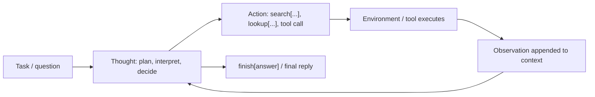

**ReAct** ("Reason + Act") is a prompting pattern, introduced by Yao et al. (arXiv October 2022, ICLR 2023), in which a language model solves a task by producing an interleaved trajectory of **Thought** (free-text reasoning), **Action** (a call into an external environment such as a search API) and **Observation** (the environment's reply, appended by the harness). Reasoning decides what to do next ("reason to act"); observations feed fresh, grounded facts back into reasoning ("act to reason"). It merged two lines of work that had been separate: [chain-of-thought](chain-of-thought.md), which reasons without grounding, and LLM-as-policy agents, which act without explicit reasoning. Today's [agent loop](agent-loop.md), with native [function calling](function-calling.md) and interleaved model "thinking", is the direct descendant of ReAct, though the text format the paper used has been almost entirely replaced. ([Yao et al.](../sources/yao-2022-react.md))

## Mechanics

### The formal idea

The paper models an agent as a policy that picks action *a_t* from context *c_t* = (o_1, a_1, …, o_t). ReAct's only change is to enlarge the action space from task actions *A* to *A ∪ L*, where *L* is natural language. A "thought" is an action in *L*: it does not touch the environment and yields no observation, but it is appended to the context and so conditions every later action. Learning a policy over an unbounded language space is hard, so the paper relies on a large frozen model (PaLM-540B) plus a few human-written example trajectories. ([Yao et al.](../sources/yao-2022-react.md))

Thoughts in the paper do six kinds of work: decompose the goal into a plan, inject commonsense, extract the relevant part of an observation, track progress, handle exceptions (for example reformulating a failed search), and synthesise the final answer. ([Yao et al.](../sources/yao-2022-react.md))

### Dense vs sparse thoughts

- **Dense** (knowledge tasks: HotpotQA, FEVER): every step is Thought → Action → Observation.
- **Sparse** (long-horizon decision tasks: ALFWorld, WebShop): the model decides when to think; most steps are bare actions, with thoughts at decision points.

### The original action space

For HotpotQA and FEVER the environment is a deliberately weak Wikipedia API: `search[entity]` returns the first five sentences of a page (or five similar titles), `lookup[string]` returns the next sentence containing the string, and `finish[answer]` ends the episode. The weakness is intentional: it forces retrieval to be steered by explicit reasoning. ([Yao et al.](../sources/yao-2022-react.md))

Synthesis: in the paper the loop is driven by text. The harness lets the model generate until it emits an action line, parses that line, runs it, appends `Observation: …`, and calls the model again with the whole trajectory. Every step therefore resends the full prompt (this is the token cost [ReWOO](../sources/xu-2023-rewoo.md) measures).

## What the paper showed

PaLM-540B, few-shot prompting ([Yao et al.](../sources/yao-2022-react.md)):

| Method | HotpotQA EM | FEVER acc |
|---|---|---|
| Standard (no reasoning, no actions) | 28.7 | 57.1 |
| CoT | 29.4 | 56.3 |
| CoT-SC (21 samples) | 33.4 | 60.4 |
| Act (actions only) | 25.7 | 58.9 |
| ReAct | 27.4 | 60.9 |
| CoT-SC → ReAct | 34.2 | **64.6** |
| ReAct → CoT-SC | **35.1** | 62.0 |
| Supervised SoTA (reference) | 67.5 | 89.5 |

Points worth knowing precisely:

- **ReAct alone does not beat CoT on HotpotQA** (27.4 vs 29.4). It wins on FEVER, where small factual differences decide the label and retrieval matters. The best results come from **hybrids**: fall back from ReAct to self-consistent CoT if no answer arrives within 7 (HotpotQA) or 5 (FEVER) steps, or from CoT-SC to ReAct when the majority answer gets fewer than half the votes.
- **The headline wins are on interactive tasks.** ALFWorld: best ReAct trial 71% success vs 45% for actions-only and 37% for BUTLER, an imitation-learning agent trained on 10^5 expert trajectories per task type. WebShop success rate: 40.0 for ReAct vs 30.1 for Act and 28.7 for imitation + RL, still far below human experts at 59.6.
- **Thoughts must reason, not just restate.** An ablation using Inner-Monologue-style thoughts, which only restate environment feedback, reached 53% on ALFWorld vs 71% for ReAct.
- **Error profile (200 hand-labelled HotpotQA trajectories).** ReAct is more grounded: hallucination accounts for 0% of its failures vs 56% for CoT, and false positives are 6% vs 14%. It makes more reasoning errors (47% vs 16% of failures), including repetition loops. Uninformative search results cause 23% of its failures.
- **Prompting vs fine-tuning.** At PaLM-8B/62B, prompted ReAct is the worst of four methods. Fine-tuned on 3,000 correct ReAct trajectories, it becomes the best: a fine-tuned 8B model beats every 62B prompting method.

## How modern tool-calling loops relate

| Aspect | ReAct (2022 paper) | Modern tool-calling loop |
|---|---|---|
| Action format | Text line (`search[x]`) parsed by the harness | Structured `tool_use` / `function_call` items validated against a JSON Schema ([Anthropic](../sources/anthropic-tool-use-docs.md), [OpenAI](../sources/openai-function-calling-guide.md)) |
| Where reasoning lives | Visible `Thought:` text in the prompt | Native thinking or reasoning items between tool calls, usually hidden or summarised and passed back opaque ([Anthropic thinking](../sources/anthropic-thinking-docs.md), [OpenAI reasoning](../sources/openai-reasoning-guide.md)) |
| How the behaviour is taught | Few-shot exemplar trajectories | Post-training of the model; tool definitions in the prompt |
| Actions per step | One | Parallel calls allowed |
| Stop condition | `finish[answer]` | Stop reason: no tool calls, `max_tokens`, `pause_turn` and so on (see [agent loop](agent-loop.md)) |

Intermediate steps between the two:

- **Code as the action.** [CodeAct](../sources/wang-2024-codeact.md) replaces JSON/text actions with executable Python and reports up to 20% higher success. [smolagents](smolagents.md) builds both its JSON `ToolCallingAgent` and its `CodeAgent` on a ReAct-style `MultiStepAgent` loop ([HF docs](../sources/smolagents-intro-agents-guide.md)).
- **A tool that only thinks.** Anthropic's "think" tool gave the model a no-op tool for reasoning after tool results arrive. Its December 2025 update recommends [extended thinking](extended-thinking.md) instead in most cases ([Anthropic](../sources/anthropic-think-tool.md)).
- **Interleaved thinking.** On current Claude models, reasoning between tool calls is automatic with adaptive thinking, and thinking blocks must be returned unmodified within the tool-use turn ([Anthropic](../sources/anthropic-thinking-docs.md)). OpenAI requires reasoning items to be passed back with tool outputs so that reasoning continues ([OpenAI](../sources/openai-reasoning-guide.md)).

Synthesis: a modern agent built on a [reasoning model](reasoning-models.md) with native tool calling *is* ReAct in substance (reason, act, observe, repeat), with three differences. The thought/action grammar is trained into the model rather than shown in exemplars. Actions are typed and schema-checked rather than regex-parsed. The reasoning is often not visible to the developer. Writing an explicit "Thought:/Action:/Observation:" text protocol on top of a native tool-calling API is usually redundant.

## Variants

| Variant | Change to ReAct | Reported effect |
|---|---|---|
| ReAct ↔ CoT-SC fallback | Switch to internal-knowledge voting when acting stalls, or to acting when the vote is uncertain | Best prompting results in the paper ([Yao et al.](../sources/yao-2022-react.md)) |
| [Reflexion](../sources/shinn-2023-reflexion.md) | Retry the task; after each failed trial, write a verbal self-reflection into memory | ALFWorld 130/134 tasks in 12 trials; no gain on WebShop |
| [ReWOO](../sources/xu-2023-rewoo.md) | Plan every tool call up front with `#E` evidence variables, run them, then solve | HotpotQA: about 5x fewer tokens, accuracy 42.4 vs 40.8 |
| [LATS](../sources/zhou-2023-lats.md) | Monte Carlo Tree Search over reason/act trajectories with LM value functions and reflection | HumanEval 92.7% pass@1 (GPT-4, per arXiv v3); WebShop score 75.9 (GPT-3.5) |
| [CodeAct](../sources/wang-2024-codeact.md) | Actions are Python programs | Up to 20% higher success than JSON/text |

Related lineage: [Tree of Thoughts](../sources/yao-2023-tree-of-thoughts.md) applies search to pure reasoning; LATS applies it to acting.

## Limits and failure modes

- **Loops.** The model repeats an earlier thought/action pair and cannot break out; the paper counts this as a reasoning error and suspects greedy decoding contributes ([Yao et al.](../sources/yao-2022-react.md)). Bound steps, detect repeated calls, and add a fallback path.
- **Derailment by bad observations.** An uninformative search result is hard to recover from (23% of ReAct's HotpotQA failures). The quality of tool output bounds the agent.
- **Less flexible reasoning.** The forced think/act cadence produced more reasoning errors than free CoT on HotpotQA ([Yao et al.](../sources/yao-2022-react.md)).
- **Brittleness to exemplars.** On ALFWorld, Verma et al. found that collecting all reasoning before the actions did not hurt (and for GPT models sometimes helped), and that wrong or placebo thought content did not collapse performance. Swapping in exemplars from a different task, or synonyms for objects, caused large drops. They conclude that few-shot ReAct gains track exemplar–query similarity, not interleaved reasoning ([Verma et al.](../sources/verma-2024-brittle-react.md)). Synthesis: this critique targets few-shot text prompting on 2023–2024 models. It says less about models post-trained for tool use, but it is a warning against assuming the visible thoughts are what make an agent work.
- **Token cost grows with depth.** Each step resends the whole trajectory, so prompt tokens grow faster than linearly with step count ([ReWOO](../sources/xu-2023-rewoo.md)). See [context engineering](context-engineering.md), [context compaction](context-compaction.md) and [prompt caching](prompt-caching.md).
- **Context limits on demonstrations.** Complex tasks with large action spaces need more exemplars than fit in context ([Yao et al.](../sources/yao-2022-react.md)).
- **Greedy and myopic.** One trajectory commits at every step with no backtracking. Reflexion (retry across trials) and LATS (tree search) exist to fix this.
- **Visible thoughts are not guaranteed faithful.** Synthesis: interpretability was a selling point of ReAct, but written reasoning can diverge from what actually drives the model (see [chain-of-thought](chain-of-thought.md)). Treat traces as debugging evidence, not proof.

## Practical guidance

Synthesis, drawing on the sources above:

1. **Use the provider's native tool calling and thinking**, not a hand-written Thought/Action text protocol. Return thinking or reasoning items exactly as the API requires ([Anthropic](../sources/anthropic-thinking-docs.md), [OpenAI](../sources/openai-reasoning-guide.md)).
2. **Reach for ReAct only when the next step depends on what the last tool returned.** If the steps are fixed, a workflow or a ReWOO-style plan-then-execute is cheaper and more predictable. Google's guide likewise puts a single agent first and ReAct or multi-agent second ([Google Cloud](../sources/google-cloud-choose-agentic-design-pattern.md)). See [agent design patterns](agent-design-patterns.md).
3. **Guard the loop in the harness:** a maximum step count, repeated-call detection, a fallback answer path (the paper's CoT-SC backoff), and budget limits. See [harness engineering](harness-engineering.md) and [agent hooks and middleware](agent-hooks-and-middleware.md).
4. **Invest in observations.** Make tool results short and informative and errors explicit, because bad observations derail the trajectory. See [tools](tools.md).
5. **Log every step as a trace span** so failures can be classified into loop, bad retrieval or bad reasoning. See [LLM observability](llm-observability.md), [OpenTelemetry GenAI](opentelemetry-genai.md) and [error analysis](error-analysis.md).
6. **Evaluate on the full trajectory and on reliability across repeated runs,** not single runs. See [agent evaluation](agent-evaluation.md).
7. **Add retry with reflection or search only when a verifiable signal exists** (tests, exact match, an environment reward). Reflexion and LATS depend on one.

## Related

[Agent loop](agent-loop.md) · [Function calling](function-calling.md) · [Chain-of-thought](chain-of-thought.md) · [Extended thinking](extended-thinking.md) · [Test-time compute](test-time-compute.md) · [Agentic RAG](agentic-rag.md) · [Coding agents](coding-agents.md)

## Sources

- [ReAct: Synergizing Reasoning and Acting in Language Models (Yao et al.)](../sources/yao-2022-react.md)
- [On the Brittle Foundations of ReAct Prompting (Verma et al.)](../sources/verma-2024-brittle-react.md)
- [Reflexion (Shinn et al.)](../sources/shinn-2023-reflexion.md)
- [ReWOO (Xu et al.)](../sources/xu-2023-rewoo.md)
- [Language Agent Tree Search (Zhou et al.)](../sources/zhou-2023-lats.md)
- [CodeAct (Wang et al.)](../sources/wang-2024-codeact.md)
- [Tree of Thoughts (Yao et al.)](../sources/yao-2023-tree-of-thoughts.md)
- [Chain-of-Thought Prompting (Wei et al.)](../sources/wei-2022-chain-of-thought.md)
- [smolagents conceptual guides](../sources/smolagents-intro-agents-guide.md)
- [Anthropic: the "think" tool](../sources/anthropic-think-tool.md)
- [Claude API docs: Thinking](../sources/anthropic-thinking-docs.md)
- [OpenAI reasoning models guide](../sources/openai-reasoning-guide.md)
- [Anthropic tool use docs](../sources/anthropic-tool-use-docs.md)
- [OpenAI function calling guide](../sources/openai-function-calling-guide.md)
- [Google Cloud: choose an agentic design pattern](../sources/google-cloud-choose-agentic-design-pattern.md)
