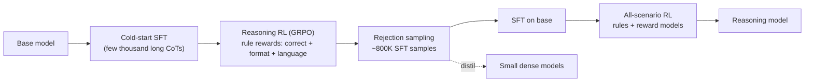

A **reasoning model** (also "large reasoning model", LRM) is an LLM [post-trained](llm-training-pipeline.md), mainly with [reinforcement learning](reinforcement-fine-tuning.md) on tasks whose answers can be checked automatically, to generate a long internal chain of thought before its final answer. In that reasoning it plans, tries approaches, checks itself and backtracks. OpenAI's o1 (September 2024) introduced the category and showed that accuracy improves with both RL training compute and inference-time thinking. DeepSeek-R1 (January 2025) published an open recipe. As of November 2026, every frontier family ships reasoning as a mode or a default: OpenAI's GPT-5.x/6 with `reasoning.effort`, Claude's [adaptive/extended thinking](extended-thinking.md), Gemini's `thinking_level`, DeepSeek's thinking mode ([OpenAI](../sources/openai-learning-to-reason-with-llms.md), [DeepSeek-R1](../sources/deepseek-r1-paper.md), [OpenAI guide](../sources/openai-reasoning-guide.md), [Claude docs](../sources/anthropic-thinking-docs.md), [Gemini docs](../sources/gemini-thinking-docs.md), [DeepSeek docs](../sources/deepseek-thinking-mode-docs.md)).

The difference from [chain-of-thought prompting](chain-of-thought.md) is where the reasoning comes from. CoT *asks* a general model to show its work. A reasoning model has been *trained* to reason, and the length and quality of that reasoning are learned behaviours. This is why it can be scaled with a budget or effort knob ([test-time compute](test-time-compute.md)).

## How they are trained

The core ingredient is **RL with verifiable rewards (RLVR)**. Sample completions for problems with a checkable answer, such as maths with a known result, code with unit tests, or instructions with programmatic constraints. Reward the completions that pass and update the policy. Tulu 3 named the technique: a constant reward on success, in place of a learned reward model ([Tulu 3](../sources/tulu-3-rlvr.md)).

DeepSeek-R1 is the best-documented instance ([DeepSeek-R1](../sources/deepseek-r1-paper.md)):

- **R1-Zero** applies RL directly to a base model, with no SFT. It uses **GRPO**, which samples a group of answers per prompt and uses the group's mean reward as the baseline, so no critic network is needed. Rewards are purely rule-based: answer accuracy plus a format reward for wrapping reasoning in think tags. Neural reward models were rejected because the policy learns to hack them.
- With nothing telling it to, the model's responses grow longer over training, and reflection and backtracking appear on their own. [AIME](benchmarks.md) 2024 pass@1 rose from 15.6% to 71.0%.
- R1-Zero's output was hard to read and mixed languages. **R1** therefore uses four stages: cold-start SFT on a few thousand clean long-CoT examples → reasoning RL (plus a language-consistency reward) → rejection-sample about 800K examples and SFT again → RL across all scenarios, with rule rewards for reasoning and reward models for helpfulness and harmlessness.
- **What did not work:** process reward models (steps are hard to define and easy to hack) and MCTS (the token search space is too large).
- **Distillation:** [fine-tuning](fine-tuning.md) small dense models on R1's 800K traces beat running RL on those small models directly. Qwen-32B scored 72.6% on AIME distilled against 47.0% with RL. See [knowledge distillation](knowledge-distillation.md).

*Diagram: DeepSeek-R1 pipeline as described in the paper.*

OpenAI described o1's training only at a high level: a data-efficient, large-scale RL algorithm that teaches the model to use its chain of thought productively ([OpenAI](../sources/openai-learning-to-reason-with-llms.md)). Synthesis: verifiable rewards explain why reasoning models gained most in maths, code and STEM, where a cheap automatic checker exists. They gained less in open-ended writing, where reward has to come from preference models (see [preference optimization](preference-optimization.md)).

## How they are used: API surface (Nov 2026)

| Vendor | Depth control | Reasoning visible? | Multi-turn / tools rule |
|---|---|---|---|
| OpenAI ([Responses API](openai-responses-api.md)) | `reasoning.effort`: none…max (model-dependent; default `medium`); `reasoning.mode` standard/pro | No. Optional summaries (`reasoning.summary`) | Pass reasoning items back with tool outputs; `encrypted_content` when `store: false` |
| Anthropic ([Messages API](anthropic-messages-api.md)) | `thinking: {type: "adaptive"}` + `output_config.effort` low…max (default `high`; `medium` on Opus 5.5 / Haiku 5.5); legacy `budget_tokens` | Summaries only (`display: "summarized"`), or omitted | Pass thinking blocks back unmodified within a tool-use turn |
| Google [Gemini](gemini-api.md) | `thinking_level` minimal…high (xhigh on one model) | Summaries opt-in | Resend thought blocks/signatures unmodified when stateless |
| DeepSeek | `thinking.type` + `reasoning_effort` low/high/max | Yes, full `reasoning_content` | With `tools`, pass back all prior `reasoning_content` or get a 400 |

Sources: [OpenAI guide](../sources/openai-reasoning-guide.md), [Claude thinking](../sources/anthropic-thinking-docs.md), [Claude steering](../sources/anthropic-steering-thinking-docs.md), [Gemini](../sources/gemini-thinking-docs.md), [DeepSeek](../sources/deepseek-thinking-mode-docs.md).

Common mechanics across vendors:

- **Reasoning tokens are billed as output tokens even when hidden**, and they count toward the output cap (`max_tokens` / `max_output_tokens`). OpenAI says usage runs from hundreds to tens of thousands of tokens per request and advises reserving at least 25K at first. Hitting the cap can return no visible answer at all ([OpenAI guide](../sources/openai-reasoning-guide.md), [Gemini](../sources/gemini-thinking-docs.md)).
- **Sampling knobs are restricted.** Recent Claude models reject non-default `temperature`/`top_p`/`top_k` (and from API version `2026-10-21` every Claude model rejects them), and DeepSeek ignores them in thinking mode ([Claude thinking](../sources/anthropic-thinking-docs.md), [DeepSeek](../sources/deepseek-thinking-mode-docs.md)). See [sampling parameters](sampling-parameters.md).
- **Opaque continuity tokens** (signatures, encrypted reasoning) must be round-tripped unmodified across [function calls](function-calling.md). Dropping them is the most common integration bug (Synthesis, from all four vendors' rules).

## Prompting differences

- Don't add "think step by step". The model already reasons, and the instruction can hurt ([OpenAI best practices](../sources/openai-reasoning-best-practices.md)). Explicit CoT prompts give reasoning models marginal gains at a large time and token cost ([Meincke et al.](../sources/meincke-2025-decreasing-value-of-cot.md)).
- State the goal, constraints, output format and what "done" means, rather than prescribing the steps ([OpenAI guide](../sources/openai-reasoning-guide.md)). Start zero-shot. R1 in particular degrades with [few-shot](few-shot-prompting.md) examples ([DeepSeek-R1](../sources/deepseek-r1-paper.md)).
- Use the effort control before prompt wording to change how much the model thinks. It is calibrated, while prompt steering depends on wording and doesn't work on some models ([Claude steering](../sources/anthropic-steering-thinking-docs.md)).

## When they help, and when not

OpenAI's framing is reasoning models as **planners** and GPT-style models as **workhorses**: a reasoning model plans and makes the decisions, and a fast model executes the steps ([OpenAI best practices](../sources/openai-reasoning-best-practices.md)).

**Use them for:** maths, code and debugging across files, multi-step agentic planning, ambiguous instructions, finding relationships across many dense documents, and grading other models' outputs ([OpenAI best practices](../sources/openai-reasoning-best-practices.md)). See also [LLM-as-judge](llm-as-judge.md) and [coding agents](coding-agents.md). Gemini's guidance is the same in other terms: minimal thinking for retrieval and classification, maximum for hard coding, maths and planning ([Gemini](../sources/gemini-thinking-docs.md)).

**Avoid or turn down for:** latency-sensitive chat, classification, extraction, simple retrieval, and high-volume pipelines where a non-reasoning call already passes your evals. The specific risks:

- **Overthinking.** o1-style models spend many tokens on trivial problems for no accuracy gain ([Chen et al.](../sources/overthinking-o1-like-llms.md)).
- **Inverse scaling.** On some tasks longer reasoning *lowers* accuracy: distraction by irrelevant details, overfitting to familiar framings, drifting into spurious correlations, losing track in long deductions ([Gema et al.](../sources/inverse-scaling-test-time-compute.md)).
- **Weaker general skills.** R1 trailed its non-reasoning sibling on function calling, multi-turn dialogue and JSON output ([DeepSeek-R1](../sources/deepseek-r1-paper.md)). Synthesis: test [structured outputs](structured-outputs.md) and tool use on the reasoning variant specifically, rather than assuming parity.
- **Unfaithful reasoning.** Visible reasoning often omits what actually drove the answer. Claude 3.7 Sonnet mentioned a hint it used about 25% of the time, R1 about 39%. Treat thinking as a debugging aid, not an audit trail ([Anthropic](../sources/anthropic-reasoning-models-dont-say-think.md)).
- **Cost and latency.** Tokens at output price, plus time to first visible token. Hidden reasoning also makes [streaming](streaming.md) UX harder (see [cost and latency optimization](cost-and-latency-optimization.md)).

Synthesis, as a practical decision rule: build the eval first ([LLM evaluation](llm-evaluation.md)). Run the task at no or low reasoning, then step effort up until quality plateaus, and plot quality against cost and p95 latency. [Route](model-routing-and-fallbacks.md) by difficulty: cheap model or low effort by default, escalating hard cases. This mirrors Snell et al.'s finding that the best use of test-time compute depends on how hard the question is ([Snell et al.](../sources/snell-scaling-test-time-compute.md)). See [model selection](model-selection.md).

## Sources

- [Learning to Reason with LLMs (OpenAI)](../sources/openai-learning-to-reason-with-llms.md)
- [DeepSeek-R1](../sources/deepseek-r1-paper.md)
- [Tulu 3: RLVR](../sources/tulu-3-rlvr.md)
- [Scaling LLM Test-Time Compute Optimally](../sources/snell-scaling-test-time-compute.md)
- [OpenAI reasoning models guide](../sources/openai-reasoning-guide.md)
- [OpenAI reasoning best practices](../sources/openai-reasoning-best-practices.md)
- [Claude API docs: Thinking](../sources/anthropic-thinking-docs.md)
- [Claude API docs: Steering thinking](../sources/anthropic-steering-thinking-docs.md)
- [Gemini API docs: Thinking](../sources/gemini-thinking-docs.md)
- [DeepSeek API docs: Thinking mode](../sources/deepseek-thinking-mode-docs.md)
- [Inverse Scaling in Test-Time Compute](../sources/inverse-scaling-test-time-compute.md)
- [Do NOT Think That Much for 2+3=?](../sources/overthinking-o1-like-llms.md)
- [Reasoning models don't always say what they think](../sources/anthropic-reasoning-models-dont-say-think.md)
- [The Decreasing Value of Chain of Thought](../sources/meincke-2025-decreasing-value-of-cot.md)
