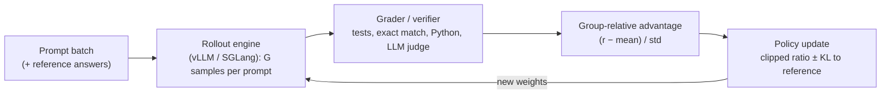

**Reinforcement fine-tuning (RFT)** trains a model on *prompts plus a way to score answers* rather than on target answers. The trainer samples several completions per prompt from the current model and scores each with a grader: a unit test, an exact-match check, a Python function or an LLM judge. It then updates the weights so that higher-scoring completions become more likely. When the score comes from a deterministic correctness check, the method is called **RL with verifiable rewards (RLVR)**. Tulu 3 named the technique: a fixed reward if the check passes, nothing otherwise, with no learned reward model ([Tulu 3](../sources/tulu-3-rlvr.md)). RLVR is the core of how [reasoning models](reasoning-models.md) are trained ([DeepSeek-R1](../sources/deepseek-r1-paper.md)). "RFT" is also the product name for managed versions on OpenAI, Amazon Bedrock and Vertex AI ([OpenAI RFT](../sources/openai-reinforcement-fine-tuning-guide.md), [Bedrock](../sources/bedrock-model-customization.md), [Vertex AI](../sources/vertex-ai-gemini-tuning.md)). It sits beside SFT and [preference optimization](preference-optimization.md) in the [fine-tuning](fine-tuning.md) toolbox.

## How it differs from SFT and DPO

| | SFT | DPO | RFT / RLVR |
|---|---|---|---|
| Data you supply | prompt → ideal answer | prompt → chosen / rejected | prompt (+ reference fields) and a grader |
| Who writes the training text | you (or a teacher) | you (or a teacher) | the model itself (on-policy samples) |
| Learns | imitation of format and content | relative preference | whatever maximises the grader |
| Data volume | hundreds to thousands | hundreds to thousands | dozens to a few hundred prompts (managed services); hundreds or more open-source |
| Main risk | copies errors in the targets | over-optimises the implicit reward | reward hacking; no signal if the model never succeeds |

Volumes: [Vertex AI](../sources/vertex-ai-gemini-tuning.md), [OpenAI RFT](../sources/openai-reinforcement-fine-tuning-guide.md), [Unsloth](../sources/unsloth-rl-guide.md). Synthesis: the key structural difference is on-policy data. RFT learns from the model's own attempts, so it can only reinforce behaviour the model sometimes already produces.

## The training loop

Synthesis: diagram assembled from the GRPO, DAPO, TRL and verl sources.

**GRPO** (Group Relative Policy Optimization) is the default algorithm. PPO needs a learned value model (critic), usually as large as the policy. GRPO drops it: it samples a group of G outputs per prompt and uses each output's reward, normalised within its group, as the advantage. The KL penalty to a reference model is added to the loss directly. DeepSeekMath used G = 64 and KL coefficient 0.04 ([GRPO](../sources/deepseekmath-grpo-2024.md)). DeepSeek-R1-Zero ran GRPO on a base model with only rule rewards (answer correctness plus a format reward for reasoning inside think tags). Long, self-checking [chains of thought](chain-of-thought.md) emerged, and AIME 2024 pass@1 rose from 15.6% to 71.0%. Neural reward models were avoided because the policy learned to hack them ([DeepSeek-R1](../sources/deepseek-r1-paper.md)).

### GRPO variants and why they exist

| Variant | Change | Problem addressed |
|---|---|---|
| **DAPO** (ByteDance, 2025) | Clip-higher (ε_low 0.2, ε_high 0.28); dynamic sampling drops all-right / all-wrong groups; token-level loss averaging; masks or softly penalises overlong answers; no KL | Entropy collapse, zero-gradient batches, long answers under-weighted, truncation noise. 50 vs 47 AIME (Qwen2.5-32B) in half the steps ([DAPO](../sources/dapo-2025.md)) |
| **Dr. GRPO** (2025) | Removes the length and std normalisation | GRPO bias that inflates the length of *wrong* answers ([Dr. GRPO](../sources/liu-2025-dr-grpo.md)) |
| **GSPO** (Qwen, 2025) | Sequence-level importance ratio and clipping | Token-level ratio instability, especially for [MoE](mixture-of-experts.md) models; used for Qwen3 ([GSPO](../sources/gspo-2025.md)) |
| **On-policy distillation** | Per-token reverse KL to a teacher as a dense reward | RL's sparse reward; Qwen3 reports 74.4% AIME'24 at ~1/10 the GPU-hours of RL ([Thinking Machines](../sources/on-policy-distillation-thinking-machines.md)) |

TRL's `GRPOTrainer` exposes these as `loss_type` (`dapo` is the default; `dr_grpo` is available). Other defaults: `num_generations=8`, `beta=0.0` (no KL and no reference model loaded), `epsilon=0.2`, `scale_rewards="group"`, LR 1e-6 ([TRL](../sources/hugging-face-trl-docs.md)). Unsloth exposes GRPO, Dr. GRPO and GSPO, plus `epsilon_high` and `mask_truncated_completions` ([Unsloth](../sources/unsloth-rl-guide.md)).

## How reasoning models are trained

The DeepSeek-R1 pipeline is the public reference ([DeepSeek-R1](../sources/deepseek-r1-paper.md)):

1. **Cold-start SFT** on thousands of readable long-CoT examples. This fixes R1-Zero's poor readability and language mixing.
2. **Reasoning RL** (GRPO, rule rewards, plus a language-consistency reward).
3. **Rejection sampling** from that checkpoint to build ~800K SFT samples (~600K reasoning, ~200K general), then retrain. This is a [synthetic data](synthetic-data-generation.md) step and descends from STaR's "keep rationales that reach the right answer" loop ([STaR](../sources/star-zelikman-2022.md)).
4. **All-scenario RL**: rule rewards for reasoning, reward models for helpfulness and harmlessness.
5. **[Distillation](knowledge-distillation.md)** of the 800K samples into small dense models. On Qwen-32B, distillation (72.6% AIME) beat running RL on the small model directly (47.0%).

Approaches that failed for DeepSeek: process reward models (steps are hard to define and get hacked) and MCTS ([DeepSeek-R1](../sources/deepseek-r1-paper.md)).

## Reward design

Reward design is most of the work.

- **Prefer verifiers**: exact or normalised answer match, unit tests, compilers, schema validation ([structured outputs](structured-outputs.md)), programmatic instruction constraints ([Tulu 3](../sources/tulu-3-rlvr.md)). DAPO used +1/−1 and converted answers to integers so they parse reliably ([DAPO](../sources/dapo-2025.md)).
- **Compose small rewards**: Unsloth recommends a rubric of several verifiable sub-rewards (format, has-a-number, correct answer, length penalty) over one all-or-nothing score ([Unsloth](../sources/unsloth-rl-guide.md)). OpenAI's `multi` grader combines sub-graders with a formula ([OpenAI RFT](../sources/openai-reinforcement-fine-tuning-guide.md)).
- **Model graders** (`score_model`, [LLM-as-judge](llm-as-judge.md)) extend RFT to fuzzy tasks but are the easiest to hack. Per-grader reward curves help catch overfitting to one grader ([OpenAI RFT](../sources/openai-reinforcement-fine-tuning-guide.md)).
- **Guess-proofing**: a task with a small answer space (yes/no, multiple choice) rewards lucky guesses for bad reasoning ([OpenAI RFT](../sources/openai-reinforcement-fine-tuning-guide.md)).

## Platforms and tooling (as of 2026-11-14)

| Option | What you get | Notes |
|---|---|---|
| OpenAI RFT | Managed RFT of o4-mini with string, similarity, Python, model and multi graders; `reasoning_effort`, `compute_multiplier`, `eval_interval` | **Effectively ended:** o4-mini and its fine-tunes shut down 2026-10-23; the fine-tuning platform is closed to new users, and job creation ends for remaining customers 2027-01-06 ([OpenAI RFT](../sources/openai-reinforcement-fine-tuning-guide.md), [deprecations](../sources/openai-deprecations-fine-tuning.md)) |
| [Amazon Bedrock](amazon-bedrock.md) | Reinforcement fine-tuning with reward functions such as AWS Lambda; prompts or invocation logs as data | [Bedrock](../sources/bedrock-model-customization.md) |
| [Vertex AI](google-vertex-ai.md) | RL fine-tuning of Gemini 3.5 Flash / 3.1 Flash-Lite with reward functions; dozens to a few hundred prompts; SFT→RLFT chaining | [Vertex AI](../sources/vertex-ai-gemini-tuning.md) |
| [TRL](hugging-face-ecosystem.md) | `GRPOTrainer`, `AsyncGRPO`, `RLOO`; [vLLM](vllm.md) colocate or server rollouts | [TRL](../sources/hugging-face-trl-docs.md) |
| verl | Large-scale RL: PPO, GRPO, DAPO and more; FSDP/Megatron training with vLLM/SGLang rollouts; multi-turn agentic RL with tools; [LoRA](peft-and-lora.md) | [verl](../sources/verl-docs.md) |
| Unsloth | Single-GPU GRPO with QLoRA; ~5 GB VRAM for ≤1.5B models (vendor claim); vLLM rollouts via `fast_inference` | [Unsloth](../sources/unsloth-rl-guide.md) |
| Axolotl | GRPO in a YAML-driven pipeline | [Axolotl](../sources/axolotl-docs.md) |

OpenAI's managed-RFT workflow still shows what a good job looks like ([OpenAI RFT](../sources/openai-reinforcement-fine-tuning-guide.md)). JSONL rows hold `messages` plus grader fields. Graders reference them as `{{item.answer}}`, and the model output as `{{sample.output_text}}`. You hold out a validation split and watch `train_reward_mean` against `valid_reward_mean`. The best three checkpoints by validation reward are kept.

## Failure modes

- **Reward hacking.** The model maximises the grader, not the intent. Inspect samples, not just reward curves ([OpenAI RFT](../sources/openai-reinforcement-fine-tuning-guide.md), [DeepSeek-R1](../sources/deepseek-r1-paper.md)).
- **No signal at 0% (or 100%).** If every sample in a group gets the same reward, the advantage is zero. If the base model never succeeds, RL cannot start. Run a baseline eval and pick prompts of mixed difficulty ([OpenAI RFT](../sources/openai-reinforcement-fine-tuning-guide.md), [DAPO](../sources/dapo-2025.md), [Unsloth](../sources/unsloth-rl-guide.md)).
- **Entropy collapse.** The policy becomes deterministic and stops exploring. Clip-higher counters it ([DAPO](../sources/dapo-2025.md)).
- **Length drift.** Normalisation bias makes wrong answers longer ([Dr. GRPO](../sources/liu-2025-dr-grpo.md)), and truncation noise also distorts length ([DAPO](../sources/dapo-2025.md)). This affects cost and latency at inference ([test-time compute](test-time-compute.md)).
- **Sharpening, not expanding.** RLVR models beat their base at pass@1 but lose at large pass@k. The reasoning paths were already in the base distribution, and distillation can add new ones ([Yue et al.](../sources/yue-2025-rlvr-reasoning-boundary.md), [GRPO](../sources/deepseekmath-grpo-2024.md)). Base models can also show "aha" reflection before any RL, so be wary of attributing everything to RL ([Dr. GRPO](../sources/liu-2025-dr-grpo.md)).
- **Slow, expensive feedback.** Expect around 300 steps before reward rises, and runs of 12+ hours on one GPU ([Unsloth](../sources/unsloth-rl-guide.md)). Slow graders and model graders lengthen and raise the cost of managed jobs ([OpenAI RFT](../sources/openai-reinforcement-fine-tuning-guide.md)).
- **Regressions elsewhere.** R1 was weaker than its base at [function calling](function-calling.md), multi-turn and JSON output ([DeepSeek-R1](../sources/deepseek-r1-paper.md)). Keep a broad regression suite ([LLM evaluation](llm-evaluation.md)).

## When to use it

Use RFT when:
- Correctness can be checked by a program or an unambiguous rubric that experts would agree on: code with tests, extraction to a schema, maths, classification with a verified gold label, tool-call success ([OpenAI RFT](../sources/openai-reinforcement-fine-tuning-guide.md)).
- The model already succeeds sometimes, but not reliably, and you have few labelled answers but can write a checker ([Vertex AI](../sources/vertex-ai-gemini-tuning.md)).

Do not use it when (Synthesis, except the last point):
- The task is style or format. SFT is cheaper and more predictable.
- Only fuzzy human taste defines quality. Use [DPO](preference-optimization.md) or better prompts.
- The model lacks the knowledge. Use [RAG](retrieval-augmented-generation.md).
- A stronger teacher exists. Distilling its traces may beat RL on a small model ([DeepSeek-R1](../sources/deepseek-r1-paper.md), [Thinking Machines](../sources/on-policy-distillation-thinking-machines.md)).

Synthesis: for a [Forward Deployed Engineer](forward-deployed-engineering.md) in late 2026, the practical path is [open weights](open-weight-models.md) plus TRL, Unsloth or verl, or a cloud RFT service (Bedrock, Vertex AI). OpenAI's RFT is no longer an option. Build the grader and the eval first; they double as your [verification](verification-and-evals.md) harness whether or not you train.

## Sources

- [Tulu 3: RLVR](../sources/tulu-3-rlvr.md)
- [DeepSeekMath and GRPO](../sources/deepseekmath-grpo-2024.md)
- [DeepSeek-R1](../sources/deepseek-r1-paper.md)
- [DAPO](../sources/dapo-2025.md)
- [Understanding R1-Zero-Like Training (Dr. GRPO)](../sources/liu-2025-dr-grpo.md)
- [GSPO](../sources/gspo-2025.md)
- [Does RL Really Incentivize Reasoning? (Yue et al.)](../sources/yue-2025-rlvr-reasoning-boundary.md)
- [STaR](../sources/star-zelikman-2022.md)
- [On-Policy Distillation (Thinking Machines)](../sources/on-policy-distillation-thinking-machines.md)
- [OpenAI Reinforcement Fine-Tuning Guide](../sources/openai-reinforcement-fine-tuning-guide.md)
- [OpenAI deprecations: fine-tuning wind-down](../sources/openai-deprecations-fine-tuning.md)
- [Amazon Bedrock model customization](../sources/bedrock-model-customization.md)
- [Vertex AI Gemini tuning](../sources/vertex-ai-gemini-tuning.md)
- [Hugging Face TRL docs](../sources/hugging-face-trl-docs.md)
- [verl docs](../sources/verl-docs.md)
- [Unsloth RL guide](../sources/unsloth-rl-guide.md)
- [Axolotl docs](../sources/axolotl-docs.md)
