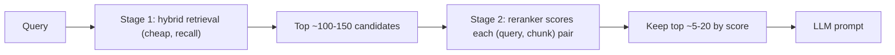

**Reranking** is the second stage of a two-stage retriever: a fast first stage ([BM25, dense or hybrid search](hybrid-search.md)) fetches a wide candidate set (often 50-150 chunks), and a slower, more accurate model re-scores each candidate against the query so that only the best few reach the LLM. The first stage optimizes recall cheaply; the reranker buys precision. In Anthropic's experiments, adding a reranker on top of [contextual embeddings](contextual-retrieval.md) plus BM25 lowered the retrieval failure rate from 2.9% to 1.9% ([Anthropic](../sources/anthropic-contextual-retrieval.md)), and the owner's guide lists it as the fix for "relevant docs buried low" ([Notebook](../sources/notebook-rag-cag.md)).

## Why a second stage: bi-encoder vs cross-encoder

| | Bi-encoder ([embedding](embeddings.md) retrieval) | Cross-encoder (reranker) |
|---|---|---|
| Input | Query and document encoded **separately** | Query and document encoded **together** |
| Output | A vector per text; cosine similarity | One relevance score per pair |
| Precompute docs? | Yes, offline | No, every pair at query time |
| Cost | One query encoding + [ANN](ann-indexes.md) lookup | One transformer pass per candidate |
| Accuracy | Lower: no token-level interaction between query and doc | Higher: full attention across both |

Source: [SBERT docs](../sources/sbert-cross-encoders.md). Their scale illustration: comparing 10,000 sentences pairwise with a cross-encoder means about 50 million passes (about 65 hours) versus about 5 seconds to embed them once. Hence the standard pattern: bi-encoder retrieves around the top 100, cross-encoder re-scores those ([SBERT docs](../sources/sbert-cross-encoders.md)).

## Kinds of rerankers

| Type | Mechanism | Examples | Trade-off |
|---|---|---|---|
| Cross-encoder | BERT-style model reads `[query; doc]`, outputs a score | `cross-encoder/ms-marco-MiniLM-L6-v2` ([SBERT](../sources/sbert-cross-encoders.md)) | Accurate; latency grows linearly with candidates |
| Hosted rerank API | Managed cross-encoder-style model, multilingual | Cohere `rerank-v5.0-pro` / `-fast`, `rerank-v4.0-*`, `rerank-v3.5` (as of 2026-11) ([Cohere](../sources/cohere-rerank-docs.md)) | No infra; per-call cost and network latency; data leaves your VPC |
| [Late interaction](late-interaction-retrieval.md) | Per-token vectors for query and doc, precomputed for docs, cheap interaction at query time | ColBERT ([Khattab & Zaharia](../sources/khattab-2020-colbert.md)) | Two orders of magnitude faster and four orders of magnitude fewer FLOPs per query than a BERT cross-encoder; more storage |
| LLM reranker | Prompt an LLM to output a ranking/permutation of candidates | RankGPT ([Sun et al.](../sources/sun-2023-rankgpt.md)) | Competitive with supervised rerankers; costly and slow; [distillable](knowledge-distillation.md) (a 440M distilled model beat a 3B supervised one on BEIR) |

## The Cohere Rerank API shape

Send a `query`, a list of `documents` and `top_n`; get back `(index, relevance_score)` pairs sorted by relevance. From v3.5 one multilingual model covers 100+ languages; structured records rank best serialized as YAML ([Cohere](../sources/cohere-rerank-docs.md)). Synthesis: rerank scores are relative to the query; use them for ordering and for a tuned cut-off threshold, not as calibrated probabilities across queries.

## Choosing the numbers

- **Candidates in (N):** Anthropic reranked the top 150 ([Anthropic](../sources/anthropic-contextual-retrieval.md)). Larger N raises recall ceiling and latency linearly.
- **Chunks out (K):** passing 20 chunks beat 10 and 5 in Anthropic's evaluation ([Anthropic](../sources/anthropic-contextual-retrieval.md)). But more context is not free: models use the middle of long contexts poorly ([long-context degradation](long-context-degradation.md); [Lost in the Middle](../sources/lost-in-the-middle.md)), so with large K put the top-scored chunks at the start and end of the context (Synthesis).
- **Latency budget:** Anthropic notes reranking adds latency and the number of chunks reranked is a cost-performance trade-off ([Anthropic](../sources/anthropic-contextual-retrieval.md)).

## Beyond relevance

Synthesis: the rerank stage is also the natural place for business logic: recency boosts, source-authority weights, de-duplication of near-identical chunks, per-user permission filtering if stage 1 could not apply it, and diversity (avoid five chunks from the same page).

## Failure modes

- **Recall ceiling:** a reranker can only reorder what stage 1 returned; it cannot rescue a missing chunk (Synthesis, consistent with "retrieval is the ceiling" in the [Notebook](../sources/notebook-rag-cag.md)).
- **Truncation:** cross-encoders have a max input length; long chunks are silently cut, so the deciding sentence may never be read (Synthesis).
- **Domain shift:** MS MARCO-trained rerankers may misjudge legal, medical or code text; evaluate on your own queries (Synthesis).
- **Latency spikes:** linear in N; batch on GPU or use a `-fast` tier (Synthesis).

## When to use / when not

- **Use** whenever retrieval quality matters and you can spend roughly tens to hundreds of milliseconds per query: it is one of the highest-return additions to a RAG pipeline ([Anthropic](../sources/anthropic-contextual-retrieval.md)).
- **Skip** for tiny corpora that fit in context, or ultra-low-latency autocomplete-style search (Synthesis).
- **Prefer an LLM reranker** only for low-volume, high-value queries or as a teacher to distil a small reranker ([Sun et al.](../sources/sun-2023-rankgpt.md)).

See also [RAG](retrieval-augmented-generation.md), [cost and latency optimization](cost-and-latency-optimization.md).

## Sources

- [Sentence-Transformers docs: Cross-Encoders](../sources/sbert-cross-encoders.md)
- [Anthropic: Introducing Contextual Retrieval](../sources/anthropic-contextual-retrieval.md)
- [Cohere docs: Rerank overview](../sources/cohere-rerank-docs.md)
- [Khattab & Zaharia 2020: ColBERT](../sources/khattab-2020-colbert.md)
- [Sun et al. 2023: RankGPT](../sources/sun-2023-rankgpt.md)
- [Liu et al. 2023: Lost in the Middle](../sources/lost-in-the-middle.md)
- [Notebook: RAG vs CAG vs GraphRAG](../sources/notebook-rag-cag.md)
