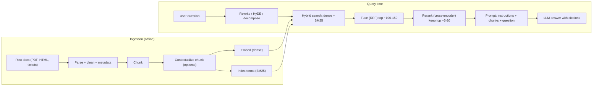

**Retrieval-augmented generation (RAG)** answers a question by first retrieving relevant passages from an external corpus and then letting the LLM generate from those passages placed in its prompt. The model's weights are the *parametric* memory; the index is a *non-parametric* memory that can be updated, swapped or permission-filtered without retraining ([Lewis et al. 2020](../sources/lewis-2020-retrieval-augmented-generation.md)). It is the default way to ground answers in private, large or fast-changing data and to reduce [hallucination](hallucination.md) by giving the model something to cite ([Notebook](../sources/notebook-rag-cag.md)).

## Origin

The term comes from Lewis et al. (NeurIPS 2020): a DPR bi-encoder retriever over about 21M 100-word Wikipedia passages, a BART-large generator, and only the query encoder and generator fine-tuned. Two variants: **RAG-Sequence** conditions the whole answer on one set of passages, **RAG-Token** may draw on a different passage per token. Their key demonstration: replacing the 2016 Wikipedia index with a 2018 one updated the model's answers about world leaders without any retraining ([source](../sources/lewis-2020-retrieval-augmented-generation.md)). Modern RAG keeps the idea but usually drops the joint training: a frozen, off-the-shelf retriever and a frozen chat LLM glued by a prompt (Synthesis).

## The pipeline end to end

Synthesis: the diagram assembles the stages described by [Anthropic](../sources/anthropic-contextual-retrieval.md) and the [Notebook](../sources/notebook-rag-cag.md); no single source shows exactly this graph.

1. **Ingestion.** Parse documents ([document processing](document-processing.md)), split them into [chunks](chunking.md), embed each chunk with an [embedding model](embeddings.md) into a [vector database](vector-databases.md) and, for hybrid search, also build a keyword index. The owner's [experiment 13](../sources/notebook-13-rag.md) is the minimal version: split, embed, FAISS, top-k, grounded answer.
2. **Retrieval.** Encode the query and find nearest chunks with an [ANN index](ann-indexes.md), ideally fused with BM25 ([hybrid search](hybrid-search.md)), then [rerank](reranking.md) a wide candidate set down to a few.
3. **Augmentation.** Put the chunks in the prompt with an instruction to answer only from them and to cite. Order matters: models use information at the start and end of the context better than the middle ([Lost in the Middle](../sources/lost-in-the-middle.md)), so put the best chunks at the edges and don't pad with marginal ones.
4. **Generation.** The LLM answers; citations let users and evaluators check grounding.

## Query-side techniques

| Technique | Fixes | Mechanism | Cost |
|---|---|---|---|
| [Query rewriting](query-transformation.md) (Rewrite-Retrieve-Read) | Vague, conversational or multi-part queries | An LLM rewrites the query before search; a small rewriter can be RL-trained on reader feedback ([Ma et al.](../sources/ma-2023-query-rewriting.md)) | One extra LLM call |
| HyDE | Short queries embed poorly next to long documents | An LLM writes a hypothetical answer; embed *that* and search ([Gao et al.](../sources/gao-2022-hyde.md)) | One generation per query; fake details can steer retrieval |
| Decomposition / multi-query | Questions needing several facts | Split into sub-queries, retrieve for each, merge ([Notebook](../sources/notebook-rag-cag.md)) | N retrievals |
| [Contextual retrieval](contextual-retrieval.md) | Chunks that lost their document context | Prepend an LLM-written 50-100 token blurb to each chunk before embedding and BM25 ([Anthropic](../sources/anthropic-contextual-retrieval.md)) | One-time, about $1.02 per M doc tokens (2024 pricing, with prompt caching) |

Anthropic's measurements (failure rate = 1 - recall@20) show how the stages stack: 5.7% baseline, 3.7% with contextual embeddings, 2.9% adding contextual BM25, 1.9% adding a reranker, a 67% reduction overall ([source](../sources/anthropic-contextual-retrieval.md)).

## RAG vs CAG vs long context

**Cache-augmented generation (CAG)** skips retrieval: preload the whole (small) knowledge base into the prompt once, precompute its [KV cache](kv-cache.md), and answer every query from that cached prefix ([Chan et al.](../sources/chan-2024-cache-augmented-generation.md)). With hosted APIs this is long context plus [prompt caching](prompt-caching.md) ([Notebook](../sources/notebook-rag-cag.md)). Anthropic's rule of thumb: under about 200k tokens (about 500 pages), just put it all in the prompt ([source](../sources/anthropic-contextual-retrieval.md)).

| | RAG | CAG |
|---|---|---|
| Corpus size | Unbounded | Must fit the [context window](context-window.md) |
| Freshness | Update the index any time | Rebuild the cache on change |
| Main failure | Missed or wrong retrieval | Overflow, staleness, [long-context degradation](long-context-degradation.md) |
| Sees whole document | No, only chunks | Yes |
| Infra | Embeddings + vector DB (+ BM25, reranker) | Model + caching |

Evidence: on HotPotQA and SQuAD subsets up to 85k tokens with Llama 3.1 8B, CAG beat sparse and dense RAG in five of six settings, but sparse RAG (top-5) won on the largest HotPotQA set (85k tokens; BERTScore 0.7535 vs 0.7407). The authors note the CAG advantage narrows as the corpus grows, citing prior findings on long-context degradation, but do not analyse that specific result ([Chan et al.](../sources/chan-2024-cache-augmented-generation.md)). The common production shape mixes them: cache the stable core (policies, glossary), retrieve the volatile long tail (tickets, catalog) ([Notebook](../sources/notebook-rag-cag.md), [experiment 14](../sources/notebook-14-rag-cag.md)).

## Variants for harder questions

- **[GraphRAG](graphrag.md)** for multi-hop and whole-corpus ("main themes?") questions that no single chunk answers.
- **[Agentic RAG](agentic-rag.md)**: retrieval becomes a [tool](tools.md) the model calls iteratively; includes corrective RAG (grade, then fall back) and Self-RAG (model decides when to retrieve and critiques support). Agents increasingly retrieve "just in time" with tools such as grep instead of only pre-computed embeddings, at the cost of speed ([Anthropic](../sources/anthropic-effective-context-engineering.md)).

## Evaluating RAG

Evaluate retrieval and generation separately, since "retrieval is the ceiling": if the right chunk never arrives, the generator cannot recover ([Notebook](../sources/notebook-rag-cag.md)).

- **Retrieval:** recall@k / failure rate on a labelled set of (question, relevant chunk) pairs, as Anthropic did ([source](../sources/anthropic-contextual-retrieval.md)).
- **Generation (RAGAS):** *faithfulness* = supported claims / total claims in the answer; *answer relevance* = mean cosine similarity between the question and questions an LLM regenerates from the answer; *context relevance* = share of context sentences actually needed ([Es et al.](../sources/es-2023-ragas.md)). The library adds context precision, context recall (needs references), noise sensitivity and an HHEM classifier option for cheaper faithfulness checks, though that option sits in the legacy metrics API that Ragas has said it will remove in 1.0 ([Ragas docs](../sources/ragas-docs-metrics.md)). In the paper, faithfulness agreed with humans 95% of the time; context relevance only 70% ([Es et al.](../sources/es-2023-ragas.md)).

These are [LLM-as-judge](llm-as-judge.md) metrics, so they inherit judge bias and cost; see [LLM evaluation](llm-evaluation.md).

## Failure modes

| Symptom | Likely cause | Fix |
|---|---|---|
| Correct doc exists, never retrieved | Chunk lost context; exact term (ID, SKU, error code) missed by dense search | [Contextual retrieval](../sources/anthropic-contextual-retrieval.md), [hybrid search](hybrid-search.md) |
| Right chunk retrieved but ranked 30th | Bi-encoder imprecision | [Reranking](reranking.md), pass 20 rather than 5 chunks ([Anthropic](../sources/anthropic-contextual-retrieval.md)) |
| Answer ignores a supplied chunk | Lost in the middle, too many chunks | Fewer, better-ordered chunks ([Liu et al.](../sources/lost-in-the-middle.md)) |
| Confident answer from irrelevant context | No relevance gate | Corrective RAG / grading ([agentic RAG](agentic-rag.md)) |
| "Summarize everything" fails | Global question, top-k can't cover it | [GraphRAG](graphrag.md) |
| Stale answers | Index not refreshed | Incremental re-ingest |

Synthesis: two more production failure modes worth designing for are access control (filter by the user's permissions at retrieval time, not after generation) and [prompt injection](prompt-injection.md) through retrieved documents, which should be treated as data, not instructions.

## When to use / when not

- **Use RAG** when the corpus is large, changes often, needs per-user filtering, or answers need citations ([Notebook](../sources/notebook-rag-cag.md)).
- **Prefer CAG / long context** when the corpus is small (roughly under 200k tokens) and stable ([Anthropic](../sources/anthropic-contextual-retrieval.md)).
- **Prefer [fine-tuning](fine-tuning.md)** for changing behaviour, format or style rather than adding facts (Synthesis, consistent with the Notebook's note that fine-tuning facts is slow and hard to update).
- **Start simple** and add hybrid, rerank or graph machinery only when evals show it helps ([Notebook](../sources/notebook-rag-cag.md)).

Frameworks: [LlamaIndex](llamaindex.md) and [LangChain](langchain.md) provide the plumbing; [text-to-SQL](text-to-sql.md) is the structured-data counterpart.

## Sources

- [Lewis et al. 2020: Retrieval-Augmented Generation](../sources/lewis-2020-retrieval-augmented-generation.md)
- [Anthropic: Introducing Contextual Retrieval](../sources/anthropic-contextual-retrieval.md)
- [Notebook: RAG vs CAG vs GraphRAG](../sources/notebook-rag-cag.md)
- [Notebook experiment 13: RAG](../sources/notebook-13-rag.md)
- [Notebook experiment 14: RAG + CAG](../sources/notebook-14-rag-cag.md)
- [Gao et al. 2022: HyDE](../sources/gao-2022-hyde.md)
- [Ma et al. 2023: Query Rewriting](../sources/ma-2023-query-rewriting.md)
- [Liu et al. 2023: Lost in the Middle](../sources/lost-in-the-middle.md)
- [Chan et al. 2024: Cache-Augmented Generation](../sources/chan-2024-cache-augmented-generation.md)
- [Es et al. 2023: RAGAS](../sources/es-2023-ragas.md)
- [Ragas docs: Available metrics](../sources/ragas-docs-metrics.md)
- [Anthropic: Effective context engineering](../sources/anthropic-effective-context-engineering.md)
