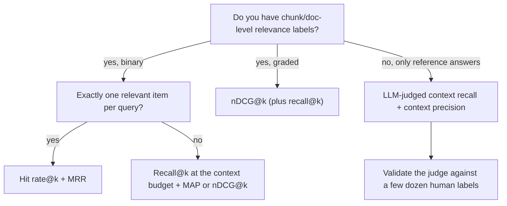

**Retrieval metrics** score a ranked list of results against **relevance judgments** (qrels): for each query, which documents or chunks are relevant, optionally with a grade. Set-based metrics (hit rate, recall@k, precision@k) ask *what* landed in the top k; rank-aware metrics (MRR, MAP, nDCG) also ask *where*. They come from three decades of TREC-style IR evaluation ([Manning et al.](../sources/manning-2008-ir-book-evaluation.md)) and are the standard way to test the retrieval half of a [RAG](retrieval-augmented-generation.md) system separately from the generator. LLM-judged variants (RAGAS context precision/recall) apply the same ideas when you have reference answers but no chunk-level labels. Every one of them is only as good as the labelled set behind it, and building that set is most of the work.

## The metrics

Notation: for one query, `Rel` is the set of relevant items, the system returns a ranked list, and `rel_i` is the relevance of the item at rank i (0/1, or a grade). Each metric is computed per query and then averaged over queries (macro-average), so every query counts equally ([Manning et al.](../sources/manning-2008-ir-book-evaluation.md)).

| Metric | Per-query formula | Relevance | Rank-aware | Answers the question |
|---|---|---|---|---|
| Hit rate@k (success@k) | 1 if any relevant item in top k, else 0 | binary | no | "Did anything useful reach the model?" |
| Recall@k | \|relevant in top k\| / \|Rel\| | binary | no | "How much of what's needed did we fetch?" |
| Precision@k | \|relevant in top k\| / k | binary | no | "How much of the context is noise?" |
| R-precision | precision@\|Rel\| (equals recall at that cut-off) | binary | no | precision adjusted for query difficulty |
| RR / MRR | 1 / rank of first relevant item (0 if none) | binary | yes | "How far down is the first good hit?" |
| AP / MAP | mean of precision@i over the rank i of each relevant item; unretrieved relevant items contribute 0 | binary | yes | whole-ranking quality across recall levels |
| nDCG@k | DCG@k / ideal DCG@k, with DCG@k = Σ gain(rel_i) / log2(i+1) | graded | yes | "Are the *most* relevant items at the top?" |

**Hit rate** is what LlamaIndex's `HitRate` computes by default ([LlamaIndex](../sources/llamaindex-retrieval-metrics-code.md)). It equals recall@k when each query has exactly one relevant item, which is common in synthetic (question, source chunk) sets. Anthropic's contextual retrieval results are reported as a failure rate, 1 − recall@20 ([Anthropic](../sources/anthropic-contextual-retrieval.md)).

**Precision@k** needs no knowledge of how many relevant items exist, but it is the least stable of the common measures and averages badly: if a query has only 8 relevant documents, even a perfect system scores 0.4 at P@20. **R-precision** fixes this by cutting at |Rel| and correlates highly with MAP in practice ([Manning et al.](../sources/manning-2008-ir-book-evaluation.md)).

**MRR** comes from the TREC-8 question answering track (1999), where systems returned up to five ranked answers and each question scored the reciprocal rank of the first correct one ([Voorhees](../sources/voorhees-1999-trec8-qa-track.md)). It suits tasks with one right answer, and it ignores everything after the first hit.

**MAP** averages precision at every relevant item's rank, divided by the total number of relevant items, so a relevant document that is never retrieved counts as precision 0. For one query AP approximates the area under the precision-recall curve. TREC treated it as the standard single-figure measure because it discriminates well between systems and is stable ([Manning et al.](../sources/manning-2008-ir-book-evaluation.md)).

**nDCG** was introduced by Järvelin and Kekäläinen (ACM TOIS, 2002) to use graded relevance (they used a 0-3 scale). Gains are discounted by the log of the rank and divided by the score of the ideal ranking, so 1.0 means the best possible order. The ideal is built from *all* known relevant items for the topic, not only the ones the system retrieved ([Järvelin and Kekäläinen](../sources/jarvelin-2002-cumulated-gain.md)). Two gain functions are in use: linear (gain = grade), as in the original paper, and exponential (gain = 2^grade − 1), as in the textbook formula ([Manning et al.](../sources/manning-2008-ir-book-evaluation.md)). With binary labels the two are identical. BEIR picked nDCG@10 as its single metric because it is rank-aware and works for both binary and graded labels, while precision and recall ignore rank and MRR and MAP are binary-only ([BEIR](../sources/thakur-2021-beir.md)). Synthesis: nDCG@10 has since become the usual headline number on embedding and retrieval leaderboards (see [embeddings](embeddings.md), [benchmarks](benchmarks.md)), which is one reason it is not the best headline metric for RAG (below).

### A worked example

One query, three relevant chunks {A, B, C}, the retriever returns `[X, A, Y, B, Z]` (k = 5):

| Metric | Value | Why |
|---|---|---|
| Hit rate@5 | 1 | A is in the top 5 |
| Recall@5 | 0.67 | 2 of 3 relevant |
| Precision@5 | 0.40 | 2 of 5 retrieved |
| RR | 0.50 | first hit at rank 2 |
| AP | 0.33 | (1/2 + 2/4) / 3 |
| RAGAS-style context precision@5 | 0.50 | (1/2 + 2/4) / 2, divided by relevant items *in the top 5* |
| nDCG@5 (binary) | 0.50 | (1/log2 3 + 1/log2 5) / (1 + 1/log2 3 + 1/log2 4) = 1.062 / 2.131 |

Synthesis: the same ranking scores anywhere from 0.33 to 1.0 depending on the metric. Always report which metric, which k, and which implementation.

## LLM-judged retrieval metrics (RAGAS, DeepEval)

When there are no chunk-level labels, RAGAS and DeepEval use an LLM judge against a reference answer (see [RAGAS and DeepEval](ragas-and-deepeval.md), [LLM-as-judge](llm-as-judge.md)):

- **Context precision@K** (RAGAS): the judge marks each retrieved chunk relevant or not (v_k ∈ {0,1}) against the reference; score = Σ (precision@k × v_k) / (number of relevant chunks in the top K). An irrelevant chunk at rank 1 roughly halves the score; at rank 2 it barely matters ([Ragas docs](../sources/ragas-metric-docs-and-releases.md)).
- **Context recall** (RAGAS, DeepEval): split the reference answer into claims; score = claims attributable to the retrieved context / total claims ([Ragas docs](../sources/ragas-metric-docs-and-releases.md), [DeepEval docs](../sources/deepeval-answer-relevancy-and-contextual-recall-docs.md)).
- RAGAS also ships non-LLM variants: string-similarity matching against reference contexts and **ID-based** precision/recall that just compare chunk IDs ([Ragas docs](../sources/ragas-metric-docs-and-releases.md)).

Synthesis: RAGAS context precision is average precision with the denominator restricted to relevant items found in the top K. That makes it a pure *ranking* metric: a retriever that finds one relevant chunk out of ten and ranks it first scores 1.0. Read it together with context recall, never alone. Context recall is measured at the level of *claims in the answer*, not documents, so it can reach 1.0 while a different chunk set from the labelled one was retrieved. That is a feature for RAG (any chunk that supports the answer counts) and a reason it is not comparable to classical recall@k.

Synthesis: decision flow distilled from the metric definitions above; not taken from a single source.

## Choosing k and the metric for RAG

- Synthesis: **set k to what the generator actually sees.** If 20 chunks go into the prompt, recall@20 is the number that predicts answer quality; precision@20 tells you how much noise the model must ignore. Anthropic's pipeline retrieves 150 candidates, reranks and keeps 20, and reports failure at 20 ([Anthropic](../sources/anthropic-contextual-retrieval.md)).
- Synthesis: **measure each stage at its own k.** For a two-stage pipeline (first-stage retrieval, then [reranking](reranking.md)), track recall@N at the candidate depth N (the reranker cannot recover what the first stage missed), then nDCG@k or MRR after reranking. High recall with low precision or low MRR points to ranking, not retrieval.
- Synthesis: modern LLMs read the whole context, so position within the top k matters less than for a human scanning results, though [long-context degradation](long-context-degradation.md) means it is not irrelevant. That pushes RAG teams toward recall@k as the headline metric and nDCG/MRR as secondary, while web search and BEIR-style benchmarks lead with nDCG@10.
- Use MRR or hit rate when each query has one answer-bearing chunk (FAQ lookup, entity lookup); use recall@k or MAP when an answer needs several chunks (multi-hop, comparisons, aggregation).

## Building the labelled set

A retrieval eval set is (query, relevant item IDs, optional grades). The options trade cost against bias.

**Pooling (the TREC method).** Run several retrievers, take the union of their top k per query, and have assessors judge only that pool. Unjudged items are treated as non-relevant ([Manning et al.](../sources/manning-2008-ir-book-evaluation.md)). This keeps labelling cheap, but the qrels then favour the systems that built the pool.

**Holes and lexical bias.** BEIR showed this is a real effect. Many datasets were labelled from candidates retrieved by BM25-like systems. On TREC-COVID, 6.4% of BM25's top-10 hits had never been judged, against 31.8% for the dense retriever TAS-B. After the holes were judged, ANCE's nDCG@10 rose from 0.654 (just below BM25) to 0.735 (6.7 points above it) ([BEIR](../sources/thakur-2021-beir.md)). Synthesis: if your labelled set was built by mining the top results of your current retriever (often [BM25](bm25.md) or one embedding model), it will under-score any genuinely different retriever ([hybrid search](hybrid-search.md), [late interaction](late-interaction-retrieval.md), a new embedding model). Measure the unjudged rate in the top k of each candidate system and judge the holes before trusting a comparison.

**Human labels.** Have domain experts write the queries, so they match how real users ask ([Manning et al.](../sources/manning-2008-ir-book-evaluation.md)). Expect only moderate agreement even among experts: TREC-style binary agreement usually lands at kappa 0.67-0.8. Swapping which assessor counts as gold changes absolute scores a lot but rarely changes which system wins ([Manning et al.](../sources/manning-2008-ir-book-evaluation.md)). Synthesis: trust *comparisons* between retrievers more than absolute numbers.

**LLM relevance labels.** Bing found that a GPT-4 labeller, with its prompt chosen against a small gold set of real searcher preferences, was more accurate than typical crowd workers at about 1/20 of the cost. Asking the model for aspect scores before the overall label helped most, and paraphrasing the prompt moved kappa between 0.50 and 0.72 ([Thomas et al.](../sources/thomas-2023-llm-relevance-labels.md)). UMBRELA, an open reproduction with GPT-4o on TREC Deep Learning 2019-2023, found per-passage agreement with humans was low (four-grade kappa about 0.31-0.37), but system rankings by nDCG@10 matched closely (Kendall tau 0.87-0.94) ([UMBRELA](../sources/upadhyay-2024-umbrela.md)). Synthesis: LLM labels are good enough to *rank retrievers* and to fill pool holes. They are not reliable per-item ground truth, and optimising a retriever hard against them risks fitting the judge's quirks, a risk Thomas et al. flag themselves.

**Synthetic queries from chunks.** Generate a question from each sampled chunk and label that chunk as the relevant item. Ragas builds a knowledge graph over documents and mixes single-hop and multi-hop query synthesizers (default 50% single-hop specific, 25% each multi-hop abstract and specific) ([Ragas testset docs](../sources/ragas-testset-generation-docs.md)); see also [synthetic data generation](synthetic-data-generation.md). Husain and Shankar recommend generating inputs along explicit dimensions rather than free-form, and warn that synthetic data cannot tell you how often a failure happens in production ([Husain and Shankar](../sources/husain-shankar-2026-ai-evals-faq.md)). Synthesis: single-chunk synthetic questions have three built-in biases. They share vocabulary with their source chunk, which flatters lexical and embedding retrievers. They have exactly one labelled relevant chunk, so near-duplicates and other valid chunks count as misses. And they miss questions that span documents. Mix in real user queries (from logs, or written by the client's experts) and have someone review the synthetic ones.

**How many queries.** Eval scores are estimates with sampling error: report a standard error, compare systems with paired differences on the same queries, and run a power analysis before claiming small gains ([Miller](../sources/miller-2024-adding-error-bars-to-evals.md)). Synthesis: retrieval metrics vary far more across queries than across systems ([Manning et al.](../sources/manning-2008-ir-book-evaluation.md)), so pairing is especially effective here. A few hundred queries detect large changes (new embedding model, adding a reranker), but a 1-2 point nDCG difference needs far more.

## Failure modes and gotchas

- **Implementation drift.** LlamaIndex's `NDCG` computes the ideal DCG over *all* expected IDs, not just the top k, so with more relevant items than retrieved slots a perfect retriever scores below 1. Its `use_granular_mrr` averages reciprocal ranks over all hits, which is not standard MRR, and `use_granular_hit_rate` is really recall ([LlamaIndex](../sources/llamaindex-retrieval-metrics-code.md)). BEIR and most papers use `pytrec_eval`, a Python wrapper of TREC's `trec_eval` ([BEIR](../sources/thakur-2021-beir.md)). Synthesis: compute metrics with one library across all experiments, and check it on a hand-worked example like the one above.
- **Unit mismatch.** Labels on documents but retrieval on chunks (or the reverse) silently changes recall and precision. Re-[chunking](chunking.md) invalidates chunk-ID labels; Synthesis: label spans or document IDs plus offsets if chunking is still in flux.
- **Rank-unaware headline metrics** hide reranker gains and losses; **rank-only metrics** (MRR, RAGAS context precision) hide missing evidence. Report one of each.
- **Queries with no relevant item** (out-of-scope questions) break recall and nDCG (0/0). Synthesis: score them separately, as a check that the system abstains, rather than dropping them silently.
- **Retrieval metrics are not answer quality.** High recall@k does not guarantee a faithful answer. Pair retrieval metrics with generation metrics such as faithfulness ([RAGAS and DeepEval](ragas-and-deepeval.md), [LLM evaluation](llm-evaluation.md)), and use [error analysis](error-analysis.md) on the misses.
- **LLM-judged metrics are non-deterministic and judge-dependent.** Pin the judge model and library version, and do not compare scores across libraries or eval modes ([DeepEval docs](../sources/deepeval-answer-relevancy-and-contextual-recall-docs.md)); see [LLM non-determinism](llm-non-determinism.md).

## Practical guidance (FDE checklist)

Synthesis, drawing on the sources above:

1. In week one, collect 50-100 real queries with the client's experts and label the relevant documents. Add LLM-generated queries only to widen coverage.
2. Build the judgment pool from at least two different retrievers (for example BM25 and dense), not only the one you will ship.
3. Headline metric: recall@k at the prompt's context budget. Diagnostics: MRR or nDCG@10 after reranking, precision@k for noise, recall@N at the reranker's input depth.
4. Before a retriever change ships, judge its unjudged top-k hits (LLM labels are fine for this) and report paired deltas with standard errors.
5. Use RAGAS context recall and precision where you only have reference answers, after checking the judge against human labels on a sample.
6. Re-label when chunking, the corpus or the user population changes. Old qrels go stale silently.

Related: [embeddings](embeddings.md), [vector databases](vector-databases.md), [query transformation](query-transformation.md), [contextual retrieval](contextual-retrieval.md), [agentic RAG](agentic-rag.md).

## Sources

- [Manning, Raghavan, Schütze: Introduction to IR, ch. 8 Evaluation](../sources/manning-2008-ir-book-evaluation.md)
- [Järvelin and Kekäläinen 2002: Cumulated gain-based evaluation](../sources/jarvelin-2002-cumulated-gain.md)
- [Voorhees: TREC-8 Question Answering Track Report](../sources/voorhees-1999-trec8-qa-track.md)
- [Thakur et al. 2021: BEIR](../sources/thakur-2021-beir.md)
- [Thomas et al. 2023: LLMs can accurately predict searcher preferences](../sources/thomas-2023-llm-relevance-labels.md)
- [Upadhyay et al. 2024: UMBRELA](../sources/upadhyay-2024-umbrela.md)
- [LlamaIndex retrieval metrics source code](../sources/llamaindex-retrieval-metrics-code.md)
- [Ragas docs: context precision, recall, faithfulness](../sources/ragas-metric-docs-and-releases.md)
- [Ragas docs: testset generation](../sources/ragas-testset-generation-docs.md)
- [DeepEval docs: answer relevancy and contextual recall](../sources/deepeval-answer-relevancy-and-contextual-recall-docs.md)
- [Anthropic: Introducing Contextual Retrieval](../sources/anthropic-contextual-retrieval.md)
- [Husain and Shankar: AI Evals FAQ](../sources/husain-shankar-2026-ai-evals-faq.md)
- [Miller 2024: Adding error bars to evals](../sources/miller-2024-adding-error-bars-to-evals.md)
