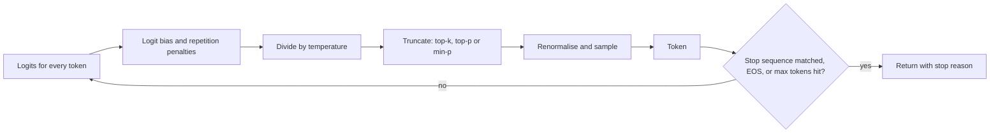

**Sampling parameters** (also called decoding parameters) control how a model turns its output distribution into actual text. At every step a [transformer](transformer-architecture.md) produces a logit for each vocabulary entry; softmax turns these into probabilities; a sampler picks one token, which is appended before the next step ([notebook](../sources/notebook-transformers.md)). Sampling knobs reshape or truncate that distribution (temperature, top-k, top-p, min-p, penalties, logit bias), and stopping knobs decide when generation ends (max tokens, stop sequences). The decoding strategy alone can dramatically change output quality from the same model ([Holtzman et al.](../sources/holtzman-2020-nucleus-sampling.md)). As of 2026-11, Anthropic has removed the distribution knobs from its API and Google silently ignores them on its newest Gemini models ([Anthropic](../sources/anthropic-api-2026-10-21-sampling-removal.md); [Gemini](../sources/gemini-generate-content-api.md)), so knowing when they still matter is part of the job.

## The pipeline

Synthesis: the order of operations varies by implementation; this is the common arrangement.

## The knobs

**Temperature (T).** Logits are divided by T before softmax. T < 1 sharpens the distribution toward the top token; T > 1 flattens it; T → 0 approaches greedy decoding (always pick the argmax). Synthesis: standard definition. Higher means more random and creative, lower means more focused ([notebook](../sources/notebook-transformers.md); [OpenAI](../sources/openai-chat-completions-api-reference.md)).

**Top-k.** Keep only the k most likely tokens. Synthesis: a fixed k is too wide when the model is confident and too narrow when it is not.

**Top-p (nucleus sampling).** Keep the smallest set of tokens whose cumulative probability exceeds p, so the candidate pool adapts to the distribution's shape. It was proposed because likelihood-maximising decoding (greedy, beam search) yields bland, repetitive text, while pure sampling wanders into the unreliable low-probability tail ([Holtzman et al.](../sources/holtzman-2020-nucleus-sampling.md)). top_p = 0.1 means only the top 10% of probability mass ([OpenAI](../sources/openai-chat-completions-api-reference.md)).

**Min-p.** Keep tokens whose probability is at least a fraction min_p of the top token's probability. The authors report better quality and diversity than top-p on GPQA, GSM8K and AlpacaEval creative writing (Mistral and Llama 3 models, 1B-123B), mostly at high temperature; it is supported in Hugging Face Transformers and vLLM ([Nguyen et al.](../sources/nguyen-2025-min-p-sampling.md)). Synthesis: treat the gains as benchmark- and temperature-dependent and check them on your own task. It is an open-weight / self-hosting knob; the big hosted APIs reviewed here do not expose it.

**Frequency and presence penalties.** Frequency penalty grows with how often a token has already appeared (reduces verbatim repetition); presence penalty applies once a token has appeared at all (pushes toward new topics). OpenAI's range is -2.0 to 2.0, default 0 ([OpenAI](../sources/openai-chat-completions-api-reference.md)). Large negative frequency penalties can make a common token repeat until the output limit ([Gemini](../sources/gemini-generate-content-api.md)).

**Logit bias.** Add a value from -100 to 100 to specific token ids before sampling; ±100 effectively bans or forces a token ([OpenAI](../sources/openai-chat-completions-api-reference.md)). Synthesis: it operates on token ids, so it is tokenizer-specific; see [tokenization](tokenization.md).

**Max tokens.** An upper bound on generated tokens; the model may stop earlier ([Messages API](../sources/anthropic-messages-api-reference.md)). On reasoning models the cap includes hidden reasoning tokens: OpenAI's `max_completion_tokens` / `max_output_tokens` cover both, and hitting the cap can return `incomplete` with no visible text ([OpenAI](../sources/openai-chat-completions-api-reference.md); [OpenAI reasoning](../sources/openai-reasoning-guide.md)). It also counts against the [context window](context-window.md).

**Stop sequences.** Strings that end generation when produced; the matched string is not included in the output ([OpenAI](../sources/openai-chat-completions-api-reference.md); [Gemini](../sources/gemini-generate-content-api.md)). Claude reports `stop_reason: "stop_sequence"` and returns the matched string in `stop_sequence` ([Messages API](../sources/anthropic-messages-api-reference.md)).

**Seed, n, logprobs.** A seed gives best-effort repeatability (OpenAI, beta; Gemini `seed`); `n` / `candidateCount` returns several samples, all billed; logprobs return per-token log-probabilities (up to 20 alternatives) for confidence scoring and debugging ([OpenAI](../sources/openai-chat-completions-api-reference.md); [Gemini](../sources/gemini-generate-content-api.md)).

## Vendor support (as of 2026-11-14)

| Parameter | Anthropic Claude | OpenAI Chat Completions | Google Gemini |
|---|---|---|---|
| temperature | **Removed** in API version 2026-10-21 (400 even at default); on 2023-06-01, non-default values rejected on Claude 4.7+ and Mythos Preview | 0-2, default 1 | 0.0-2.0; **silently ignored** on Gemini 3.6 Flash and newer |
| top_p | Removed (as above) | 0-1, default 1; change temperature or top_p, not both | Ignored on 3.6 Flash+ |
| top_k | Removed (as above) | Not offered | Ignored on 3.6 Flash+ |
| max tokens | `max_tokens` (required); 0 = warm the cache only | `max_completion_tokens` (`max_tokens` deprecated, incompatible with o-series) | `maxOutputTokens` |
| stop sequences | `stop_sequences` | `stop`, up to 4; unsupported on o3 / o4-mini | `stopSequences`, up to 5 |
| penalties / logit bias | Not offered | frequency, presence, logit_bias | presence, frequency |
| seed / logprobs | Not offered | seed (beta), logprobs, top_logprobs ≤ 20 | seed, responseLogprobs, logprobs ≤ 20 |

Sources: [Anthropic migration and deprecations](../sources/anthropic-api-2026-10-21-sampling-removal.md), [Messages API](../sources/anthropic-messages-api-reference.md), [OpenAI](../sources/openai-chat-completions-api-reference.md), [Gemini](../sources/gemini-generate-content-api.md).

Anthropic's stated replacement for the removed knobs is to guide behaviour through prompting. Teams that rely on non-default values can keep those requests on API version 2023-06-01 (except on Claude 4.7+, which already accept only defaults); the latest SDK and CLI major versions no longer expose the parameters. Without them, requests sample at the defaults (temperature 1.0); a request that relied on a lowered temperature on a model like Claude Sonnet 4.6 loses that effect, and no other setting replaces it ([Anthropic](../sources/anthropic-api-2026-10-21-sampling-removal.md)). Synthesis: frameworks that set `temperature=0` by default (common in older LangChain-style code) will error against the new Claude API version and must be updated; check this early in any [PoC-to-production](poc-to-production.md) migration.

## Temperature 0 is not deterministic

Greedy decoding should be deterministic in theory, but hosted APIs and vLLM/SGLang still vary run to run. The main cause is not GPU concurrency but **batch invariance**: kernel numerics change with batch size, and batch size depends on server load. Qwen3-235B at temperature 0 gave 80 distinct completions out of 1,000, diverging at token 103; batch-invariant kernels made all 1,000 identical. Determinism costs throughput: on 1,000 Qwen3-8B sequences, default vLLM took 26 s, an unoptimised deterministic version 55 s, and one with an improved attention kernel 42 s ([Thinking Machines](../sources/defeating-nondeterminism-llm-inference.md)). OpenAI's `seed` is explicitly best-effort, with `system_fingerprint` flagging backend changes ([OpenAI](../sources/openai-chat-completions-api-reference.md)).

Synthesis: design tests and [evals](llm-evaluation.md) to tolerate variation (assert on structure or graded criteria, run several samples) rather than relying on byte-identical outputs.

## Failure modes

- **Degeneration at low temperature / greedy**: repetitive, dull loops ([Holtzman et al.](../sources/holtzman-2020-nucleus-sampling.md)).
- **Incoherence at high temperature with top-p** ([Nguyen et al.](../sources/nguyen-2025-min-p-sampling.md)).
- **Silent truncation**: output ends at `max_tokens` mid-sentence or mid-JSON; check `stop_reason` (`max_tokens`, `model_context_window_exceeded`) before parsing ([Messages API](../sources/anthropic-messages-api-reference.md)).
- **Reasoning starvation**: a small output cap on a reasoning model is spent on hidden reasoning, leaving no answer ([OpenAI reasoning](../sources/openai-reasoning-guide.md)).
- **Parameter rejected or ignored**: 400 errors on Claude, silent no-ops on new Gemini models ([Anthropic](../sources/anthropic-api-2026-10-21-sampling-removal.md); [Gemini](../sources/gemini-generate-content-api.md)).
- **Stop sequence collisions**: Synthesis: a stop string that can legitimately appear in the output (e.g. `}` in nested JSON) truncates valid content.

## Practical guidance

Synthesis:
- **Hosted frontier models (2026-11):** leave sampling at defaults; get consistency from clear [prompts](prompt-engineering.md), [structured outputs](structured-outputs.md) and [few-shot examples](few-shot-prompting.md), and set `max_tokens` generously with stop-reason handling.
- **Diversity on purpose** (brainstorming, synthetic data, [self-consistency](chain-of-thought.md) voting): sample several outputs at default or higher temperature and select or vote, rather than turning one knob.
- **Self-hosted / [open-weight models](open-weight-models.md):** the full set (temperature, top-p, top-k, min-p, penalties) is still available in servers like vLLM; low temperature or greedy for extraction and classification, moderate temperature plus min-p for creative text.
- **Classification and routing:** use logprobs where available to get a confidence score instead of re-sampling.
- **Determinism requirements** (audit, regression tests): pin model version, log full requests, and if bitwise reproducibility is mandatory, self-host with batch-invariant kernels ([Thinking Machines](../sources/defeating-nondeterminism-llm-inference.md)).

## Sources

- [The Curious Case of Neural Text Degeneration (Holtzman et al.)](../sources/holtzman-2020-nucleus-sampling.md)
- [Min-p Sampling (Nguyen et al.)](../sources/nguyen-2025-min-p-sampling.md)
- [Defeating Nondeterminism in LLM Inference (Thinking Machines)](../sources/defeating-nondeterminism-llm-inference.md)
- [Claude API 2026-10-21 migration: sampling parameters removed](../sources/anthropic-api-2026-10-21-sampling-removal.md)
- [Messages API reference (Claude API)](../sources/anthropic-messages-api-reference.md)
- [Chat Completions API reference (OpenAI)](../sources/openai-chat-completions-api-reference.md)
- [Reasoning models guide (OpenAI)](../sources/openai-reasoning-guide.md)
- [generateContent / GenerationConfig (Gemini)](../sources/gemini-generate-content-api.md)
- [Notebook: How LLMs & transformers work](../sources/notebook-transformers.md)
