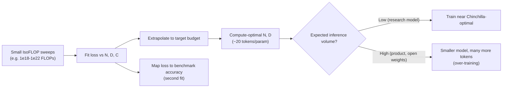

**Scaling laws** are empirical fits showing that a language model's pretraining loss falls smoothly and predictably, as a power law, when you increase parameters (N), training tokens (D) or training compute (C). Labs use them to choose model size and data budget before an expensive run, and to predict the result from runs 100-10,000x smaller. For a practitioner, they explain why model families come in the sizes they do, why small open models are trained on absurd numbers of tokens, and why "bigger is better" holds for loss but not always for a given benchmark or cost target ([Kaplan](../sources/kaplan-2020-scaling-laws.md), [Hoffmann](../sources/hoffmann-2022-chinchilla.md)).

## The core quantities

- **N:** parameter count. Kaplan counts only non-embedding parameters; with embeddings included the curves look shape-dependent ([Kaplan](../sources/kaplan-2020-scaling-laws.md)). For [mixture-of-experts](mixture-of-experts.md) models, total and active parameters differ, so a single N is ambiguous (Synthesis).
- **D:** training tokens (see [tokenization](tokenization.md): the same text gives different D under different tokenizers).
- **C ≈ 6·N·D FLOPs:** roughly 2 FLOPs per parameter per token forward and 4 backward. It ignores attention cost, which grows with context length ([Kaplan](../sources/kaplan-2020-scaling-laws.md), [Hoffmann](../sources/hoffmann-2022-chinchilla.md)).
- **Loss:** next-token cross-entropy on held-out text. Scaling laws predict loss, not task accuracy.

## Kaplan et al. (2020): "make the model bigger"

OpenAI fitted single-factor laws L(N) ∝ N^-0.076, L(D) ∝ D^-0.095 and L(C) ∝ C^-0.050 over six-plus orders of magnitude, using models up to 1.5B parameters. Other findings: depth versus width hardly matters at fixed N; bigger models are more sample-efficient; and the compute-optimal plan is a very large model stopped well before convergence, with N ∝ C^0.73 and data growing only as C^0.27 ([Kaplan](../sources/kaplan-2020-scaling-laws.md)). GPT-3-era models (175B on about 300B tokens) followed this advice ([Hoffmann](../sources/hoffmann-2022-chinchilla.md)).

## Chinchilla (2022): scale tokens as fast as parameters

DeepMind ran 400+ models (70M-16B, 5B-500B tokens) and estimated the optimum three ways ([Hoffmann](../sources/hoffmann-2022-chinchilla.md)):

| Method | N_opt ∝ C^a | D_opt ∝ C^b |
|---|---|---|
| 1. Minimum over training curves | 0.50 | 0.50 |
| 2. IsoFLOP profiles (vary N at 9 fixed budgets) | 0.49 | 0.51 |
| 3. Parametric fit of L(N, D) | 0.46 | 0.54 |
| Kaplan et al. 2020 | 0.73 | 0.27 |

The parametric form is **L(N, D) = E + A/N^α + B/D^β**: E is the irreducible entropy of text, the A term is the penalty for finite model capacity, and the B term is the penalty for finite data and optimisation. The published fit was E = 1.69, A = 406.4, B = 410.7, α = 0.34, β = 0.28 ([Hoffmann](../sources/hoffmann-2022-chinchilla.md)).

Compute-optimal token counts work out to about **20 tokens per parameter**: 1B → 20B tokens, 10B → 205B, 67B → 1.5T, 175B → 3.7T. Chinchilla (70B, 1.4T tokens) used Gopher's budget (280B, 300B tokens) and beat Gopher, GPT-3 and MT-NLG 530B, with MMLU 67.5% ([Hoffmann](../sources/hoffmann-2022-chinchilla.md)).

**Why the two papers disagree.** Kaplan used one token count and one learning-rate schedule for every run, then read loss off intermediate checkpoints. A cosine schedule that has not finished decaying overstates loss, so short training looked worse than it was, which pushed the fit toward bigger models. Chinchilla matched the schedule length to each run's token count, and its models were mostly over 500M parameters while Kaplan's were mostly under 100M ([Hoffmann](../sources/hoffmann-2022-chinchilla.md)).

**Correction to Chinchilla.** Epoch AI re-fitted Approach 3 from the paper's figure and found the published parameters fit badly, with confidence intervals that would need about 600,000 runs. The cause was an optimiser that stopped early. The corrected fit (E ≈ 1.82, α ≈ 0.35, β ≈ 0.37) agrees with Approaches 1-2 and with about 20 tokens per parameter ([Besiroglu](../sources/besiroglu-2024-chinchilla-replication.md)). Practical point: fitted constants are fragile; trust the convergent conclusion, not the third decimal.

Synthesis: the diagram combines the Llama 3 prediction method with the inference-aware argument; no single source draws it.

## Over-training: why Chinchilla-optimal is not production-optimal

Chinchilla minimises **training** compute. Once a model is served, every generated token costs roughly 2N FLOPs, so a smaller model trained longer can be cheaper over its lifetime even if it costs more to train. Sardana et al. add inference demand to the objective ([Sardana](../sources/sardana-2024-beyond-chinchilla-optimal.md)):

| Target quality (Chinchilla-equivalent) | Lifetime inference | Optimal model | Training tokens |
|---|---|---|---|
| 30B | 5T tokens | 16.4B | 3.27T |
| 70B | 10T tokens | 41.6B | 7.92T |

In dollars the shift is bigger because decoding runs at low hardware utilisation: up to 58% cheaper for a 30B-quality model at very high request volume. They trained 47 models (150M-6B) at up to 10,000 tokens per parameter (that extreme only for the 150M model; larger models went to 500-1,000) and saw loss and downstream accuracy still improving, though more slowly than a Chinchilla-style fit on typical ratios predicts ([Sardana](../sources/sardana-2024-beyond-chinchilla-optimal.md)).

Industry practice follows this. Llama 3's scaling-law sweep predicted a 402B model on 16.55T tokens for its flagship budget (they trained 405B), while the smaller models were trained "much longer than is compute-optimal" ([Llama 3](../sources/llama-3-herd-2024.md)). Llama 3 8B was trained on about 15T tokens ([Sardana](../sources/sardana-2024-beyond-chinchilla-optimal.md)), which works out to about 1,875 tokens per parameter (Synthesis: our arithmetic, not a figure from the sources). MoE pushes the same economics further: DeepSeek-V3 activates 37B of 671B parameters per token and was trained on 14.8T tokens ([DeepSeek-V3](../sources/deepseek-v3-technical-report.md)), and Qwen3 reports an MoE base matching a dense model with about one fifth of the active parameters ([Qwen3](../sources/qwen3-technical-report.md)).

Synthesis, for practitioners:
- A small model's quality comes from its token budget as much as its size. An 8B model from 2024+ is not comparable to a 2022 8B model.
- Heavily over-trained models pack more information into each weight. This is consistent with reports that aggressive [quantization](quantization.md) hurts recent small models more, but none of the sources here measure it, so verify on your task.
- Vendors optimise for serving cost, which is why "mini/flash/haiku" tiers exist and are often good enough (see [model selection](model-selection.md), [cost and latency](cost-and-latency-optimization.md)).

## From loss to capabilities

Loss is predictable; benchmark scores are less so. Llama 3 predicted downstream accuracy in two steps (FLOPs → benchmark negative log-likelihood → accuracy), extrapolating four orders of magnitude and slightly under-predicting ARC Challenge ([Llama 3](../sources/llama-3-herd-2024.md)). Abilities that seem to "emerge" suddenly at some scale often reflect all-or-nothing metrics like exact match: on continuous metrics the same outputs improve smoothly ([Schaeffer](../sources/schaeffer-2023-emergent-abilities-mirage.md)). When reading a capability chart, check the metric before believing in a phase change (see [benchmarks](benchmarks.md)).

## Data limits

- **Repetition:** at fixed compute, up to about 4 epochs of repeated data is nearly as good as fresh data; beyond that the value of extra compute decays toward zero ([Muennighoff](../sources/muennighoff-2023-data-constrained-scaling.md)).
- **Stock of human text:** Epoch AI projects frontier datasets will reach the size of all public human text between 2026 and 2032, sooner with over-training ([Villalobos](../sources/villalobos-2024-running-out-of-data.md)). This is why labs turn to [synthetic data](synthetic-data-generation.md), quality filtering and more compute per token.

## Other scaling axes

Pretraining is no longer the only lever (Synthesis, linking sources):
- **RL post-training compute:** performance against RL compute fits a sigmoid with a ceiling. Some recipe choices raise the ceiling; others (loss aggregation, normalisation, curriculum) mostly change efficiency ([Khatri](../sources/khatri-2025-scaling-rl-compute.md)). See [reinforcement fine-tuning](reinforcement-fine-tuning.md).
- **Test-time compute:** spending more inference on reasoning or search can substitute for parameters on some problems ([Snell](../sources/snell-scaling-test-time-compute.md)); see [test-time compute](test-time-compute.md) and [reasoning models](reasoning-models.md).

## Limitations and failure modes

- **Setup-specific constants.** Exponents depend on data, tokenizer, architecture and LR schedule. Kaplan and Chinchilla disagree mainly because of the schedule ([Hoffmann](../sources/hoffmann-2022-chinchilla.md)). Do not reuse published constants for a different data mix.
- **Fitting errors.** Even the canonical Chinchilla Approach 3 fit was wrong ([Besiroglu](../sources/besiroglu-2024-chinchilla-replication.md)).
- **Extreme ratios.** Laws fitted at typical ratios (up to about 100 tokens per parameter) overestimate the gain from extra tokens at extreme ratios ([Sardana](../sources/sardana-2024-beyond-chinchilla-optimal.md)).
- **Loss is not usefulness.** Scaling laws say nothing directly about instruction following, safety or tool use, which come from the [training pipeline](llm-training-pipeline.md)'s later stages.
- **The 6ND approximation** ignores attention FLOPs, which matter at long context ([Hoffmann](../sources/hoffmann-2022-chinchilla.md)).

## When this matters to you

- **Choosing or comparing models:** ask about training tokens and active parameters, not just size.
- **Pretraining or continued pretraining your own model:** run small IsoFLOP sweeps on your own data; match the LR schedule to each run's length; budget inference cost, not just training cost.
- **Fine-tuning:** scaling laws mostly do not apply. Knowledge comes from pretraining; see [fine-tuning](fine-tuning.md).
- **Forecasting:** expect smooth loss gains and lumpy benchmark gains, plus growing reliance on RL and inference-time compute.

## Sources

- [Kaplan et al. 2020, Scaling Laws for Neural Language Models](../sources/kaplan-2020-scaling-laws.md)
- [Hoffmann et al. 2022, Chinchilla](../sources/hoffmann-2022-chinchilla.md)
- [Besiroglu et al. 2024, Chinchilla replication](../sources/besiroglu-2024-chinchilla-replication.md)
- [Sardana et al. 2024, Beyond Chinchilla-Optimal](../sources/sardana-2024-beyond-chinchilla-optimal.md)
- [Llama 3 Herd: pre-training and post-training recipe](../sources/llama-3-herd-2024.md)
- [Muennighoff et al. 2023, Scaling Data-Constrained LMs](../sources/muennighoff-2023-data-constrained-scaling.md)
- [Villalobos et al. 2024, Will We Run Out of Data?](../sources/villalobos-2024-running-out-of-data.md)
- [Schaeffer et al. 2023, Emergent abilities mirage](../sources/schaeffer-2023-emergent-abilities-mirage.md)
- [Khatri et al. 2025, Scaling RL compute](../sources/khatri-2025-scaling-rl-compute.md)
- [Qwen3 Technical Report](../sources/qwen3-technical-report.md)
- [DeepSeek-V3 Technical Report](../sources/deepseek-v3-technical-report.md)
- [Snell et al., Scaling test-time compute](../sources/snell-scaling-test-time-compute.md)
