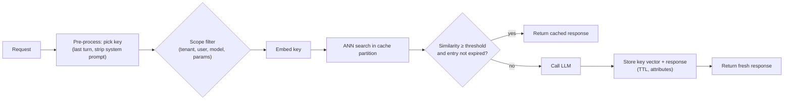

**Semantic caching** stores earlier LLM responses keyed by the [embedding](embeddings.md) of their prompt. When a new prompt arrives, the cache embeds it and runs a [nearest-neighbour search](ann-indexes.md) over the stored prompts. If the closest one is within a similarity threshold, the cache returns that stored response and the model is never called. Otherwise the request goes to the LLM and the new pair is written back ([GPTCache paper](../sources/gptcache-2023.md), [LangCache](../sources/redis-langcache-docs.md)). A hit costs no generation tokens and returns in milliseconds rather than seconds. The catch is that a hit is a *guess*. Two prompts can be close in embedding space yet need different answers, and the user then gets a confident answer to a question they did not ask. Exact-match response caching and provider [prompt caching](prompt-caching.md) do not have this failure mode.

## Mechanics

GPTCache's decomposition is still the reference architecture ([GPTCache paper](../sources/gptcache-2023.md)):

1. **Pre-processor** picks the cache key, for example only the last user turn with boilerplate stripped. This step is critical. If a long shared [system prompt](system-prompts.md) dominates the key, nearly everything hits.
2. **Embedding model** turns the key into a vector.
3. **[Vector store](vector-databases.md) + scalar store** hold the vectors, the responses and metadata, with eviction (LRU/FIFO by count).
4. **Similarity evaluator** decides hit or miss. It can be the raw cosine score or a second model, such as a [cross-encoder](reranking.md).
5. **Post-processor** chooses among candidates and returns the answer.

Products implement the same loop at three layers:

| Layer | Examples | Key / threshold controls | Scoping & invalidation |
|---|---|---|---|
| Library in the app | GPTCache; RedisVL `SemanticCache` | GPTCache `similarity_threshold`; RedisVL `distance_threshold` (cosine *distance*, 0 to 2, lower = stricter; example 0.1) | RedisVL tag/numeric `filterable_fields`, `ttl`, `drop`/`clear` ([GPTCache docs](../sources/gptcache-usage-docs.md), [RedisVL](../sources/redisvl-semantic-cache-docs.md)) |
| Managed cache service | Redis LangCache (preview, 2026-11) | `similarityThreshold` (similarity, examples 0.9); `searchStrategies` exact and/or semantic; embeddings handled by the service | `attributes` that must match; delete by ID, by attributes, or flush ([LangCache](../sources/redis-langcache-docs.md)) |
| [LLM gateway](llm-gateways.md) | Portkey, LiteLLM, Kong, Azure APIM | Portkey cosine 0.95 default, user text only, model and params must match exactly; APIM `score-threshold` where **lower is stricter** (start about 0.05, above 0.2 risks mismatches) | Portkey namespaces and `max_age`; APIM `vary-by`; Kong `max-age`/`s-maxage` ([Portkey](../sources/portkey-gateway-docs.md), [APIM](../sources/azure-apim-llm-semantic-cache-docs.md), [Kong](../sources/kong-ai-semantic-cache-plugin-docs.md)) |

Some gateways cache only exact matches. Cloudflare AI Gateway hashes the full request and lists semantic caching as future work. Vercel AI Gateway leaves response caching to the application ([Cloudflare](../sources/cloudflare-ai-gateway-docs.md), [Vercel](../sources/vercel-ai-gateway-docs.md)). LiteLLM offers `redis-semantic`, `valkey-semantic` and `qdrant-semantic` alongside exact caches ([LiteLLM](../sources/litellm-proxy-docs.md)).

Watch the threshold direction. Some products take a similarity (higher = stricter) and others a distance (lower = stricter), so a value copied between them can invert its meaning. Synthesis: always check which one the setting is before you change it.

## Threshold tuning and false hits

The threshold trades hit rate against **false hits**, which GPTCache calls "negative hits". Evidence that this is hard:

- GPTCache at cosine 0.7 served 876 hits out of 1,000 paraphrase queries, and 39 of those were wrong. Its authors judged a 99%-correct cache without losing hit rate unlikely with current embeddings. Search-tuned embeddings can score opposite-meaning sentences as close ([GPTCache paper](../sources/gptcache-2023.md)).
- vCache measured the similarity distributions of correct and incorrect hits. They overlap almost entirely (mean about 0.84 vs 0.85), and the best threshold varies per cached entry from about 0.71 to 1.0. A static threshold therefore cannot bound the error rate, and in their runs GPTCache's error rate grew as the cache filled ([vCache](../sources/schroeder-2025-vcache.md)).
- Embedding density differs by domain. In code, 0.80 reportedly matches `sort_ascending` to `sort_descending` (about 15% false matches) where 0.90 gives about 3%. Sparse conversational text tolerates about 0.75 ([Wang et al.](../sources/wang-2025-category-aware-semantic-caching.md); figures stated without a measurement method).

Three levers improve the trade-off:

1. **A better embedding for duplicate detection.** Redis fine-tuned a 149M-parameter ModernBERT on duplicate-question pairs (LangCache-Embed). Precision rose from 64% to 84% on Quora and from 78% to 92% on medical queries. Trained on [synthetic data](synthetic-data-generation.md) only, it beat text-embedding-3-large on medical precision (0.87 vs 0.85). Training for too many epochs cost 8 points on other domains ([Gill et al. 2025](../sources/gill-2025-langcache-embed.md)). This is a vendor paper.
2. **Adaptive thresholds.** vCache learns, for each entry, how likely a hit at a given similarity is to be correct, and re-queries the LLM with some probability to keep error below a user-set δ. At δ = 0.02 it reached a 35.5% hit rate with 1.2% error, and it reports up to 26x lower error than static thresholds. The guarantee assumes i.i.d. traffic and a good sigmoid fit ([vCache](../sources/schroeder-2025-vcache.md)). Wang et al. propose per-*category* thresholds, TTLs and quotas instead ([Wang et al.](../sources/wang-2025-category-aware-semantic-caching.md)).
3. **A verification step.** GPTCache supports a second-stage similarity evaluator ([GPTCache paper](../sources/gptcache-2023.md)). vCache uses an [LLM judge](llm-as-judge.md) offline to label whether a hit was correct ([vCache](../sources/schroeder-2025-vcache.md)).

Synthesis: tune the threshold like a classifier. Sample real traffic, label pairs as "same answer acceptable" or not, plot precision against hit rate across thresholds, and choose the operating point from the cost of a wrong answer. This is part of [LLM evaluation](llm-evaluation.md).

## Conversation context and agents

A follow-up like "and in Python?" means nothing without its history. Keying only on the last turn produces false hits, and keying on the whole history produces almost no hits. MeanCache stores each query's context chain to tell follow-ups apart ([MeanCache](../sources/gill-2024-meancache.md)). Gateways mitigate this with limits. Portkey's semantic cache accepts at most 4 messages and under 8,191 tokens, and APIM's `max-message-count` skips caching for longer dialogs ([Portkey](../sources/portkey-gateway-docs.md), [APIM](../sources/azure-apim-llm-semantic-cache-docs.md)). LiteLLM's docs warn that semantic caching goes badly wrong on agentic traffic ([LiteLLM](../sources/litellm-proxy-docs.md)). Synthesis: in an [agent loop](agent-loop.md), cache tool-free leaf calls such as classification or FAQ lookups, not turns whose correct output depends on tool results or state.

## Invalidation and freshness

A cached answer is a snapshot. It goes stale when the underlying data, the prompt template, the model or the retrieved documents change. Available tools:

- **TTL** per entry: RedisVL `ttl`, Portkey `max_age` (60 s to 90 days, default 7 days), APIM store `duration`, Kong `max-age`. Note that RedisVL by default refreshes the TTL of matched entries on every hit, so popular stale answers can live on unless you pass `refresh_ttl_on_hit=False` ([RedisVL](../sources/redisvl-semantic-cache-docs.md), [Portkey](../sources/portkey-gateway-docs.md)).
- **TTL by volatility:** days for code answers, hours for docs, minutes for prices and news ([Wang et al.](../sources/wang-2025-category-aware-semantic-caching.md)).
- **Targeted deletes:** LangCache deletes by attributes, such as all entries tagged with a document version. A delete call with *no* attributes wipes the whole cache ([LangCache](../sources/redis-langcache-docs.md)).
- **Bypass:** GPTCache `cache_skip`, Portkey's force-refresh header, Kong `Cache-Control`. Kong notes that most AI APIs send `no-cache`, so honouring it bypasses the cache almost always ([GPTCache docs](../sources/gptcache-usage-docs.md), [Kong](../sources/kong-ai-semantic-cache-plugin-docs.md)).

Synthesis: put the model ID, prompt-template version and knowledge-base version into the scope attributes, so a deploy naturally starts a fresh partition and you never need to hunt down affected entries.

## Personalization, PII and side channels

A shared cache will return user A's answer to user B. That is wrong if the answer was personalised, and it is a data leak if the answer contained A's data. APIM recommends `vary-by` on user or group IDs, and RedisVL shows a `user_id` tag filter ([APIM](../sources/azure-apim-llm-semantic-cache-docs.md), [RedisVL](../sources/redisvl-semantic-cache-docs.md)). Portkey ignores the system prompt when matching ([Portkey](../sources/portkey-gateway-docs.md)), and APIM recommends ignoring system messages (`ignore-system-messages`, off by default) ([APIM](../sources/azure-apim-llm-semantic-cache-docs.md)). So any personalisation injected through the system prompt is *invisible to the key*, and you must scope it explicitly. Even with no shared content, hit/miss **timing** leaks information. Song et al. showed that timing probes against a shared GPTCache semantic cache (in a [LangChain](langchain.md) chatbot) reveal whether other users recently sent a similar prompt, with about 81% hit detection in one trial and about 95% after five. They recommend anonymising PII before the similarity search, at about 4% overhead ([Song et al.](../sources/song-2024-early-bird-timing-side-channels.md)). MeanCache keeps the cache client-side for privacy ([MeanCache](../sources/gill-2024-meancache.md)). The cache itself is also a new store of prompts and responses that falls under [PII and data-privacy](pii-and-data-privacy.md) retention rules. Synthesis: a poisoned or [prompt-injected](prompt-injection.md) response written to a shared cache gets replayed to everyone who asks something similar.

## Interaction with prompt caching and determinism

| | Semantic cache | Exact response cache | [Prompt caching](prompt-caching.md) |
|---|---|---|---|
| What is reused | A whole response | A whole response | KV state of an identical prefix |
| Match rule | Embedding similarity | Hash of full request | Byte-identical prefix |
| Can be wrong? | Yes (false hits) | Only if stale | No: output unchanged ([Anthropic](../sources/anthropic-prompt-caching-docs.md)) |
| Saves | Input + output + latency | Input + output + latency | Mostly input cost and time to first token (Anthropic cache reads 0.1x base input on most models, lower on some, as of 2026-11) |
| Where | App / gateway | App / gateway | Provider or engine ([OpenAI](../sources/openai-prompt-caching-guide.md)) |

They stack. Synthesis: the usual order is exact cache, then semantic cache, then an LLM call that benefits from prompt caching. Pre-processing that strips the system prompt from the semantic key does not affect the prompt-cache prefix, so the two do not conflict.

On determinism, a hit freezes one sample. At non-zero [temperature](sampling-parameters.md) the user always gets that same answer instead of a fresh draw. GPTCache makes temperature a cache knob: the higher it is, the more lookups it skips, and at 2 it never reads the cache ([GPTCache docs](../sources/gptcache-usage-docs.md)). Portkey requires model and parameters to match exactly ([Portkey](../sources/portkey-gateway-docs.md)). Synthesis: include sampling parameters and the output schema ([structured outputs](structured-outputs.md)) in the scope, and skip the cache wherever variety is the point.

## Measured hit rates and savings

- Regmi & Pun: 61.6-68.8% hit rates and up to 68.8% fewer API calls, with over 97% of hits judged correct, on their test categories ([Regmi](../sources/regmi-2024-gpt-semantic-cache.md)).
- vCache: a 35.5% hit rate at 1.2% error on a classification workload, which cut a batch run from 240 to 170 minutes ([vCache](../sources/schroeder-2025-vcache.md)).
- MeanCache: about 31% of queries were repeats in their data ([MeanCache](../sources/gill-2024-meancache.md)).
- Wang et al.: 40-60% for code and docs and 5-15% for conversation, presented as representative rather than measured ([Wang et al.](../sources/wang-2025-category-aware-semantic-caching.md)).
- Break-even: a remote vector lookup (about 30 ms) is paid on *every* request, hits and misses alike. The abstract puts the hit rate needed to pay off in latency at 15-20%, and at 3-5% with a local in-memory index (about 2 ms per miss). The paper's body gives lower figures (roughly 6-15% remote, under 1% local), so treat these as a modelled range, not a measurement ([Wang et al.](../sources/wang-2025-category-aware-semantic-caching.md)).
- Redis's savings formula: output-token spend times hit rate, assuming saved input roughly offsets embedding and storage cost ([LangCache](../sources/redis-langcache-docs.md)).

Synthesis: most published numbers come from paraphrase-heavy benchmarks or from vendors. Measure your own repetition rate from logs before you promise savings, and track the false-hit rate in [observability](llm-observability.md) next to the hit rate.

## When to use / when not

**Use** it for high-volume, repetitive, user-independent questions: FAQ and support deflection, internal help desks, documentation Q&A, and classification or routing calls with a small answer space. Use it where the answer changes slowly and a slightly off answer is cheap ([GPTCache paper](../sources/gptcache-2023.md)).

**Avoid** it, or scope it tightly, for personalised or permissioned answers, multi-turn and agentic flows, volatile data, creative generation, and regulated outputs where one wrong hit costs more than every saved call. Start with exact-match caching plus prompt caching, add semantic caching only after measuring repetition, and go through the [cost and latency optimization](cost-and-latency-optimization.md) checklist first (Synthesis).

## Sources

- [GPTCache paper (Fu & Feng, 2023)](../sources/gptcache-2023.md)
- [GPTCache usage docs](../sources/gptcache-usage-docs.md)
- [GPT Semantic Cache (Regmi & Pun, 2024)](../sources/regmi-2024-gpt-semantic-cache.md)
- [vCache (Schroeder et al., 2025)](../sources/schroeder-2025-vcache.md)
- [Domain-specific embeddings for semantic caching (Gill et al., 2025)](../sources/gill-2025-langcache-embed.md)
- [Category-aware semantic caching (Wang et al., 2025)](../sources/wang-2025-category-aware-semantic-caching.md)
- [MeanCache (Gill et al., 2024)](../sources/gill-2024-meancache.md)
- [Timing side channels in LLM serving (Song et al., 2024)](../sources/song-2024-early-bird-timing-side-channels.md)
- [Redis LangCache docs](../sources/redis-langcache-docs.md)
- [RedisVL SemanticCache guide](../sources/redisvl-semantic-cache-docs.md)
- [Azure APIM llm-semantic-cache-lookup](../sources/azure-apim-llm-semantic-cache-docs.md)
- [Kong AI Semantic Cache plugin](../sources/kong-ai-semantic-cache-plugin-docs.md)
- [Portkey gateway docs](../sources/portkey-gateway-docs.md)
- [LiteLLM proxy docs](../sources/litellm-proxy-docs.md)
- [Cloudflare AI Gateway docs](../sources/cloudflare-ai-gateway-docs.md)
- [Vercel AI Gateway docs](../sources/vercel-ai-gateway-docs.md)
- [Anthropic prompt caching docs](../sources/anthropic-prompt-caching-docs.md)
- [OpenAI prompt caching guide](../sources/openai-prompt-caching-guide.md)
