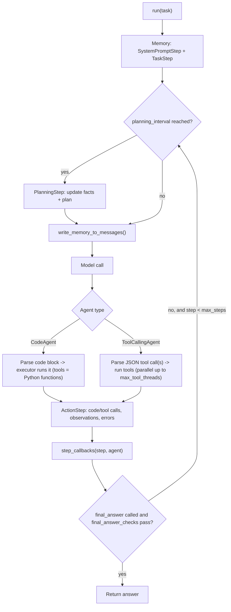

**smolagents** is Hugging Face's open-source (Apache-2.0) Python library for building agents. It is deliberately small: the core agent logic is about a thousand lines ([guided tour](../sources/smolagents-docs-guided-tour.md), [README](../sources/smolagents-github-readme.md)). Its defining idea is the **code agent**. Instead of emitting a JSON tool call each step, the model writes a Python snippet that calls tools as functions, and an interpreter runs it. smolagents launched on 2024-12-31 as the replacement for the deprecated `transformers.agents` ([launch post](../sources/hugging-face-smolagents-blog.md)). As of 2026-11-14 the latest release is **1.26.0** (2026-05-29, Python 3.10+) ([PyPI](../sources/smolagents-pypi.md)). The API reference still labels it experimental and subject to change ([reference](../sources/smolagents-agents-reference.md)). It sits inside the [Hugging Face ecosystem](hugging-face-ecosystem.md): you can share tools and agents on the Hub and run models through Inference Providers, but it is model-agnostic.

## Why code actions

The case for code comes from the CodeAct paper. Across 17 LLMs, writing actions as executable Python gave up to 20% higher success than JSON or text formats. It also let the agent self-debug from interpreter errors ([CodeAct](../sources/wang-2024-codeact.md)). Hugging Face's docs give four reasons code beats JSON: you can compose tools (loops, conditionals, nesting), you can keep objects such as images or dataframes in variables, code is more general, and code is heavily represented in training data ([intro guide](../sources/smolagents-intro-agents-guide.md)). The README cites about **30% fewer steps**, and so fewer LLM calls ([README](../sources/smolagents-github-readme.md)).

The strongest public evidence is Hugging Face's Open Deep Research reproduction. A `CodeAgent` scored **55.15%** on GAIA validation ([benchmarks](benchmarks.md)). The same agent with JSON actions averaged about **33%**, and OpenAI Deep Research reported 67.36% ([Open Deep Research](../sources/hugging-face-open-deep-research-blog.md)). See [deep research agents](deep-research-agents.md).

Microsoft Agent Framework later adopted the same pattern as an opt-in `execute_code` tool ([MAF CodeAct](../sources/microsoft-agent-framework-codeact-docs.md)); see [Microsoft Agent Framework](microsoft-agent-framework.md). smolagents differs by making code the *native* action format.

The docs also argue against agents where they aren't needed. They describe an agency spectrum: processor, then router, tool call, multi-step agent, multi-agent, and finally code agent. If a fixed workflow covers the requests, write it as plain code ([intro guide](../sources/smolagents-intro-agents-guide.md)). This matches the guidance on [agent design patterns](agent-design-patterns.md).

## Architecture: the MultiStepAgent loop

Every agent subclasses `MultiStepAgent`, which runs a [ReAct](react-pattern.md) [loop](agent-loop.md) over a step-structured memory ([intro guide](../sources/smolagents-intro-agents-guide.md)):

*Diagram follows the loop described in the [intro guide](../sources/smolagents-intro-agents-guide.md) and [API reference](../sources/smolagents-agents-reference.md).*

Two details matter in practice:

- **Termination** happens when the model calls `final_answer(...)` or the run hits `max_steps` (default 20). `final_answer_checks` are validators that can reject a final answer and keep the loop going ([guided tour](../sources/smolagents-docs-guided-tour.md)). This is a cheap built-in hook for [verification](verification-and-evals.md).
- **Errors are observations.** A code error is logged on the `ActionStep` and fed back to the model, which usually fixes it on the next step ([inspect runs](../sources/smolagents-inspect-runs-docs.md)). This is the self-debugging behaviour CodeAct describes.

## Key APIs and parameters

| Area | API / parameter | Notes |
|---|---|---|
| Agents | `CodeAgent`, `ToolCallingAgent` (both `MultiStepAgent`) | ToolCallingAgent uses native [function calling](function-calling.md) |
| Loop control | `max_steps=20`, `planning_interval`, `instructions`, `final_answer_checks`, `step_callbacks` | `return_full_result` returns token/step details |
| Code execution | `additional_authorized_imports`, `executor_type` (`local` default, `e2b`, `docker`, `modal`, `blaxel`), `executor_kwargs`, `max_print_outputs_length` | Submodules must be authorised explicitly or with `pkg.*` |
| Generation | `stream_outputs`, `use_structured_outputs_internally`, `code_block_tags` | Structured generation per step is optional ([structured outputs](structured-outputs.md)) |
| Run | `run(task, stream, reset, images, additional_args, max_steps)` | `additional_args` injects Python objects (e.g. a dataframe) into the run; `reset=False` continues memory |
| Multi-agent | `managed_agents=[...]` + `name`/`description` on [sub-agents](subagents.md) | Hierarchical only |
| Sharing | `save()`, `push_to_hub()`, `from_hub(..., trust_remote_code=True)` | Saves `agent.json`, `prompt.yaml`, tools, `app.py` |

Sources: [API reference](../sources/smolagents-agents-reference.md), [guided tour](../sources/smolagents-docs-guided-tour.md).

**Models.** The model classes are `InferenceClientModel` (HF Inference Providers), `LiteLLMModel` (100+ providers), `OpenAIModel`, `AzureOpenAIModel`, `AmazonBedrockModel`, and the local backends `TransformersModel` and `MLXModel`. Extra keyword arguments pass through to the completion call. Local models served by Ollama via [LiteLLM](litellm.md) need a context larger than Ollama's 2048-token default ([guided tour](../sources/smolagents-docs-guided-tour.md)). See [local LLMs](local-llms.md) and [context window](context-window.md).

**Tools.** You can define a [tool](tools.md) in two ways: the `@tool` decorator, which needs type hints and an `Args:` docstring, or a `Tool` subclass with `name`, `description`, `inputs`, `output_type` and `forward`. Tool metadata is rendered into the system prompt ([guided tour](../sources/smolagents-docs-guided-tour.md), [tools docs](../sources/smolagents-tools-docs.md)). Tools can also come from other sources ([tools docs](../sources/smolagents-tools-docs.md)):

- [MCP](model-context-protocol.md) servers, through `MCPClient` or `ToolCollection.from_mcp`, over stdio or Streamable HTTP (the docs' multi-server example also passes an SSE URL). `MCPClient` accepts a list of servers.
- Gradio Spaces, through `Tool.from_space`.
- [LangChain](langchain.md), through `Tool.from_langchain`.
- The Hub, through `load_tool(..., trust_remote_code=True)`.

With `structured_output=True`, MCP `outputSchema` is injected into the CodeAgent prompt so the model knows the shape of a tool's result before it writes code against it. This is off by default today, and the docs say the default will change later. See [MCP in practice](mcp-in-practice.md).

**Memory and observability.** Memory is a list of step objects (`agent.memory.steps`) that you can read and edit. Callbacks can prune it, for example by dropping old browser screenshots to cut tokens. `agent.step()` lets you drive the loop yourself ([memory docs](../sources/smolagents-memory-docs.md)). That is the hook for hand-rolled [context engineering](context-engineering.md). Synthesis: none of the docs cited here describe a persistence layer (no checkpointer or session store), so memory lives in-process unless you serialise `memory.steps` yourself. [Tracing](llm-observability.md) uses [OpenTelemetry](opentelemetry-genai.md): the OpenInference `SmolagentsInstrumentor` sends spans to [Phoenix](arize-phoenix.md) or [Langfuse](langfuse.md), and MLflow offers its own one-line `mlflow.smolagents.autolog()` ([inspect runs](../sources/smolagents-inspect-runs-docs.md)).

## Security model and failure modes

The default executor is the **`LocalPythonExecutor`**. It does not run `exec()`. It walks the AST one operation at a time and enforces these limits ([secure execution](../sources/smolagents-secure-code-execution-docs.md)):

- imports are blocked unless authorised, and submodules are blocked unless authorised separately;
- the total number of operations is capped;
- undefined operations raise errors.

Both the docs and the README say plainly that it is **not a security sandbox** ([README](../sources/smolagents-github-readme.md)). Authorised packages can still be abused; an image library, for example, could fill a disk. The docs list four threats: plain model error, a compromised model, [prompt injection](prompt-injection.md) from browsed content, and abuse of publicly exposed agents ([secure execution](../sources/smolagents-secure-code-execution-docs.md)).

There are two remote options:

| | Snippets in sandbox (`executor_type="e2b"/"docker"/"modal"/"blaxel"`) | Whole agent in sandbox |
|---|---|---|
| What goes remote | Only generated code; model calls stay local | Agent loop, model calls, tools |
| Secrets | Stay outside the sandbox | API keys must enter the sandbox |
| Multi-agent | **Not supported** (no managed agents) | Supported |
| Setup | One parameter | More setup |

Source: [secure execution](../sources/smolagents-secure-code-execution-docs.md). Call `cleanup()` or use the agent as a context manager so sandboxes are torn down. E2B runs each sandbox in its own Firecracker microVM with egress controls ([E2B](../sources/e2b-sandbox-docs.md)). See [code execution sandboxes](code-execution-sandboxes.md).

Other failure modes:

- **Code agents are less predictable.** They produce syntax and runtime errors, and only the code they actually run can be audited. The docs recommend `ToolCallingAgent` for atomic dispatch where validated arguments matter ([guided tour](../sources/smolagents-docs-guided-tour.md)).
- **Approval is coarse.** As MAF's CodeAct docs note for the same pattern, approval covers a whole program rather than each side effect ([MAF CodeAct](../sources/microsoft-agent-framework-codeact-docs.md)). smolagents has no built-in per-tool [human-in-the-loop](human-in-the-loop.md) interrupt; the closest is `agent.interrupt()` or a callback ([guided tour](../sources/smolagents-docs-guided-tour.md)).
- **Hub loading runs remote code.** `from_hub` and `load_tool` need `trust_remote_code=True` (the docs' `ToolCollection.from_mcp` examples pass it too), and stdio MCP servers run code on your machine ([tools docs](../sources/smolagents-tools-docs.md)).
- **Too many tools** overwhelm weaker models ([tools docs](../sources/smolagents-tools-docs.md)).
- **Maintenance signal.** As of 2026-11-14 there had been no PyPI release since 2026-05-29 (commits were still landing), with about 430 open issues and 650 open PRs ([README](../sources/smolagents-github-readme.md)). Synthesis: pin versions and expect to fork or patch.

## Comparison

| | smolagents | [LangGraph](langgraph.md) | [OpenAI Agents SDK](openai-agents-sdk.md) | [Claude Agent SDK](claude-agent-sdk.md) | [Microsoft Agent Framework](microsoft-agent-framework.md) | [Mastra](mastra.md) |
|---|---|---|---|---|---|---|
| Language | Python | Python, JS | Python, TS | Python, TS | .NET, Python | TypeScript |
| Native action | Python code (or JSON) | Tool calls in graph nodes | Tool calls, [handoffs](agent-handoffs.md) | Claude Code tools (bash, files) | Tool calls; CodeAct opt-in | Tool calls |
| State / durability | In-memory step list | Checkpointers | Sessions | Sessions | Workflow checkpoints, sessions | Storage-backed memory, suspendable workflows |
| Multi-agent | Managed agents (hierarchy) | Arbitrary graphs | Handoffs, agents-as-tools | Subagents | Workflows + orchestrations | Supervisor agents, workflows |
| Models | Any (HF, LiteLLM, local) | Any | OpenAI-first | Claude | Any chat client | Any (AI SDK) |

Sources: smolagents sources above, [LangChain/LangGraph 1.0](../sources/langchain-langgraph-1-0-announcement.md), [OpenAI Agents SDK docs](../sources/openai-agents-sdk-docs.md), [Claude Agent SDK overview](../sources/claude-agent-sdk-overview-docs.md). Synthesis for the table's framing: smolagents optimises for a small, readable loop and fewer steps per task. The heavier frameworks optimise for durable state, typed orchestration and enterprise controls.

## When to use it, and when not

Synthesis, grounded in the sources above:

- **Use it** for research prototypes, data-analysis or deep-research agents where one step needs to chain many tool calls and transform results; for running [open](open-weight-models.md) or local models (code actions narrowed the gap to closed models in Hugging Face's tests, per the [launch post](../sources/hugging-face-smolagents-blog.md)); and for teaching, because the whole loop is readable.
- **Avoid it, or wrap it,** when you need durable, resumable runs ([durable agent execution](durable-agent-execution.md)), per-action approval, multi-tenant production with strict audit, or TypeScript/.NET stacks. In those cases LangGraph, MAF, Mastra or the vendor SDKs fit better. If you keep it, run it in a remote sandbox, pin the version, and add tracing from the first day.

## Sources

- [smolagents docs: Index and Guided tour](../sources/smolagents-docs-guided-tour.md)
- [smolagents conceptual guides](../sources/smolagents-intro-agents-guide.md)
- [smolagents API reference: Agents](../sources/smolagents-agents-reference.md)
- [smolagents docs: Secure code execution](../sources/smolagents-secure-code-execution-docs.md)
- [smolagents docs: Tools](../sources/smolagents-tools-docs.md)
- [smolagents docs: Memory](../sources/smolagents-memory-docs.md)
- [smolagents docs: Inspecting runs](../sources/smolagents-inspect-runs-docs.md)
- [huggingface/smolagents README](../sources/smolagents-github-readme.md)
- [smolagents on PyPI](../sources/smolagents-pypi.md)
- [Introducing smolagents](../sources/hugging-face-smolagents-blog.md)
- [Open-source DeepResearch](../sources/hugging-face-open-deep-research-blog.md)
- [CodeAct paper (Wang et al., 2024)](../sources/wang-2024-codeact.md)
- [Microsoft Agent Framework: CodeAct](../sources/microsoft-agent-framework-codeact-docs.md)
- [E2B documentation](../sources/e2b-sandbox-docs.md)
- [LangChain and LangGraph 1.0](../sources/langchain-langgraph-1-0-announcement.md)
- [OpenAI Agents SDK docs](../sources/openai-agents-sdk-docs.md)
- [Claude Agent SDK overview](../sources/claude-agent-sdk-overview-docs.md)
