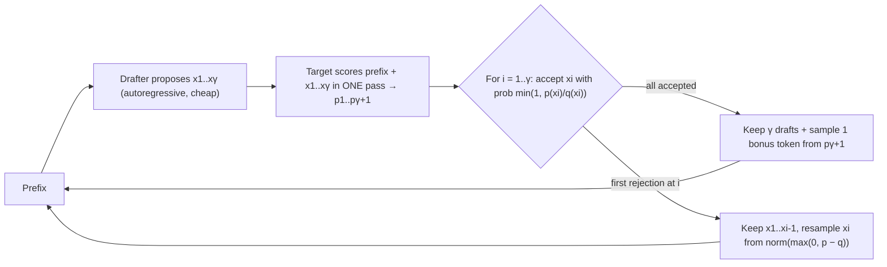

**Speculative decoding** speeds up autoregressive generation without changing what the model outputs. A cheap **drafter** guesses the next γ tokens. The expensive **target** model scores all γ positions in a single forward pass. A modified rejection-sampling rule then accepts the longest valid prefix of the guesses and adds one token sampled by the target itself. Decode is memory-bound, so one target pass over γ+1 positions costs about the same wall time as a pass over one position. Every accepted draft token is therefore close to free latency ([Leviathan et al.](../sources/leviathan-speculative-decoding.md), [NVIDIA](../sources/nvidia-mastering-llm-inference-optimization.md)).

## The algorithm

Source: Algorithm 1 in [Leviathan et al.](../sources/leviathan-speculative-decoding.md).

**Speculative sampling** is what makes the method lossless. Let q be the drafter's distribution and p the target's. A draft token x is accepted when q(x) ≤ p(x). Otherwise it is rejected with probability 1 − p(x)/q(x), and a replacement is drawn from the residual distribution `norm(max(0, p − q))`. The tokens produced this way are distributed exactly as p, for any q. With greedy decoding the rule reduces to "accept while the draft equals the target's argmax" ([Leviathan et al.](../sources/leviathan-speculative-decoding.md)).

## The math that decides whether it pays

Let α be the acceptance rate (how well q approximates p), γ the number of drafted tokens, and c the cost of one drafter step relative to one target step ([Leviathan et al.](../sources/leviathan-speculative-decoding.md)):

- Expected tokens per target pass = (1 − α^(γ+1)) / (1 − α).
- Expected wall-time speedup = (1 − α^(γ+1)) / ((1 − α)(γc + 1)).
- Total arithmetic **increases**, because rejected drafts are wasted work. Memory reads of target weights and KV **decrease** by the tokens-per-pass factor.

Synthesis, worked example: with α = 0.8, γ = 4 and c = 0.05, a pass yields (1 − 0.8⁵)/0.2 ≈ 3.36 tokens, and the speedup is 3.36 / 1.2 ≈ 2.8x. With α = 0.5, the same settings give about 1.94 tokens and about 1.6x. Raising γ helps only while α is high. In the paper's experiments, drafters about 100x smaller than the target reached α of 0.5-0.9, and even a bigram model reached α = 0.2 (a 1.25x speedup). T5-XXL ran 2-3x faster with identical outputs ([Leviathan et al.](../sources/leviathan-speculative-decoding.md)).

## Variants

| Method | Drafter | Pros | Cons |
|---|---|---|---|
| **Draft model** | Small model from the same family (shared [tokenizer](tokenization.md)) | No training if a sibling exists; lossless | Extra weights and KV in memory; tokenizer must match |
| **N-gram / prompt lookup** | Copies continuations from the prompt or context | Free, no extra model; strong on code edits, [RAG](retrieval-augmented-generation.md) and extraction where output repeats input | Modest gains on open-ended text |
| **Suffix decoding** | Suffix structures over prompts and prior outputs | No model; no extra load at peak traffic | Modest gains |
| **Medusa** | Extra decoding heads on the target predict t+1, t+2, …; tree attention verifies several candidate branches at once | No separate model; Medusa-1 (frozen backbone) reaches over 2.2x and the paper calls it lossless; Medusa-2 (joint fine-tune) reaches 2.3-3.6x | Heads need training; its "typical acceptance" is not exactly distribution-preserving |
| **EAGLE / EAGLE-3** | Light head that reuses the target's hidden features; EAGLE-3 fuses low, mid and top layer features and predicts tokens directly | Up to 6.5x over vanilla, about 1.4x over EAGLE-2; 1.38x throughput at batch 64 in SGLang | Needs a trained head per target model |
| **MTP (multi-token prediction)** | Prediction heads trained into the model itself | Native to [models that ship them](open-weight-models.md) | Only for models trained with MTP |

Sources: [vLLM docs](../sources/vllm-speculative-decoding-docs.md), [Medusa](../sources/medusa-multiple-decoding-heads.md), [EAGLE-3](../sources/eagle-3-speculative-decoding.md), [TensorRT-LLM](../sources/tensorrt-llm-overview.md). Synthesis: the pros/cons for draft models and n-gram summarize the general mechanism and are not stated in a single source.

## In serving engines (as of 2026-11)

- **[vLLM](vllm.md):** set `speculative_config={"method": ..., "model": ..., "num_speculative_tokens": k}` (or the `--speculative-config` JSON flag). Use `draft_tensor_parallel_size` for the drafter. Methods include EAGLE, MTP, draft model, n-gram, suffix decoding, dynamic speculation, adaptive verification and a lossy "FLy" verifier (selected via `rejection_sample_method`, and not distribution-preserving). The rejection sampler is lossless up to hardware numerics, but logprobs are not guaranteed stable across runs ([vLLM docs](../sources/vllm-speculative-decoding-docs.md)).
- **TensorRT-LLM:** EAGLE, MTP and n-gram ([TensorRT-LLM](../sources/tensorrt-llm-overview.md)).
- **SGLang:** the EAGLE-3 paper reports results inside SGLang ([EAGLE-3](../sources/eagle-3-speculative-decoding.md)).

## Limitations and failure modes

- **Load dependence.** The gain comes from idle compute during memory-bound decode. vLLM targets medium-to-low QPS. At high QPS, EAGLE and MTP still give medium-to-high gains, draft models, n-gram and suffix decoding only medium gains, because batching already uses the compute ([vLLM docs](../sources/vllm-speculative-decoding-docs.md), [Leviathan et al.](../sources/leviathan-speculative-decoding.md)).
- **Low acceptance hurts.** When α is low (a drafter mismatched to the domain, or high [temperature](sampling-parameters.md)), you pay for drafting and wasted verification for little gain. Synthesis: sharper distributions accept more. The paper notes α rises as the adjusted distribution gets sharper ([Leviathan et al.](../sources/leviathan-speculative-decoding.md)).
- **Lossy variants.** Typical acceptance (Medusa) and FLy (vLLM) trade exactness for speed. Know which one is enabled ([Medusa](../sources/medusa-multiple-decoding-heads.md), [vLLM docs](../sources/vllm-speculative-decoding-docs.md)).
- **Memory.** Draft models add weights and their own KV cache, which competes with the target's [KV cache](kv-cache.md). Synthesis.
- **Version gaps.** Some combinations were historically unsupported, for example pipeline parallelism with speculation in vLLM ≤ 0.15 ([vLLM docs](../sources/vllm-speculative-decoding-docs.md)).

## When to use / when not

Synthesis:
- **Use** for latency-sensitive, low-concurrency workloads: interactive chat, [coding agents](coding-agents.md), single-user [local LLMs](local-llms.md), long outputs. Try n-gram first for input-copying tasks such as edits, RAG answers and extraction. Use EAGLE or MTP heads when they exist for your model.
- **Skip or measure carefully** for throughput-bound batch jobs (see [batch processing](batch-processing.md)), at very high QPS, or when high sampling temperature drives α down.
- It complements [quantization](quantization.md) and the batching techniques in [LLM inference serving](llm-inference-serving.md). See also [cost and latency optimization](cost-and-latency-optimization.md).

## Sources

- [Fast Inference from Transformers via Speculative Decoding (Leviathan et al.)](../sources/leviathan-speculative-decoding.md)
- [Mastering LLM Techniques: Inference Optimization (NVIDIA)](../sources/nvidia-mastering-llm-inference-optimization.md)
- [Medusa](../sources/medusa-multiple-decoding-heads.md)
- [EAGLE-3](../sources/eagle-3-speculative-decoding.md)
- [vLLM docs: Speculative Decoding](../sources/vllm-speculative-decoding-docs.md)
- [TensorRT-LLM overview](../sources/tensorrt-llm-overview.md)
