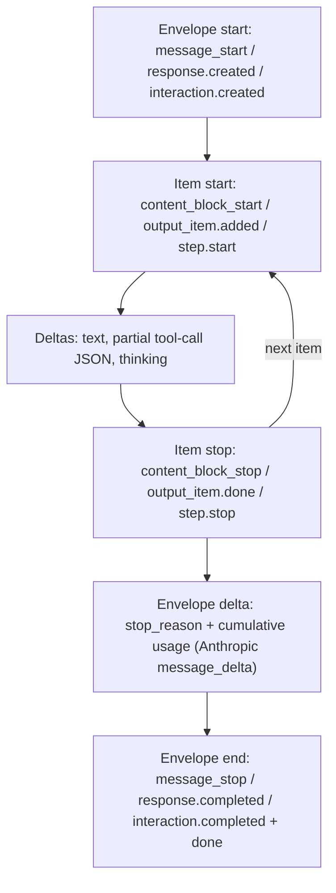

**Streaming** returns a model's output incrementally while it is being generated, instead of as one response after generation ends. All three major vendor APIs implement it with **server-sent events (SSE)**: a long-lived HTTP response where each event has a name (`event:`) and a JSON payload (`data:`). You enable it with `stream: true`. Streaming doesn't change what the model generates or what you pay. It changes *when* you see it: time-to-first-token drops from "whole generation" to roughly [prefill](transformer-architecture.md) time, and long generations avoid HTTP idle timeouts ([Anthropic](../sources/anthropic-streaming-docs.md), [OpenAI](../sources/openai-streaming-responses-guide.md), [Gemini](../sources/gemini-streaming-interactions-docs.md)).

## Event grammars compared (as of 2026-11)

All three APIs use the same nesting: a message or response envelope, content items inside it, and deltas inside each item.

| | [Anthropic Messages](anthropic-messages-api.md) | [OpenAI Responses](openai-responses-api.md) | [Gemini Interactions](gemini-api.md) |
|---|---|---|---|
| Start | `message_start` (Message with empty `content`) | `response.created`, `response.in_progress` | `interaction.created`, `interaction.status_update` |
| Item open/close | `content_block_start` / `content_block_stop` with `index` | `response.output_item.added/done`, `response.content_part.added/done` | `step.start` (typed: `thought`, `model_output`, …) / `step.stop` |
| Text | `content_block_delta` + `text_delta` | `response.output_text.delta/done` | `step.delta` with `type: text` |
| Tool args | `input_json_delta` (`partial_json`) | `response.function_call_arguments.delta/done` | step deltas |
| Reasoning | `thinking_delta`, then `signature_delta` | reasoning items | `thought` steps, `thought_signature` delta |
| Stop info | `message_delta` (stop_reason, **cumulative** usage) | `response.completed` / `response.failed` | `interaction.completed` with usage |
| End | `message_stop` | `response.completed` | `done` with `[DONE]` |
| Keep-alive / errors | `ping`, `error` | `error` | `error` (with `code`, e.g. `gateway_timeout`) |

Sources: [Anthropic](../sources/anthropic-streaming-docs.md), [OpenAI](../sources/openai-streaming-responses-guide.md), [OpenAI function calling](../sources/openai-function-calling-guide.md), [Gemini](../sources/gemini-streaming-interactions-docs.md).

Details worth knowing:

- **Anthropic** blocks carry an `index` that matches their position in the final `content` array. Some blocks arrive whole with no deltas: server-tool results such as `web_search_tool_result`, `redacted_thinking` and `fallback` blocks. Usage in `message_delta` is cumulative, so take the last value rather than summing. New event types may be added, so clients must ignore unknown ones ([Anthropic](../sources/anthropic-streaming-docs.md)).
- **OpenAI** events are typed semantic events rather than raw token chunks. For plain text, `response.created`, `response.output_text.delta`, `response.completed` and `error` are enough ([OpenAI](../sources/openai-streaming-responses-guide.md)).
- **Gemini** routes everything (text, thoughts, tool calls) through one step-based event shape. A non-streaming response's `steps` array is exactly the assembled start → deltas → stop cycles. The older generateContent API streams via `streamGenerateContent` ([Gemini](../sources/gemini-streaming-interactions-docs.md)).

## Streaming tool calls and structured output

Tool arguments arrive as **partial JSON strings**. Anthropic's final `tool_use.input` is an object, but the deltas are string fragments: accumulate them and parse on `content_block_stop`, or use a partial-JSON parser or the SDK helpers, which expose the parsed input incrementally. By default Claude buffers each complete key/value before emitting it, which can cause pauses. Per-tool `eager_input_streaming` (fine-grained tool streaming) sends values sooner ([Anthropic](../sources/anthropic-streaming-docs.md)). OpenAI opens a call with `response.output_item.added` (carrying `call_id` and `name`), then streams `function_call_arguments.delta` keyed by `output_index` ([OpenAI function calling](../sources/openai-function-calling-guide.md)). Gemini's [structured output](structured-outputs.md) streams as valid partial JSON chunks that concatenate to the full object ([Gemini structured outputs](../sources/gemini-structured-outputs-docs.md)).

Synthesis: never execute a tool from a partial argument string. Wait for the block or item `done` event, and for multi-call turns, wait for the whole message to finish so you can return all results together (see [function calling](function-calling.md)).

## Errors and recovery

- **Errors inside a 200 stream.** The HTTP status is already 200 when the stream starts, so failures arrive as events. Claude can send an `error` event with `overloaded_error`, the streaming equivalent of HTTP 529 ([Anthropic](../sources/anthropic-streaming-docs.md)). OpenAI has `response.failed` and `error` ([OpenAI](../sources/openai-streaming-responses-guide.md)). Gemini's Interactions stream sends an `error` event carrying a `code` and `message` ([Gemini](../sources/gemini-streaming-interactions-docs.md)). Your [retry logic](rate-limits-and-retries.md) must inspect events, not only status codes.
- **Resuming an interrupted stream.** Anthropic's guidance is to keep everything received, then send a continuation request. On Claude 4.5 and earlier, the partial text goes in as the assistant turn. On Claude 4.6 and later, you add a user message asking the model to continue from the partial text. Tool-use and [thinking](extended-thinking.md) blocks cannot be partially recovered, so resume from the last text block ([Anthropic](../sources/anthropic-streaming-docs.md)).
- **Timeouts.** Anthropic's SDKs require streaming for large `max_tokens` to avoid HTTP timeouts, and offer helpers (`get_final_message()`, `finalMessage()`) that stream internally but return a complete Message ([Anthropic](../sources/anthropic-streaming-docs.md)).
- **Platform gaps.** [Bedrock](amazon-bedrock.md)'s `bedrock-runtime` endpoint does not emit plain SSE ([Anthropic](../sources/anthropic-streaming-docs.md)). Batch APIs reject `stream: true` ([Anthropic batches](../sources/anthropic-message-batches-docs.md)).

## Interactions and trade-offs

- **Moderation.** Partial output is harder to moderate, and OpenAI's moderation results arrive only after the full output ([OpenAI](../sources/openai-streaming-responses-guide.md)). Synthesis: if output guardrails must block content *before* users see it, buffer by sentence or paragraph, or stream only after a check. See [content moderation](content-moderation.md) and [guardrail tooling](guardrail-tooling.md).
- **Prompt caching.** On Claude, a cache entry becomes readable only once the first response *starts*, and time spent streaming counts against the TTL ([Anthropic caching](../sources/anthropic-prompt-caching-docs.md)). See [prompt caching](prompt-caching.md).
- **Cost.** Streaming doesn't change token billing. It changes perceived latency, which matters most for chat UIs and [voice agents](voice-agents.md). See [cost and latency optimization](cost-and-latency-optimization.md).

## When to use / when not

- **Use** for any user-facing generation, long outputs (timeouts), agent UIs that show tool progress, and pipelines that can start work on early output (TTS, incremental rendering).
- **Skip** for short machine-to-machine calls where you need the whole object anyway. A non-streaming call is simpler to retry and log, and the SDK accumulator helpers give you streaming's timeout safety without event handling.
- **Don't** use for offline bulk work: use [batch processing](batch-processing.md).

## Sources

- [Anthropic Streaming Messages Docs](../sources/anthropic-streaming-docs.md)
- [OpenAI Streaming API Responses Guide](../sources/openai-streaming-responses-guide.md)
- [OpenAI Function Calling Guide](../sources/openai-function-calling-guide.md)
- [Gemini API Streaming Interactions Docs](../sources/gemini-streaming-interactions-docs.md)
- [Gemini API Structured Outputs Docs](../sources/gemini-structured-outputs-docs.md)
- [Anthropic Prompt Caching Docs](../sources/anthropic-prompt-caching-docs.md)
- [Anthropic Message Batches Docs](../sources/anthropic-message-batches-docs.md)
