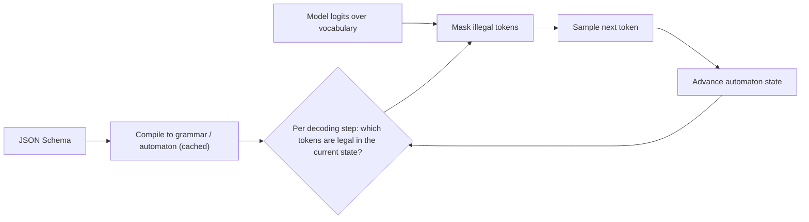

**Structured outputs** constrain a model's generation so the result is guaranteed to parse and to match a developer-supplied JSON Schema. Vendors implement this with **[constrained decoding](constrained-decoding.md)**: the schema is compiled into a grammar or automaton, and at each decoding step tokens that would violate it are masked out before sampling. This differs from **JSON mode**, which only guarantees syntactically valid JSON of no particular shape, and from prompting ("respond in JSON"), which guarantees nothing ([OpenAI](../sources/openai-structured-outputs-guide.md), [Anthropic](../sources/anthropic-structured-outputs-docs.md), [Gemini](../sources/gemini-structured-outputs-docs.md)). For any output a program consumes, the owner's tutorial gives the rule of thumb: ask for a schema, not prose ([Notebook](../sources/notebook-prompt-engineering.md)).

## How constrained decoding works

- **FSM indexing ([Outlines](instructor-and-outlines.md)).** Willard and Louf model generation as moving through a finite-state machine compiled from a regex or grammar. They precompute an index from each state to the vocabulary tokens valid from that state, so the per-step cost is a lookup plus a mask ([Willard & Louf 2023](../sources/efficient-guided-generation-outlines.md)).
- **CFGs and XGrammar.** JSON's nesting needs a context-free grammar, and with it a parser stack, which makes naive per-token checks expensive. XGrammar splits the vocabulary into context-independent tokens (prechecked ahead of time) and context-dependent tokens (checked at runtime with a persistent stack), and overlaps this work with GPU execution. It reports up to 100× speedups and near-zero serving overhead ([XGrammar](../sources/xgrammar-structured-generation.md)).
- **Vendor practice.** Anthropic compiles schemas into grammars cached for 24 h from last use. Gemini compiles them into a state machine with limits on states, branching and depth. OpenAI notes extra latency on the first request with a new schema ([Anthropic](../sources/anthropic-structured-outputs-docs.md), [Gemini](../sources/gemini-structured-outputs-docs.md), [OpenAI](../sources/openai-structured-outputs-guide.md)).

Synthesis: the guarantee is syntactic and structural. The grammar can force a `"total": <number>` field to exist, but not make the number correct. Masking can even push the model into a well-formed but wrong value when the "right" continuation is disallowed.

## API surface (as of 2026-11)

| | [Anthropic](anthropic-messages-api.md) | [OpenAI](openai-responses-api.md) | [Gemini](gemini-api.md) |
|---|---|---|---|
| Final-answer schema | `output_config.format: {type:"json_schema", schema}` (SDK `messages.parse(output_format=Model)`) | Responses `text.format: {type:"json_schema", strict:true, schema}`; Chat Completions `response_format` generateContent: `response_mime_type: "application/json"` + `response_json_schema`; Interactions API: `response_format: {mime_type:"application/json", schema}` (Pydantic/Zod in SDKs) |
| Tool-argument schema | `strict: true` on a tool | `strict: true` on a function | `ANY` / `VALIDATED` function-calling modes |
| JSON-only mode | none separate | `text.format: {type:"json_object"}` | MIME type without schema |
| Optional fields | omit from `required` (required fields emitted first) | all fields required; optional = `["T","null"]` | standard `required` |
| `additionalProperties` | must be `false` | must be `false` | n/a |
| Key order | schema order, but required before optional | schema order | schema order (Gemini 2.0 needed `propertyOrdering`) |

Sources: [Anthropic](../sources/anthropic-structured-outputs-docs.md), [OpenAI](../sources/openai-structured-outputs-guide.md), [Gemini](../sources/gemini-structured-outputs-docs.md).

## Schema subsets and limits

None of the vendors supports full JSON Schema.

- **Anthropic.** Supported: basic types, scalar `enum`, `const`, `anyOf`, `allOf` (not with `$ref`), internal `$ref`/`$defs`, string `format`s, simple regex. Rejected with a 400: recursion, numeric bounds (`minimum`, `maximum`, `multipleOf`), string length bounds, `minItems` other than 0 or 1, external refs, regex lookaround or backreferences. Per-request caps: 20 strict tools, 24 optional parameters total, 16 union-typed parameters total, an internal grammar-size limit ("Schema is too complex for compilation"), and a 180 s compile timeout. Each optional parameter roughly doubles part of the grammar's state space. The SDKs strip unsupported constraints, fold them into descriptions, and re-validate the parsed result client-side ([Anthropic](../sources/anthropic-structured-outputs-docs.md)).
- **OpenAI.** Supported: `pattern`, `format`, numeric `minimum`/`maximum`/`multipleOf`, `minItems`/`maxItems`, `anyOf`, `$defs`, recursion through `$ref`. Unsupported: `allOf`, `not`, `if/then/else`, `dependentRequired`, `dependentSchemas`. The root must be an object and cannot be an `anyOf` (so a top-level discriminated union is rejected). Fine-tuned models additionally lose the string, numeric and array constraint keywords. Limits: 5,000 properties, 10 nesting levels, 120,000 characters of names and enum values, 1,000 enum values ([OpenAI](../sources/openai-structured-outputs-guide.md)).
- **Gemini.** `minLength`, `maxLength`, `minProperties`, `maxProperties` and `uniqueItems` are **silently stripped** rather than rejected, while `minItems`/`maxItems` are enforced. Over-complex schemas return `400 INVALID_ARGUMENT` ([Gemini](../sources/gemini-structured-outputs-docs.md)).

Synthesis: the same Pydantic model can be enforced on OpenAI, rejected on Anthropic (raw schema with `minimum`) and partially ignored on Gemini. Validate on the client with the original model regardless of vendor.

## Failure modes: when "guaranteed" output isn't

1. **Refusals.** Claude returns `stop_reason: "refusal"` with HTTP 200, bills the tokens, and the output may not match the schema. OpenAI puts a refusal in a `refusal` content part ([Anthropic](../sources/anthropic-structured-outputs-docs.md), [OpenAI](../sources/openai-structured-outputs-guide.md)).
2. **Truncation.** Hitting [`max_tokens`](sampling-parameters.md) (Claude) or `status: "incomplete"` with `max_output_tokens` (OpenAI) yields cut-off JSON. Check the stop reason before parsing.
3. **Enum casing.** Claude may return an enum value that differs only in capitalisation, with no error. Compare case-insensitively ([Anthropic](../sources/anthropic-structured-outputs-docs.md)).
4. **Hallucination to fit.** If the input doesn't contain what the schema asks for, the model may invent values. Tell it what to emit for unfit input, for example nulls or a flag ([OpenAI](../sources/openai-structured-outputs-guide.md)). See [hallucination](hallucination.md).
5. **JSON mode pitfalls.** OpenAI's JSON mode errors if "JSON" doesn't appear in the context, and without an instruction it can emit whitespace until the token limit ([OpenAI](../sources/openai-structured-outputs-guide.md)).
6. **Empty dicts.** A free-form `dict` field becomes an object with no properties, so Claude can only return `{}`. Model it as an array of key/value objects ([Anthropic](../sources/anthropic-structured-outputs-docs.md)).
7. **Reasoning quality.** Tam et al. found that format restrictions significantly degrade reasoning on the tasks they tested, more so the stricter the format; the effect is task-dependent and largest on reasoning ([Let Me Speak Freely?](../sources/let-me-speak-freely.md)). Anthropic's grammar applies only to the final output, not to thinking blocks, so reasoning can happen unconstrained first ([Anthropic](../sources/anthropic-structured-outputs-docs.md)). Synthesis: for hard tasks, let the model reason in [extended thinking](extended-thinking.md) or a free-text step, then emit the structured result. Don't add a "reasoning" string field as the first key: on Claude that can also trigger a `reasoning_extraction` refusal ([Anthropic tool docs](../sources/anthropic-tool-use-docs.md)).

## Interactions with other features

- **Prompt caching.** Changing `output_config.format` invalidates Claude's prompt cache for the thread ([Anthropic](../sources/anthropic-structured-outputs-docs.md)). On OpenAI, changing `text.format` can break the cached prefix ([OpenAI caching](../sources/openai-prompt-caching-guide.md)). See [prompt caching](prompt-caching.md).
- **Streaming.** It works on all three vendors. Gemini streams valid partial JSON strings that concatenate to the final object ([Gemini](../sources/gemini-structured-outputs-docs.md)). See [streaming](streaming.md).
- **Incompatibilities (Claude).** Citations (400) and assistant prefill ([Anthropic](../sources/anthropic-structured-outputs-docs.md)).
- **Data handling.** Claude's compiled schemas are cached separately from prompts for up to 24 h, so keep [PHI](pii-and-data-privacy.md) out of property names, enums and patterns ([Anthropic](../sources/anthropic-structured-outputs-docs.md)).

## When to use / when not

- **Use** for extraction, classification, form filling, routing decisions, or any output parsed by code ([Document processing](document-processing.md) and [text-to-SQL](text-to-sql.md) pipelines). Structured outputs remove the retry-on-parse-failure loop.
- **Use strict tools instead** when the structure is the *argument to an action* ([function calling](function-calling.md)).
- **Avoid** heavy constraints on open-ended reasoning or long prose. Keep schemas flat, mostly required, with few unions, to stay under the compile limits and reduce first-call latency.
- **Self-hosted:** engines such as vLLM and SGLang expose the same technique through Outlines- or XGrammar-style backends ([XGrammar](../sources/xgrammar-structured-generation.md)). See [LLM inference serving](llm-inference-serving.md).

## Sources

- [Anthropic Structured Outputs Docs](../sources/anthropic-structured-outputs-docs.md)
- [OpenAI Structured Outputs Guide](../sources/openai-structured-outputs-guide.md)
- [Gemini API Structured Outputs Docs](../sources/gemini-structured-outputs-docs.md)
- [Efficient Guided Generation for LLMs (Outlines)](../sources/efficient-guided-generation-outlines.md)
- [XGrammar](../sources/xgrammar-structured-generation.md)
- [Let Me Speak Freely?](../sources/let-me-speak-freely.md)
- [Anthropic Tool Use Docs](../sources/anthropic-tool-use-docs.md)
- [Notebook: Prompt & Context Engineering](../sources/notebook-prompt-engineering.md)
- [OpenAI Prompt Caching Guide](../sources/openai-prompt-caching-guide.md)
