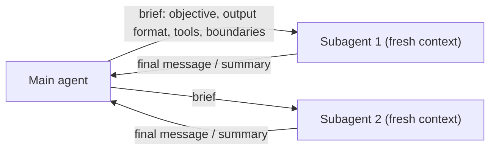

**Subagents** are agents started by a main agent to handle a focused sub-task, each in its own fresh [context window](context-window.md). Each one runs its own [agent loop](agent-loop.md) and returns a summary, not its full transcript. One documented exception: in the [Claude Agent SDK](claude-agent-sdk.md), a *fork* (`subagent_type: "fork"`) copies the parent conversation instead of starting fresh. A non-fork subagent sees only its own prompt, the delegation prompt, project CLAUDE.md and its tools, and only its final message returns to the parent ([SDK subagents](../sources/claude-agent-sdk-subagents-docs.md)).

The brief fields come from Anthropic's research system, where vague briefs led to duplicated work ([Anthropic](../sources/anthropic-multi-agent-research-system.md)).

## Trade-offs

- **Benefit: clean context.** A subagent can read hundreds of files and return a few paragraphs, which keeps the main agent's window clear. This is a [context engineering](context-engineering.md) technique as much as a way to run work in parallel.
- **Benefit: parallelism.** Independent sub-tasks such as search, implementation and review can run at the same time. Anthropic's research lead runs 3-5 subagents at once, each making 3+ parallel tool calls, which cut research time by up to 90% on complex queries ([Anthropic](../sources/anthropic-multi-agent-research-system.md)).
- **Benefit: unbiased review and restricted tools.** A fresh subagent reviews work without the author's reasoning in its context, and can be given a narrower tool set. Anthropic's Claude Code guidance lists parallelism, isolating noisy output, unbiased review and restricted tools as the reasons to use subagents, and says they do *not* give a smarter answer ([best practices](../sources/claude-code-best-practices.md)). See [verification and evals](verification-and-evals.md).
- **Cost: lossy handoffs.** A subagent knows only what its brief says, and the main agent sees only the summary. Subagents can instead write outputs to external storage and return references, which avoids relaying everything through the lead ([Anthropic](../sources/anthropic-multi-agent-research-system.md)).
- **Cost: tokens.** Each subagent pays for its own context. Anthropic measured roughly 4x chat-level tokens for a single agent and about 15x for its multi-agent research system ([Anthropic](../sources/anthropic-multi-agent-research-system.md)).
- **Cost: conflicting decisions.** Cognition (Devin) argues that actions carry implicit decisions, so parallel subagents that cannot see each other's work produce mismatched pieces even when each gets the original task. It recommends a single-threaded agent, with a separate model that compresses history for very long tasks ([Cognition](../sources/cognition-dont-build-multi-agents.md)); see [context compaction](context-compaction.md).
- **Rule of thumb:** delegate when sub-tasks are truly independent. Otherwise the overhead outweighs the gain. Anthropic finds multi-agent designs fit high-value, parallelisable work, with tightly coupled work such as most coding a weaker fit ([Anthropic](../sources/anthropic-multi-agent-research-system.md)), and Cognition reaches the same conclusion for coding ([Cognition](../sources/cognition-dont-build-multi-agents.md)).

## When it pays off

- **Breadth-first research.** An Opus 4 lead with Sonnet 4 subagents beat a single Opus 4 agent by 90.2% on Anthropic's internal research eval, with the biggest gains on breadth-first questions. Token usage alone explained about 80% of performance variance on BrowseComp: multi-agent designs work largely because they spend more tokens in parallel, separate windows ([Anthropic](../sources/anthropic-multi-agent-research-system.md)). See [deep research agents](deep-research-agents.md).
- **Cheaper workers.** Opus 5.5 directing Sonnet 5.5 subagents cost about a third less at a similar score on work larger than one context window. Haiku 5.5 workers on coding cut cost 32% but lost about 4 points of pass rate ([Anthropic](../sources/anthropic-optimizing-cost-and-intelligence.md)). See [model selection](model-selection.md).
- **Where it fails.** Across seven open-source multi-agent systems, failure rates ran from 41% to 86.7%, often with minimal gains over single-agent baselines. The most common failure modes in the MAST taxonomy are step repetition (15.7%), reasoning-action mismatch (13.2%) and unawareness of termination conditions (12.4%). Adding an objective verification step helped but did not solve the problem ([MAST](../sources/cemri-2025-mast-multi-agent-failures.md)). See [agent evaluation](agent-evaluation.md).

## Arrangements

How subagents are wired together is an architectural choice. It can be a fixed order (sequential, parallel or loop), routing by a coordinator model, multi-level hierarchical decomposition, or an all-to-all swarm. Google's guide advises starting with a single agent and moving to multi-agent only when one agent must juggle several distinct responsibilities. See [agent design patterns](agent-design-patterns.md).

Subagents differ from **handoffs**. In the OpenAI Agents SDK, a handoff passes the conversation to a specialist that takes over (by default it sees the full prior history), while `Agent.as_tool()` runs the specialist as a subtask and the caller keeps control, which is the subagent shape ([handoffs](../sources/openai-agents-sdk-handoffs-docs.md)). See [agent handoffs](agent-handoffs.md).

Across boundaries: for agents owned by another team, vendor or organisation, or for long-running, multi-turn work, delegate over the [A2A protocol](agent2agent-protocol.md) instead ([A2A and MCP](../sources/a2a-and-mcp-docs.md)).

## In practice (Claude Agent SDK and Claude Code)

- **Background by default.** A spawned subagent runs in the background and reports in a later turn; Claude blocks only when it needs the result ([SDK subagents](../sources/claude-agent-sdk-subagents-docs.md)).
- **Caps.** Defaults allow 3 levels of nesting and 20 concurrent subagents, with no spend cap unless `max_budget_usd` is set. The docs warn that Opus 5 delegates more readily than earlier models, so the caps matter most there. For dozens to hundreds of agents, a `Workflow` tool moves orchestration into a script outside the conversation ([SDK subagents](../sources/claude-agent-sdk-subagents-docs.md)).
- **Skills.** A subagent definition can preload [skills](agent-skills.md), and a skill with `context: fork` runs in a subagent that sees only the skill content ([Claude Code skills](../sources/claude-code-skills-docs.md)).
- **Review escalation.** Claude Code's verification ladder ends with independent review in a fresh subagent, after prompting, `/goal` and a `Stop` [hook](agent-hooks-and-middleware.md) ([best practices](../sources/claude-code-best-practices.md)).

## Related

[Verification and evals](verification-and-evals.md), where independent reviewer subagents are a common use. [Context engineering](context-engineering.md), [agent handoffs](agent-handoffs.md), [agent skills](agent-skills.md).

## Going deeper

- [Deep Research Agents](deep-research-agents.md): the orchestrator-worker case with measured gains and ~15x token cost.
- [Claude Agent SDK](claude-agent-sdk.md): concrete subagent mechanics: forks, background runs, nesting and concurrency caps.
- [OpenAI Agents SDK](openai-agents-sdk.md): handoffs versus agents-as-tools.
- [Agent2Agent (A2A) Protocol](agent2agent-protocol.md): delegating to agents across team, vendor or organisation boundaries.
- [Agent Evaluation](agent-evaluation.md): MAST failure modes specific to multi-agent systems.
- [Model Selection](model-selection.md): cost of a strong orchestrator with cheaper worker models.
- [LangGraph](langgraph.md): subgraphs and handoffs as a framework-level implementation.

## Sources

- [The Anatomy of a Modern AI Agent](../sources/anatomy-of-a-modern-ai-agent.md)
- [Choose a design pattern for your agentic AI system (Google Cloud)](../sources/google-cloud-choose-agentic-design-pattern.md)
- [Subagents in the SDK (Claude Agent SDK docs)](../sources/claude-agent-sdk-subagents-docs.md)
- [Claude Code best practices](../sources/claude-code-best-practices.md)
- [Claude Code skills docs](../sources/claude-code-skills-docs.md)
- [How we built our multi-agent research system (Anthropic)](../sources/anthropic-multi-agent-research-system.md)
- [Don't Build Multi-Agents (Cognition, 2025)](../sources/cognition-dont-build-multi-agents.md)
- [MAST: Why do multi-agent LLM systems fail? (Cemri et al., 2025)](../sources/cemri-2025-mast-multi-agent-failures.md)
- [Optimizing for cost and intelligence (Anthropic)](../sources/anthropic-optimizing-cost-and-intelligence.md)
- [Handoffs (OpenAI Agents SDK docs)](../sources/openai-agents-sdk-handoffs-docs.md)
- [A2A and MCP](../sources/a2a-and-mcp-docs.md)
