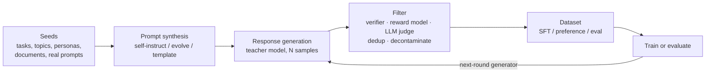

**Synthetic data generation** means using one or more LLMs to produce the prompts, responses, [preference pairs](preference-optimization.md) or test cases that you later train or evaluate on, instead of collecting them from people. It is now the default source of [post-training](llm-training-pipeline.md) data. NVIDIA reported that over 98% of Nemotron-4-340B's alignment data was synthetic, with only about 20K human-annotated examples ([Nemotron-4](../sources/nemotron-4-340b-2024.md)). DeepSeek-R1's distilled models were trained entirely on ~800K samples generated by R1 ([DeepSeek-R1](../sources/deepseek-r1-paper.md)). Generation is cheap. The value comes from the **filter**: verification, scoring, deduplication and decontamination decide whether the data teaches the model something or just teaches it to sound right ([Gudibande et al.](../sources/gudibande-2023-false-promise-imitation.md)).

## Pipeline anatomy

Synthesis: generalised from the Self-Instruct, Nemotron-4 and Llama 3 pipelines.

## Generation techniques

| Technique | How it works | Evidence |
|---|---|---|
| **Self-Instruct** | 175 seed tasks; the model writes new instructions from 8 [in-context examples](few-shot-prompting.md), then inputs and outputs (output-first for classification); keep only instructions with ROUGE-L < 0.7 to all existing ones | 52K instructions / 82K instances for ~$600; +33% absolute on Super-NaturalInstructions over GPT-3 ([Self-Instruct](../sources/self-instruct-wang-2022.md)) |
| **Evol-Instruct** | An LLM rewrites seed instructions into progressively harder ones | Evolved instructions rated above human ones; WizardLM preferred to ChatGPT on the hardest slice ([WizardLM](../sources/evol-instruct-wizardlm-2023.md)) |
| **Magpie** | Give an aligned model only the chat-template prefix for a user turn; it writes a query, then answers it | 4M generated, 300K kept; SFT alone rivalled Llama-3-8B-Instruct on some tasks ([Magpie](../sources/magpie-2024.md)) |
| **Topic / persona / template prompting** | Seed with topic taxonomies, keywords, documents and personas; role-play user against assistant for multi-turn | ~3K topics, 17K maths and 12K Python keywords ([Nemotron-4](../sources/nemotron-4-340b-2024.md)) |
| **Synthetic textbooks** | A teacher writes pedagogical text and exercises for pre-training or mid-training | phi-1 (1.3B): ~1B synthetic tokens + 6B filtered web, 50.6% HumanEval ([phi-1](../sources/phi-1-textbooks-2023.md)) |
| **Teacher distillation** | A strong model answers your prompts; the student is fine-tuned on the answers | R1 traces into Qwen/Llama 1.5B–70B ([DeepSeek-R1](../sources/deepseek-r1-paper.md)); Bedrock automates it ([Bedrock](../sources/bedrock-model-customization.md)); see [knowledge distillation](knowledge-distillation.md) |
| **Rejection sampling / self-training** | Sample N answers, keep those that pass a check, train on them, repeat | STaR keeps rationales that reach the gold answer and rationalizes failures from a hint ([STaR](../sources/star-zelikman-2022.md)); R1 stage 3 built ~600K reasoning samples this way ([DeepSeek-R1](../sources/deepseek-r1-paper.md)) |
| **Synthetic preferences** | Responses from several models, ranked by verifier, LLM judge or reward model | Reward model as judge was more accurate than LLM judge on Chat-Hard (0.87 vs 0.54) ([Nemotron-4](../sources/nemotron-4-340b-2024.md)) |

Rejection sampling also connects SFT to [reinforcement fine-tuning](reinforcement-fine-tuning.md). RL makes a model better at pass@1, and sampling-plus-filtering from that model turns the gain into SFT data for the next model ([DeepSeek-R1](../sources/deepseek-r1-paper.md)).

## Quality filtering: where the value is

- **Verify, don't trust.** In Self-Instruct, only 58% of outputs were correct and 54% of examples were fully valid. The noisy data still helped, but an unverified dataset is mostly noise ([Self-Instruct](../sources/self-instruct-wang-2022.md)). Prefer executable checks: answer match, unit tests, code execution. Llama 3 used execution and outcome/step reward models to remove invalid maths reasoning ([Llama 3](../sources/llama-3-herd-2024.md)).
- **Model-judge filtering.** Llama 3 had earlier checkpoints score code samples 0/1 on correctness and style, and kept only perfect scores ([Llama 3](../sources/llama-3-herd-2024.md)). Nemotron filtered dialogues by reward-model score ([Nemotron-4](../sources/nemotron-4-340b-2024.md)). See [LLM-as-judge](llm-as-judge.md) for judge biases.
- **Watch the difficulty distribution.** Llama 3's strict filter removed hard prompts disproportionately and hurt benchmarks. Meta fixed it by revising the hard-category responses until they passed ([Llama 3](../sources/llama-3-herd-2024.md)).
- **Diversity and dedup.** Use similarity thresholds (ROUGE-L < 0.7 in Self-Instruct) and diverse seeds (topics, personas, documents), so a large dataset does not become many paraphrases of a few tasks ([Self-Instruct](../sources/self-instruct-wang-2022.md), [Nemotron-4](../sources/nemotron-4-340b-2024.md)).
- **Small and curated beats large and raw.** LIMA aligned a 65B model with 1,000 curated examples ([LIMA](../sources/lima-zhou-2023.md)). s1 got o1-preview-class maths from 1,000 selected [reasoning traces](reasoning-models.md) ([s1](../sources/s1-simple-test-time-scaling.md)). Magpie kept 300K of 4M ([Magpie](../sources/magpie-2024.md)).
- **Decontaminate.** Synthetic prompts generated from [benchmark](benchmarks.md)-like seeds can leak test items. On GSM1k, a fresh test set matched to GSM8K, some models scored up to 8 points lower, consistent with partial memorisation ([GSM1k](../sources/zhang-2024-gsm1k.md)). Self-Instruct's seeds were written without looking at test sets ([Self-Instruct](../sources/self-instruct-wang-2022.md)). Synthesis: n-gram or [embedding](embeddings.md)-match synthetic data against every eval set you report on before training.

## Failure modes

- **Style without substance.** Imitation fine-tunes on ChatGPT outputs fooled crowd raters but barely closed the gap on targeted benchmarks. Copying a teacher transfers style more than factuality ([Gudibande et al.](../sources/gudibande-2023-false-promise-imitation.md)). Imitating outputs also teaches the student to assert facts it does not know, which is a [hallucination](hallucination.md) risk (Synthesis).
- **Inherited errors and teacher ceiling.** The student inherits the teacher's mistakes ([Notebook](../sources/notebook-knowledge-distillation.md)). Nemotron's iterative weak-to-strong loop reports that the teacher did not cap the student ([Nemotron-4](../sources/nemotron-4-340b-2024.md)), so the ceiling is not absolute.
- **Model collapse.** Training each model generation recursively on the previous one's outputs erases the tails of the distribution, starting with rare cases ([Shumailov et al.](../sources/shumailov-model-collapse.md)). Synthesis: keep real human data in the mix and anchor generation to real seeds. Do not loop a model on its own unfiltered output.
- **Self-generated data sharpens rather than expands.** Data sampled from the model itself (rejection sampling, RLVR) mostly re-weights paths the model can already produce. Distilling from a stronger teacher can add new reasoning patterns ([Yue et al.](../sources/yue-2025-rlvr-reasoning-boundary.md)).

## Legal and licensing caveats (as of 2026-11-14)

| Generator | Output ownership | Restriction relevant to training |
|---|---|---|
| OpenAI API / ChatGPT | User owns Output (terms version effective 2024-12-11; a 2026-01-01 version exists but was not read) | May not use Output to develop models that compete with OpenAI ([OpenAI terms](../sources/openai-terms-of-use.md)) |
| Anthropic API | Customer owns Outputs | May not use the Services to build a competing product, including training competing AI models (§D.4) ([Anthropic terms](../sources/anthropic-commercial-terms.md)) |
| Llama 4 ([open weights](open-weight-models.md)) | — | A model trained or fine-tuned on Llama outputs and then distributed must have a name beginning with "Llama"; Acceptable Use Policy applies ([Llama 4 licence](../sources/llama-4-license.md)) |
| Nemotron-4 340B | — | NVIDIA Open Model License explicitly covers using outputs, positioned for generating training data ([Nemotron-4](../sources/nemotron-4-340b-2024.md)) |

Black-box distillation from commercial APIs may breach terms of service ([Notebook](../sources/notebook-knowledge-distillation.md)). Synthesis: for a client project, (1) record which model generated each record and under which terms; (2) fine-tuning a private internal model on API outputs is a different question from shipping a general-purpose model, so have counsel read "competing" against the actual use; (3) PII in seed documents survives into generated data, so scrub it first ([PII](pii-and-data-privacy.md)); (4) an open-weight generator with a permissive output clause removes most of this risk.

## Synthetic data for evals

The same machinery builds test sets. OpenAI's eval guidance lists synthetic data alongside domain, production and human-curated data ([OpenAI evals](../sources/openai-evaluation-best-practices.md)). Hamel Husain's advice is to generate *inputs* along explicit dimensions (features, scenarios, personas) while the system responses stay real ([Husain](../sources/husain-llm-judge-critique-shadowing.md)). Chroma built its [chunking](chunking.md) benchmark from LLM-generated queries, and warns that a small synthetic set limits query diversity ([Chroma](../sources/chroma-evaluating-chunking.md)). Synthesis: synthetic eval items need the same verification as training data, they must never overlap the training set, and they should be refreshed against real production traffic ([LLM evaluation](llm-evaluation.md)).

## When to use / when not

Synthesis: drawn from the evidence above rather than from a single source.

- **Use** when real data is scarce, private or expensive to label, when correctness can be checked (code, maths, extraction to a schema, [structured outputs](structured-outputs.md)), or to bootstrap a test set before launch.
- **Use teacher distillation** to shrink a working prompt-plus-frontier-model pipeline into a cheaper fine-tuned model ([fine-tuning](fine-tuning.md), [knowledge distillation](knowledge-distillation.md)), after checking the teacher's terms.
- **Avoid** when the target behaviour is knowledge the teacher lacks or gets wrong, when you cannot verify outputs and the domain is high-stakes, or when the generator's licence forbids the use.

## Sources

- [Self-Instruct](../sources/self-instruct-wang-2022.md)
- [WizardLM / Evol-Instruct](../sources/evol-instruct-wizardlm-2023.md)
- [Magpie](../sources/magpie-2024.md)
- [Textbooks Are All You Need (phi-1)](../sources/phi-1-textbooks-2023.md)
- [STaR](../sources/star-zelikman-2022.md)
- [Nemotron-4 340B Technical Report](../sources/nemotron-4-340b-2024.md)
- [The Llama 3 Herd of Models](../sources/llama-3-herd-2024.md)
- [DeepSeek-R1](../sources/deepseek-r1-paper.md)
- [s1: Simple Test-Time Scaling](../sources/s1-simple-test-time-scaling.md)
- [LIMA](../sources/lima-zhou-2023.md)
- [Does RL Really Incentivize Reasoning? (Yue et al.)](../sources/yue-2025-rlvr-reasoning-boundary.md)
- [The False Promise of Imitating Proprietary LLMs](../sources/gudibande-2023-false-promise-imitation.md)
- [The Curse of Recursion / Model Collapse](../sources/shumailov-model-collapse.md)
- [OpenAI Terms of Use](../sources/openai-terms-of-use.md)
- [Anthropic Commercial Terms](../sources/anthropic-commercial-terms.md)
- [Llama 4 License](../sources/llama-4-license.md)
- [Notebook: Knowledge Distillation](../sources/notebook-knowledge-distillation.md)
- [Amazon Bedrock model customization](../sources/bedrock-model-customization.md)
- [OpenAI evaluation best practices](../sources/openai-evaluation-best-practices.md)
- [Husain: LLM judges and critique shadowing](../sources/husain-llm-judge-critique-shadowing.md)
- [Chroma: Evaluating Chunking](../sources/chroma-evaluating-chunking.md)
- [GSM1k](../sources/zhang-2024-gsm1k.md)
