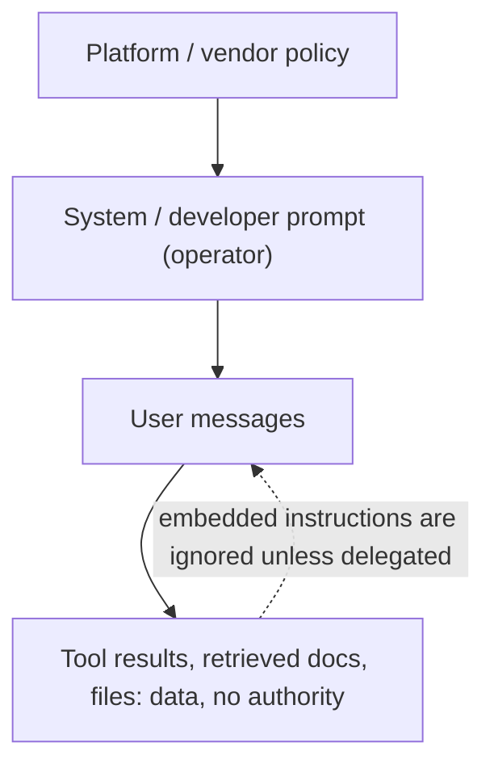

A **system prompt** is the block of instructions an application developer (the "operator") sends with every request, separate from the end user's messages, to set the model's role, rules, output conventions and context for the whole conversation. Models are trained to give it more authority than user turns, so it is where an application encodes behaviour the user should not be able to override ([OpenAI Model Spec](../sources/openai-model-spec.md), [Anthropic mid-conversation](../sources/anthropic-mid-conversation-system-messages.md)). It is the persistent layer of [prompt engineering](prompt-engineering.md) and the first item of an agent's context ([context engineering](context-engineering.md)).

## Vendor implementations (as of 2026-11)

| Vendor / API | Field | Notes |
|---|---|---|
| Anthropic Messages API | top-level `system` (string or blocks) | Plus `role: "system"` messages inside `messages` on supported models ([Anthropic mid-conversation](../sources/anthropic-mid-conversation-system-messages.md)) |
| OpenAI Responses API | `developer` role messages, or the `instructions` parameter | `instructions` applies to one request only and is not carried over via `previous_response_id` ([OpenAI guide](../sources/openai-prompt-engineering-guide.md)). Reasoning models since `o1-2024-12-17` take developer messages instead of system messages ([OpenAI reasoning](../sources/openai-reasoning-best-practices.md)) |
| OpenAI "system" | Platform-level, written by OpenAI | Above developer; may be invisible to developers ([Model Spec](../sources/openai-model-spec.md)) |
| Google Gemini | system instruction | For persistent behaviour: persona, verbosity, date and knowledge cutoff, grounding rules ([Google](../sources/google-gemini-prompting-strategies.md)) |

## Precedence: the instruction hierarchy

OpenAI's Model Spec gives the most explicit ordering: root (the spec itself) > system (platform) > developer > user > guideline (soft defaults). Assistant messages, tool outputs, quoted text, files and images have **no authority by default**; instructions inside them are information unless a higher-level instruction delegates authority. Conflicts resolve by discarding instructions that clash with a higher level or are superseded by a later same-level one; then higher authority and recency win ([Model Spec](../sources/openai-model-spec.md)). Anthropic's API treats system messages as operator-level priority and `user` messages as end-user input ([Anthropic mid-conversation](../sources/anthropic-mid-conversation-system-messages.md)).

This hierarchy is learned, not enforced by the runtime. OpenAI's Instruction Hierarchy paper argues that injections and jailbreaks succeed because models gave system prompts and untrusted text equal weight. Training GPT-3.5 on synthetic conflicts to ignore lower-privileged instructions substantially improved robustness, including against unseen attacks ([Wallace et al.](../sources/wallace-2024-instruction-hierarchy.md)). Anthropic reports that Sonnet 5.5 and Haiku 5.5 are trained to resist injection via tool results, to the point that they may ignore a system message placed directly after a tool result ([Anthropic mid-conversation](../sources/anthropic-mid-conversation-system-messages.md)).

## What goes where

| Put in the system prompt | Put in the user turn |
|---|---|
| Role/identity, tone, audience | The specific task instance and its variable input |
| Hard rules and policies, refusal and escalation behaviour | End-user questions and uploaded content |
| Output conventions (format, length, language) | Per-request documents (long ones at the top of the turn, query last) |
| Tool-use policy, stable few-shot examples | Continuations of interrupted replies |
| Current date, model identity, knowledge cutoff | |

Sources for the table: role in system ([Anthropic](../sources/anthropic-prompting-best-practices.md)); identity → instructions → examples → context layout ([OpenAI guide](../sources/openai-prompt-engineering-guide.md)); date, cutoff and grounding rules ([Google](../sources/google-gemini-prompting-strategies.md)); role, constraints and format in the system instruction or at the start for Gemini 3 ([Google](../sources/google-gemini-prompting-strategies.md)); continuations in the user turn ([Anthropic](../sources/anthropic-prompting-best-practices.md)). Synthesis: the dividing line is *stable and privileged* (system) vs *per-request and untrusted* (user).

**Role prompting.** Anthropic says one sentence of role in `system` noticeably focuses behaviour and tone ([Anthropic](../sources/anthropic-prompting-best-practices.md)). The Notebook lists role/persona as a standard technique for expertise and tone ([Notebook](../sources/notebook-prompt-engineering.md)).

## Changing instructions mid-conversation

Editing the top-level `system` field changes the start of the prompt and invalidates the [prompt cache](prompt-caching.md) for everything after it. On many current Claude models it also invalidates earlier thinking blocks ([Anthropic best practices](../sources/anthropic-prompting-best-practices.md)). Anthropic's **mid-conversation system messages** append a `role: "system"` message instead ([Anthropic mid-conversation](../sources/anthropic-mid-conversation-system-messages.md)):

- It applies from its position onward. Later system messages override earlier ones and the top-level field.
- It must follow a user turn and cannot sit between `tool_use` and `tool_result` (400 error).
- Betas: add or remove tools mid-conversation (`tool_addition` / `tool_removal`), turn-scoped reminders (`clear_at: "next_user_message"`), per-message `effort`.
- Not available on Claude Sonnet 5. Use the top-level field for whole-conversation rules, system messages for later or frequently changing rules (mode switches, state changes, budget reminders), and user messages for anything from the end user.

OpenAI's per-request `instructions` gives a similar "swap the rules this turn" ability, but you must resend it each request ([OpenAI guide](../sources/openai-prompt-engineering-guide.md)).

## Writing guidance

- **Calm, specific language.** Newer Claude models are more responsive to the system prompt; "CRITICAL: you MUST…" written for older models causes over-triggering ([Anthropic](../sources/anthropic-prompting-best-practices.md)). Google warns against overly persuasive language with Gemini 3 ([Google](../sources/google-gemini-prompting-strategies.md)).
- **Explain the reasons for rules** so the model generalises them ([Anthropic](../sources/anthropic-prompting-best-practices.md)).
- **Structure** with headers or XML sections. OpenAI uses Markdown headers for sections and XML for documents ([OpenAI guide](../sources/openai-prompt-engineering-guide.md)); Google says to choose one format and use it consistently within a prompt for Gemini 3 ([Google](../sources/google-gemini-prompting-strategies.md)).
- **Format toggles:** OpenAI reasoning models avoid markdown unless the developer message starts with "Formatting re-enabled" ([OpenAI reasoning](../sources/openai-reasoning-best-practices.md)).
- **Version it** as code, pinned to a model snapshot and covered by evals ([OpenAI guide](../sources/openai-prompt-engineering-guide.md)).
- **Keep it stable and first** for cache hits ([OpenAI guide](../sources/openai-prompt-engineering-guide.md)).

## Limitations and failure modes

- **Not a security boundary.** Priority is a trained tendency, so a determined [prompt injection](prompt-injection.md) or [jailbreak](jailbreaks.md) can still win ([Wallace et al.](../sources/wallace-2024-instruction-hierarchy.md)). Synthesis: enforce permissions in code and tooling ([agent guardrails](agent-guardrails.md)), and treat the system prompt as policy guidance, not access control.
- **Not secret.** Synthesis: assume users can extract it, and never put credentials or sensitive logic in it.
- **Bloat.** Synthesis: long, accreted system prompts cost tokens on every call and can trigger unwanted behaviour. Anthropic notes that large, complex system prompts can make adaptive thinking fire more often ([Anthropic](../sources/anthropic-prompting-best-practices.md)).
- **Drift across models.** A prompt tuned for one model can over- or under-steer the next. Re-evaluate on upgrades ([Anthropic](../sources/anthropic-prompting-best-practices.md)).

## Sources

- [OpenAI Model Spec](../sources/openai-model-spec.md)
- [The Instruction Hierarchy (OpenAI)](../sources/wallace-2024-instruction-hierarchy.md)
- [Prompt engineering guide (OpenAI)](../sources/openai-prompt-engineering-guide.md)
- [Reasoning best practices (OpenAI)](../sources/openai-reasoning-best-practices.md)
- [Prompting best practices (Anthropic)](../sources/anthropic-prompting-best-practices.md)
- [Mid-conversation system messages (Anthropic)](../sources/anthropic-mid-conversation-system-messages.md)
- [Prompt design strategies (Google Gemini)](../sources/google-gemini-prompting-strategies.md)
- [Prompt & Context Engineering (Notebook)](../sources/notebook-prompt-engineering.md)
