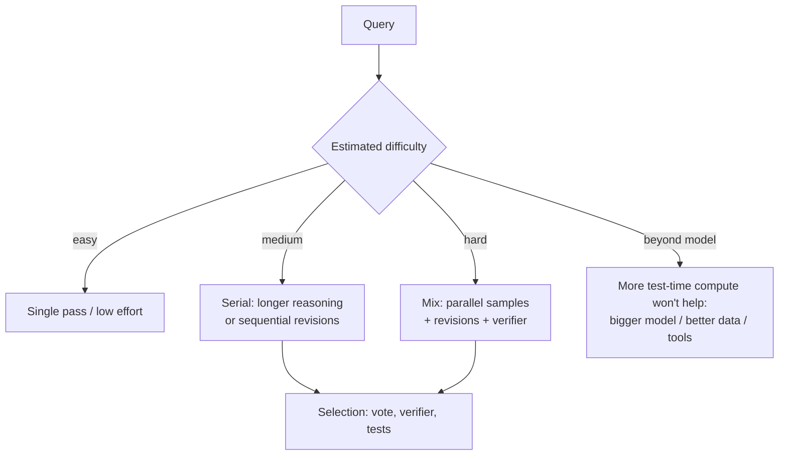

**Test-time compute** (also called inference-time compute or test-time scaling) is the compute a model spends answering one query, beyond a single greedy pass. You can spend more of it in two ways. **Serially**, by letting the model reason longer before answering, which is what [reasoning models](reasoning-models.md) are trained to do. Or **in parallel**, by sampling many candidate answers and picking one with a vote, a verifier or a scoring model. o1 showed that accuracy keeps rising with more RL training compute *and* with more thinking time, so test-time compute became a second scaling axis next to parameters and pretraining data ([OpenAI](../sources/openai-learning-to-reason-with-llms.md)).

## The two axes

| | Serial (sequential) | Parallel |
|---|---|---|
| Mechanism | One longer chain: plan, check, backtrack, revise | N independent samples + aggregation |
| Selection | Implicit: the model decides when it's done | Majority vote ([self-consistency](../sources/wang-2022-self-consistency.md)), best-of-N with a reward model, beam search with a process reward model |
| Acts like | Local refinement | Global search over approaches |
| Product knob | `effort`, `thinking_level`, `budget_tokens` | Usually not exposed; build it yourself (n samples + judge). OpenAI's `reasoning.mode: pro` does more model work per request, but OpenAI does not say whether that work is parallel |
| Latency | Grows with tokens (sequential decode) | Wall-clock roughly flat if samples run concurrently; cost scales with N |

Sources: [Snell et al.](../sources/snell-scaling-test-time-compute.md), [Anthropic](../sources/anthropic-visible-extended-thinking.md), [OpenAI guide](../sources/openai-reasoning-guide.md). The latency row is Synthesis.

Anthropic reported both axes for Claude 3.7 Sonnet. Serially, AIME accuracy grew roughly with the log of allowed thinking tokens. In parallel, 256 samples, a learned scorer and a 64K budget reached 84.8% on GPQA. The parallel setup was a research configuration, not the shipped product ([Anthropic](../sources/anthropic-visible-extended-thinking.md)). OpenAI likewise described a log-linear AIME curve for o1 ([OpenAI](../sources/openai-learning-to-reason-with-llms.md)). Synthesis: log-linear means every constant gain costs a *multiple* of tokens. The first doubling of the budget is cheap, but later doublings are expensive.

*Synthesis: routing view of Snell et al.'s compute-optimal findings.*

## What the research says about spending it well

**Compute-optimal allocation depends on difficulty** ([Snell et al.](../sources/snell-scaling-test-time-compute.md)):

- Easy questions do best with purely sequential revision. Harder ones want a mix of sequential and parallel sampling.
- Beam search against a process reward model beats best-of-N at small budgets and on medium-hard questions. On easy questions it over-optimizes the verifier and gets *worse* with more budget. On the hardest questions nothing helps much.
- Choosing the strategy per difficulty bin matches best-of-N with up to about 4x less compute.
- Against a model about 14x larger at equal FLOPs, test-time compute wins on easy and medium questions and when inference volume is low relative to pretraining. Pretraining wins on the hardest questions and under heavy inference load. The two are not interchangeable.
- Naive self-revision turns right answers wrong: about 38% of correct answers got revised back to incorrect ones, so some selection step (a verifier or vote over the revision chain) is needed.

**Models can learn to spend it.** In DeepSeek-R1-Zero, response length grew during RL with no instruction to think longer. Pure outcome reward taught the model to buy accuracy with tokens ([DeepSeek-R1](../sources/deepseek-r1-paper.md)).

**It can be controlled at decode time.** s1's *budget forcing* ends thinking early by emitting the end-of-thinking delimiter, or extends it by suppressing the stop and appending "Wait". This lifted a 32B model trained on only 1,000 examples from 50% to 57% on AIME24 ([s1](../sources/s1-simple-test-time-scaling.md)). Synthesis: vendor "budget" and "effort" controls are the productised version of this lever.

**Parallel scaling without training:** self-consistency (sample several CoTs, majority-vote the answer) gave +17.9 points on GSM8K over greedy CoT. It needs answers that can be compared exactly ([Wang et al.](../sources/wang-2022-self-consistency.md)).

## Failure modes

- **Overthinking.** Reasoning models spend large budgets on trivial inputs ("2+3") with no accuracy gain, which is pure cost and latency ([Chen et al.](../sources/overthinking-o1-like-llms.md)).
- **Inverse scaling.** On some tasks accuracy *falls* as reasoning gets longer. Causes include distraction by irrelevant information, overfitting to familiar framings, a shift to spurious correlations, and losing focus in long deductions. Extended reasoning also amplified concerning behaviour in one safety evaluation ([Gema et al.](../sources/inverse-scaling-test-time-compute.md)).
- **Verifier hacking.** More search against an imperfect reward model optimizes the reward model's errors ([Snell et al.](../sources/snell-scaling-test-time-compute.md)). PRMs were also abandoned in R1 training for this reason ([DeepSeek-R1](../sources/deepseek-r1-paper.md)).
- **Budget exhaustion.** Hidden reasoning counts toward the output cap. A cap sized for a non-reasoning answer can produce a truncated response with no visible text ([OpenAI guide](../sources/openai-reasoning-guide.md), [Claude steering](../sources/anthropic-steering-thinking-docs.md)).

## Practical guidance

Synthesis, grounded in the sources above:

1. **Treat effort as a hyperparameter, set by evals.** Sweep low → max on a representative set and pick the knee of the quality-vs-cost curve. Expect diminishing, sometimes negative, returns. See [LLM evaluation](llm-evaluation.md).
2. **Use parallel compute when you have a cheap checker.** Unit tests, schema validation, SQL execution or exact-match voting turn N samples into reliable gains. Without a checker you need an [LLM judge](llm-as-judge.md), and its errors cap the benefit.
3. **Route by difficulty.** A cheap first pass or classifier sends easy traffic to low effort and escalates the rest. This is the product version of compute-optimal allocation. See [model selection](model-selection.md) and [cost and latency optimization](cost-and-latency-optimization.md).
4. **Size output limits for reasoning.** Raise `max_tokens` before blaming the model; OpenAI suggests reserving at least 25K tokens at first ([OpenAI guide](../sources/openai-reasoning-guide.md)). Very long budgets belong in [batch processing](batch-processing.md).
5. **Know when to stop scaling inference.** If the model is far below the bar, more thinking rarely closes the gap. Change the model, the context ([RAG](retrieval-augmented-generation.md), tools) or the training ([fine-tuning](fine-tuning.md)).

## Sources

- [Scaling LLM Test-Time Compute Optimally](../sources/snell-scaling-test-time-compute.md)
- [Learning to Reason with LLMs (OpenAI)](../sources/openai-learning-to-reason-with-llms.md)
- [Claude's extended thinking (Anthropic)](../sources/anthropic-visible-extended-thinking.md)
- [DeepSeek-R1](../sources/deepseek-r1-paper.md)
- [s1: Simple test-time scaling](../sources/s1-simple-test-time-scaling.md)
- [Self-Consistency (Wang et al.)](../sources/wang-2022-self-consistency.md)
- [Inverse Scaling in Test-Time Compute](../sources/inverse-scaling-test-time-compute.md)
- [Do NOT Think That Much for 2+3=?](../sources/overthinking-o1-like-llms.md)
- [Claude API docs: Steering thinking](../sources/anthropic-steering-thinking-docs.md)
- [OpenAI reasoning models guide](../sources/openai-reasoning-guide.md)
