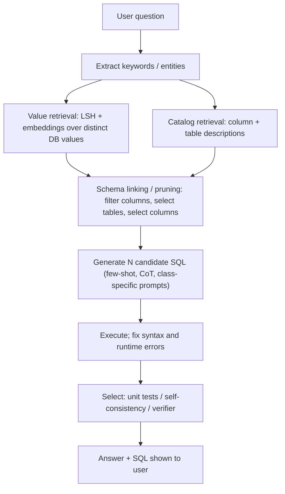

**Text-to-SQL** (NL2SQL) is the task of turning a natural-language question ("which region grew fastest last quarter?") into a SQL query over a specific database, running it, and returning the result. It is how LLM systems retrieve from *structured* data, where [RAG](retrieval-augmented-generation.md) over text chunks cannot compute aggregates or joins. The hard parts are not SQL syntax. They are **schema linking** (mapping words to the right tables, columns and values), knowing business meaning that the schema does not encode, and the fact that a wrong query usually still runs and returns a plausible number ([DIN-SQL](../sources/din-sql-2023.md), [dbt Labs](../sources/dbt-semantic-layer-vs-text-to-sql-2026.md)).

## Pipeline anatomy

Modern systems decompose the task. DIN-SQL and CHESS are the reference designs ([DIN-SQL](../sources/din-sql-2023.md), [CHESS](../sources/chess-text-to-sql-2024.md)):

Synthesis: the diagram merges DIN-SQL's modules with CHESS's agents.

1. **Schema linking.** In DIN-SQL's [error analysis](error-analysis.md) of few-shot CodeX on Spider, schema linking was the largest failure category. One example: the model picked a column literally named `average` instead of computing `AVG(capacity)`. JOIN errors were second ([DIN-SQL](../sources/din-sql-2023.md)). In CHESS's analysis, 57.1% of vanilla GPT-4's wrong SQL traced to schema linking ([CHESS](../sources/chess-text-to-sql-2024.md)).
2. **Value retrieval.** Users say "California", the column holds `CA`. CHESS pre-indexes every distinct value with locality-sensitive hashing, then re-ranks candidates by [embedding](embeddings.md) similarity and edit distance. That cut lookup from about 5 minutes to about 5 seconds ([CHESS](../sources/chess-text-to-sql-2024.md)). This is [hybrid search](hybrid-search.md) applied to cell values. DIN-SQL instead put sample rows in the prompt for BIRD ([DIN-SQL](../sources/din-sql-2023.md)).
3. **Schema pruning.** Enterprise schemas do not fit in context, or fit but distract the model. CHESS filters column by column with a cheap LLM, then selects tables, then columns, and always keeps primary and foreign keys. Column precision rose from 0.11 to 0.71 while recall fell only from 1.0 to 0.94. On a 4,337-column schema it cut tokens more than 5x ([CHESS](../sources/chess-text-to-sql-2024.md)). See [context engineering](context-engineering.md).
4. **Classification and decomposition.** DIN-SQL routes questions as easy, non-nested complex (joins) or nested complex, and uses a different prompt per class. Complex classes use the NatSQL intermediate representation ([DIN-SQL](../sources/din-sql-2023.md)). This is [chain-of-thought](chain-of-thought.md) and [few-shot prompting](few-shot-prompting.md) tuned to SQL.
5. **Generation, execution and self-correction.** Run the query and feed errors back. DIN-SQL found a "generic" fix prompt (assume the SQL is buggy) helped CodeX, but a "gentle" one (check for problems) worked better for GPT-4 ([DIN-SQL](../sources/din-sql-2023.md)).
6. **Candidate selection.** Generate several queries and pick one, using LLM-written unit tests in CHESS or many-candidate self-consistency in top BIRD entries ([CHESS](../sources/chess-text-to-sql-2024.md), [BIRD](../sources/bird-benchmark.md)). This is [test-time compute](test-time-compute.md) spent on SQL.
7. **Agentic exploration.** For Spider 2.0-style tasks, the model must search metadata, read dialect docs and project code, and issue several queries, so it works as an [agent loop](agent-loop.md) with SQL [tools](tools.md) ([Spider 2.0](../sources/spider-2-lei-2024.md)).

Ablations show each step pays. In CHESS, removing table selection cost 6.12 EX points, column selection 5.44, and the retrieval tools 4.76 ([CHESS](../sources/chess-text-to-sql-2024.md)).

## Semantic layers: constrain instead of generate

A **semantic layer** (dbt Semantic Layer/MetricFlow, Cube, Snowflake semantic views) defines entities (join keys), dimensions, measures and named metrics once. The LLM then *chooses* a metric, dimensions and filters, and the layer compiles deterministic SQL. dbt says every consumer then gets the same metric definitions, and AI tools connect through its MCP server ([dbt Labs](../sources/dbt-semantic-layer-vs-text-to-sql-2026.md); see [MCP](model-context-protocol.md)).

dbt Labs' April 2026 benchmark (11 questions on a third-normal-form insurance schema, 20 runs, vendor-run) gives the trade-off in numbers ([dbt Labs](../sources/dbt-semantic-layer-vs-text-to-sql-2026.md)):

| Setting | Text-to-SQL | Semantic layer |
|---|---|---|
| Raw schema, in-scope questions (Sonnet 4.6 / GPT-5.3 Codex) | 62.5% / 51.2% | 100% / 100% |
| Raw schema, questions needing many join hops | 70.0% / 100% | 0% (cannot express) |
| Raw schema, all 11 questions | 64.5% / 64.5% (GPT-4 in 2023: 32.7%) | 72.7% |
| After an LLM added 3 dbt models | 90.0% / 84.1% | 98.2% / 100% |

The key qualitative point is that text-to-SQL **fails silently** (wrong join, wrong number that looks right), while the semantic layer **fails loudly** (an error when out of scope). dbt recommends the semantic layer for KPIs and board reporting and text-to-SQL as a fallback for exploration. Good data modeling lifted both ([dbt Labs](../sources/dbt-semantic-layer-vs-text-to-sql-2026.md)).

A middle path is **verified queries**. Snowflake Cortex Analyst stores human-checked question/SQL pairs in the semantic model and reuses the matching SQL when a new question is similar. Each verified query must use logical names and be tested, because wrong examples hurt accuracy ([Snowflake VQR](../sources/snowflake-cortex-analyst-vqr-docs.md)). Synthesis: this works like a retrieved few-shot library and is the cheapest way to lock in the top recurring questions.

## Benchmarks

| Benchmark | Scale and setting | What it stresses | Reported numbers |
|---|---|---|---|
| Spider 1.0 (EMNLP 2018) | 10,181 questions, 200 databases, 138 domains; split by database | Unseen schemas | 12.4% exact match at release; DIN-SQL 85.3% EX in 2023 ([Spider](../sources/spider-yu-2018.md), [DIN-SQL](../sources/din-sql-2023.md)) |
| BIRD (NeurIPS 2023) | 12,751 pairs, 95 databases, 33.4 GB, 37 domains | Dirty values, external-knowledge "evidence", efficiency (R-VES) | ChatGPT 40.08% vs human 92.96% at release; top test EX 83.40% (2026-10) ([BIRD](../sources/bird-benchmark.md)) |
| Spider 2.0 (ICLR 2025) | 632 enterprise tasks; BigQuery, Snowflake, dbt; 1,000+ column schemas | Dialects, metadata search, multi-query workflows | o1-preview agent 21.3% at release; as of 2026-11 Lite top 76.23, Snow top 96.70, DBT top 65.6 ([Spider 2.0](../sources/spider-2-lei-2024.md)) |
| BIRD-Interact / LiveSQLBench (2025-26) | Multi-turn ambiguity; contamination-resistant refreshes | Clarification, live data | Best success roughly 8-45% in 2025 ([BIRD](../sources/bird-benchmark.md)) |

Metrics: **exact match** compares SQL structure and penalizes equivalent rewrites. **Execution accuracy (EX)** compares result sets, so a wrong query that happens to return the right rows still counts as correct. **R-VES** adds query efficiency ([Spider](../sources/spider-yu-2018.md), [BIRD](../sources/bird-benchmark.md)). Synthesis: EX is the practical default, but check it on several database states.

**Treat leaderboard numbers with suspicion.** An expert audit found annotation errors in 52.8% of BIRD Mini-Dev and 62.8% of audited Spider 2.0-Snow examples. On corrected BIRD Dev data, agent scores moved by -7% to +31% relative and ranks by up to 9 places. Rank correlation with the full Dev set fell from 0.85 to 0.32 ([Jin et al.](../sources/jin-2026-text-to-sql-annotation-errors.md)). See [benchmarks](benchmarks.md).

## Accuracy issues and failure modes

- **Silent wrong answers:** queries that run but join wrongly, double-count across a fan-out join, or misread a column's meaning ([dbt Labs](../sources/dbt-semantic-layer-vs-text-to-sql-2026.md)). This is the SQL form of [hallucination](hallucination.md).
- **Business-definition gaps:** "active customer" or "revenue" is not in the schema. BIRD made such external knowledge an explicit input for this reason ([BIRD](../sources/bird-benchmark.md)).
- **Value mismatch:** abbreviations, casing and dirty values ([BIRD](../sources/bird-benchmark.md), [CHESS](../sources/chess-text-to-sql-2024.md)).
- **Scale:** a full schema in context is optimistic for big warehouses, and Spider 2.0 shows sharp drops on 1,000+ column schemas and dialect quirks ([dbt Labs](../sources/dbt-semantic-layer-vs-text-to-sql-2026.md), [Spider 2.0](../sources/spider-2-lei-2024.md)).
- **Ambiguity:** multi-turn interactive benchmarks remain far from solved ([BIRD](../sources/bird-benchmark.md)).
- **More reasoning is not always better:** in dbt's runs, raising [reasoning](reasoning-models.md) effort added latency with no accuracy gain on semantic-layer queries ([dbt Labs](../sources/dbt-semantic-layer-vs-text-to-sql-2026.md)).
- **Security (Synthesis):** generated SQL is untrusted code. Use a read-only role, row-level security and allow-listed schemas, set statement timeouts and row limits, and treat database contents as possible [prompt injection](prompt-injection.md). See [agent guardrails](agent-guardrails.md).

## When to use what

Synthesis, grounded in the sources above:

| Situation | Approach |
|---|---|
| Recurring KPIs, finance, board or audited numbers | Semantic layer (and/or verified queries); refuse out-of-scope questions |
| Ad hoc exploration by analysts who can read SQL | Text-to-SQL with schema pruning, value retrieval and execution feedback; always show the SQL |
| Small, clean schema (tens of tables) | Full schema plus descriptions and sample rows in the prompt; few-shot from a query log |
| Large warehouse (hundreds+ tables) | Retrieval over the catalog and values (CHESS-style), then agentic exploration |
| Business users with no SQL skills | Semantic layer first; text-to-SQL only with a confidence signal and [human review](human-in-the-loop.md) |

Implementation checklist (Synthesis): curate column descriptions and metric definitions; build an eval set of 50-200 real questions with gold *results* from the business; score EX plus a human audit of the gold set (benchmarks show gold SQL is often wrong); log every generated query; add the best ones to a verified-query library; use [structured outputs](structured-outputs.md) or [function calling](function-calling.md) when the model should emit semantic-layer parameters rather than raw SQL. Related: [document processing](document-processing.md) for the unstructured-data half of enterprise retrieval, [agentic RAG](agentic-rag.md), [LLM evaluation](llm-evaluation.md).

## Sources

- [Spider (Yu et al., 2018)](../sources/spider-yu-2018.md)
- [BIRD Benchmark and Leaderboard](../sources/bird-benchmark.md)
- [Spider 2.0 and Leaderboard](../sources/spider-2-lei-2024.md)
- [DIN-SQL](../sources/din-sql-2023.md)
- [CHESS](../sources/chess-text-to-sql-2024.md)
- [dbt Labs: Semantic Layer vs. Text-to-SQL 2026](../sources/dbt-semantic-layer-vs-text-to-sql-2026.md)
- [Snowflake Cortex Analyst VQR Docs](../sources/snowflake-cortex-analyst-vqr-docs.md)
- [Pervasive Annotation Errors (Jin et al., 2026)](../sources/jin-2026-text-to-sql-annotation-errors.md)
