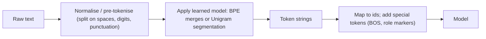

**Tokenization** is the step that converts text into the integer ids a [transformer](transformer-architecture.md) actually reads, and converts generated ids back into text. Modern LLMs use **subword** tokenizers: frequent words become a single token, rare words split into several known pieces, and nothing is ever "out of vocabulary" ([Hugging Face](../sources/hugging-face-tokenizer-summary.md); [Sennrich et al.](../sources/sennrich-2016-bpe-subword-units.md)). The token is the unit of everything operational: the [context window](context-window.md) is measured in tokens, APIs bill per token, and latency grows with tokens generated ([notebook](../sources/notebook-transformers.md)).

## Why subwords

| Granularity | Vocabulary | Sequence length | Problem |
|---|---|---|---|
| Word | Huge (every inflection) | Short | Unseen words map to `<unk>`; giant embedding matrix |
| Character | Tiny | Very long | Each unit carries little meaning; quality suffers |
| **Subword** | Fixed, typically ~50k-200k | Moderate | Compromise used by LLMs |

([Hugging Face](../sources/hugging-face-tokenizer-summary.md); vocabulary range from the [notebook](../sources/notebook-transformers.md))

Subword vocabularies came into neural NLP to solve open-vocabulary translation: names, compounds and loanwords can be built from smaller units ([Sennrich et al.](../sources/sennrich-2016-bpe-subword-units.md)).

## The algorithms

Synthesis: generic pipeline; SentencePiece skips the whitespace pre-tokenisation step and works on the raw stream.

| Algorithm | How the vocabulary is built | Segmentation at inference | Used by (per sources) |
|---|---|---|---|
| **BPE** | Start from characters; repeatedly merge the most frequent adjacent pair; vocab = base + merges | Deterministic: replay merge rules | Llama, Gemma, Qwen2 ([HF](../sources/hugging-face-tokenizer-summary.md)) |
| **Byte-level BPE** | Same, but base vocabulary is the 256 byte values | Any UTF-8 input encodable, no `<unk>` | GPT-2 (50,257 entries) ([HF](../sources/hugging-face-tokenizer-summary.md)); OpenAI's tiktoken ([tiktoken](../sources/openai-tiktoken.md)) |
| **WordPiece** | Merge the pair maximising freq(ab) / (freq(a)·freq(b)) | Synthesis: greedy longest-match against the vocabulary | BERT family ([HF](../sources/hugging-face-tokenizer-summary.md)) |
| **Unigram LM** | Start large; prune tokens whose removal least increases loss | Probabilistic; can sample alternative segmentations | T5, BigBird, Pegasus ([HF](../sources/hugging-face-tokenizer-summary.md)) |
| **SentencePiece** (library) | Runs BPE or Unigram on raw text; space becomes `▁` | Fully reversible; language-independent | Languages without spaces ([SentencePiece](../sources/kudo-2018-sentencepiece.md); [HF](../sources/hugging-face-tokenizer-summary.md)) |

BPE as used by OpenAI is reversible and lossless, handles arbitrary text, and averages about 4 bytes per token ([tiktoken](../sources/openai-tiktoken.md)).

**Vocabulary size is a trade-off.** A larger vocabulary compresses text into fewer tokens (cheaper, more fits in context) at the cost of a bigger embedding table. Llama 3 moved to a 128K vocabulary and gets up to 15% fewer tokens than Llama 2 ([Llama 3](../sources/meta-llama-3-announcement.md)). OpenAI's encodings went from `cl100k_base` to `o200k_base` ([tiktoken](../sources/openai-tiktoken.md)).

## Rules of thumb (and where they break)

- English: about 4 characters per token; roughly 750 words per 1,000 tokens ([notebook](../sources/notebook-transformers.md)). Google gives about 4 characters and 60-80 words per 100 tokens for Gemini ([Gemini](../sources/gemini-token-docs.md)).
- **Claude Opus 4.7 and later (including the Fable/Mythos families and Mythos Preview) use a newer tokenizer** that produces roughly 30% more tokens for the same text, with the exact increase depending on content ([Anthropic](../sources/anthropic-token-counting-docs.md)). On it, 1M tokens is about 555k words, versus about 750k words on earlier Claude models ([Claude models overview](../sources/anthropic-models-overview.md)). Rules of thumb are tokenizer-specific.
- **Other languages cost more.** Translations of the same text can differ by up to 15x in token count, even with multilingual tokenizers; that means higher cost, higher latency and less content per window ([Petrov et al.](../sources/petrov-2023-tokenizer-unfairness.md)).
- Code, numbers, rare words and unusual whitespace tokenize into more pieces ([notebook](../sources/notebook-transformers.md)).
- **[Media](multimodal-models.md) are tokens too.** Gemini charges 258 tokens per small image (or per 768×768 tile) and 32 tokens per second of audio ([Gemini](../sources/gemini-token-docs.md)).

## Counting tokens across vendors (as of 2026-11)

| Vendor | How to count before sending | Notes |
|---|---|---|
| OpenAI | Local: `tiktoken.encoding_for_model(...)`, then `len(enc.encode(text))` | Open-source library; encoding per model ([tiktoken](../sources/openai-tiktoken.md)) |
| [Anthropic](anthropic-messages-api.md) | API: `POST /v1/messages/count_tokens` with the same body as a Messages request | Free, rate-limited, an **estimate**; counts tools, images, PDFs, thinking; rejects server tools (except the advisor tool), [MCP](model-context-protocol.md) connector and url/file media; does not apply [prompt caching](prompt-caching.md) ([Anthropic](../sources/anthropic-token-counting-docs.md)) |
| [Google Gemini](gemini-api.md) | API: `countTokens` (input only); response `usage` reports input, output, thought, cached and tool-use tokens | ([Gemini](../sources/gemini-token-docs.md)) |
| [Open-weight models](open-weight-models.md) | Load the model's own tokenizer (e.g. [Hugging Face](hugging-face-ecosystem.md)) | Synthesis: each family ships its own vocabulary |

Two traps:

1. **A raw-text count is not the request count.** Requests are transformed into a model-ready format before reaching the model (Synthesis: role markers, tool schemas) and outputs are parsed afterwards, so billed tokens do not match visible content one-to-one ([Messages API](../sources/anthropic-messages-api-reference.md)). Anthropic may count system-added tokens that it does not bill ([Anthropic](../sources/anthropic-token-counting-docs.md)).
2. **Counts don't transfer between tokenizers.** Recount against the exact model you'll deploy, especially on a migration ([Anthropic](../sources/anthropic-token-counting-docs.md)). Synthesis: never estimate Claude or Gemini usage with tiktoken except as a rough order of magnitude.

## Failure modes caused by tokenization

- **Arithmetic and digits.** GPT-3.5/GPT-4 tokenizers chunk numbers into up-to-3-digit tokens from the left, misaligning with place value; forcing right-to-left chunking with thousands separators markedly improves addition ([Singh & Strouse](../sources/tokenization-counts-arithmetic.md)).
- **Character-level tasks** (spelling, counting letters, reversing strings). Synthesis: the model sees ids for multi-character chunks, not letters, so such tasks need [tools](tools.md) or explicit decomposition. See [LLM limitations](llm-limitations.md).
- **Language inequity** in cost and context, as above ([Petrov et al.](../sources/petrov-2023-tokenizer-unfairness.md)).
- **Budget surprises after a model upgrade** from a tokenizer change ([Anthropic](../sources/anthropic-token-counting-docs.md)).
- **Stop sequences and token boundaries.** Synthesis: a stop string can span token boundaries; vendors match on decoded text, but behaviour around whitespace can surprise. See [sampling parameters](sampling-parameters.md).

## Practical guidance

Synthesis:
- Budget with the target model's counter and keep a margin (10-20%) for formatting overhead.
- For multilingual products, measure tokens per language on real data before pricing; consider languages in [model selection](model-selection.md).
- Prefer formats that tokenize compactly for large payloads (e.g. trimmed JSON, CSV) when feeding data; it saves cost and context. See [cost and latency optimisation](cost-and-latency-optimization.md).
- When numbers matter, format them consistently (separators) or hand arithmetic to a tool ([Singh & Strouse](../sources/tokenization-counts-arithmetic.md)).
- [Embeddings](embeddings.md) models have their own tokenizers and input limits; chunk sizes for [chunking](chunking.md) should be measured in that model's tokens.

## Sources

- [Neural Machine Translation of Rare Words with Subword Units (Sennrich et al.)](../sources/sennrich-2016-bpe-subword-units.md)
- [SentencePiece (Kudo & Richardson)](../sources/kudo-2018-sentencepiece.md)
- [Hugging Face: Tokenization algorithms](../sources/hugging-face-tokenizer-summary.md)
- [tiktoken (OpenAI)](../sources/openai-tiktoken.md)
- [Introducing Meta Llama 3](../sources/meta-llama-3-announcement.md)
- [Language Model Tokenizers Introduce Unfairness Between Languages](../sources/petrov-2023-tokenizer-unfairness.md)
- [Tokenization counts: arithmetic in frontier LLMs](../sources/tokenization-counts-arithmetic.md)
- [Token counting (Claude API docs)](../sources/anthropic-token-counting-docs.md)
- [Messages API reference (Claude API)](../sources/anthropic-messages-api-reference.md)
- [Models overview (Claude Docs)](../sources/anthropic-models-overview.md)
- [Understand and count tokens (Gemini API docs)](../sources/gemini-token-docs.md)
- [Notebook: How LLMs & transformers work](../sources/notebook-transformers.md)
