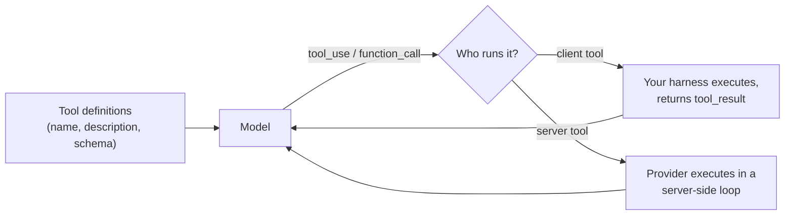

**Tools** are functions the [harness](harness-engineering.md) exposes to the model, each with a name, a description and a parameter schema (the wire format is covered in [function calling](function-calling.md)). They are the only way an [agent loop](agent-loop.md) affects anything outside the model: reading files, [running commands](code-execution-sandboxes.md), querying data, calling APIs. Anthropic describes a tool as a contract between deterministic software and a [non-deterministic](llm-non-determinism.md) agent ([writing tools](../sources/anthropic-writing-tools-for-agents.md)). SWE-agent calls the whole tool layer the **agent-computer interface (ACI)**: LM agents are a new kind of user who needs interfaces built for them, the way humans need IDEs ([SWE-agent](../sources/swe-agent-yang-2024.md)).

*Diagram: client vs server tool execution, per the Anthropic tool use and server tools docs.*

## Design principles

- **Tool design is interface design.** The model knows a tool only through its name, description and schema. Vague descriptions produce vague usage. Write them like a docstring for a new colleague ([Anatomy](../sources/anatomy-of-a-modern-ai-agent.md)). Anthropic calls descriptions the most important factor in tool performance and asks for at least 3 to 4 sentences on what the tool does, when to use it and what each parameter means ([tool use docs](../sources/anthropic-tool-use-docs.md)).
- **Fewer, sharper tools.** Overlapping tools make the model pick the wrong one some of the time. Consolidate them ([Anatomy](../sources/anatomy-of-a-modern-ai-agent.md)). Prefer workflow-shaped tools (a log search that returns the relevant lines) over a thin wrapper on every API endpoint, and namespace related tools by service or resource prefix; the best naming scheme varies by model and should be tested ([writing tools](../sources/anthropic-writing-tools-for-agents.md)).
- **Lean output.** Tool results go into the [context window](context-window.md), so large outputs crowd out what matters. See [context engineering](context-engineering.md). Return high-signal fields, offer a concise/detailed response format, and paginate, filter and set default limits. Claude Code caps a tool response at 25,000 tokens by default, and the truncation message should steer the agent to a narrower query ([writing tools](../sources/anthropic-writing-tools-for-agents.md)).
- **Risk varies by tool.** Read-only tools can run freely, while writes and outward-facing actions need [guardrails](agent-guardrails.md). The MCP spec says a human should be able to deny tool calls and hosts should confirm sensitive operations ([MCP tools spec](../sources/mcp-tools-spec.md)). Read-only hints let the Claude Agent SDK run calls in parallel, but annotations are metadata, not enforcement ([Agent SDK custom tools](../sources/claude-agent-sdk-custom-tools-docs.md)), and MCP clients must treat them as untrusted unless the server is trusted ([MCP tools spec](../sources/mcp-tools-spec.md)). Deterministic enforcement belongs in [hooks and middleware](agent-hooks-and-middleware.md).

## The agent-computer interface: evidence

SWE-agent's ablations show interface details move results by several points. On SWE-bench Lite with GPT-4 Turbo (18.0% with the full interface), removing the edit command dropped it to 10.3%, editing without a lint check to 15.0%, and a full-file viewer instead of a 100-line window to 12.7% ([SWE-agent](../sources/swe-agent-yang-2024.md)). Its design choices:

| Choice | Why |
| --- | --- |
| Search commands cap results at 50 and ask for a narrower query beyond that | Keeps observations compact and informative |
| Windowed file viewer (100 lines, line numbers, count of omitted lines) | A 30-line window or the full file both scored worse |
| Line-range `edit` that re-shows the file, guarded by a flake8 lint check | Rejects edits that introduce syntax errors |
| Older observations collapsed to one line | Keeps history from crowding the window |

Failed edits cascade: success probability fell from 90.5% to 57.2% after a single failed edit ([SWE-agent](../sources/swe-agent-yang-2024.md)). See [coding agents](coding-agents.md) for how current coding harnesses apply this. Anthropic recommends evaluating tools the same way: multi-step verifiable tasks, tracking tool errors and call counts, with a held-out set to avoid overfitting descriptions ([writing tools](../sources/anthropic-writing-tools-for-agents.md)); see [agent evaluation](agent-evaluation.md).

## Results and errors

- **Two error channels.** MCP separates protocol errors (JSON-RPC, such as an unknown tool) from tool execution errors (`isError: true`), which go back to the model so it can self-correct ([MCP tools spec](../sources/mcp-tools-spec.md)). In the Claude Agent SDK, handler exceptions become error results rather than stopping the loop ([Agent SDK custom tools](../sources/claude-agent-sdk-custom-tools-docs.md)). On the Messages API, a skipped or failed call still needs a `tool_result` with `is_error: true` ([tool use docs](../sources/anthropic-tool-use-docs.md)).
- **Errors should teach.** An error message should say how to fix the call ([writing tools](../sources/anthropic-writing-tools-for-agents.md)).
- **Structured results.** MCP tools may declare an `outputSchema` and return conforming `structuredContent`, plus serialized JSON as text for compatibility ([MCP tools spec](../sources/mcp-tools-spec.md)). See [structured outputs](structured-outputs.md).
- **Stateful tools use handles.** Because MCP is now stateless, the spec's guidance is for a creation tool to return an opaque handle (high-entropy if the server is unauthenticated), re-check authorization on every use, state the handle's lifetime in the description, and return a tool execution error when it expires ([MCP tools spec](../sources/mcp-tools-spec.md)).

## Scaling the catalogue

Every definition is injected into the context and billed as input tokens. OpenAI's soft guideline is to keep fewer than about 20 functions available at the start of a turn and to use `tool_search` with `defer_loading` for larger catalogues ([OpenAI](../sources/openai-function-calling-guide.md)). Claude has the same `defer_loading` flag and a tool search server tool, and the tool definitions also add a hidden system prompt of roughly 286 to 804 tokens depending on model and `tool_choice` ([tool use docs](../sources/anthropic-tool-use-docs.md)). The Claude Agent SDK turns tool search on by default for SDK MCP tools ([Agent SDK custom tools](../sources/claude-agent-sdk-custom-tools-docs.md)). Details are in [function calling](function-calling.md).

Keep the tool list stable for [prompt caching](prompt-caching.md): MCP recommends deterministic `tools/list` ordering for caching ([MCP tools spec](../sources/mcp-tools-spec.md)), changing `tool_choice` on Claude invalidates cached message blocks ([tool use docs](../sources/anthropic-tool-use-docs.md)), and OpenAI's `allowed_tools` restricts the usable subset without changing the list, which preserves the cache ([OpenAI](../sources/openai-function-calling-guide.md)).

MCP tool names are only unique per server: collisions across servers are expected, and aggregating clients should prefix names with a server identifier ([MCP tools spec](../sources/mcp-tools-spec.md)).

**Programmatic (code-mode) tool calling** goes further: the model writes code that calls tools inside a sandbox, so intermediate results never enter the context. Anthropic's `code_execution_20260120` and later versions support this from inside the sandbox ([code execution tool](../sources/anthropic-code-execution-tool-docs.md)), and exposing MCP tools as code APIs cut one workflow from about 150,000 to about 2,000 tokens, at the cost of running a secure sandbox ([code execution with MCP](../sources/anthropic-code-execution-with-mcp.md)). See [code execution sandboxes](code-execution-sandboxes.md).

## Where tools run

- **Client tools** run in your harness, which returns the result.
- **Server tools** (web search, web fetch, code execution, tool search) run on the provider's side ([tool use docs](../sources/anthropic-tool-use-docs.md)). They need no `tool_result` from you. A long server-side loop can return `pause_turn`, which you continue by resending the assistant content unchanged; when Claude mixes a server and a client tool in one parallel group, the server tool runs only after you return the client results ([server tools](../sources/anthropic-server-tools-docs.md)). See [web search APIs](web-search-apis.md) and the [Messages API](anthropic-messages-api.md).
- **Computer and browser toolsets** are client-side tool families for GUI control; see [computer-use agents](computer-use-agents.md).
- **Code tools for exact work.** Arithmetic and counting suffer from subword tokenization ([Singh & Strouse](../sources/tokenization-counts-arithmetic.md)), so exact computation belongs in a code-execution or calculator tool; see [LLM limitations](llm-limitations.md).
- **The "think" tool is mostly retired.** A no-op tool that only logs a thought gave the model room to reason after tool results; on τ-Bench airline it raised pass^1 from 0.370 to 0.570 with an optimized prompt. Anthropic's December 2025 update now recommends extended thinking over it in most cases ([think tool](../sources/anthropic-think-tool.md)), since interleaved thinking reasons between tool calls; see [extended thinking](extended-thinking.md).

## Security

Tool results and tool descriptions are both attack surfaces ([lethal trifecta](lethal-trifecta.md)).

- **Results are untrusted data.** Put third-party content only in `tool_result` blocks, label its origin, JSON-encode it so it cannot break out of delimiters, and never put your own instructions in tool results ([Anthropic jailbreak docs](../sources/anthropic-mitigate-jailbreaks-docs.md)). See [prompt injection](prompt-injection.md).
- **Descriptions can be poisoned.** Hidden instructions in an MCP tool description made an agent read `~/.ssh/id_rsa` and exfiltrate it through a parameter, or changed only after approval (a rug pull) ([Invariant Labs](../sources/invariant-2025-mcp-tool-poisoning.md)). See [MCP in practice](mcp-in-practice.md).
- **Servers validate, clients check.** MCP servers must validate inputs, enforce access control, rate limit and sanitize outputs; clients should show inputs before calling, validate results, time out calls and log usage ([MCP tools spec](../sources/mcp-tools-spec.md)).
- **Keep credentials out of the model.** The model must not have access to tool credentials ([agent-auth draft](../sources/ietf-aiagent-auth-draft.md)); credential brokers inject them server-side and return only results ([Composio](../sources/composio-authentication-docs.md)). See [agent authentication and authorization](agent-authentication-and-authorization.md).

## Related

[Model Context Protocol](model-context-protocol.md), a standard way to expose tools to any agent.

## Going deeper

- [Function calling](function-calling.md): vendor wire formats, parallel calls, strict schemas and tool search for large catalogues.
- [MCP in practice](mcp-in-practice.md): tool naming, the two error channels and annotations in the MCP tools spec.
- [Web search APIs](web-search-apis.md): the main example of server-side tools.
- [Computer-use agents](computer-use-agents.md): computer and browser toolsets.
- [Code execution sandboxes](code-execution-sandboxes.md): server-side code tools and programmatic tool calling.
- [Coding agents](coding-agents.md): the agent-computer interface applied in current coding harnesses.
- [Agent skills](agent-skills.md): packaged instructions that teach a model how to use tools.
- [Agentic RAG](agentic-rag.md): retrieval exposed as a tool.
- [Agent hooks and middleware](agent-hooks-and-middleware.md): deterministic checks around tool calls.
- [Agent authentication and authorization](agent-authentication-and-authorization.md): injecting tool credentials server-side.
- [Prompt injection](prompt-injection.md): why tool results must be treated as untrusted data.
- [LLM limitations](llm-limitations.md): routing arithmetic, counting and dates to code tools.

## Sources

- [The Anatomy of a Modern AI Agent](../sources/anatomy-of-a-modern-ai-agent.md)
- [Writing effective tools for agents (Anthropic)](../sources/anthropic-writing-tools-for-agents.md)
- [SWE-agent: Agent-Computer Interfaces (Yang et al., 2024)](../sources/swe-agent-yang-2024.md)
- [MCP Tools Specification (2026-07-28)](../sources/mcp-tools-spec.md)
- [Anthropic Tool Use Docs](../sources/anthropic-tool-use-docs.md)
- [OpenAI Function Calling Guide](../sources/openai-function-calling-guide.md)
- [Server tools (Claude docs)](../sources/anthropic-server-tools-docs.md)
- [Claude Agent SDK custom tools docs](../sources/claude-agent-sdk-custom-tools-docs.md)
- [The "think" tool (Anthropic)](../sources/anthropic-think-tool.md)
- [Anthropic code execution tool docs](../sources/anthropic-code-execution-tool-docs.md)
- [Code execution with MCP (Anthropic)](../sources/anthropic-code-execution-with-mcp.md)
- [Anthropic: Mitigate jailbreaks and prompt injections](../sources/anthropic-mitigate-jailbreaks-docs.md)
- [Invariant Labs: MCP tool poisoning](../sources/invariant-2025-mcp-tool-poisoning.md)
- [IETF AI agent auth draft](../sources/ietf-aiagent-auth-draft.md)
- [Composio authentication docs](../sources/composio-authentication-docs.md)
- [Tokenization counts (Singh & Strouse)](../sources/tokenization-counts-arithmetic.md)
