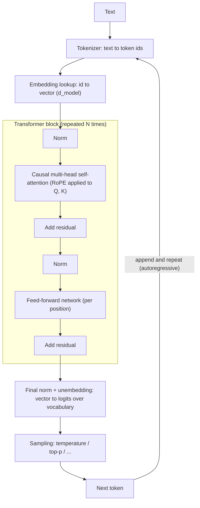

The **transformer** is the neural-network architecture behind every current large language model. It was introduced in 2017 as an encoder-decoder for translation that drops recurrence and convolution entirely in favour of **attention**, a mechanism that lets every position in a sequence pull information from every other position in parallel ([Vaswani et al.](../sources/vaswani-2017-attention-is-all-you-need.md)). Today's LLMs use the **decoder-only** variant: a stack of identical blocks that reads a sequence of [tokens](tokenization.md) and outputs a probability distribution over the next token. Generation repeats that one step: sample a token, append it, run again ([notebook](../sources/notebook-transformers.md); [Llama 3](../sources/meta-llama-3-announcement.md)).

## The forward pass

Synthesis: block layout drawn in the pre-norm style common in modern decoder-only models; the 2017 paper placed normalisation after each residual add.

1. **Tokens to vectors.** Each token id indexes a learned embedding table, giving a vector of width `d_model` ([notebook](../sources/notebook-transformers.md)).
2. **Blocks.** Each block is self-attention followed by a position-wise feed-forward network, each wrapped in a residual connection and normalisation ([Vaswani](../sources/vaswani-2017-attention-is-all-you-need.md)). Models stack dozens to over a hundred blocks; the learned weights in them are the model's parameters ([notebook](../sources/notebook-transformers.md)). Modern decoders commonly use RMSNorm as the normalisation layer; it is one of the kernels Thinking Machines had to make batch-invariant in vLLM ([Thinking Machines](../sources/defeating-nondeterminism-llm-inference.md)).
3. **Logits.** The final vector at the last position is projected to one score (logit) per vocabulary entry; softmax turns them into probabilities, and the [sampling parameters](sampling-parameters.md) decide which token is picked.

## Attention, precisely

For each position the block computes three projections of the input: a **query** (what this token is looking for), a **key** (what it offers to be matched on) and a **value** (what it contributes if matched). Scaled dot-product attention is

`Attention(Q, K, V) = softmax(Q Kᵀ / √d_k) · V`

The dot product of a query with every key gives a relevance score; dividing by √d_k stops scores from growing with dimension and saturating the softmax; the softmax weights then mix the values ([Vaswani](../sources/vaswani-2017-attention-is-all-you-need.md)). **Multi-head attention** runs h of these in parallel on different learned projections (the original base model used h = 8, d_model = 512) so different heads can track different relations, such as syntax or coreference, then concatenates the results ([Vaswani](../sources/vaswani-2017-attention-is-all-you-need.md); [notebook](../sources/notebook-transformers.md)).

**Causal masking** makes the model a decoder: scores for future positions are set to minus infinity before the softmax, so position i only sees positions ≤ i. That is what allows training on every position of a sequence at once while still predicting left to right ([Vaswani](../sources/vaswani-2017-attention-is-all-you-need.md)). Llama 3 additionally masks across document boundaries inside packed 8,192-token training sequences ([Llama 3](../sources/meta-llama-3-announcement.md)).

**Cost.** Attention connects any two positions in one step, but comparing every query with every key is quadratic in sequence length ([Vaswani](../sources/vaswani-2017-attention-is-all-you-need.md)). Anthropic frames the consequence as an "attention budget": n tokens create n² pairwise relationships that stretch thinner as context grows ([Anthropic](../sources/anthropic-effective-context-engineering.md)). See [context window](context-window.md).

## Positional encoding and RoPE

Attention is order-blind: shuffling the input permutes the output identically. Position must be injected.

| Scheme | How | Where used | Notes |
|---|---|---|---|
| Sinusoidal (absolute) | Fixed sin/cos vectors added to embeddings | Original Transformer | Simple; no learned parameters ([Vaswani](../sources/vaswani-2017-attention-is-all-you-need.md)) |
| **RoPE** (rotary) | Rotate each Q and K vector by an angle proportional to its position, pairs of dimensions at different frequencies | Most modern [open decoders](open-weight-models.md) | Q·K then depends only on the relative offset; dependency decays with distance; flexible lengths ([Su et al.](../sources/su-2021-roformer-rope.md)) |
| RoPE + scaling (e.g. YaRN) | Rescale RoPE frequencies, short fine-tune | Long-context variants | Extends context with about 10x fewer tokens and 2.5x fewer steps than prior methods ([YaRN](../sources/peng-2023-yarn.md)) |

Why RoPE matters in practice: RoPE models do not generalise past the length they were trained on, because they meet rotation angles never seen in training ([YaRN](../sources/peng-2023-yarn.md)). Context extension by interpolation works, but positional precision degrades somewhat, which is one reason long-context quality declines gradually rather than falling off a cliff ([Anthropic](../sources/anthropic-effective-context-engineering.md)). Synthesis: this is a mechanism behind [long-context degradation](long-context-degradation.md), and why an advertised window is not the same as a reliable one.

## Making attention affordable at inference

Generation has two phases. **Prefill** processes the whole prompt in parallel. **Decode** produces one token at a time, and each step must read the keys and values of every earlier token, which are cached rather than recomputed (the [KV cache](kv-cache.md)). Decoding is therefore bound by memory bandwidth for loading K and V ([GQA](../sources/gqa-grouped-query-attention.md)). Synthesis: this is why the variants below all target the K/V side.

| Variant | K/V heads | Effect |
|---|---|---|
| Multi-head (MHA) | One per query head | Best quality, largest KV cache ([GQA](../sources/gqa-grouped-query-attention.md)) |
| Multi-query (MQA) | One shared | Much faster decoding, can lose quality ([GQA](../sources/gqa-grouped-query-attention.md)) |
| Grouped-query (GQA) | One per group of query heads | Quality close to MHA at near-MQA speed; used by Llama 3 8B and 70B ([GQA](../sources/gqa-grouped-query-attention.md); [Llama 3](../sources/meta-llama-3-announcement.md)) |
| Multi-head latent (MLA) | K/V compressed into a latent vector | DeepSeek-V2: KV cache cut 93.3%, max throughput 5.76x vs DeepSeek 67B ([DeepSeek-V2](../sources/deepseek-v2-mla.md)) |

**FlashAttention** is orthogonal: it computes exact attention in tiles that fit in on-chip SRAM instead of writing the n×n score matrix to GPU memory, reporting 15% end-to-end training speedup on BERT-large (seq 512), 3x on GPT-2 (seq 1K) and 2.4x on Long-Range Arena (seq 1K-4K), and making longer contexts practical ([FlashAttention](../sources/dao-2022-flashattention.md)). It changes speed and memory, not the model's outputs.

## Architecture families

| Family | Attention | Typical use |
|---|---|---|
| Encoder-decoder | Bidirectional encoder, causal decoder with cross-attention | Original Transformer, translation ([Vaswani](../sources/vaswani-2017-attention-is-all-you-need.md)) |
| Decoder-only | Causal self-attention only | Chat LLMs, e.g. Llama 3 ([Llama 3](../sources/meta-llama-3-announcement.md)) |
| Encoder-only | Bidirectional, no generation | Synthesis: BERT-style models, used for classification and [embeddings](embeddings.md) |

Synthesis: decoder-only won for general LLMs because a single next-token objective covers every text task and trains on all positions at once.

## Failure modes and limits that come from the architecture

- **Next-token prediction, not truth.** The model outputs plausible continuations, so it can [hallucinate](hallucination.md) fluently ([notebook](../sources/notebook-transformers.md)).
- **Fixed knowledge.** Weights are frozen after training; there is a knowledge cutoff and no learning from chats without [external memory](agent-memory.md) or [retrieval](retrieval-augmented-generation.md) ([notebook](../sources/notebook-transformers.md)).
- **Quadratic attention and context rot.** Longer inputs cost more and are used less reliably ([Anthropic](../sources/anthropic-effective-context-engineering.md)). See [context window](context-window.md).
- **Length generalisation.** RoPE models break beyond trained length unless extended ([YaRN](../sources/peng-2023-yarn.md)).
- **Numerical nondeterminism.** Kernel results depend on batch size, so identical requests can diverge on a busy server ([Thinking Machines](../sources/defeating-nondeterminism-llm-inference.md)). See [sampling parameters](sampling-parameters.md).
- **Token-level view of text.** The model sees subword ids, not characters; see [tokenization](tokenization.md).

## Why an AI engineer needs this

Synthesis:
- **Cost and latency** scale with tokens: prefill with prompt length, decode with output length. That is the basis of [cost and latency optimisation](cost-and-latency-optimization.md), [prompt caching](prompt-caching.md) (reusing prefill work for a shared prefix) and [speculative decoding](speculative-decoding.md).
- **Self-hosting choices** ([LLM inference serving](llm-inference-serving.md), [quantization](quantization.md)) are mostly about KV-cache memory, which GQA/MLA and context length dominate.
- **Prompt layout** matters because attention over long inputs is uneven; see [long-context degradation](long-context-degradation.md) and [context engineering](context-engineering.md).

## Sources

- [Attention Is All You Need (Vaswani et al., 2017)](../sources/vaswani-2017-attention-is-all-you-need.md)
- [RoFormer: Rotary Position Embedding (Su et al., 2021)](../sources/su-2021-roformer-rope.md)
- [GQA: Grouped-Query Attention](../sources/gqa-grouped-query-attention.md)
- [DeepSeek-V2 (MLA)](../sources/deepseek-v2-mla.md)
- [FlashAttention (Dao et al., 2022)](../sources/dao-2022-flashattention.md)
- [YaRN (Peng et al., 2023)](../sources/peng-2023-yarn.md)
- [Introducing Meta Llama 3](../sources/meta-llama-3-announcement.md)
- [Effective context engineering for AI agents (Anthropic)](../sources/anthropic-effective-context-engineering.md)
- [Defeating Nondeterminism in LLM Inference](../sources/defeating-nondeterminism-llm-inference.md)
- [Notebook: How LLMs & transformers work](../sources/notebook-transformers.md)
