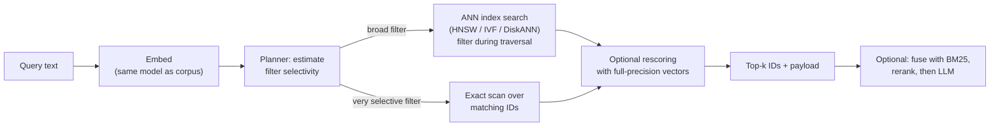

A **vector database** stores [embeddings](embeddings.md) alongside their source data and metadata, and answers "which stored vectors are nearest to this query vector, subject to these filters?" in milliseconds over millions to billions of items. It is the storage and retrieval layer of [RAG](retrieval-augmented-generation.md). The hard parts are not the similarity math but everything around it: [approximate indexes](ann-indexes.md), filtering, updates, tenancy, memory cost and operations ([notebook](../sources/notebook-vector-databases.md)).

## Data model and request path

Every product shares the same vocabulary: a **collection** (index, namespace, table) of fixed-dimension vectors; a **distance metric** fixed at creation; a **payload** of metadata per vector; **upsert** by ID as the main write; **top-k** queries with optional metadata filters ([notebook](../sources/notebook-vector-databases.md)).

Synthesis: the query path below is common to all of them; products differ in where filtering happens and where data lives (RAM, SSD, object storage).

## Filtering is the real differentiator

Approximate indexes only find the near neighbours they visit. Filtering after the index search starves results: in pgvector, an HNSW scan with `ef_search` 40 and a filter matching 10% of rows returns about 4 rows on average ([pgvector](../sources/pgvector-readme.md)). Systems handle this differently:

- **pgvector:** post-filters by default. Since 0.8.0, **iterative index scans** (`hnsw.iterative_scan = strict_order | relaxed_order`, capped by `hnsw.max_scan_tuples`, default 20,000) keep scanning until enough rows pass. For selective filters, use a B-tree on the filter column, partial indexes, or partitioning ([pgvector](../sources/pgvector-readme.md)).
- **Qdrant:** **filterable HNSW** adds extra graph edges per indexed payload value so filtered traversal stays connected. A query planner switches to full scan when the estimated match set is below `full_scan_threshold` (10,000 KB of vectors by default), and ACORN (v1.16, opt-in per query) explores neighbours of neighbours for strict filters, trading speed for accuracy. Payload indexes must exist *before* the HNSW build or the extra edges are missing ([Qdrant](../sources/qdrant-indexing-docs.md)).
- **Weaviate:** builds an **allow-list** from its inverted index first, then traverses HNSW with the ACORN strategy (default since v1.34). It drops to flat search over matches when the filter is very restrictive, around 15% of the dataset ([Weaviate](../sources/weaviate-vector-index-docs.md)).
- **Milvus:** recommends picking the index by filter ratio (share of data filtered out): graph below 85%, IVF between 85% and 95%, brute-force FLAT for very high ratios (the page says over 98% in its prose and over 95% in its decision matrix, and calls these rules not always correct) ([Milvus](../sources/milvus-index-explained.md)).
- **Faiss (library):** ID-selector callbacks, with metadata-first brute force chosen when the subset is tiny ([Faiss](../sources/faiss-library-paper.md)).

## Product trade-offs (as of November 2026)

| Store | Shape | Index options | Filtering | Scale / ops profile | Best fit |
|---|---|---|---|---|---|
| **pgvector** | Postgres extension (0.8.x) | HNSW, IVFFlat; `vector` / `halfvec` / `bit` / `sparsevec` | SQL `WHERE`; post-filter plus iterative scans | Postgres operations, joins and transactions; indexable dims max 2,000 (`vector`) or 4,000 (`halfvec`) | Already on Postgres; vectors next to relational data |
| **Pinecone** | Managed serverless | Proprietary geometric partitioning plus freshness layer | Metadata filters; namespaces as hard partitions | No infra; storage on blob, compute caches segments; cold queries take seconds | Hands-off production, many tenants |
| **Weaviate** | OSS + cloud | HNSW, flat, dynamic, HFresh (disk, preview in v1.36, GA in v1.38); PQ / BQ / SQ / RQ | Allow-list + ACORN | Built-in vectorizers, hybrid search, multi-tenancy | Batteries-included hybrid search |
| **Qdrant** | OSS + cloud (Rust) | HNSW, sparse inverted index; quantization | Filterable HNSW + planner + ACORN | Tenant-aware payload indexes (`is_tenant`) | Heavy metadata filtering, self-hosting |
| **Milvus / Zilliz** | OSS distributed + cloud | Almost every family: FLAT, IVF*, HNSW*, DiskANN, ScaNN, RaBitQ, GPU CAGRA | Scalar filtering; index choice by filter ratio | Billion-scale, more components to run | Very large corpora, GPU, dedicated team |
| **Chroma** | OSS (Apache 2.0) embedded/server + Chroma Cloud | Dense, sparse and hybrid search | Metadata, keyword and regex | Simplest local start | Prototypes, notebooks, small/medium apps |

Sources: [pgvector](../sources/pgvector-readme.md), [Pinecone](../sources/pinecone-serverless-architecture.md), [Weaviate](../sources/weaviate-vector-index-docs.md), [Qdrant](../sources/qdrant-indexing-docs.md), [Milvus](../sources/milvus-index-explained.md), [Chroma](../sources/chroma-introduction.md), [notebook](../sources/notebook-vector-databases.md).

### Architecture notes worth knowing

- **Pinecone serverless** writes to a log and blob storage (the source of truth). An index builder partitions vectors around centroids into immutable segments, and a small **freshness index** makes new writes searchable within seconds. Executors cache segments, so infrequently queried namespaces are cheap but their first query can take about a couple of seconds, up to about 20 s at billion scale ([Pinecone](../sources/pinecone-serverless-architecture.md)).
- **Weaviate's dynamic index** starts flat and switches one way to HNSW at 10,000 objects, so small tenants never pay for a graph ([Weaviate](../sources/weaviate-vector-index-docs.md)).
- **pgvector** HNSW builds are far faster when the graph fits in `maintenance_work_mem`, and can be parallelized. IVFFlat must be built after loading data because its clusters are trained on it ([pgvector](../sources/pgvector-readme.md)).
- **FAISS** is a library, not a database: you own persistence, metadata and updates ([notebook](../sources/notebook-vector-databases.md)).

## Multitenancy

Options run from hard to soft isolation: separate collections or tables; Pinecone namespaces (hard partitions, hundreds of thousands per index) ([Pinecone](../sources/pinecone-serverless-architecture.md)); Postgres list partitioning ([pgvector](../sources/pgvector-readme.md)); Qdrant `is_tenant` payload indexes that co-locate a tenant's data ([Qdrant](../sources/qdrant-indexing-docs.md)); Weaviate per-tenant shards with flat-to-HNSW dynamic indexes ([Weaviate](../sources/weaviate-vector-index-docs.md)). Synthesis: a shared index with a `tenant_id` filter is the cheapest option but the leakiest. One forgotten filter exposes another customer's data, so enforce it server-side.

## Cost and memory

Raw float32 vectors cost 4 × dims bytes, and a graph index adds link storage on top. Milvus estimates HNSW at 640 MB for 1M 128-dim vectors, versus 136 MB with PQ ([Milvus](../sources/milvus-index-explained.md)). Storing embeddings as int8 or binary cuts storage 4x or 32x; 250M 1024-dim vectors drop from about 954 GB to about 30 GB as binary ([HF](../sources/hf-embedding-quantization.md)). pgvector supports `halfvec` and binary-quantized expression indexes with re-ranking ([pgvector](../sources/pgvector-readme.md)). See [ANN indexes](ann-indexes.md) for the compression options.

## Failure modes

- **Filtered queries returning too few results**, from post-filtering or payload indexes created after the graph ([pgvector](../sources/pgvector-readme.md), [Qdrant](../sources/qdrant-indexing-docs.md)).
- **Metric or dimension mismatch** with the embedding model ([notebook](../sources/notebook-vector-databases.md)).
- **Model upgrade means full re-embed and re-index.** Synthesis: plan a dual-write or blue/green collection swap.
- **Deletes and updates degrade graphs.** HNSW in Faiss does not support removal ([Faiss](../sources/faiss-library-paper.md)), and Qdrant suggests its ACORN mode when many points are deleted ([Qdrant](../sources/qdrant-indexing-docs.md)).
- **Cold-start latency** on serverless tiers ([Pinecone](../sources/pinecone-serverless-architecture.md)).
- **No keyword recall** unless hybrid search is enabled ([notebook](../sources/notebook-vector-databases.md)). See [hybrid search](hybrid-search.md).

## When to use which

Synthesis, built on the notebook's rules of thumb ([notebook](../sources/notebook-vector-databases.md)):

- **Prototype:** Chroma or in-process FAISS; the chunk, embed, upsert and query flow does not change when you swap later.
- **Already run Postgres, under roughly 10M vectors, need joins and transactions:** pgvector. Turn on iterative scans for filtered queries.
- **Managed, spiky or multi-tenant workloads, no ops team:** Pinecone, or Qdrant, Weaviate or Zilliz cloud.
- **Heavy metadata filtering, self-hosted:** Qdrant or Weaviate.
- **Billions of vectors, SSD or GPU indexes:** Milvus, or anything offering DiskANN.
- **Do you need one at all?** Under about 10k vectors, brute force is competitive ([Faiss](../sources/faiss-library-paper.md)), and a small corpus may fit in the [context window](context-window.md) with [prompt caching](prompt-caching.md).

## Sources

- [Vector Databases Compared (Notebook)](../sources/notebook-vector-databases.md)
- [pgvector README](../sources/pgvector-readme.md)
- [Qdrant indexing docs](../sources/qdrant-indexing-docs.md)
- [Weaviate vector index, filtering and quantization docs](../sources/weaviate-vector-index-docs.md)
- [Milvus Index Explained](../sources/milvus-index-explained.md)
- [Pinecone serverless architecture](../sources/pinecone-serverless-architecture.md)
- [Chroma introduction](../sources/chroma-introduction.md)
- [The Faiss Library](../sources/faiss-library-paper.md)
- [Binary and scalar embedding quantization](../sources/hf-embedding-quantization.md)
