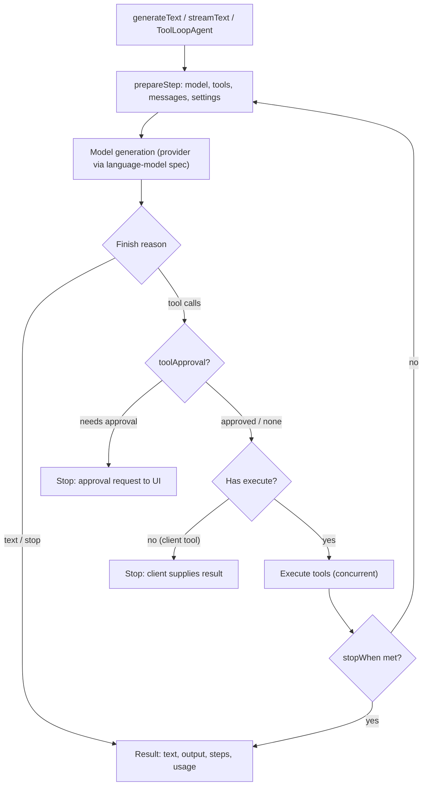

The **AI SDK** (npm package `ai`, often called the Vercel AI SDK) is an open-source TypeScript toolkit for building LLM features and agents in React, Next.js, Vue, Svelte or Node. It has three surfaces ([AI SDK docs](../sources/ai-sdk-docs.md)):

- **AI SDK Core:** one API for text, structured output, [tool calls](function-calling.md) and agents across providers. Each provider package (`@ai-sdk/openai`, `@ai-sdk/anthropic`, `@ai-sdk/google`, `@ai-sdk/amazon-bedrock`, ...) implements a shared language-model specification.
- **AI SDK UI:** hooks such as `useChat` that manage chat state and render streamed messages.
- **Harnesses:** run existing agents (Claude Code, Codex, Pi) behind the same agent interface.

Version as of 2026-11-14: **7.0.172** on npm. Major releases landed on npm as 5.0.0 (2025-07-31), 6.0.0 (2025-12-22) and 7.0.0 (2026-06-25) ([docs](../sources/ai-sdk-docs.md)).

## Core primitives

| API | Purpose | Key behaviour |
|---|---|---|
| `generateText` | Complete result: text, tool calls, `steps`, usage | Single generation unless `stopWhen` allows more steps |
| `streamText` | [Streaming](streaming.md) result | Starts immediately; **backpressure**, so tokens are generated only as the stream is consumed; errors become stream parts (handle with `onError`) instead of being thrown |
| `output: Output.object/array/choice/json/text` | [Structured output](structured-outputs.md) on either call, with Zod, Valibot or JSON Schema | Validated against the schema; can combine with tools; counts as a step; `partialOutputStream` and the `useObject` hook stream partial objects |
| `tool({ description, inputSchema, execute })` | [Tool](tools.md) definition | No `execute` means a client-side tool, and the loop stops so the UI can supply the result |
| `wrapLanguageModel(model, middleware)` | Model-agnostic middleware | [Guardrails](agent-guardrails.md), [RAG](retrieval-augmented-generation.md) injection, caching, logging |
| `embed`, [rerank](reranking.md), image, speech | Non-chat modalities | |

Source: [docs](../sources/ai-sdk-docs.md). The current docs put structured output on the `output` option of `generateText`/`streamText` rather than on a separate call.

## The agent loop: `stopWhen` and `prepareStep`

A **step** is one model generation plus the execution of any local tools it requested. By default `generateText`/`streamText` run a **single step** (`isStepCount(1)`). Multi-step [agent loops](agent-loop.md) are opt-in ([docs](../sources/ai-sdk-docs.md)):

- `stopWhen`: `isStepCount(n)`, `hasToolCall('finalAnswer')`, `isLoopFinished()` (no limit), an array (stop when **any** condition is met), or a custom predicate over all steps. Conditions are evaluated only when the last step contains tool results.
- The loop also ends when the model finishes for a reason other than tool calls, when a called tool has no `execute`, or when a tool call needs approval.
- `prepareStep` runs before each step and can swap the model, the active tools, `toolChoice`, [sampling settings](sampling-parameters.md) (`temperature`, `maxOutputTokens`, `reasoning`, ...) or the `messages`. A returned `messages` array persists as the base for later steps, which is the hook for [context](context-engineering.md) compaction with `pruneMessages`.
- Parallel tool calls in one step run **concurrently** by default; `toolCallConcurrency: 1` forces model order when calls have side effects.

`ToolLoopAgent` packages model, tools, instructions and loop settings for reuse (`agent.generate()` / `agent.stream()`), with a safety default of **`isStepCount(20)`** that logs a warning when it cuts a loop short. `WorkflowAgent.stream()` has **no** default step limit, while `WorkflowAgent.generate()` stops after 20 steps like `ToolLoopAgent` ([docs](../sources/ai-sdk-docs.md)).

Synthesis: assembled from the documented loop-control and tool-calling rules.

## AI SDK 7 (June 2026) additions

Vercel announced AI SDK 7 on 2026-06-25 ([changelog](../sources/vercel-ai-sdk-7-changelog.md)):

- **Breaking:** Node.js 22 minimum and **ESM only**. Codemods are available via `npx @ai-sdk/codemod v7`.
- **Tool approvals:** call- or agent-level policies (require [user approval](human-in-the-loop.md), auto-approve, auto-deny, typed function). `toolApproval` replaces the deprecated `needsApproval`. Optional HMAC signing binds approved arguments to the approval token, so arguments cannot be altered between approval and resume.
- **`WorkflowAgent`** (`@ai-sdk/workflow`): [persists state between steps](durable-agent-execution.md), so runs survive deploys, restarts and long approval waits.
- **Timeouts:** total, per-step, per-chunk and per-tool budgets, raising `TimeoutError`.
- **Context:** `runtimeContext` carries shared state (tenant, request ID) through the loop; `toolsContext` gives each tool only its own typed secrets.
- **Other:** a provider-agnostic `reasoning` option mapped to each vendor's [extended-thinking](extended-thinking.md) settings (behaviour varies), [sandboxes](code-execution-sandboxes.md), `HarnessAgent` adapters (Claude Code, Codex, Deep Agents, OpenCode, Pi), [MCP](model-context-protocol.md) Apps, `@ai-sdk/otel` [telemetry](llm-observability.md), and `uploadFile` to reuse provider file references.

## UI layer and stream protocol

`useChat` manages message state, status and errors, and sends with `sendMessage`. Render messages from their typed `parts` (text, tool invocations, tool results, reasoning) rather than a flat `content` string. The server returns a **UI message stream**: Server-Sent Events with the header `x-vercel-ai-ui-message-stream: v1`, and keep-alive pings and reconnect support. A plain text-stream protocol exists for text-only use ([docs](../sources/ai-sdk-docs.md)). Because the protocol is documented, non-JS backends can serve it. Pydantic AI's `VercelAIAdapter` lets a Python agent drive `useChat` unchanged ([comparisons](../sources/pydantic-ai-framework-comparisons.md)).

## Limitations and failure modes

- **Single-step by default.** Passing tools to `generateText` without `stopWhen` returns after the first tool call, with no final answer text. This is a common surprise.
- **Unconsumed streams never finish.** Because of backpressure, `onFinish`-style promises wait until the stream is read. Errors inside `streamText` do not throw; without `onError` they can disappear silently. Errors thrown inside the experimental lifecycle callbacks of `generateText` are also caught silently ([docs](../sources/ai-sdk-docs.md)).
- **Runaway loops.** `isLoopFinished()` and `WorkflowAgent.stream()` have no step cap. Pair them with a step count or timeout.
- **Provider normalization is lossy.** Settings such as `reasoning` map differently per provider ([changelog](../sources/vercel-ai-sdk-7-changelog.md)); provider-specific features need `providerOptions`.
- **Major-version churn.** v5 (2025-07-31), v6 (2025-12-22) and v7 (2026-06-25) each renamed core APIs. Pin versions and use the codemods ([docs](../sources/ai-sdk-docs.md), [changelog](../sources/vercel-ai-sdk-7-changelog.md)).
- **TypeScript only, and thin above the loop.** Per Pydantic's (vendor-written) comparison, the SDK has no [evals](llm-evaluation.md) or [memory](agent-memory.md), and multi-agent, planning, skills and compaction live in Eve, a separate Apache-2.0 package; the SDK itself offers only `pruneMessages` for compaction ([comparisons](../sources/pydantic-ai-framework-comparisons.md)).

## When to use / when not

| Situation | Choice |
|---|---|
| Next.js/React product with streaming chat, generative UI, tool-approval UX | AI SDK (Core + UI) |
| TS backend that must switch providers or route through a [gateway](llm-gateways.md) | AI SDK Core |
| Python data or ML backend | [Pydantic AI](pydantic-ai.md) (can still serve `useChat`) or [LangGraph](langgraph.md) |
| Heavy RAG ingestion and indexing | [LlamaIndex](llamaindex.md) (it has a TS port), with the AI SDK for the UI |
| Single provider, server-only, few calls | Raw provider SDK ([Anthropic](../sources/anthropic-building-effective-agents.md)) |

Synthesis: the AI SDK's distinctive value is the **front-end contract**: typed message parts, a documented SSE protocol, and approval and resume flows that reach the browser. Its back-end agent features are converging with the other frameworks. For an [FDE](forward-deployed-engineering.md) building a customer-facing web demo in TypeScript, it is usually the shortest path. For back-end-heavy work, pick the framework by language and by where the hard problem is (data, control flow or prompt quality).

## Sources

- [AI SDK documentation](../sources/ai-sdk-docs.md)
- [AI SDK 7 changelog](../sources/vercel-ai-sdk-7-changelog.md)
- [Pydantic AI framework comparison pages](../sources/pydantic-ai-framework-comparisons.md)
- [Building effective agents (Anthropic)](../sources/anthropic-building-effective-agents.md)
