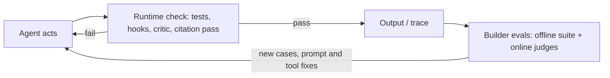

**Verification** gives an agent a feedback signal that doesn't come from the model itself, so it can check its work against reality. **Evals** do the same for the people building the agent.

*Synthesis: the two loops combine the agent-side checks and the builder-side eval flywheel described in the sources below.*

## For the agent

Models are confident, which is not the same as correct. Effective agents check their output:

- [Coding agents](coding-agents.md) run tests, type checkers and linters, and read the errors.
- [Browser agents](computer-use-agents.md) take screenshots of what actually rendered.
- [Research agents](deep-research-agents.md) cite sources and re-read them.

An agent that can run the tests fixes its own bugs. One that can't ships them confidently. The single most useful verification step is a pass/fail check the agent can run: tests, a build exit code, a linter, a screenshot diff ([Claude Code best practices](../sources/claude-code-best-practices.md)).

**Make the check external to the agent's judgement.** An agent stops when work *looks* done. Claude Code's escalation ladder runs from the prompt, to `/goal` (a separate model checks a condition each turn), to a `Stop` hook that exits with code 2 to send the agent back (capped at eight consecutive blocks), to independent review by a fresh subagent. Ask for evidence (the command and its output), not "all tests pass" ([Claude Code best practices](../sources/claude-code-best-practices.md)). A `Stop` hook can also return `decision: block`, and `prompt`/`agent` hook types let a model judge the result; note that failing hooks fail open, and `onFailure: "block"` has no effect on `Stop` ([hooks docs](../sources/claude-code-hooks-docs.md)). See [agent hooks and middleware](agent-hooks-and-middleware.md) and [harness engineering](harness-engineering.md).

**Test as a user, not just as a unit.** In Anthropic's long-running harness, agents marked features done after unit tests or curl calls; prompting them to test end to end through browser automation substantially improved results. The harness also guards against **premature victory** with a JSON feature list that agents may only flip from failing to passing ([long-running harnesses](../sources/anthropic-effective-harnesses-long-running-agents.md)).

**Verify citations separately.** Anthropic's research system ends with a dedicated CitationAgent that maps each claim in the report to its sources ([Anthropic research system](../sources/anthropic-multi-agent-research-system.md); see [deep research agents](deep-research-agents.md)).

**Constrain, then validate structured output.** Instructor validates a reply against a Pydantic model and re-asks with the validation error, up to `max_retries`, which does not guarantee success ([Instructor](../sources/instructor-docs.md)). The wiki's recommended pattern is to enforce structure with a strict mode, then validate meaning with one or two bounded retries (see [Instructor and Outlines](instructor-and-outlines.md), [structured outputs](structured-outputs.md)).

**Don't treat the reasoning trace as the check.** Chain-of-thought explanations can rationalise answers driven by hidden biasing features without mentioning them ([Turpin et al.](../sources/turpin-2023-unfaithful-cot.md)). Reasoning models mentioned a hint they used only about 25% (Claude 3.7 Sonnet) and 39% (DeepSeek R1) of the time, and in reward-hacking setups verbalised the hack under 2% of the time. CoT monitoring is useful but not sufficient ([Anthropic](../sources/anthropic-reasoning-models-dont-say-think.md); see [chain-of-thought](chain-of-thought.md)). Verify the outcome, not the narrative.

## For the builder

[Evals](llm-evaluation.md) are a set of realistic tasks with checkable outcomes, run every time a prompt, [tool](tools.md) or model changes. Without them, every change is a guess.

- **Vocabulary.** A task has inputs and success criteria; a trial is one attempt; a grader scores one aspect; the outcome is the final environment state, which can differ from what the agent claims it did ([Anthropic evals](../sources/anthropic-demystifying-evals-for-ai-agents.md)).
- **Capability vs regression.** Capability evals should start at a low pass rate; regression evals should sit near 100%, and saturated capability tasks graduate into the regression suite. Start with 20 to 50 tasks drawn from real failures; a 0% pass rate over many trials usually means a broken task ([Anthropic evals](../sources/anthropic-demystifying-evals-for-ai-agents.md)). Use [error analysis](error-analysis.md) to choose them.
- **pass@k vs pass^k.** pass@k (at least one of k trials succeeds) rises with k; pass^k (all k succeed) falls. At 75% per-trial success, pass^3 is about 42% ([Anthropic evals](../sources/anthropic-demystifying-evals-for-ai-agents.md)). Because outputs vary run to run, score several trials (see [LLM non-determinism](llm-non-determinism.md) and [agent evaluation](agent-evaluation.md)).
- **Graders.** Code graders are fast and reproducible but brittle; model graders handle nuance but are non-deterministic and need human calibration; humans are the gold standard but slow. Grade outcomes rather than exact paths, and give judges an "Unknown" option. Grader bugs distort scores: Opus 4.5 went from 42% to 95% on CORE-Bench after grading fixes and a less constrained scaffold ([Anthropic evals](../sources/anthropic-demystifying-evals-for-ai-agents.md)).
- **Judge biases.** In pairwise judging, GPT-4 gave a consistent verdict when answers were swapped only 65% of the time, and padding attacks fooled weaker judges in over 90% of cases. Mitigation: call the judge twice with the order swapped and count disagreement as a tie; reference answers and few-shot examples also help ([Zheng et al.](../sources/judging-llm-as-a-judge.md); see [LLM-as-judge](llm-as-judge.md)).
- **Rubrics for open-ended work.** Anthropic's research system started with about 20 real queries and one LLM-judge rubric (factual accuracy, citation accuracy, completeness, source quality, tool efficiency). Human testers still caught a preference for SEO content farms ([Anthropic research system](../sources/anthropic-multi-agent-research-system.md)).
- **Evaluate across effort levels.** Longer reasoning can lower accuracy on some tasks (distraction, spurious correlations, lost focus on deduction), so evaluate across reasoning lengths, not only at the maximum ([inverse scaling](../sources/inverse-scaling-test-time-compute.md); see [test-time compute](test-time-compute.md)).
- **Retrieval separately.** For RAG, measure retrieval on its own: Anthropic reported failure rate as 1 - recall@20 on a labelled set ([contextual retrieval](../sources/anthropic-contextual-retrieval.md); see [retrieval metrics](retrieval-metrics.md) and [RAG](retrieval-augmented-generation.md)).
- **Offline gate, online signal.** Gate deploys with offline evals, then monitor production with traces and sampled LLM-judge scores on live traffic, implicit feedback and guardrail hits, and feed every failure back into the dataset ([notebook](../sources/notebook-llm-evaluation.md); see [LLM observability](llm-observability.md), [OpenTelemetry GenAI](opentelemetry-genai.md)). On the path to production, an eval score meeting an agreed threshold is the first stage gate (see [POC to production](poc-to-production.md)).

## As architecture

The **review-and-critique** (generator–critic) pattern builds verification into the system: a separate critic agent checks output against criteria (often an [LLM-as-judge](llm-as-judge.md)), or runs tests, before it's accepted. Each revision cycle costs another model call. See [agent design patterns](agent-design-patterns.md). Claude Code's version is review by a fresh subagent that never saw the generator's reasoning; when asking a reviewer for issues, tell it to skip style, or it will always find *something* ([Claude Code best practices](../sources/claude-code-best-practices.md)).

Note: the Google Cloud pattern guide gives no evaluation guidance. Builder-side evals originally rested on the agents post alone; they are now covered by Anthropic's agent evals post and the judge-bias literature cited above.

## Related

[Agent loop](agent-loop.md) · [Subagents](subagents.md) · [Harness engineering](harness-engineering.md) · [Agent hooks and middleware](agent-hooks-and-middleware.md)

## Going deeper

- [LLM Evaluation](llm-evaluation.md): graders, datasets and statistics for builder-side evals.
- [Agent Evaluation](agent-evaluation.md): trials, outcome vs trajectory grading, pass@k vs pass^k.
- [LLM-as-Judge](llm-as-judge.md): model graders and their biases (position, verbosity).
- [Error Analysis](error-analysis.md): reading traces to decide which evals to write.
- [Hallucination](hallucination.md): runtime checks such as chain-of-verification and existence checks.
- [LLM Observability](llm-observability.md): online evals and traces as the seed for eval datasets.
- [Benchmarks](benchmarks.md): public benchmarks and why they don't replace task-specific evals.
- [LLM Red Teaming](llm-red-teaming.md): adversarial testing as a complement to capability evals.
- [Retrieval metrics](retrieval-metrics.md): recall@k and ranking metrics for the retrieval half of RAG.
- [Chain-of-thought](chain-of-thought.md): why visible reasoning is not a faithful verification log.

## Sources

- [The Anatomy of a Modern AI Agent](../sources/anatomy-of-a-modern-ai-agent.md)
- [Choose a design pattern for your agentic AI system (Google Cloud)](../sources/google-cloud-choose-agentic-design-pattern.md)
- [Claude Code best practices](../sources/claude-code-best-practices.md)
- [Effective harnesses for long-running agents (Anthropic)](../sources/anthropic-effective-harnesses-long-running-agents.md)
- [Hooks reference (Claude Code docs)](../sources/claude-code-hooks-docs.md)
- [How we built our multi-agent research system (Anthropic)](../sources/anthropic-multi-agent-research-system.md)
- [Instructor documentation](../sources/instructor-docs.md)
- [Language Models Don't Always Say What They Think (Turpin et al.)](../sources/turpin-2023-unfaithful-cot.md)
- [Reasoning models don't always say what they think (Anthropic)](../sources/anthropic-reasoning-models-dont-say-think.md)
- [Demystifying evals for AI agents (Anthropic)](../sources/anthropic-demystifying-evals-for-ai-agents.md)
- [Judging LLM-as-a-Judge (Zheng et al.)](../sources/judging-llm-as-a-judge.md)
- [Inverse Scaling in Test-Time Compute (Gema et al.)](../sources/inverse-scaling-test-time-compute.md)
- [LLM evaluation notebook](../sources/notebook-llm-evaluation.md)
- [Contextual Retrieval (Anthropic)](../sources/anthropic-contextual-retrieval.md)
