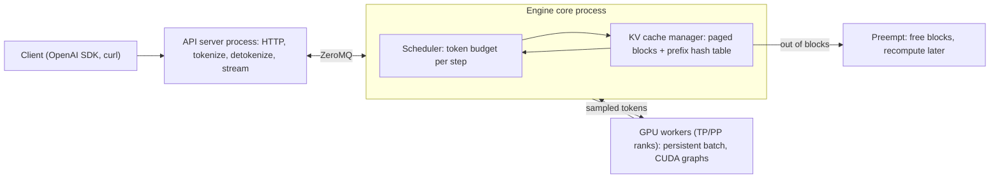

**vLLM** is an open-source (Apache-2.0) inference and serving engine for LLMs. It started in UC Berkeley's Sky Computing Lab and has more than 2,000 contributors ([README](../sources/vllm-github-readme.md)). Its founding idea is **PagedAttention**: the [KV cache](kv-cache.md) is managed like OS virtual memory, in fixed-size blocks, so far more sequences fit in GPU memory and can be batched together ([Kwon et al., SOSP 2023](../sources/vllm-pagedattention-paper.md)). Around that it adds continuous batching, chunked prefill, automatic prefix caching, [quantization](quantization.md), [speculative decoding](speculative-decoding.md), [structured outputs](structured-outputs.md), multi-LoRA, five kinds of parallelism, and an OpenAI-compatible HTTP server. It supports 200+ Hugging Face architectures on NVIDIA, AMD and Intel GPUs and CPUs, with plugins for TPU, Gaudi, Ascend and other chips ([README](../sources/vllm-github-readme.md)). For the general serving background (prefill vs decode, TTFT/TPOT, goodput), see [LLM inference serving](llm-inference-serving.md). This page covers vLLM specifically.

## Mental model: a scheduler wrapped around a block allocator

Every engine step, vLLM does three things:

1. It decides **which requests get how many tokens** of compute.
2. It makes sure each of those requests has **enough KV blocks**.
3. It runs **one forward pass** over the resulting mixed batch.

Almost every flag tunes one of these three steps.

Synthesis: the diagram combines the V1 process split ([V1 blog](../sources/vllm-v1-alpha-release-blog.md)), the scheduler policy ([tuning docs](../sources/vllm-optimization-and-tuning-docs.md)) and the prefix cache design ([APC docs](../sources/vllm-automatic-prefix-caching-docs.md)).

## PagedAttention

**The problem.** Earlier engines reserved one contiguous KV region per request, sized for the maximum sequence length. Measured in the paper, only 20.4%–38.2% of that memory held real token states. The rest was lost to reserved-but-unused slots, internal fragmentation and external fragmentation. The amounts are large: OPT-13B needs about 800 KB of KV per token, so a 2,048-token request can need 1.6 GB ([Kwon et al.](../sources/vllm-pagedattention-paper.md)).

**The mechanism.** K and V are stored in fixed-size **blocks** (16 tokens by default). Blocks are allocated only when a sequence grows into them. A per-request **block table** maps logical blocks to physical ones, and the attention kernel gathers K/V through that table. Because every block is the same size, there is no external fragmentation. Internal waste is limited to the last, partially filled block. Blocks have reference counts and use **copy-on-write**, so parallel samples, beam-search branches and shared prompts can point at the same physical memory ([Kwon et al.](../sources/vllm-pagedattention-paper.md)).

**The payoff.** More resident sequences means larger decode batches, and decode is memory-bandwidth-bound. The paper reports 2–4x the throughput of FasterTransformer and Orca at the same latency, with bigger gains for longer sequences and larger models ([Kwon et al.](../sources/vllm-pagedattention-paper.md)).

Synthesis, sizing example: a Llama-3-8B-class model (32 layers, 8 KV heads, head dim 128, BF16) stores 2 × 32 × 8 × 128 × 2 B = 128 KiB per token, so 16 GiB of KV budget holds about 131k tokens across all running sequences. vLLM logs the actual KV capacity and maximum concurrency at startup, and those are the numbers to check ([parallelism docs](../sources/vllm-parallelism-scaling-docs.md)).

## Continuous batching and the V1 scheduler

vLLM schedules at the **iteration level**. After every forward pass, finished sequences leave the batch and waiting ones join. This idea comes from Orca ([Orca](../sources/orca-iteration-level-scheduling.md)). In Anyscale's benchmark, continuous batching alone gave about 8x over static batching, and combined with vLLM's memory management it gave up to 23x ([Anyscale](../sources/anyscale-continuous-batching.md)).

In V1, prefill and decode are **no longer separate phases**. Each step, the scheduler outputs a map from request ID to number of tokens, under a fixed token budget ([V1 blog](../sources/vllm-v1-alpha-release-blog.md)). The policy works like this:

- **Decodes first.** All running decodes (one token each) are scheduled. Then the remaining `--max-num-batched-tokens` budget is filled with prefill tokens. A long prompt is split across steps, which is **chunked prefill** and is on by default in V1. This is the Sarathi-Serve "stall-free" idea: a new long prompt no longer freezes everyone else's token stream ([tuning docs](../sources/vllm-optimization-and-tuning-docs.md), [Sarathi-Serve](../sources/sarathi-serve-chunked-prefill.md)).
- **The token budget is the main knob.** Small budgets (such as 2048) favor inter-token latency. Larger ones favor TTFT, and the docs recommend more than 8192 for throughput ([tuning docs](../sources/vllm-optimization-and-tuning-docs.md)).
- **Concurrency cap.** `--max-num-seqs` limits how many sequences run per step ([engine args](../sources/vllm-engine-args-docs.md)).
- **Preemption.** When blocks run out, V1 **recomputes** by default: it drops the victim's blocks and re-prefills the sequence later. GPU-to-CPU swapping was removed in V1 ([tuning docs](../sources/vllm-optimization-and-tuning-docs.md), [V1 guide](../sources/vllm-v1-user-guide.md)).
- **Policies.** FCFS by default. Priority scheduling via `--scheduling-policy`, and requests with a non-zero `priority` require it ([V1 guide](../sources/vllm-v1-user-guide.md), [OpenAI server docs](../sources/vllm-openai-compatible-server-docs.md)).

## Automatic prefix caching (APC)

Two requests that share a prefix, such as a system prompt, few-shot examples, a chat history or a RAG preamble, can share the KV blocks for that prefix. vLLM identifies each **full** block by a hash chained from its parent: hash(parent hash, the block's tokens, extras). The extras are the LoRA ID, multimodal input hashes and an optional `cache_salt`. When a new request arrives, vLLM walks its blocks, and every hit skips that block's prefill. Freed blocks stay in an LRU free queue until they are evicted. Only full blocks are cached, so the tail of a prompt shorter than one block is always recomputed ([APC docs](../sources/vllm-automatic-prefix-caching-docs.md)).

- In V1, APC is **on by default**. The V1 blog reports under 1% throughput loss at a 0% hit rate ([V1 blog](../sources/vllm-v1-alpha-release-blog.md)).
- The default hash has been SHA-256 since v0.11. Faster xxhash options exist but are not cryptographic, which carries collision risk across tenants ([APC docs](../sources/vllm-automatic-prefix-caching-docs.md)).
- **Security:** a shared prefix cache is a timing side channel. A cache hit makes TTFT measurably faster, and that has been used to infer other users' prompts on SGLang ([Song et al.](../sources/song-2024-early-bird-timing-side-channels.md)). Use a per-tenant `cache_salt` to confine reuse to one trust group ([APC docs](../sources/vllm-automatic-prefix-caching-docs.md)).
- Requests that ask for prompt logprobs bypass the cache. Mamba and hybrid models do not get prefix caching yet ([V1 guide](../sources/vllm-v1-user-guide.md)).
- With data parallelism, each rank has its own cache. Prefix hits therefore depend on routing, and the built-in DP load balancer is not KV-aware ([DP docs](../sources/vllm-data-parallel-deployment-docs.md)). Cache-aware routing across replicas is what layers such as NVIDIA Dynamo add ([Dynamo](../sources/nvidia-dynamo.md)).

This is the self-hosted counterpart of API [prompt caching](prompt-caching.md). The same rule applies: put stable content first and variable content last.

## The V1 engine

V1 is a re-architecture announced in January 2025. It keeps the model code and kernels and rewrites the scheduler, KV cache manager, worker, sampler and API server. The goal was near-zero CPU overhead, because at small per-token GPU times Python bookkeeping had become the bottleneck ([V1 blog](../sources/vllm-v1-alpha-release-blog.md), [V1 guide](../sources/vllm-v1-user-guide.md)).

- **Separate engine-core process.** Scheduler and model execution run apart from the API server and talk over ZeroMQ. Tokenization, detokenization and streaming therefore overlap with GPU work.
- **Persistent batch.** Input tensors are cached and patched with diffs each step. Workers keep request state and receive only incremental updates. The scheduler and worker 0 run in separate processes, so one GPU and many GPUs use the same code path.
- **torch.compile and piecewise CUDA graphs**, plus FlashAttention 3. Multimodal inputs get a preprocessing cache and an encoder cache.
- The blog reports **up to 1.7x the throughput of V0** ([V1 blog](../sources/vllm-v1-alpha-release-blog.md)).

**Timeline:**

| Date | Release | Change |
|---|---|---|
| 2025-01-27 | alpha | Opt-in with `VLLM_USE_V1=1` ([V1 blog](../sources/vllm-v1-alpha-release-blog.md)) |
| 2025-03-18 | v0.8.0 | V1 becomes the default |
| 2025-10-02 | v0.11.0 | V0 code removed, V1 is the only engine |

Sources for the last two rows: [release notes](../sources/vllm-github-releases-v0-8-and-v0-11.md).

**Behavior changes that bite on migration** ([V1 guide](../sources/vllm-v1-user-guide.md)):

- `best_of` is gone.
- Per-request logits processors were replaced by global ones set at startup.
- Returned logprobs are **raw** by default, computed before temperature and penalties. Use `--logprobs-mode` to change this.
- CUDA graph capture uses more memory than it did in V0.
- `async_scheduling` overlaps CPU scheduling with GPU execution ([engine args](../sources/vllm-engine-args-docs.md)).

## Parallelism options

| Mode | Flag | What is split | When to use |
|---|---|---|---|
| Tensor (TP) | `--tensor-parallel-size` | Each layer's matrices, Megatron-style | Model doesn't fit on one GPU, or to free KV memory. Within a node over NVLink |
| Pipeline (PP) | `--pipeline-parallel-size` | Contiguous groups of layers; uneven splits are allowed | Across nodes (TP = GPUs per node, PP = nodes), or on GPUs without NVLink such as L40S |
| Data (DP) | `--data-parallel-size` | Full replicas, each its own engine core with its own KV cache | Throughput. Also gives data-parallel attention for MoE |
| Expert (EP) | `--enable-expert-parallel` | MoE experts across DP×TP ranks | Large [MoE](mixture-of-experts.md) models (DeepSeek, Qwen, Kimi) |
| Context (CP) | `--decode-context-parallel-size`, `--prefill-context-parallel-size` | The KV cache and prefill compute of long sequences | Very long contexts (Synthesis: use case inferred from the flag descriptions) |

Sources: [parallelism docs](../sources/vllm-parallelism-scaling-docs.md), [DP docs](../sources/vllm-data-parallel-deployment-docs.md), [EP docs](../sources/vllm-expert-parallel-deployment.md), [engine args](../sources/vllm-engine-args-docs.md), [tuning docs](../sources/vllm-optimization-and-tuning-docs.md).

Details worth knowing:

- **Executor backends.** Multiprocessing (`mp`) is the default on a single node and Ray on multiple nodes. `mp` can also span nodes with `--nnodes`, `--node-rank`, `--master-addr` and `--headless`. Inter-node traffic is **unencrypted**, so bind `VLLM_HOST_IP` to a private network. Before trusting multi-node TP, confirm that NCCL is using InfiniBand/GPUDirect RDMA rather than sockets ([parallelism docs](../sources/vllm-parallelism-scaling-docs.md)).
- **MoE ranks are coupled.** In the canonical DeepSeek-style layout (`--tensor-parallel-size 1 --data-parallel-size 8 --enable-expert-parallel`), attention is data-parallel and experts shard across all 8 ranks ([EP docs](../sources/vllm-expert-parallel-deployment.md)). The ranks sync on every step, so an idle rank still runs dummy forward passes ([DP docs](../sources/vllm-data-parallel-deployment-docs.md)).
- **Communication and load balance for EP.** `--all2all-backend` selects the communication layer (DeepEP high-throughput for prefill, low-latency for decode). EPLB (`--enable-eplb`) replicates hot experts at the cost of extra memory ([EP docs](../sources/vllm-expert-parallel-deployment.md)).
- **Front-end bottleneck.** At large DP sizes the API server can limit throughput. `--api-server-count` scales it out. `--max-num-seqs` applies per rank ([DP docs](../sources/vllm-data-parallel-deployment-docs.md)).
- **Disaggregated prefill/decode** (experimental). Prefill and decode run as separate instances, and `--kv-transfer-config` picks a KV connector such as NixlConnector, LMCache or Mooncake. The docs are explicit that this improves TTFT/ITL control and tail ITL, **not throughput** ([disagg docs](../sources/vllm-disaggregated-prefill-docs.md)). Dynamo orchestrates this at cluster scale over vLLM ([Dynamo](../sources/nvidia-dynamo.md)).

## The OpenAI-compatible server

`vllm serve <model>` starts an HTTP server. The docs' examples use `http://localhost:8000/v1` ([OpenAI server docs](../sources/vllm-openai-compatible-server-docs.md)).

**Endpoints** ([online serving docs](../sources/vllm-online-serving-docs.md)):

- OpenAI-style: `/v1/chat/completions`, `/v1/completions`, `/v1/responses`, `/v1/embeddings`, and audio transcription and translation.
- Others: an Anthropic-style `/v1/messages`, Cohere-style `/v2/rerank` and `/v2/embed`, `/tokenize` and `/detokenize`, and pooling, score and classify routes.

This means most OpenAI SDK clients, [LiteLLM](litellm.md) and [LLM gateways](llm-gateways.md) can talk to it unchanged.

**Things that differ from OpenAI:**

- **Extra sampling parameters** such as `top_k`, `min_p` and `repetition_penalty` go in the SDK's `extra_body`, or directly in the JSON payload ([OpenAI server docs](../sources/vllm-openai-compatible-server-docs.md)). See [sampling parameters](sampling-parameters.md).
- **`generation_config.json` is applied by default.** If the model repo ships one, its sampling defaults override what you might expect. Pass `--generation-config vllm` to get vLLM's own defaults ([OpenAI server docs](../sources/vllm-openai-compatible-server-docs.md)).
- **Chat templates.** Chat needs a template, either from the tokenizer config or from `--chat-template`. Without one, chat requests fail ([online serving docs](../sources/vllm-online-serving-docs.md)).
- **Structured outputs** use a `structured_outputs` field (`choice`, `regex`, `json`, `grammar`, `structural_tag`) or `response_format` with a JSON schema. Backends are xgrammar or guidance. The old `guided_*` fields were removed in v0.12.0. With `--reasoning-parser`, the constraint applies to the final answer rather than the reasoning ([structured outputs docs](../sources/vllm-structured-outputs-docs.md), [constrained decoding](constrained-decoding.md)).
- **Unsupported or ignored parameters.** `suffix` is not supported in Completions. `user` is ignored in Chat. `parallel_tool_calls=true` does not guarantee multiple calls ([online serving docs](../sources/vllm-online-serving-docs.md)). See [function calling](function-calling.md).
- **Auth is thin.** `--api-key` (or `VLLM_API_KEY`) only protects the `/v1`, `/v2`, `/inference` and `/cohere` prefixes. Routes such as `/invocations` stay open, so put a reverse proxy in front ([OpenAI server docs](../sources/vllm-openai-compatible-server-docs.md)). Dev endpoints (`VLLM_SERVER_DEV_MODE=1`) and runtime LoRA loading are documented as unsafe for production ([online serving docs](../sources/vllm-online-serving-docs.md)).

## Key flags

| Flag | Default | What it controls |
|---|---|---|
| `--gpu-memory-utilization` | 0.92 | Fraction of GPU memory vLLM may claim. Whatever is left after weights and activations becomes KV cache |
| `--max-model-len` | From the model config | Maximum context per request. Lowering it saves KV memory per sequence |
| `--max-num-seqs` | Not stated on the args page | Concurrent sequences per step (per DP rank) |
| `--max-num-batched-tokens` | Not stated on the args page | Token budget per step: the ITL vs TTFT/throughput trade-off |
| `--kv-cache-dtype` | `auto` | Set `fp8` to roughly halve KV memory, ideally with calibrated scales |
| `--quantization` | From the checkpoint | Weight quantization method (AWQ, GPTQ, FP8, compressed-tensors, ...) |
| `--tensor-parallel-size` / `--pipeline-parallel-size` / `--data-parallel-size` | 1 | Parallel layout |
| `--enable-expert-parallel` | Off | EP for MoE layers |
| `--speculative-config` | Off | JSON with `method` (eagle, mtp, ngram, ...) and `num_speculative_tokens` |
| `--enable-lora`, `--max-loras`, `--max-lora-rank` | Off, 1, 16 | Multi-LoRA serving ([PEFT and LoRA](peft-and-lora.md)) |
| `--enforce-eager` | Off | Disables CUDA graphs and torch.compile. Useful for debugging, slower |
| `--cpu-offload-gb`, `--kv-offloading-size` | 0, off | Spill weights or KV to CPU RAM |
| `--served-model-name` | The model path | Name clients must send in `model` |
| `--trust-remote-code` | Off | Runs Python from the model repo. Only enable for repos you trust |
| `--generation-config` | Repo file if present | Set to `vllm` to ignore the repo's sampling defaults |

Sources: [engine args](../sources/vllm-engine-args-docs.md), [tuning docs](../sources/vllm-optimization-and-tuning-docs.md), [quantized KV docs](../sources/vllm-quantized-kv-cache-docs.md), [quantization docs](../sources/vllm-quantization-docs.md), [spec decoding docs](../sources/vllm-speculative-decoding-docs.md), [OpenAI server docs](../sources/vllm-openai-compatible-server-docs.md).

The engine args page also documents a default of 1.0 for `--gpu-memory-utilization` when an extensible KV cache is configured.

Hardware notes:

- FP8 weights and activations (W8A8) need Ada, Hopper or AMD GPUs. AWQ needs Turing or newer ([quantization docs](../sources/vllm-quantization-docs.md)).
- Speculative decoding is lossless under the standard rejection sampler, and helps most at low-to-medium QPS. It could not be combined with pipeline parallelism up to v0.15.0 ([spec decoding docs](../sources/vllm-speculative-decoding-docs.md)).

## vLLM vs SGLang vs TensorRT-LLM

| | vLLM | SGLang | TensorRT-LLM |
|---|---|---|---|
| KV memory | PagedAttention, 16-token blocks by default | Paged layout with page size 1 token, indexed by a radix tree | Paged KV with block reuse |
| Prefix reuse | Hash-chained full blocks, LRU, on by default in V1 | RadixAttention: radix tree over token sequences, LRU over leaves, cache-aware scheduling; always on | Block reuse |
| Structured output | xgrammar / guidance backends | Compressed finite state machines | Guided decoding |
| Distinctive | Widest model and hardware coverage, plugin ecosystem, OpenAI + Anthropic + Cohere routes | Frontend language for multi-call programs; up to 6.4x vs then-SOTA in its paper; self-reports more than 400k GPUs deployed | NVIDIA-only; FP8 on Hopper, FP4 on Blackwell; PyTorch-based since its TensorRT engine backend was removed; `trtllm-serve` |
| Hardware | NVIDIA, AMD, Intel, CPU; TPU, Gaudi, Ascend via plugins | NVIDIA, AMD, Intel Xeon, TPU, Ascend, Moore Threads | NVIDIA |

Sources: [Kwon et al.](../sources/vllm-pagedattention-paper.md), [APC docs](../sources/vllm-automatic-prefix-caching-docs.md), [README](../sources/vllm-github-readme.md), [SGLang paper](../sources/sglang-paper.md), [LMSYS blog](../sources/lmsys-sglang-radixattention-blog.md), [SGLang docs](../sources/sglang-docs.md), [TensorRT-LLM overview](../sources/tensorrt-llm-overview.md).

Synthesis, how to read the comparison:

- **Prefix reuse.** The engines converged. Since V1 turned APC on by default, vLLM's prefix reuse is in the same family as RadixAttention. The difference is granularity: vLLM matches whole blocks, while SGLang's tree matches at token granularity and adds cache-aware scheduling.
- **Headline benchmarks are dated.** SGLang's "5x vs vLLM" was measured against vLLM 0.2.5 ([LMSYS blog](../sources/lmsys-sglang-radixattention-blog.md)). Sarathi-Serve's 2.6–5.6x was measured against a vLLM without chunked prefill ([Sarathi-Serve](../sources/sarathi-serve-chunked-prefill.md)). Treat such numbers as historical and benchmark the current versions on your own workload.
- **Rule of thumb.** vLLM is the default for coverage (new open-weight models, non-NVIDIA hardware, LoRA fleets). Consider SGLang for agentic or multi-turn workloads with heavy prefix sharing. Choose TensorRT-LLM when you are committed to NVIDIA and need FP4/FP8 peak per-GPU performance. All three plug into Dynamo for disaggregated, KV-aware serving ([Dynamo](../sources/nvidia-dynamo.md)).

## Limits and failure modes

- **Preemption storms.** When KV demand exceeds supply, V1 recomputes evicted sequences. That burns prefill compute and stretches tail latency. Raise `--gpu-memory-utilization`, lower `--max-num-seqs`, `--max-num-batched-tokens` or `--max-model-len`, use FP8 KV, or add TP/PP ([tuning docs](../sources/vllm-optimization-and-tuning-docs.md), [quantized KV docs](../sources/vllm-quantized-kv-cache-docs.md)).
- **Startup OOM or a shrunken KV pool.** CUDA graph capture takes more memory in V1, and another process on the same GPU shares the memory that `--gpu-memory-utilization` assumes it owns ([V1 guide](../sources/vllm-v1-user-guide.md), [engine args](../sources/vllm-engine-args-docs.md)). Synthesis: if the startup log shows a small KV capacity, the issue is memory and has nothing to do with the scheduler.
- **Silent sampling drift.** The repo's `generation_config.json` overrides defaults, and logprobs are raw by default. Both can make vLLM outputs or evaluations differ from those of a hosted API ([OpenAI server docs](../sources/vllm-openai-compatible-server-docs.md), [V1 guide](../sources/vllm-v1-user-guide.md)).
- **Non-determinism at temperature 0.** Results depend on batch composition, which depends on concurrent load. In one test, 1,000 temperature-0 completions from Qwen3-235B gave 80 distinct outputs. Batch-invariant kernels fix this at a speed cost ([Thinking Machines](../sources/defeating-nondeterminism-llm-inference.md), [LLM non-determinism](llm-non-determinism.md)).
- **Chat template mismatches.** A missing or wrong template causes request errors or degraded outputs. Tool-calling quality also depends on the model ([online serving docs](../sources/vllm-online-serving-docs.md)).
- **Security exposure.** Partial API-key coverage, unencrypted inter-node traffic, shared prefix caches that act as timing side channels, and `--trust-remote-code` ([OpenAI server docs](../sources/vllm-openai-compatible-server-docs.md), [parallelism docs](../sources/vllm-parallelism-scaling-docs.md), [APC docs](../sources/vllm-automatic-prefix-caching-docs.md)).
- **DP routing blind to the cache.** Internal DP balancing looks at queue lengths, not cache contents, so multi-turn sessions can lose their prefix hits ([DP docs](../sources/vllm-data-parallel-deployment-docs.md)).
- **Feature interactions.** Spec decoding could not be combined with PP up to v0.15.0. Mamba and hybrid models have no prefix caching. Disaggregation is experimental ([spec decoding docs](../sources/vllm-speculative-decoding-docs.md), [V1 guide](../sources/vllm-v1-user-guide.md), [disagg docs](../sources/vllm-disaggregated-prefill-docs.md)).

## Practical guidance

Synthesis, drawing on the sources above:

1. **Fit first.** Weights plus KV must fit. Pick the smallest TP that leaves a healthy KV pool, then read the logged KV capacity and maximum concurrency. Quantize weights or KV ([quantization](quantization.md)) before adding GPUs. Cap `--max-model-len` at what you actually need.
2. **Set an SLO, then tune the budget.** Measure TTFT and ITL at realistic input and output lengths. Lower `--max-num-batched-tokens` for smoother streaming and raise it for TTFT and throughput. Watch the preemption counts in metrics ([LLM observability](llm-observability.md)).
3. **Design prompts for APC.** Put stable system prompts, tools and documents first and the variable user content last. In multi-tenant deployments, set a `cache_salt` per tenant.
4. **Scale out with DP plus a cache-aware router** before reaching for PP or disaggregation. Use EP only for MoE models. Consider disaggregation only when tail ITL under mixed long prompts remains the problem.
5. **Pin behaviour.** Pin the vLLM version (flags and defaults move quickly, e.g. `guided_*` removal, V0 removal). Set `--generation-config vllm` or explicit sampling parameters, and set `--served-model-name` so clients aren't coupled to a repo path.
6. **Harden the edge.** Put a gateway or reverse proxy in front for authentication, rate limits and routing ([LLM gateways](llm-gateways.md)). Keep inter-node traffic on a private network. Never expose dev endpoints.

Related: [local LLMs](local-llms.md) (when llama.cpp or Ollama fit better), [open-weight models](open-weight-models.md), [enterprise LLM deployment](enterprise-llm-deployment.md), [Hugging Face ecosystem](hugging-face-ecosystem.md).

## Sources

- [Efficient Memory Management for LLM Serving with PagedAttention (Kwon et al., SOSP 2023)](../sources/vllm-pagedattention-paper.md)
- [vLLM GitHub README](../sources/vllm-github-readme.md)
- [vLLM V1 alpha release blog (2025-01-27)](../sources/vllm-v1-alpha-release-blog.md)
- [vLLM docs: V1 User Guide](../sources/vllm-v1-user-guide.md)
- [vLLM release notes v0.8.0 and v0.11.0](../sources/vllm-github-releases-v0-8-and-v0-11.md)
- [vLLM docs: Optimization and Tuning](../sources/vllm-optimization-and-tuning-docs.md)
- [vLLM docs: Automatic Prefix Caching design](../sources/vllm-automatic-prefix-caching-docs.md)
- [vLLM docs: Engine Arguments](../sources/vllm-engine-args-docs.md)
- [vLLM docs: Parallelism and Scaling](../sources/vllm-parallelism-scaling-docs.md)
- [vLLM docs: Data Parallel Deployment](../sources/vllm-data-parallel-deployment-docs.md)
- [vLLM docs: Expert Parallel Deployment](../sources/vllm-expert-parallel-deployment.md)
- [vLLM docs: Disaggregated Prefilling](../sources/vllm-disaggregated-prefill-docs.md)
- [vLLM docs: Online Serving](../sources/vllm-online-serving-docs.md)
- [vLLM docs: OpenAI-Compatible Server](../sources/vllm-openai-compatible-server-docs.md)
- [vLLM docs: Structured Outputs](../sources/vllm-structured-outputs-docs.md)
- [vLLM docs: Speculative Decoding](../sources/vllm-speculative-decoding-docs.md)
- [vLLM docs: Quantization](../sources/vllm-quantization-docs.md)
- [vLLM docs: Quantized KV Cache](../sources/vllm-quantized-kv-cache-docs.md)
- [Orca: iteration-level scheduling (OSDI 2022)](../sources/orca-iteration-level-scheduling.md)
- [How continuous batching enables 23x throughput (Anyscale)](../sources/anyscale-continuous-batching.md)
- [Sarathi-Serve: chunked prefill](../sources/sarathi-serve-chunked-prefill.md)
- [SGLang paper](../sources/sglang-paper.md)
- [LMSYS: RadixAttention and SGLang](../sources/lmsys-sglang-radixattention-blog.md)
- [SGLang docs](../sources/sglang-docs.md)
- [TensorRT-LLM overview](../sources/tensorrt-llm-overview.md)
- [NVIDIA Dynamo](../sources/nvidia-dynamo.md)
- [Defeating Nondeterminism in LLM Inference (Thinking Machines)](../sources/defeating-nondeterminism-llm-inference.md)
- [Song et al. 2024: timing side channels in LLM serving](../sources/song-2024-early-bird-timing-side-channels.md)
