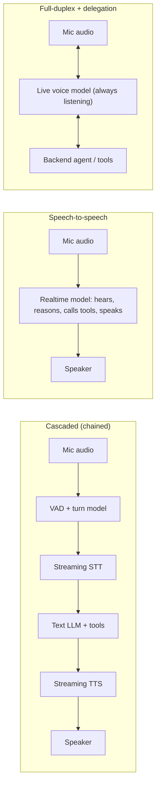

A **voice agent** is an [agent loop](agent-loop.md) whose input and output are live speech: it listens to a user on a microphone or phone line, decides when the user has finished, reasons and calls [tools](tools.md), and speaks a reply, while staying interruptible. What makes it hard is not the language model but timing: humans answer each other in about 500 ms, and a voice agent has to fit audio transport, endpointing, inference and speech synthesis into a budget of roughly one to one and a half seconds ([voice primer](../sources/voice-ai-and-voice-agents-primer.md)). The design choices are the **architecture**, **turn detection**, **transport**, and how to keep tool calls from blowing the budget.

## Three architectures

| | Cascaded STT, LLM, TTS | Speech-to-speech (OpenAI Realtime, Gemini Live) | Full-duplex with delegation (OpenAI GPT-Live) |
|---|---|---|---|
| How | Three separate models stream into each other | One model consumes and emits audio; the session handles turns, interruptions, tools | Voice model listens and speaks at once; reasoning and tools run in a backend the user can talk over |
| Strengths | Inspect and transform text between stages; swap any component; run policy checks before speaking; per the primer, more reliable tool calling and instruction following | Fewer hops, captures tone and nuance, simpler to wire | Add voice to an existing text agent; user is never blocked by backend work |
| Weaknesses (Synthesis: OpenAI lists only strengths; these come from the primer and the architecture itself) | More moving parts; latency adds up stage by stage | Less visibility into intermediate steps; less configurable | Newest pattern, two prompts to keep consistent |
| Pick when | Compliance, transcripts, regulated answers, heavy tool use | Browser-first conversational apps | Existing backend workflow needing a voice front end |

Sources: [OpenAI voice agents](../sources/openai-voice-agents-guide.md), [OpenAI Realtime](../sources/openai-realtime-api-guide.md), [Gemini Live](../sources/gemini-live-api-docs.md).

> **Contradiction (soft):** OpenAI positions speech-to-speech for low first-audio latency ([OpenAI Realtime](../sources/openai-realtime-api-guide.md)), while the Pipecat-community primer reports that, in practice, both OpenAI and Google speech-to-speech models were slower than a well-tuned cascade, less reliable at instruction following and tool calls, and 3-5x the cost of a GPT-4.1 cascade ([voice primer](../sources/voice-ai-and-voice-agents-primer.md)). Both are dated (the primer was updated June 2026); measure on your own stack.

OpenAI's guidance on splitting prompts applies to every architecture: speaking style in the voice model's prompt, business rules in the backend prompt, permissions and records in your application ([OpenAI voice agents](../sources/openai-voice-agents-guide.md)).

## The latency budget

One published cascade budget (ms), mouth to ear ([voice primer](../sources/voice-ai-and-voice-agents-primer.md)):

| Stage | ms |
|---|---|
| Mic input + Opus encode + network + jitter buffer + decode (inbound) | ~114 |
| **Transcription + endpointing** | **300** |
| **LLM time to first token** | **650** |
| Sentence aggregation | 20 |
| **TTS time to first byte** | **120** |
| Outbound encode, network, jitter buffer, decode, speaker | ~89 |
| Total | ~1,290 |

The target in that guide is 1,500 ms voice-to-voice; an LLM TTFT of 600 ms or less is fast enough for most uses, and co-locating all models on one GPU cluster has reached about 500 ms ([voice primer](../sources/voice-ai-and-voice-agents-primer.md)).

Levers, each traceable to the sources:

- **Stream every stage.** Streaming STT, an LLM that streams tokens ([streaming](streaming.md)), and TTS that starts playback before synthesis finishes (OpenAI's Speech endpoint uses chunked transfer; WAV/PCM output is fastest) ([OpenAI TTS](../sources/openai-text-to-speech-guide.md)).
- **Endpointing is the hidden cost.** The turn decision sits before transcription is final; a fixed 0.8 s silence window alone costs 800 ms (Pipecat's default stop-after-silence) ([voice primer](../sources/voice-ai-and-voice-agents-primer.md)).
- **Geography.** UK to us-west-1 RTT was about 140 ms vs about 15 ms to eu-west-2; edge routing on a private backbone cut jitter ([voice primer](../sources/voice-ai-and-voice-agents-primer.md)).
- **LLM TTFT** dominates: smaller/faster models ([model selection](model-selection.md)), short prompts, [prompt caching](prompt-caching.md), low [reasoning](reasoning-models.md) effort. See [cost and latency optimization](cost-and-latency-optimization.md).
- **Measure what users feel.** Time to a *useful* spoken answer (not a filler "sure"), per-stage timestamps, p50 and p95, change one factor at a time and check task success doesn't fall ([OpenAI voice agents](../sources/openai-voice-agents-guide.md)).

## Turn detection and interruptions

Turn detection decides when the user is done. Too eager and the agent talks over people who pause mid-thought; too patient and it feels sluggish.

1. **Silence VAD.** A small voice-activity model (Silero runs on under 1/8 of a vCPU core) plus a silence timeout. Pipecat defaults: start after 0.2 s of speech, stop after 0.8 s of silence, confidence 0.7 ([voice primer](../sources/voice-ai-and-voice-agents-primer.md)). OpenAI's `server_vad` exposes `threshold` (raise it in noisy rooms), `prefix_padding_ms` and `silence_duration_ms` ([OpenAI VAD](../sources/openai-realtime-vad-guide.md)).
2. **Semantic / end-of-utterance models.** VAD only knows *whether* someone is speaking. LiveKit's 135M-parameter text model reads the last four turns of transcript and stretches or shrinks the VAD timeout; it cut unintended interruptions by 85% in about 50 ms of CPU inference, but as a text model it only fits cascades ([LiveKit](../sources/livekit-eou-turn-detection.md)). OpenAI's `semantic_vad` does the same inside Realtime sessions, with `eagerness` `low`/`medium`/`high` (`auto` = `medium`) tuning how long it waits before ending the turn ([OpenAI VAD](../sources/openai-realtime-vad-guide.md)). Pipecat's Smart Turn works on raw audio (23 languages), deciding in about 30 ms, about 250 ms after a pause ([voice primer](../sources/voice-ai-and-voice-agents-primer.md)).
3. **LLM-signalled waits.** The primer describes having the LLM emit a single-token tag meaning "respond", "wait 5 s" or "wait 10 s", layered on VAD and a turn model ([voice primer](../sources/voice-ai-and-voice-agents-primer.md)).

**Barge-in** (user interrupts the agent) is supported natively by Realtime (`interrupt_response`) and Gemini Live ([OpenAI VAD](../sources/openai-realtime-vad-guide.md), [Gemini Live](../sources/gemini-live-api-docs.md)). Two engineering details from the primer: spurious interruptions come from coughs, keyboard clicks, echo-cancellation failures and background voices (mitigate with VAD start length and confidence, volume smoothing, speaker isolation); and after an interruption, use word-level TTS timestamps to keep in [context](context-engineering.md) only the words the user actually heard ([voice primer](../sources/voice-ai-and-voice-agents-primer.md)). Synthesis: otherwise the model believes it said things the user never heard, and its next turn refers to them.

## Transport

- **WebRTC** for browser and mobile clients: UDP media, built-in timestamps, echo cancellation, noise reduction and AGC. The primer argues WebSockets should not carry client-server realtime media in production (TCP head-of-line blocking, no audio congestion control, awkward reconnects) ([voice primer](../sources/voice-ai-and-voice-agents-primer.md)).
- **WebSocket** is fine server-to-server: OpenAI recommends WebRTC for browsers and WebSocket for servers ([OpenAI Realtime](../sources/openai-realtime-api-guide.md)); Gemini Live is WebSocket-only, at 16 kHz PCM in and 24 kHz PCM out ([Gemini Live](../sources/gemini-live-api-docs.md)).
- **Never ship the API key to the client.** Mint [ephemeral credentials](agent-authentication-and-authorization.md) server-side (`POST /v1/realtime/client_secrets` for OpenAI; ephemeral tokens for Gemini) ([OpenAI Realtime](../sources/openai-realtime-api-guide.md), [Gemini Live](../sources/gemini-live-api-docs.md)).
- Orchestration frameworks such as LiveKit and Pipecat integrate with the vendors' realtime APIs and handle transport for you ([Gemini Live](../sources/gemini-live-api-docs.md)).

## Tool calls in voice

A [function call](function-calling.md) costs a second, non-streamable inference round: with 450 ms TTFT, 100 tokens/s and a 100-token call, the call alone takes 1 s to emit, so time to first token of the full inference is about 1,450 ms, not counting tool execution ([voice primer](../sources/voice-ai-and-voice-agents-primer.md)). Mitigations from that source: say something before calling, or arm a watchdog that speaks only if the tool is slow; keep call/result pairs matched in context. Full-duplex delegation exists for the same reason: the user can keep talking while the backend works ([OpenAI voice agents](../sources/openai-voice-agents-guide.md)). Consequential actions still need [guardrails](agent-guardrails.md) and confirmation, which the cascaded architecture makes easiest because you can check text before it is spoken ([OpenAI voice agents](../sources/openai-voice-agents-guide.md)).

## Speech components

STT models (see [multimodal models](multimodal-models.md)) are Whisper descendants trained on large weakly supervised corpora ([Whisper](../sources/whisper-radford-2022.md)). For live use OpenAI recommends `gpt-live-transcribe`; diarization is not available in realtime sessions; domain terms go in `keywords`/`prompt` ([OpenAI STT](../sources/openai-speech-to-text-guide.md)). For TTS, OpenAI is moving synthesis onto the Realtime API (Speech API TTS models shut down 2027-01-06; migration target `gpt-realtime-2.1-mini`) and requires disclosure that the voice is AI-generated ([OpenAI TTS](../sources/openai-text-to-speech-guide.md)).

## Evaluation

OpenAI recommends scoring four things separately: task and tool outcomes, conversational timing, speech and language quality, and session reliability; and a crawl-walk-run path: synthetic single-turn speech, then replayed real recordings, then a simulated caller with interruptions, plus human listening for pronunciation and pacing ([OpenAI voice agents](../sources/openai-voice-agents-guide.md)). The primer adds that function-calling accuracy needs its own evals and production monitoring ([voice primer](../sources/voice-ai-and-voice-agents-primer.md)). See [LLM evaluation](llm-evaluation.md) and [LLM observability](llm-observability.md).

## When to use / when not

- **Use** voice when users are hands-busy, on the phone, or the task is conversational (support triage, scheduling, intake, tutoring).
- **Prefer a cascade** for regulated domains, heavy tool use, auditable transcripts, or when you want to swap vendors per stage.
- **Prefer speech-to-speech** for prototypes and expressive, low-tool conversations; **full-duplex delegation** when a mature text agent already exists.
- **Avoid** voice for tasks needing long precise outputs (codes, tables, legal text), where a screen is better. Synthesis: a hybrid that speaks a summary and sends details by SMS or email is common.

## Sources

- [OpenAI Voice Agents Guide](../sources/openai-voice-agents-guide.md)
- [OpenAI Realtime API Guide](../sources/openai-realtime-api-guide.md)
- [OpenAI Realtime VAD Guide](../sources/openai-realtime-vad-guide.md)
- [OpenAI Speech-to-Text Guide](../sources/openai-speech-to-text-guide.md)
- [OpenAI Text-to-Speech Guide](../sources/openai-text-to-speech-guide.md)
- [Gemini Live API Docs](../sources/gemini-live-api-docs.md)
- [Voice AI & Voice Agents primer](../sources/voice-ai-and-voice-agents-primer.md)
- [LiveKit end-of-turn detection](../sources/livekit-eou-turn-detection.md)
- [Whisper paper](../sources/whisper-radford-2022.md)
