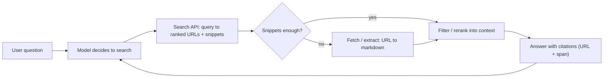

**Web search APIs for agents** are the [tools](tools.md) that give a model live access to the web: a *search* step that turns a query into ranked URLs (often with extracted text), and a *fetch/extract* step that turns a chosen URL into clean, token-efficient content. They are the standard fix for a model's training cutoff and a main source of grounding against [hallucination](hallucination.md). They come in two shapes. **Provider-native** tools run inside the model API's server-side loop and return citations automatically. **Third-party** APIs you wrap as a [function-calling](function-calling.md) tool yourself, which gives you control over the index, filters, cost and which model you use.

## The two halves: search and fetch

Synthesis: almost every web-enabled agent combines two operations, and the vendors differ mainly in how much of each they bundle.

| Operation | Input → output | Examples |
|---|---|---|
| Search | query → ranked results (title, URL, snippet or chunks) | Claude `web_search`, OpenAI `web_search`, Gemini `google_search`, Tavily, Exa, Brave, Perplexity Search, SerpApi |
| Fetch / extract | URL → main content as markdown/text/JSON | Claude `web_fetch`, OpenAI `open_page`/`find_in_page` actions, Gemini `url_context`, Firecrawl, Jina Reader, Tavily Extract |

Anthropic documents the combined flow directly: with both tools enabled, Claude searches, picks promising results, fetches full content, then answers with citations ([web fetch docs](../sources/anthropic-web-fetch-tool-docs.md)). SerpApi returns only result-page snippets, so a fetch step is always needed ([SerpApi](../sources/serpapi-google-search-api.md)). Tavily and Exa return extracted content in the search call itself ([Tavily](../sources/tavily-api-docs.md), [Exa](../sources/exa-search-docs.md)).

Synthesis: the loop arrow is the important part. Agentic search means repeated search and fetch rounds inside one turn, not a single retrieval as in classic [RAG](retrieval-augmented-generation.md).

## Provider-native search tools (as of 2026-11)

| | Anthropic `web_search` | OpenAI `web_search` ([Responses](openai-responses-api.md)) | Gemini `google_search` |
|---|---|---|---|
| Who runs the loop | API server (`server_tool_use`), may `pause_turn` | API server; [reasoning models](reasoning-models.md) add `open_page`, `find_in_page` | API server |
| Domain control | `allowed_domains` or `blocked_domains` (not both) | `filters.allowed/blocked_domains`, up to 100 each | not in the guide |
| Volume control | `max_uses` per turn | `search_context_size` low/medium/high, `return_token_budget` | none documented |
| Freshness control | `web_fetch_20260309`+ `use_cache: false` | `external_web_access: false` = cache-only | n/a |
| Citations | always on; `cited_text` up to 150 chars, not billed as tokens | `url_citation` annotations with char span; `sources` lists all URLs consulted | `url_citation` with `start_index`/`end_index` |
| Price | $10 / 1k searches + tokens; failed searches free | per-call tool fee + tokens (see pricing page) | Gemini 3+: 5k free/month then $14 / 1k queries; Gemini 2.5 and older billed per prompt |

Sources: [Anthropic search](../sources/anthropic-web-search-tool-docs.md), [OpenAI](../sources/openai-web-search-tool-docs.md), [Gemini](../sources/gemini-google-search-grounding-docs.md).

Details that matter in production:

- **Context filtering.** Basic search dumps every result into context. Claude's `web_search_20260209`+ and `web_fetch_20260209`+ let the model write code that filters results before they reach the context ("dynamic filtering"). It runs search from inside [code execution](code-execution-sandboxes.md), which the API provisions automatically; it is on by default (`allowed_callers` defaults to code execution) and is turned off with `allowed_callers: ["direct"]`. It needs Claude 4.6+ models, is not ZDR/HIPAA eligible, and is unavailable on Google-managed [Vertex](google-vertex-ai.md) and Azure-hosted [Foundry](azure-ai-foundry.md) deployments, which offer only `web_search_20250305`. OpenAI caps search context at 128k tokens whatever the model's window. ([Anthropic](../sources/anthropic-web-search-tool-docs.md), [OpenAI](../sources/openai-web-search-tool-docs.md)) This is [context engineering](context-engineering.md) applied to the web.
- **Multi-turn state.** Claude results carry `encrypted_content` and citations carry `encrypted_index`. Both must be sent back unchanged, or the next request fails with a 400. Search results also count as input tokens on every later turn, so they are worth [prompt caching](prompt-caching.md). ([Anthropic](../sources/anthropic-web-search-tool-docs.md))
- **Errors are in-band.** Claude returns HTTP 200 with `web_search_tool_result_error` codes (`max_uses_exceeded`, `too_many_requests`, `query_too_long`...), so your loop must inspect content, not status codes. ([Anthropic](../sources/anthropic-web-search-tool-docs.md))
- **Display obligations.** All three vendors require citations or search suggestions to be shown to end users. OpenAI asks for clickable inline links; Google's search-suggestion HTML is governed by its terms. ([OpenAI](../sources/openai-web-search-tool-docs.md), [Gemini](../sources/gemini-google-search-grounding-docs.md), [Anthropic](../sources/anthropic-web-search-tool-docs.md))
- **Model churn.** OpenAI shut down the `gpt-4o-search-preview-2025-03-11` and `gpt-4o-mini-search-preview-2025-03-11` snapshots on 2026-07-23 (named replacement `gpt-5.6-terra`). Chat Completions now offers only `gpt-5-search-api`, which always searches and has no domain filters. ([deprecations](../sources/openai-deprecations-deep-research.md), [OpenAI](../sources/openai-web-search-tool-docs.md))

## Third-party search APIs

| API | Index / mechanism | Returns | Key knobs | Price (2026-11) |
|---|---|---|---|---|
| **Tavily** | aggregator tuned for LLM agents | results with relevance `score` + 1-3 query-relevant chunks per source; optional raw content and answer | `search_depth` ultra-fast/fast/basic/advanced, `topic`, `time_range`, `include_domains` (300) | 1 credit (advanced 2); $0.008/credit PAYG, 1k free/month |
| **Exa** | own index; [embedding](embeddings.md)-style retrieval (docs show a `neural` cost line) | results + highlights, full text, per-result summary, or schema answer | `type` lite/auto/deep-lite/deep, `category`, `maxAgeHours`, 1,200-domain filters | per 1k requests (up to 10 results): `lite` $4, `auto` $7, `deep-lite`/`deep` $12; contents $1/1k pages per type |
| **Brave** | own independent index, no Google/Bing fallback | SERP JSON; LLM Context endpoint with extracted content (~1k-33k tokens) | vertical endpoints, Goggles | $5/1k searches at 50 QPS; Answers $4/1k + $5/M tokens; $5 free credit/month |
| **Perplexity** | own search stack | Search API: ranked results; `sonar`: grounded answer | `search_type: fast`; Agent API effort presets | Search $5/1k ($1/1k fast); `sonar` $0.25/$2.50 per M tokens |
| **SerpApi** | scrapes live Google SERPs | parsed blocks: organic, knowledge graph, local, related questions | `location`, `gl`, `hl`, `device`, `no_cache` | plans (not on the reference page); cached hits free |

Sources: [Tavily](../sources/tavily-api-docs.md), [Exa](../sources/exa-search-docs.md), [Brave](../sources/brave-search-api.md), [Perplexity](../sources/perplexity-api-docs.md), [SerpApi](../sources/serpapi-google-search-api.md).

How to tell them apart. Synthesis:

- **Google-parity vs own index.** SerpApi shows you exactly what Google shows, including local and shopping blocks. That is useful for SEO, local or commerce agents, but it is snippet-only and depends on scraping. Brave and Exa have independent indexes, which means different recall and a different exposure to SEO spam. Brave also sells storage/training rights only on custom plans, which matters if you want to cache results into your own [vector database](vector-databases.md) ([Brave](../sources/brave-search-api.md)).
- **Keyword vs semantic queries.** Exa expects descriptive natural-language queries ("describe subject, source type, period") ([Exa](../sources/exa-search-docs.md)). SerpApi supports Google operators like `site:`. Agents write better queries once the tool description says which style the backend wants (see [query transformation](query-transformation.md)).
- **Pre-chunked content saves tokens.** Tavily's chunks and Exa's highlights are already a retrieval-and-[reranking](reranking.md) step. Asking for raw full text instead can multiply context cost by 10x or more.
- **Answer endpoints** (Tavily `include_answer`, Exa `deep`/`outputSchema`, Brave Answers, Perplexity `sonar`) put a second LLM between the web and your model. That is fast, but you lose control of synthesis and citation granularity.

## Content extraction and crawling

| Tool | Model | JS rendering | Freshness / cache | Cost |
|---|---|---|---|---|
| Claude `web_fetch` | server tool; only URLs already in context | no (use browser tool) | cached by default; `use_cache: false` | tokens only |
| Firecrawl | scrape/crawl/map/search/interact/agent; self-hostable OSS | yes, plus proxies and anti-bot | `maxAge` default 2 days (up to 5x faster); `0` forces fresh | 1 credit/page; JSON +4; PDF 1/page |
| Jina Reader | prefix `r.jina.ai/<url>`; `s.jina.ai` search | headless by default, `X-Engine: direct` faster | `X-No-Cache`, `X-Cache-Tolerance` | billed per output token; 10M free |

Sources: [web fetch](../sources/anthropic-web-fetch-tool-docs.md), [Firecrawl](../sources/firecrawl-docs.md), [Jina](../sources/jina-reader-docs.md).

Page sizes drive cost. Anthropic estimates about 2.5k tokens for an average page, 25k for a large docs page and 125k for a research PDF, and offers `max_content_tokens` to truncate ([web fetch](../sources/anthropic-web-fetch-tool-docs.md)). Schema-driven extraction (Firecrawl JSON, ReaderLM-v2 with a schema header) turns pages into [structured outputs](structured-outputs.md) before they reach the main model ([Firecrawl](../sources/firecrawl-docs.md), [Jina](../sources/jina-reader-docs.md)). Crawling whole sites (Firecrawl Crawl/Map, Tavily Crawl) is ingestion for an offline index, not live search; see [document processing](document-processing.md).

## Citation grounding

Grounding means every claim in the answer points to a span in a retrieved source. Native tools return structured citations: Claude gives a URL, title and `cited_text`; OpenAI and Gemini give a URL, title and character span in the answer ([Anthropic](../sources/anthropic-web-search-tool-docs.md), [OpenAI](../sources/openai-web-search-tool-docs.md), [Gemini](../sources/gemini-google-search-grounding-docs.md)). With third-party APIs you build this yourself: number the sources in context, ask for `[n]` markers or a [structured output](structured-outputs.md) of claim-source pairs, then check that each cited URL was actually retrieved. OpenAI's `sources` list is usually longer than the citations, which shows the gap between what was read and what was credited ([OpenAI](../sources/openai-web-search-tool-docs.md)). Anthropic's research system runs a dedicated citation pass after writing ([multi-agent research](../sources/anthropic-multi-agent-research-system.md)); see [deep research agents](deep-research-agents.md).

## Cost and freshness trade-offs

- **Two meters.** You pay per search (about $1-14 per 1k across vendors as of 2026-11, from Perplexity fast search to Gemini grounding) plus tokens for everything placed in context. On native tools the token bill usually dominates, because results stay in the history on every later turn ([Anthropic](../sources/anthropic-web-search-tool-docs.md), [Perplexity](../sources/perplexity-api-docs.md), [Gemini](../sources/gemini-google-search-grounding-docs.md), [Exa](../sources/exa-search-docs.md)).
- **Freshness is a cache setting.** Exa `maxAgeHours`, Firecrawl `maxAge`, Jina cache tolerance, Claude `use_cache`, OpenAI `external_web_access` and SerpApi's 1-hour cache all trade latency and price against staleness. Forcing live fetches is slower and fails more often ([Firecrawl](../sources/firecrawl-docs.md), [Exa](../sources/exa-search-docs.md)). Note that `maxAgeHours` controls content age, not publication date; use date filters for recency.
- **Latency tiers.** Exa `lite` takes about 300 ms (cache only), `auto` about 1 s and `deep` 4-15 s ([Exa](../sources/exa-search-docs.md)). Perplexity's effort presets range from 1 step to 300 ([Perplexity](../sources/perplexity-api-docs.md)). Voice and chat UX need the cheap end; see [cost and latency optimization](cost-and-latency-optimization.md).
- **Budget caps.** Use `max_uses` (Claude), `search_context_size` (OpenAI) and `max_results` / `chunks_per_source` (Tavily) to bound runaway loops.

## Failure modes

- **Prompt injection from pages.** Fetched content is untrusted input that can redirect the agent or exfiltrate data. Claude's fetch tool refuses URLs the model invented or that contain credentials, but the docs still warn of residual risk when untrusted content meets sensitive data. OpenAI advises running public web search and private MCP lookups in separate requests. ([web fetch](../sources/anthropic-web-fetch-tool-docs.md), [OpenAI](../sources/openai-web-search-tool-docs.md)) See [prompt injection](prompt-injection.md).
- **Low-quality sources.** Agents favoured SEO content farms over authoritative sources until source-quality heuristics were added ([multi-agent research](../sources/anthropic-multi-agent-research-system.md)). Domain allow-lists are the blunt fix.
- **JS-heavy or blocked pages.** Basic fetchers do not render JavaScript. `robots.txt` and private addresses are refused ([web fetch](../sources/anthropic-web-fetch-tool-docs.md)). Fall back to Firecrawl or Jina rendering, or to [computer use](computer-use-agents.md).
- **Context flooding.** Raw results are mostly irrelevant, which is why dynamic filtering and pre-chunked results exist ([Anthropic](../sources/anthropic-web-search-tool-docs.md)). See [long-context degradation](long-context-degradation.md).
- **Citation drift.** A citation can point to a real page that does not support the claim. Check claims against `cited_text` or spans, using an [LLM-as-judge](llm-as-judge.md) if needed.

## When to use / when not

- **Native tool:** the fastest path when you are already on one provider and want citations, ZDR or compliance handling and less plumbing. You accept the vendor's index and opaque ranking.
- **Third-party API:** when you need model portability, a specific index (Google SERP parity, an independent index, semantic search), fine control over chunks and filters, or one search layer shared by several models (often exposed through [MCP](model-context-protocol.md)).
- **Web search as RAG fallback:** Corrective RAG grades local retrieval and falls back to web search only when it fails; the owner's experiment wires this with a stub search ([CRAG paper](../sources/yan-2024-corrective-rag.md), [notebook](../sources/notebook-23-corrective-rag.md)). See [agentic RAG](agentic-rag.md).
- **Not at all:** for stable knowledge, closed-domain enterprise questions answerable from internal data, or where data-egress rules forbid sending queries to third parties. Search queries themselves can leak sensitive intent; see [PII and data privacy](pii-and-data-privacy.md).

## Sources

- [Claude web search tool docs](../sources/anthropic-web-search-tool-docs.md)
- [Claude web fetch tool docs](../sources/anthropic-web-fetch-tool-docs.md)
- [OpenAI web search tool guide](../sources/openai-web-search-tool-docs.md)
- [OpenAI deprecations (search and deep research models)](../sources/openai-deprecations-deep-research.md)
- [Gemini Grounding with Google Search docs](../sources/gemini-google-search-grounding-docs.md)
- [Tavily API docs](../sources/tavily-api-docs.md)
- [Exa search API docs](../sources/exa-search-docs.md)
- [Brave Search API](../sources/brave-search-api.md)
- [Perplexity API docs](../sources/perplexity-api-docs.md)
- [SerpApi Google Search API](../sources/serpapi-google-search-api.md)
- [Firecrawl docs](../sources/firecrawl-docs.md)
- [Jina Reader](../sources/jina-reader-docs.md)
- [How we built our multi-agent research system (Anthropic)](../sources/anthropic-multi-agent-research-system.md)
- [Yan et al. 2024: Corrective RAG](../sources/yan-2024-corrective-rag.md)
- [Notebook experiment 23: Corrective RAG](../sources/notebook-23-corrective-rag.md)
