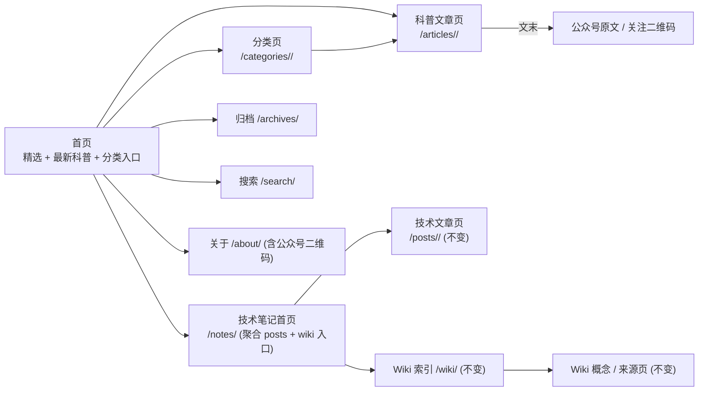

# 博客改版设计：AI 科普归档站 + 技术笔记小栏目

- 日期：2026-11-21
- 状态：待作者审批（已过构建者审阅）
- 范围：整体规划三个子项目；本文详细设计**子项目 1（站点改版）**，子项目 2、3 只定边界，各自后续单独走设计流程。

## 1. 意图

博客改成和公众号「AI进化调研员」同一定位：**中文 AI 科普**。公众号的问题是搜不到、旧文难翻，所以博客的首要职责是**公众号文章的长期归档**：每篇公众号文章都同步到博客，能被搜索引擎收录、能长期翻阅，并把读者引回公众号。

现有的技术文章（4 篇英文 post）和 Wiki 原样保留，降为一个小栏目「技术笔记」。

UI 要"更酷炫、兼容性更强"。按作者自己的《Modern Web Guidelines》落地：平台原生动效 + 渐进增强，而不是重 JS 框架。

## 2. 三个子项目与顺序

| # | 子项目 | 产出 | 依赖 |
|---|---|---|---|
| 1 | 站点改版 | 新信息架构、BA 图、功能说明书、Stitch 设计稿、自研 Hugo 主题 | — |
| 2 | 公众号同步 | `wx-sync` 技能：读公众号文章 → 图片传 R2 → Markdown → 检查 → 推送 | 1 的内容模型（front matter、目录） |
| 3 | Remotion 视频 | 每篇文章一条 9:16 短视频（视频号 / 小红书）+ 一段横版循环作为博客动态封面 | 1 的设计语言；2 的文章数据 |

顺序 1 → 2 → 3，作者已同意。每个子项目都走 slack-off 那套流程：BA 图 → 功能说明书 → Stitch 设计 → 计划 → 实现。

## 3. 目标 / 非目标 / 反目标

**目标**
- 中文科普为主体，首页是科普文章流，可按分类浏览。
- 每篇科普文章底部有"原文发于公众号"链接和关注二维码。
- 技术笔记（posts + wiki）保留，有独立入口。
- 视觉上明显比 PaperMod 更有辨识度，含动效；移动端优先（读者多从微信来）。
- 兼容性：目标 Baseline **Widely available**；Newly available 的特性只作增强，不支持时页面完整可用。
- 性能与无障碍：Core Web Vitals 全绿（LCP < 2.5s、INP < 200ms、CLS < 0.1，以移动端为准），WCAG 2.2 AA。

**非目标**
- 双语 / 翻译科普文章（以后可在此基础上加）。
- 评论、订阅邮件、会员、统计分析。
- 更换部署平台（仍是 GitHub Pages + GitHub Actions）。
- 本子项目不做同步脚本、不做视频（属于子项目 2、3），只预留接口。

**反目标**（技术上能跑，但算失败）
- 动效拖慢阅读或掉 CWV，或者在关闭动效（`prefers-reduced-motion`）时内容缺失。
- 现有 URL 失效（`/posts/...`、`/wiki/...` 必须保持不变，外部链接不断）。
- Wiki 工作流（ingest / lint、`gen-index.py`、`check-wiki.sh`、Mermaid、链接渲染钩子）被破坏。
- 首页长成营销落地页，文章被挤到下面。

## 4. 约束

- 仓库公开。公众号原创文章可以公开放；转载、引用他人的图片不进站（子项目 2 处理）。
- 图片放 Cloudflare R2（免费额度），不进仓库。先用 `r2.dev` 子域名（有限速，作者知情），以后有域名再切；图片基址放配置 `params.imageBase`，切换只改一处 + 批量替换。
- 中文 Web 字体动辄数 MB：正文用系统中文字体栈（PingFang SC / Noto Sans SC / Microsoft YaHei），只有拉丁标题字体可用子集化 Web 字体。
- Hugo 0.169 extended，CI 用 `--panicOnWarning`，不能有构建警告。
- 推送 `main` 即发布；`check-wiki.sh` 通过后可直接推送（CLAUDE.md 已授权）。

## 5. 方案（Approaches）

| 方案 | 做法 | 取舍 |
|---|---|---|
| A. 覆盖 PaperMod | 在 `layouts/` 覆盖模板、加自定义 CSS | 改动小；但 Stitch 出的布局和 PaperMod 结构差异大，覆盖越多越难维护，升级主题会冲突 |
| **B. 自研 Hugo 主题（选定）** | 新建 `themes/evo/`，按 Stitch 设计稿实现；保留 Hugo、内容、`layouts/_markup` 钩子和检查脚本 | 工作量最大的是重做 PaperMod 已有的功能（搜索、归档、标签、TOC、代码复制、深色模式、RSS）；但设计能完全落地，内容和工作流不动 |
| C. 换 Astro / Next.js | 重写站点 | 生态更"酷"，但要迁移 wiki 渲染钩子、检查脚本、部署，风险和成本都高，收益主要是 B 也能做到的动效 |

选 B：Stitch 设计要完整落地，同时 Hugo 上的 wiki 工作流必须原样保留。作者把技术选型交给我决定（"按你推荐的来"）。

Remotion 是 React 渲染视频的工具，不当页面 UI 框架用；视频本身在子项目 3 制作，但**子项目 1 必须为它预留好接口**（见第 8.1 节），作者明确要求（2026-11-21）。

## 6. 信息架构（子项目 1）



- **新目录** `content/articles/`：科普文章，中文。URL `/articles/<slug>/`。slug 用英文或拼音短词（由子项目 2 决定生成规则），不用中文 URL。
- **分类**：taxonomy `categories`，front matter 里写**英文 slug**，显示名由 `data/categories.yaml` 映射（我的决定）。暂定 4 个：`models` 新模型速递、`concepts` 概念科普、`tools` 工具实测、`industry` 行业观察，URL 为 `/categories/<slug>/`（Hugo 默认结构，不与 `/articles/<slug>/` 冲突）。slug 一经上线不再改；显示名可随时改。公众号后台本次没能读取，首次同步前按真实文章确认这组 slug。标签 `tags` 继续沿用。
- **技术笔记**：`content/posts/` 与 `content/wiki/` 位置和 URL 不变。新增 `/notes/` 作为栏目首页（列出 posts，链到 wiki）。
- **语言**：站点 `locale: zh-cn`；英文页面（posts、wiki、`/notes/`）由 cascade 设置 `lang: en`，模板据此输出 `<html lang>`，**界面文字（导航、阅读时长、目录、上下篇等）也随页面语言切换**：主题内用一个按 `.Params.lang` 取文案的 partial + `i18n/zh-cn.yaml`、`i18n/en.yaml`（我的决定）。不启用 Hugo 多语言（避免 URL 加前缀）。
- **导航**：首页 · 科普（下拉/展开分类）· 技术笔记 · 归档 · 搜索 · 关于。CV、Now 移到页脚。
- **首页、归档、RSS**：只收科普文章 + 技术文章（`mainSections: [articles, posts]`），wiki 页仍不进首页/归档/RSS（现有检查保留）。
- **搜索**：中英文全站（科普 + posts + wiki），沿用 JSON 索引 + 客户端搜索；中文需要按字符/n-gram 匹配，Fuse.js 对中文可用但需调阈值（构建者验证）。

### 科普文章 front matter（子项目 2 会按此写入）

```yaml
---
title: "……"
date: 2026-11-20T08:00:00+08:00
summary: "一句话摘要，用于列表和 meta description"
categories: ["concepts"]   # 英文 slug，见 data/categories.yaml
tags: ["agents"]
cover: "https://<imageBase>/articles/<slug>/cover.jpg"   # 必填，列表卡片和 og:image
cover_video: ""        # 可选，子项目 3 的横版循环 MP4/WebM（R2 链接）
video_vertical: ""     # 可选，子项目 3 的 9:16 短视频（R2 链接）
wechat_url: "https://mp.weixin.qq.com/s/……"            # 必填，文末"原文"链接
wechat_id: "……"        # 公众号 appmsgid，同步去重用
featured: false        # 可选；首页精选取最新一篇 featured: true，没有则取最新文章
draft: false
---
```

## 7. 页面清单（交给 Stitch 的单位）

沿用 slack-off：`docs/ba/functional-spec.md` 每页一节，"全局设计要求 + 某一节"直接交给 Stitch。

| # | 页面 | 要点 |
|---|---|---|
| 01 | 首页 | 一篇精选大卡（带动态封面视频槽位）、最新科普流、分类入口、技术笔记入口（次要）、公众号关注卡 |
| 02 | 分类 / 列表页 | 卡片网格，移动端单列；分类切换 |
| 03 | 科普文章页 | 封面（视频槽位，静态图兜底）、正文内嵌视频块、标题、日期/阅读时长/分类、正文排版（中文行高、图片、引用、表格）、TOC、文末公众号卡、上一篇/下一篇、相关文章 |
| 04 | 技术笔记首页 | 英文；posts 列表 + Wiki 入口；视觉上与科普区分（更"终端/文档"感）但同一套设计语言 |
| 05 | 技术文章页 | 英文长文、代码块（复制按钮）、Mermaid、TOC |
| 06 | Wiki 索引与概念页 | 沿用内容，换皮；`_index.md` 分组列表 |
| 07 | 归档 | 按年月 |
| 08 | 搜索 | 即时结果，中英混合 |
| 09 | 关于 | 新定位介绍、公众号二维码、CV 链接 |
| 10 | 404 | |

每页画：浅色 / 深色、375px 手机 / ≥1280px 桌面。

**全局设计要求（初稿，写入 functional-spec 第 0 节）**
- 气质：科技科普，"调研员"的严谨 + 有活力；参考暗色海军蓝底 + 橙 / 青 / 紫强调色（与小红书卡片 xhs-sync 一致，形成跨平台品牌统一）。浅色主题同样完整。
- 中文排版优先：正文 17–18px、行高 1.8、段落间距舒展、最大行宽约 40 个汉字。
- 动效只服务于导航和阅读：页面切换、卡片进入、阅读进度；不要粒子背景、不要自动轮播。

## 8. 前端技术方案（子项目 1）

全部遵循《Modern Web Guidelines》（`content/posts/modern-web-guidelines.md`）：

- **无前端框架**。Hugo 模板 + 原生 CSS + 少量原生 JS（模块）。JS 预算：搜索页之外每页 < 20KB（gzip）。
- **CSS**：自定义属性做设计令牌；`light-dark()` + `color-scheme` 做主题（不支持时回退到 `prefers-color-scheme` 媒体查询）；容器查询做卡片响应式；`:has()`、嵌套、`@layer` 组织样式。用 Hugo Pipes 打包、压缩、指纹。
- **动效（全部渐进增强）**：
  - 跨文档 View Transitions（`@view-transition { navigation: auto; }`），卡片封面 → 文章封面共享元素过渡；不支持的浏览器正常跳转。
  - 滚动驱动动画（`animation-timeline: scroll()/view()`）做阅读进度条、卡片入场，放在 `@supports` 里。
  - `prefers-reduced-motion: reduce` 时关闭所有非必要动效。
- **动态封面槽位**：`cover_video` 存在时用 `<video muted loop playsinline preload="none" poster=cover>`，进入视口才播放，reduced-motion 时只显示 poster。
- **图片**：全部带 `width`/`height`（防 CLS），首屏封面 `fetchpriority="high"`，其余 `loading="lazy"`；R2 图片无法用 Hugo 处理，尺寸由同步脚本写入（子项目 2）或模板缺省比例兜底。
- **字体**：中文系统字体栈；拉丁标题可选一款 Google Fonts 子集（`font-display: swap`）。
- **需在新主题重做的 PaperMod 功能**：深色模式切换、TOC、代码复制按钮、阅读时长、归档、标签/分类页、搜索（`index.json` 输出）、RSS、SEO meta / Open Graph、`robots.txt`、`llms.txt`、"Suggest changes" 链接。
- **保留不动**：`layouts/_markup/render-link.html`、`render-codeblock-mermaid.html`、`static/js/mermaid-loader.js`。
- **SEO（归档站的核心价值）**：`<title>`/description/canonical、Open Graph、`Article` JSON-LD、sitemap；科普文章 canonical 指向博客自身，同时页面内链接公众号原文。

### 8.1 为 Remotion 预留的接口（子项目 1 内完成）

| 接口 | 子项目 1 做什么 | 子项目 3 怎么用 |
|---|---|---|
| **单一来源的设计令牌** | Stitch 定稿后，把色板、字号、圆角、间距、动效时长/缓动写进 `data/tokens.yaml`；Hugo 模板据此生成 CSS 自定义属性（不在 CSS 里手写颜色） | Remotion 组件直接读同一个 `tokens.yaml`，视频与网站视觉一致，改一处两边都变 |
| **封面视频槽位** `cover_video` | 首页精选卡、文章卡、文章页封面都支持；`<video muted loop playsinline preload="none" poster>`，进入视口才播，reduced-motion 只显示 poster | 渲染 3–6 秒横版无声循环，上传 R2，写回 front matter |
| **正文视频块** shortcode `` | 实现 shortcode：懒加载、带字幕/说明、默认不自动播放、有声视频需点击 | 给文章插入"概念动画讲解"片段 |
| **竖版视频入口** front matter `video_vertical` | 可选字段；有值时文末公众号卡旁显示"看 60 秒视频版" | 9:16 短视频（视频号 / 小红书同款）上传 R2 后写入 |
| **目录位置** | 在本仓库预留 `video/`（独立 Node 包，`.gitignore` 掉渲染产物 `video/out/`）；CI 只构建 Hugo，不碰 `video/` | Remotion 工程放这里，就近读 `data/tokens.yaml` 和 `content/articles/*` |

**网页内是否用 `@remotion/player` 实时播放？** 默认不用：它需要在页面加载 React + 组合代码（远超 20KB JS 预算），对"兼容性更强"不利。网页上一律播放预渲染的 MP4/WebM。将来如果某篇文章需要可交互的动画，再按单页 opt-in 引入（front matter `interactive: true` 才加载），本次不实现（我的决定）。

Stitch 设计稿里要画出这三个视频位（首页精选、文章封面、正文视频块）以及无视频时的静态兜底。

## 9. 上线策略（我的决定）

子项目 1 完成时还没有科普文章（同步在子项目 2）。所以：

- 子项目 1、2 在分支 `redesign` 上开发，**不推送 `main`**；本地 `hugo server` 预览。
- 主题开发用 `content/articles/` 下 3 篇标为 `draft: true` 的示例文章（占位文字，不含真实内容），只在 `hugo server -D` 可见；每页同时设计"空状态"。
- 子项目 2 首批同步进真实文章、检查通过后，删除示例文章，合并 `redesign` 到 `main` 发布。"首页能看到 `/articles/`"这条检查在合并前加入。

## 10. 需要同步修改的仓库文件

- `hugo.yaml`：`theme: evo`、`locale: zh-cn`、标题/描述改新定位、`mainSections`、菜单、`params.imageBase`、taxonomy。
- `scripts/check-wiki.sh`：`check_home_posts_only` 的语义改为"首页/归档不列 wiki 页"（保持），新增检查：首页能看到 `/articles/` 文章；`/posts/` 旧 URL 仍在；科普文章必须有 `wechat_url` 与 `cover`。
- `CLAUDE.md`：内容分区新增 `content/articles/`（由同步技能写入，非作者手写）。
- `content/about.md`、`content/now/index.md`：改写为新定位（中文），加公众号二维码（作者提供图片）。
- `.github/workflows/deploy.yml`：子模块仍需要（若删除 PaperMod 子模块，同步更新）。

## 11. BA 与设计产物（沿用 slack-off）

```
docs/ba/
├── README.md               # 产物索引 + 审阅状态
├── 01-reader-flow.mmd      # 读者画像与路径：微信来的 / 搜索来的 / 技术读者
├── 06-ui-nav.mmd           # 页面跳转（即第 6 节的图，细化）
├── functional-spec.md      # 第 0 节全局要求 + 每页一节，交给 Stitch
└── open-questions.md
design/
├── DESIGN.md               # Stitch 导出的设计语言（色板、字号、间距、组件）
├── prompts/                # 每页给 Stitch 的英文/中文提示词
├── screens/                # 截图（桌面 + mobile/）
└── code/                   # Stitch 导出的 HTML，作为实现参考，不直接上线
```

slack-off 里的状态机、时序、ER 图对内容站不适用，省略（我的决定）。

审阅节点：BA 图 + 功能说明书 → 作者审；Stitch 稿 → 作者审；之后才写主题代码。

**Stitch 分工（作者确认，2026-11-21）**：同 slack-off。Claude 在作者的 Chrome 里驱动 Stitch，按 `design/prompts/` 出稿、截图存 `design/screens/`；每页定稿后由作者执行 Export → Code to Clipboard，Claude 用 `pbpaste > design/code/<page>.html` 落盘。没有导出代码的页面，按提示词 + 功能说明书 + 截图实现。

## 12. 子项目 2、3 的边界（不在本次实现）

**子项目 2 · 公众号同步（`wx-sync` 技能）**
- 通过 Claude in Chrome 读已发表文章（同 xhs-sync 的接口），转 Markdown。
- 图片下载后用 `wrangler r2 object put` 上传到 R2，替换为 `imageBase` 链接，记录宽高。作者需自行完成 `wrangler login`。
- 以 `wechat_id` 去重，可重复运行；跳过征稿启事和非原创内容。
- 写入 `content/articles/<slug>/index.md` → `check-wiki.sh` → 提交推送。

**子项目 3 · Remotion 视频**
- 独立目录（如 `video/` 子包或独立仓库），输入为文章 front matter + 要点。
- 输出：9:16 30–60 秒 MP4（本地渲染，作者手动发布）；横版 3–6 秒无声循环 WebM/MP4 上传 R2，写回 `cover_video`。
- 视觉复用子项目 1 的 `data/tokens.yaml`；接口见 8.1 节，子项目 3 不需要改网站模板。

## 13. 留给构建者决定的

- 主题内部文件结构、CSS 组织细节、搜索库选择（Fuse.js 或 Pagefind，须支持中文、不引入构建期 Node 依赖到 CI 以外的复杂度）。
- 拉丁标题字体的具体选择（Stitch 稿出来后定）。
- 分类页、归档的分页大小。
- 是否删除 PaperMod 子模块（新主题稳定后可删）。
