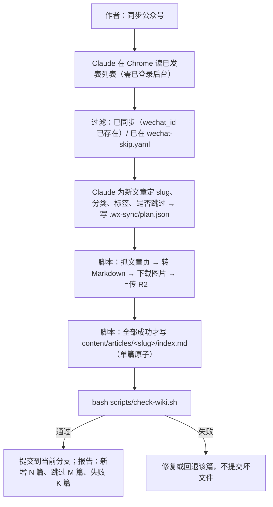

# 子项目 2 设计：公众号 → 博客同步（wx-sync）

- 日期：2026-11-21
- 状态：待作者审批（已过构建者审阅）
- 上级设计：`docs/superpowers/specs/2026-11-21-blog-repositioning-design.md`（第 11 节列了本子项目的边界）
- 前置：子项目 1（站点改版）已在分支 `redesign` 完成，未合并。本子项目也在 `redesign` 上做，首批同步通过检查后，**经作者同意**再合并到 `main` 上线。

## 1. 意图

公众号「AI进化调研员」的文章搜不到、旧文难翻。博客要成为它的长期、可搜索归档。本子项目把**作者本人写的已发表文章**搬到 `content/articles/`：正文转 Markdown，图片放 Cloudflare R2，写好 front matter，跑检查，提交。

作者按需触发（像现有的 `xhs-sync` 技能一样，说一句"同步公众号"），可以反复跑，只处理新文章。

## 2. 现状（2026-11-21 只读调研）

- 公众号共 48 次发表、65 篇文章。**只有 22 篇带微信「原创」标记**（`copyright_type=1`）：系列文章 10 篇全部有；其余 55 篇里只有 12 篇有。
- 内容主题是 **AI 与普通人的生活**：裁员与求职、孩子用 AI、选专业、钱、诈骗、健康、AI 视频。
- 栏目：头条（48）；系列【AI 脑洞实验室】（5）、【AI 工具推荐】（1）、【AI 手机应用推荐 · 学习/求职/高考志愿/钱包篇】（4）；另有【招募令】这类非文章公告。
- 文章页 `https://mp.weixin.qq.com/s/<id>` **无需登录**即可读取。正文在 `#js_content`，结构干净：`p`、`h2`、`strong`、`em`、`a`、`section`（带内联样式）、`img`（`data-src` 指向 `mmbiz.qpic.cn`，`wx_fmt=jpeg`，`data-w=1280`），外加 `mp-common-profile`（公众号名片）等组件。示例文章：正文约 1600 字、3 张图。
- **已发表列表只能在登录后的后台读取**：`/cgi-bin/appmsgpublish?sub=list…`（见 xhs-sync 技能）。字段有 `title`、`create_time`、`digest`、`cover`、`link`、`copyright_type`、`appmsgid`/`itemidx`。实测 65 篇的 `link` 全是短格式 `https://mp.weixin.qq.com/s/<id>`（无 query string，可经浏览器工具读出）；`cover` 带 `?wx_fmt=`，读不出。
- 本机没有装 `wrangler`。R2 bucket 还没建。
- Claude in Chrome 的输出过滤会**拦截含 query string 的内容**（图片 URL 带 `?wx_fmt=`），所以图片地址和文章 HTML 不能经由 Claude 的浏览器工具中转，只能由本地脚本直接抓取。

## 3. 目标 / 非目标 / 反目标

**目标**
- 一次运行把所有未同步的文章同步进来，可重复运行（幂等），已同步的跳过。
- 文章在博客上完整可读：标题层级、加粗、链接、列表、图片都保留；图片走 R2，不依赖微信防盗链。
- 每篇有合适的分类、标签、英文短 slug、封面，满足主题的 front matter 契约（`cover`、`wechat_url` 必填，否则构建失败）。
- 公众号文章之间的互链，若目标也已同步，改成站内链接。

**非目标**
- 定时、无人值守的自动同步（后台登录要扫码，token 会过期）。
- 同步阅读数、评论、留言；同步到小红书（已有 xhs-sync）；视频（子项目 3）。
- 在博客上二次编辑文章内容（博客是归档；内容以公众号为准）。

**反目标**（技术上能跑，但算失败）
- 同步了【招募令】、征稿启事这类公告。
- 图片仍然直链 `mmbiz.qpic.cn`（在博客上会显示"此图片来自微信公众平台"或加载失败）。
- 已上线文章的 slug（URL）在重跑后变了。
- 任何密钥（R2 访问密钥、Cloudflare token）进了仓库。
- 一次运行半途失败后留下"半篇"文章（有 Markdown 没图片，或反过来）。

## 4. 约束

- 仓库公开。原始抓取缓存不提交（`.wx-sync/` 加入 `.gitignore`）。
- 主题契约（子项目 1）：`content/articles/<slug>/index.md`；front matter 字段见第 7 节；非草稿缺 `cover`/`wechat_url` 构建失败；`--panicOnWarning`；内部链接必须能解析（`check-site.sh` 的 `check_internal_links`）。
- 图片基址 `params.imageBase`（`hugo.yaml`），先用 R2 的 `r2.dev` 公共地址，作者买域名后切到自定义域名。
- 本机 macOS，Node 22 可用；Python 3.9 可用（已装 PyYAML）。

## 5. 方案（Approaches）

| 方案 | 做法 | 取舍 |
|---|---|---|
| **A. 浏览器取列表 + 本地脚本干活（选定）** | Claude 在已登录的 Chrome 里读"已发表列表"（只取不含 query string 的字段：`title`、`create_time`、`digest`、`link`、`copyright_type`、`appmsgid`、`itemidx`），为每篇定好 slug/分类/标签，写成 `.wx-sync/plan.json`；本地 Node 脚本按 plan 抓公开文章页、转 Markdown、下载图片、传 R2、写文件 | 列表需要人登录一次后台；但抓正文和图片完全在本地完成，绕开浏览器输出过滤，可测试、可重跑 |
| B. 微信官方 API（`freepublish/batchget`） | 用 AppID/AppSecret 拉已发布文章，可放 CI 定时跑 | 需要 IP 白名单；个人订阅号很多接口没有权限；返回的正文同样要清洗。可行性不确定，暂不选 |
| C. 纯本地脚本，不用浏览器 | 直接抓公开文章页 | 拿不到"已发表列表"（列表只在后台），只能手动给链接 |

选 A：唯一既能拿到完整列表、又不受浏览器输出过滤限制的做法。作者把选型交给了我（"按你推荐的来"）。

## 6. 分类调整（作者确认：按话题分，2026-11-21）

子项目 1 的四个分类（新模型速递、概念科普、工具实测、行业观察）不符合真实内容，**在任何文章上线前**替换为：

| slug | 名称 | 收什么 |
|---|---|---|
| `work` | 工作与职业 | 裁员、求职、职业规划、技能 |
| `education` | 教育与成长 | 孩子用 AI、考试、选专业、学习方法 |
| `life` | 生活与安全 | 钱、健康、诈骗、社会、AI 视频等日常话题 |
| `tools` | AI 工具 | 工具教程、App 推荐（含【AI 工具推荐】【AI 手机应用推荐】） |

- 每篇**只有一个分类**，栏目（系列）作为**标签**：`脑洞实验室`、`工具推荐`、`手机应用推荐`。
- 改动：`data/categories.yaml`、`content/categories/<slug>/_index.md`、示例文章的分类、相关检查（`check_category_order` 等）。
- 同时补上评审遗留项：文章的分类 slug 不在 `data/categories.yaml` 里时**构建失败**（`errorf`），不再静默生成孤立分类页。

## 7. 一篇文章怎么落地

**文件**：`content/articles/<slug>/index.md`

```yaml
---
title: "被 AI 裁员了怎么办？失业后的 30 天行动清单"
date: 2026-11-20T08:00:00+08:00     # create_time，北京时间
summary: "…"                        # 公众号摘要 digest；为空时取正文前 80 字
categories: ["work"]
tags: ["裁员", "求职"]              # 2–4 个；系列文章加系列标签
cover: "https://<imageBase>/articles/<slug>/cover.jpg"
wechat_url: "https://mp.weixin.qq.com/s/<id>"
wechat_id: "<appmsgid>_<itemidx>"
draft: false
---
```

- **slug**：Claude 按标题起英文短 slug（kebab-case，≤ 6 个词，例 `ai-layoff-30-day-plan`），全站唯一。**一旦写入就不再改**：重跑时以 `wechat_id` 找到已有文件并跳过，不会重新起名。
- **分类与标签**：Claude 根据标题和摘要判断；拿不准时读正文。系列从摘要开头的【…】识别。
- **原创标记不作为条件**：作者确认（2026-11-21）所有文章都是本人所写，没打微信「原创」标记的也同步。
- **跳过**：【招募令】/征稿启事等公告；如果正文主体是转载或引用他人的长篇内容，也跳过并在报告里注明，由作者决定。跳过的记入 `data/wechat-skip.yaml`（`wechat_id` + 标题 + 原因），下次不再询问；作者可手动删掉某条让它重新参与同步。

**正文转换**（脚本）：
- 取 `#js_content`，删除：`mp-common-profile` 等 `mp-*` 组件、"往期推荐"及其后内容、空 `section`、纯装饰的分隔图。
- 保留并转 Markdown：`h1–h3`（`h1` 降为 `##`）、段落、`strong`/`em`、链接、列表、引用、表格、代码、图片（及紧跟的图注）。带样式的 `section` 去样式，按内容转成段落或引用。
- 链接：指向**已同步**公众号文章的 `mp.weixin.qq.com/s/…` 改写成 `../<slug>/index.md`（由现有链接渲染钩子解析）；其余保持外链。

**图片**：
- 下载 `data-src` 原图，R2 key 为 `articles/<slug>/<n>.<ext>`（按出现顺序编号），封面为 `articles/<slug>/cover.<ext>`。封面地址由脚本从文章页自身取（`og:image` / `msg_cdn_url`），因为列表里的 `cover` 带 query string，经浏览器工具读不出来。
- **图片尺寸（防 CLS）**：脚本读取每张图的宽高，写进 front matter `images:`（键为 R2 key 的文件名，值为 `[宽, 高]`，封面也记）。主题新增 `render-image` 钩子：按图片文件名查这张表，输出带 `width`/`height`、`loading="lazy"`、`decoding="async"` 的 ``；查不到时照常输出（我的决定，补上级设计 §8 要求）。
- Markdown 里写 R2 的完整 URL：`params.imageBase` + key。
- 已在 R2 上的对象不重复上传（幂等）。

## 8. 一次同步的流程



- **更新已同步文章**：默认跳过已同步的 `wechat_id`。`--resync <slug>` 重新抓取该篇并覆盖 Markdown 与图片，**slug 和图片 key 保持不变**（我的决定）。
- **单篇原子**：一篇的图片全部上传成功、Markdown 生成成功后，才写入 `content/`；失败的篇目记入报告，下次重跑会再试。
- **预演模式**：`--dry-run` 只抓取、转换，输出到 `.wx-sync/preview/`，不上传、不写 `content/`。首批同步先用它让作者抽查几篇。
- **提交与发布**：`redesign` 合并前，提交到 `redesign`；合并后提交到 `main` 即发布（CLAUDE.md 已授权检查通过后直接推送）。

## 9. 作者需要做的一次性准备

1. Cloudflare 账号里创建 R2 bucket（建议名 `aijinhua-media`），开启 **Public Development URL（r2.dev）**，把得到的地址告诉 Claude，写进 `params.imageBase`。
2. 本机登录 Cloudflare：`! npx wrangler login`（浏览器授权）。不在仓库里保存任何密钥。
3. 每次同步前，在 Chrome（Browser 1）里登录公众号后台。

## 10. 交付物

- `.claude/skills/wx-sync/SKILL.md`：项目技能，描述上面的流程、跳过规则、分类判断标准、安全规则（只读后台、不改公众号任何内容）。
- `tools/wx-sync/`：Node 包（自带 `package.json`，`node_modules/` 不提交）。转换（HTML→Markdown）、图片下载、R2 上传（调用 `wrangler r2 object put`）、写文件、`--dry-run`。
- `data/wechat-skip.yaml`、`.wx-sync/`（缓存与 plan，git-ignored）。
- 分类调整（第 6 节）及其检查。
- 测试：转换器用**合成的**微信风格 HTML 夹具做单元测试（不提交真实文章原文）；幂等（重跑不产生改动）；单篇原子（模拟上传失败不写文件）；链接改写。
- 首批同步：作者抽查预演 → 正式同步全部文章（约 63 篇） → 删除 `sample-*` 示例文章 → 检查通过 → 提交。合并 `redesign` 到 `main` 单独请作者确认。
- CLAUDE.md 增加 "Sync" 工作流说明。

## 10b. 检查脚本与示例文章（我的决定）

`scripts/check-site.sh` 里约 35 项检查依赖 `sample-1/2/3`。删掉示例文章后它们会失效，所以：
- 示例文章从 `content/articles/` **移到测试夹具** `scripts/fixtures/articles/sample-*`（仍是 `draft: true`）。
- `check-site.sh` 构建时把 `content/` 和夹具合并到临时内容目录（`--contentDir`），检查继续针对 sample-*，与真实文章数量无关。
- 依赖"某分类为空"的检查（如 `check_category_empty`）改成在去掉文章的变体构建里验证，不假设真实内容里有空分类。
- 夹具文章的分类改用新 slug（`work`、`education`、`tools`）。

## 11. 留给构建者决定的

- HTML→Markdown 的库（如 turndown）及自定义规则的具体写法。
- 抓取公开文章页的方式：先试本地 `fetch`（浏览器 UA）；若被微信"环境异常"拦截，改用本地无头 Chrome（Puppeteer）。在计划的第一个任务里先验证。
- 图片下载是否需要特定请求头（预期不带 Referer 即可）；同样在第一个任务里验证。
- `plan.json` 的确切结构、日志格式。

## 12. 风险

- 微信可能对频繁抓取限流：脚本串行抓取、每篇间隔 1–2 秒。
- 后台接口字段可能变化：技能里写明字段来源，失败时停止并报告，不猜。
- r2.dev 有限速，只适合过渡；买域名后切换（另行处理）。
